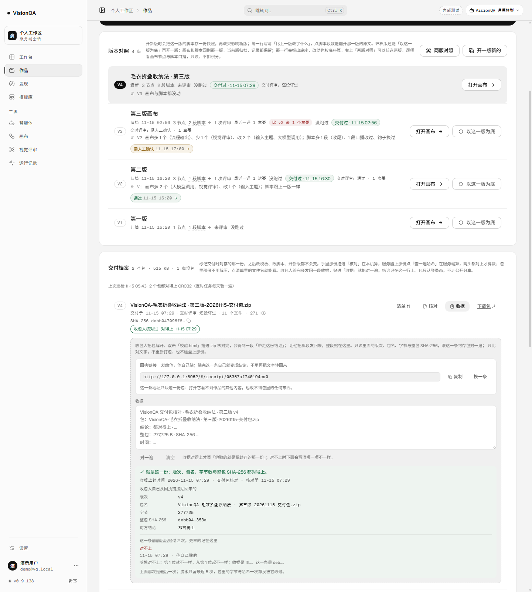
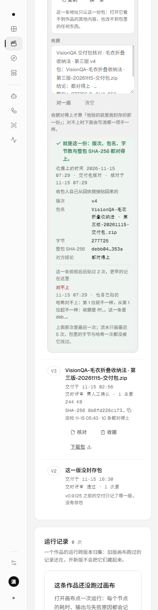
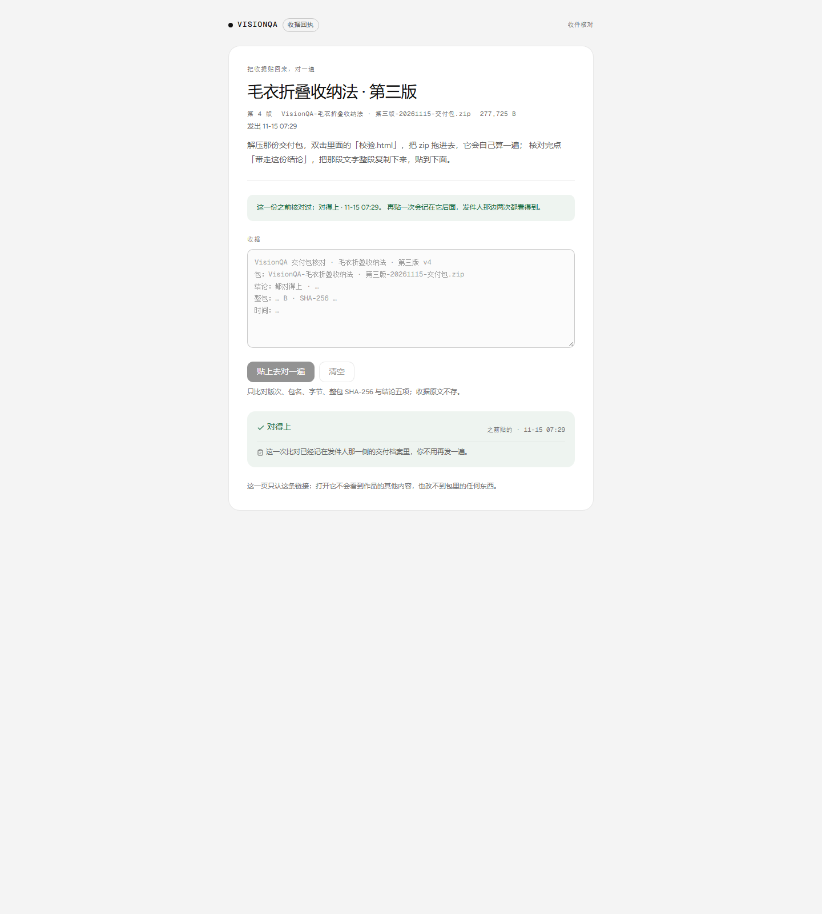

# 贴过几次都留着：回执流水（v0.9.138，2026-11-15）

v0.9.137 把「收据怎么回来」换成了一条地址：收包人打开链接、把收据贴上来、点一下，结论写进发件人的交付记录。它只剩一个说不通的地方——**每贴一次都盖掉上一次**。收包人先贴了一张对不上的（比如他核对的是旧包），换了包再贴一张对得上的，档案里只剩后者；第一次差在哪、你当时有没有追过，全没有了。链接一旦发出去，「他后来又贴了一张」就是常态，不是例外。

这一版给每条交付记一条流水：每次对账接在后面，最新一次仍写在档案行上，更早的在面板里按时间倒序列出来——什么时候、谁贴的、差哪一项，都留着。一条交付只留最近 5 次。

- **两条路一条流水**：收包人从回执链接贴（via=link）、你自己替他贴（via=you），都接进同一条交付记录的流水里。
- **最新一次仍在原处**：receipt 还是最后一条，档案行那句「收包人核对过 · 对得上」与老界面一个字不变；流水只是把更早的那几次留着，不吃掉原来那个字段。
- **老数据补一条**：升级前只有结论、没有流水的那条，读出来算一条，不把「一次」说成「零次」。
- **5 次上限**：更早的挤出去。留着是证据，不是日志；一条交付贴二十次的概率比贴两次低得多。
- **只动这一条记录**：包的字节、哈希、交付时间、那一版的评审快照、回执 token，一次都不改——流水是事后发生的事，不能反过来改写当初封存时记下的事实。
- **收包人那边的提示跟着改**：之前核对过的那一页不再说「覆盖」，改成「再贴一次会记在它后面，发件人那边两次都看得到」。

## 怎么走一遍

1. 作品页 →「交付这一版」，封存包带上回执 token；把回执链接发给收包人。
2. 收包人第一次贴回来的收据如果对不上，档案行写「对不上」，下面把差的那一项摆出来。
3. 他换了包再贴一次（或你替他贴），这次对得上：档案行跟着变，面板底部多一段「这一条前前后后贴过 2 次，更早的记在这里」。
4. 更早那次写清「对不上 · 时间 · 他自己贴的」与当时的摘要；再往下只有一句：上面那次是最后一次，流水只留最近 5 次，包里的字节与哈希一次都没被它改过。
5. 他再打开同一条链接，页面顶部提醒他之前核对过、再贴会记在后面。

## 实测（本地真服务 + 真封存包 + 真 Chrome）

| 检查 | 读数 |
| --- | --- |
| 封存包 / 校验页 | 277,725 B、11 条；校验页 28,759 B；收据 229 字，抬头「… · 毛衣折叠收纳法 · 第三版 v4」 |
| 第一次贴（改过哈希） | 判「对不上」，只有哈希这一项不一致；公开页仍不显示任何哈希 |
| 第二次贴（真的） | 五项全「一致」、判「对得上」，并写「已经记在发件人那一侧的交付档案里」 |
| 写回的流水 | 2 条，mismatch → match，两条都 via=link；receipt 等于最后一条 |
| 包与时间 | 包字节仍 277,725 B、SHA-256 不变、交付时间不变、token 不变 |
| 档案行 | 「收包人核对过 · 对得上 · 11-15 07:29」；来源「收包人自己从回执链接贴回来的」 |
| 流水 | 头「这一条前前后后贴过 2 次，更早的记在这里」；一条「对不上 · 11-15 07:29 · 他自己贴的」+ 当时的摘要；尾注「只留最近 5 次」 |
| 真刷新 | 流水从盘上读回来，仍在（不是只在内存里） |
| 收包人再打开 | 「这一份之前核对过：对得上 · 11-15 07:29。再贴一次会记在它后面，发件人那边两次都看得到。」 |
| 公开接口 | 坏 token **404**、空文字 **400**、垃圾 **422**、9000 字 **413**、连发第 13 次 **429** |
| 公开视图 | 仍只给这一条：不含 receipts、不含哈希 |
| 390 | 档案区 scrollWidth 390 = clientWidth 390；档案行 256、收据块 224、流水一条 182 |
| 上游调用 | 0（只走本地接口） |

## 坑

- **「清空」和「贴上去」是同一族按钮**：两个都是 .rpage-button，验收脚本按类名点「清空」时点到了主按钮，同一张对不上的收据被贴了两遍，流水直接变 3 条。界面本身没错（主按钮另带 .is-primary），但脚本要写 .rpage-button:not(.is-primary)。这也说明凡是「按类名点按钮」的验收，都得先认准它是不是唯一。
- **新 profile 的手上引导会吃掉点击**：第一次进工作台会弹「上手引导」，遮罩盖住整页；脚本里点「收据」那一下落在遮罩上，面板永远不开。先真点一次关闭按钮（也就把那一次「按账号记一次」写进 localStorage）再验。
- **文案必须跟着行为改**：收包人那页原来写「再贴一次会覆盖上一次的结论」，流水上线后这句就是假话。行为变了，界面上的每一句解释都要重新读一遍。
- **同一版重新封存会换一条交付记录**：新包新编号，流水与旧包一起消失。旧结论指向的包已经不在这条记录上，留着就是假线索；这一点在文档里写清楚，比让人以为「流水丢了」好。
- **别把流水当日志**：只留 5 次、只存结论（五项与摘要），不存收据原文；留的是「他验过、结论是什么」的证据，不是审计流水。

## 发现但没做

流水只能看，不能手动删掉一条、也不能标成「已处理」；没有「谁贴的」以外的身份（链接仍是 bearer token，拿到地址的人就能贴一张）；没有「他贴完通知我」的推送（没有 SMTP 与告警 webhook 授权）；分享离线包（/api/share/project/*）里还没有回执链接，收到分享包的人没法把收据贴回同一个地方；流水不记录「这一次比上一次改了哪一项」，只能逐条读。

## 回退

bash /opt/visionqa/ops/rollback.sh --to 1 → **v0.9.137**；--to 2 → **v0.9.136**。旧版本读 projects.json 会忽略 receipts，receipt 照旧可读；没有数据迁移，回到新版本流水还在。