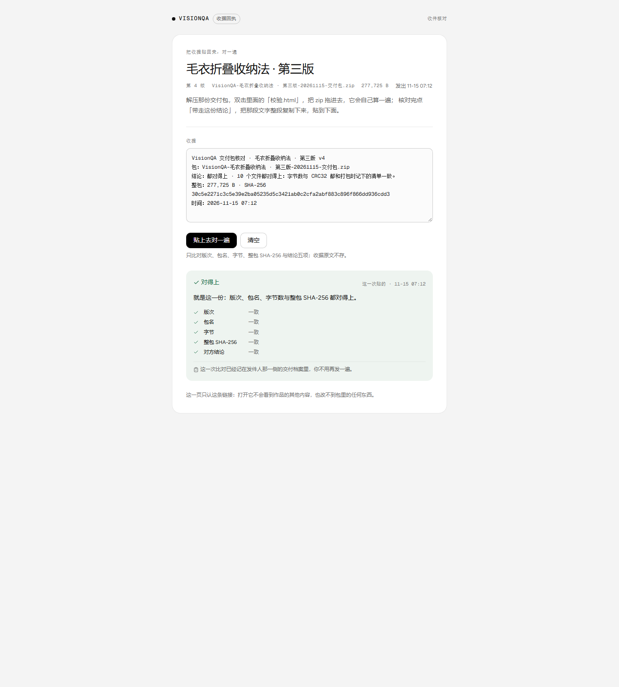
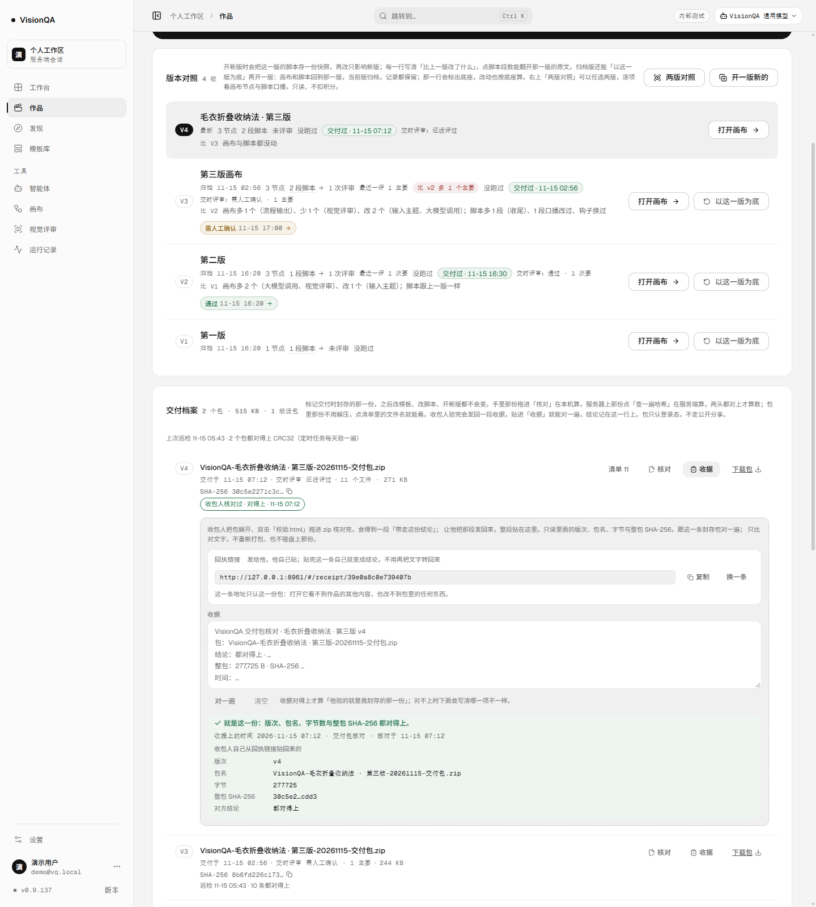

# 回执链接：收据不用再发回来了（v0.9.137，2026-11-15）

上一版让「收据贴回来」有了去处：发件人把收包人发回的那段文字贴进作品页，五项比一遍，结论写回交付记录。缺的那一环不在作品页里——**收据怎么回来**。收包人手里只有一段文字，他要先找到你、贴进微信或邮件、你再复制回作品页；中间任何一步断了，这一条交付就停在没有结论的地方。

这一版把这一环换成一条地址：封存交付包时顺手发一枚 16 位 token，作品页的「收据」面板里能直接复制成链接；收包人打开它、把收据整段贴上去、点一下，结论直接写进你的交付记录。他不用注册，你也不用再转一次文字。

- **谁打开都只认这一条**：链接只指向一份封存包，页面只给作品名、版次、包名、字节与发出时间；不给哈希、不给作品的其他内容，也改不到包里的任何东西。
- **写回同一条记录**：结论挂在原来那条交付上，receipt.via 记 link（他自己贴的）或 you（你替他贴的）；包的字节、哈希、交付时间与评审快照一个字不动。
- **换一条就作废**：链接泄露或发错人，点「换一条」换一枚 token，旧地址立刻 404；没换的时候再次打开面板还是同一枚，发给对方的地址不会凭空失效。
- **老包也能补**：v0.9.125 之后、这次之前封存的包没有 token，面板里给一个「生成回执链接」，点一下补上。
- **公开写入口有闸**：/api/receipts/<token> 不要求登录（那一侧本来没有账号），按 IP 每分钟 12 次限流；空文字 400、认不出的收据 422、超过 8000 字 413；坏 token 一律 404，不区分「不存在」与「已作废」。

## 怎么走一遍

1. 作品页 →「交付这一版」：交付包封存时带上一枚 token。
2. 交付档案里点「收据」：面板上方是回执链接，复制发给收包人（邮件、微信都行）。
3. 收包人打开链接：解压包、双击「校验.html」拖进 zip，核对完点「带走这份结论」，把那段整段贴进这一页，点「贴上去对一遍」。
4. 他那边看到「对得上」并被告知「已经记在发件人的交付档案里」；你这边这一条的档案行变成「收包人核对过 · 对得上」，下面写「收包人自己从回执链接贴回来的」。

## 实测（本地真服务 + 真封存包 + 真 Chrome）

| 检查 | 读数 |
| --- | --- |
| 封存包 / 校验页 | 277,725 B、11 条；校验页 28,759 B |
| 封存时发的 token | 16 位十六进制；GET 公开视图 200 |
| 公开视图 | 作品名、第 4 版、包名、277,725 B、发出时间；**不含哈希**（页面文字里也搜不到 32 位十六进制串） |
| 匿名页真贴 | cookie 为空；五项全是「一致」，判「对得上」；写着「已经记在发件人那一侧的交付档案里」 |
| 写回 | state=match、via=link、收据版次 4、包字节仍 277,725 B、token 不变 |
| 档案面板 | 链接形如 http://…/#/receipt/<token>；档案行「收包人核对过 · 对得上 · 11-15 07:12」；来源「收包人自己从回执链接贴回来的」 |
| 换一条 | 新 token 与旧的不同；旧地址 **404**、新地址 **200**；真刷新后仍是新链接 |
| 老包（v3） | 面板写「这一条是升级前封存的，还没有回执链接」；点「生成回执链接」后可用，指向第 3 版 |
| 公开接口 | 坏 token **404**、空文字 **400**、垃圾 **422**、9000 字 **413**；连发第 13 次 **429** |
| 发件人接口 | 未登录发行 **401**、GET **405**、坏编号 **404** |
| 坏链接页 | #/receipt/deadbeefdeadbeef 不白屏：说清「这条回执链接不在了」，找发件人要新的 |
| 390 | 回执页 scrollWidth 390 = clientWidth 390，正文 358、输入框 308；档案区 390/390，档案行 256、收据块 224 |
| 上游调用 | 0（只走本地接口） |

## 坑

- **登录门有两道**：只把 /api/receipts 加进 index.mjs 的 PUBLIC_API 还不够——作品路由自己还有一道「生产必须登录」，它先返回 401，公开分支根本走不到。修法是在那道门前放行 /api/receipts（打印页早就是同一种做法）。
- **公开页不该回期望值**：一开始想把五项的两边值都回给收包人，看着更「有用」；但那样拿到链接的人不用有包，也能照着期望值拼出一段「对得上」。所以公开接口只回哪几项对上，期望值一个字不给。
- **收据里的「收包人那边」**：内部结论句是写给发件人看的（「收包人那边读不出来」），收包人自己看到要换成「你那边」。
- **换包就要换链接**：同一版重新交付会生成新包、新编号；链接如果沿用，就会指向上一份包。所以换包时一起换 token，只有「打包失败、沿用上一份包」时才保留。
- **窄屏上的长地址**：回执地址是 40 多个字符的连续串，不加 overflow-wrap: anywhere 会直接把档案行撑宽；390 上 224 宽的收据块里它折成两行。

## 发现但没做

链接本身仍然是 bearer token：拿到地址的人就能贴一张收据（贴错了也只是多一条对不上的结论，覆盖不了包，但会覆盖上一次结论）；没有「贴完通知我」的推送（没有 SMTP 与告警 webhook 授权）；没有对账流水，只记最近一次；发件人只能复制链接，不能在这里直接写邮件发给对方；分享离线包（/api/share/project/*）的包还没有回执链接。

## 回退

bash /opt/visionqa/ops/rollback.sh --to 1 → **v0.9.136**；--to 2 → **v0.9.135**。旧版本读 projects.json 会忽略 receiptToken 与 receipt.via，没有数据迁移；已经发出去的链接在回退后 404，回到新版本仍可用。
