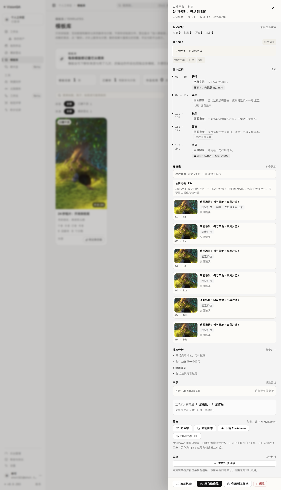

# 复刻链路：真的读一次原片声音（r321 / 0.9.293）

2026-11-26。目标里的第 1 项「修复」。这一版没有花一分钱上游——全部是 ffmpeg 本地测量 + 单测 + 本地集成自检。

## 问题：这一步是整条链路里最假的

复刻的产出物是「脚本结构 + 分镜表」，其中 `structure[].voiceover` 过去写的是
**该段口播/旁白原文或复述**。但这条链路从来没读过原片的声音：

- `server/frames.mjs` 抽帧时带 `-an`，抽出来的是 jpg，本来就不需要音轨——**这不是丢音轨的根因**；
  真正的缺口是**没有任何一步去读音轨**。
- `server/vision.mjs` 的提示词里明写：「即使原片没有人声和字幕，也要给出可执行的建议口播……
  不要整段写『不确定』」。于是模型把编的句子填进 `voiceover`，落库后和「原片真的说过」没法区分。
- 用户拿这条模板去复刻，抄的是一段**从没存在过的口播**。

## 这一版做了什么

| 层 | 改动 | 文件 |
| --- | --- | --- |
| 真源 | 新增音轨事实层：ffmpeg `silencedetect` + `volumedetect` **就地**读原片音频流（不落地 wav，跑完任务目录就删，多存一份没意义） | `server/audio.mjs`（新） |
| 流水线 | 抽帧之后新增一步「读取原片音轨」，实测事实写进任务日志，并且在调视觉模型**之前**拿到 | `server/jobs.mjs` |
| 提示词 | 删掉「没有人声也要编口播」那条要求；口播只允许两种来源，必须自带 `voiceoverSource`；明确告诉模型「你听不到这条片子的声音」再把实测音轨数据喂进去 | `server/vision.mjs` |
| 落库 | 模板新增 `audio` 事实；每个段落/镜头标 `voiceoverSource` 与 `audioGap`（这一段原片是不是基本没声音） | `server/vision.mjs`、`server/templates.mjs` |
| 界面 | 「逐帧分析」前多一步进度（读取原片音轨）；模板详情显示原片声音事实行与口播来源标记 | `src/components/ReplicateModal.tsx`、`src/pages/TemplateLibraryPage.tsx` |

### 数据形状（冻结）

```js
audio: {
  hasTrack, durationSec, soundSec, silenceSec, pauses,
  segments: [{ start, end }],            // 停顿区间，最多 40 段
  meanDb, peakDb, rangeDb,               // 测不到就是 null，不是 0
  bed: 'silent' | 'paused' | 'continuous' | 'unknown',
  note: '音轨 12 秒 · 1 处停顿共 3 秒',   // 给界面/日志的一句话，不重复拼
}
```

### 阈值与口径

| 常量 | 值 | 为什么是这个数 |
| --- | --- | --- |
| `SILENCE_DB` | -35 dB | 口播停顿的标准门限 |
| `MIN_SILENCE_SEC` | 0.35 s | 短于它的多是字间间隙，全算进去会把一句话切成十几段 |
| `FLAT_RANGE_DB` | 8 dB | 响度起伏小于它 + 全程有声 → 更像一路铺底，而不是有停顿的口播 |
| `CONTINUOUS_GAP_RATIO` | 0.02 | 底噪占比低于 2% 视为全程有声 |

## 刻意没做的事

- **没有接 ASR。** 现在没有任何可用的语音识别通道（GeteAPI / SeeAPI 目录里都没有 whisper 那类模型），
  所以 `voiceover` 仍然可能是「建议口播」，区别是**它现在被标出来了**（`voiceoverSource: 'inferred'`），
  界面写「画面推断」。等真接上识别通道，标 `'asr'` 即可，形状不用改。
- **没有说「检测到人声」。** ffmpeg 只能测停顿与响度，测不出说话人；字段名就叫 `bed`（声音的连续性），
  不叫人声。响声平缓只说「像一路铺底」，不说「有 BGM」。
- **没有改远端算力契约。** 远端模式源码不在本机，读不到音轨，这时事实是
  `note: '源视频不在本机（远端算力模式），没读到音轨'`——不假装读过。

## 证据

单测 **15 条**：`test/audio.test.mjs` 9 条（含两条**真跑 ffmpeg** 的：一条有停顿的片子、一条没音轨的片子）、
`test/vision-audio.test.mjs` 6 条（含一条回归断言：提示词里一旦重新出现「即使原片没有人声」就失败）。

本地集成自检（`.tmp-vq/e2e-audio.mjs`：真 ffmpeg 造一条 12 秒「0-3 有声 / 3-6 静音 / 6-12 有声」的片子，
假视觉上游收下*模型实际收到的提示词*）：

```
meta 12.0s 640x360          frames 5
音轨事实: {"hasTrack":true,"pauses":1,"segments":[{"start":3.02,"end":6.01}],"silenceSec":3,"note":"音轨 12 秒 · 1 处停顿共 3 秒"}
job 日志: 读取原片音轨 | 音轨：音轨 12 秒 · 1 处停顿共 3 秒 | 逐帧分析脚本与分镜
template.audio: 与上面一致（真落库）
段落: 0-3 source=on-screen gap=false | 3-6 source=inferred gap=true | 6-12 source=inferred gap=false
镜头: 1:false, 2:true, 3:false
模型收到的提示词: 「音轨（ffmpeg 实测，你听不到声音，只能参考这些数字）：音轨 12 秒 · 1 处停顿共 3 秒」
                 「停顿区间（秒）：3.02-6.01」
```

也就是说：**停顿是量出来的、位置对得上；口播来源和留白标记是算出来的**，不是模型的口述。

界面长这样（真渲染）：



- `docs/audio-facts-1440.png`（1440×2507：抽屉 579=579、note 宽 531、溢出 0、帧图 6/6）
- `docs/audio-facts-390.png`（390×3014：390=390、抽屉 389=389）

这两张图里的**事实字段全部由真代码产出**：夹具片是一条真的 24 秒片子（`segments [{8,11.01},{16,19.01}]`，
两段真静音），`audio` 来自 `analyzeAudio`、`structure/storyboard` 来自 `normalizeResult`、帧图由 ffmpeg 真抽、
模板走 `createTemplate` 落库。为了验证「模型不许自称做过语音识别」，模型 JSON 里「操作」那一段写的是
`voiceoverSource: 'asr'`，落库后是 `inferred`——界面上出现的只有「字幕实录」与「画面推断」。

夹具片源画面来自 Big Buck Bunny（Blender Foundation，CC-BY 3.0），只作本地 QA 夹具，不是产品素材。
