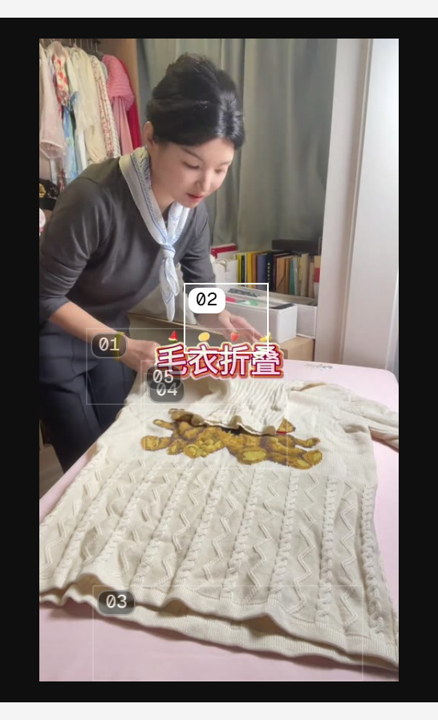
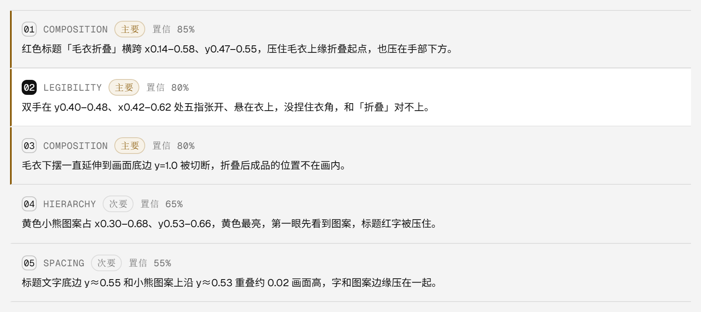
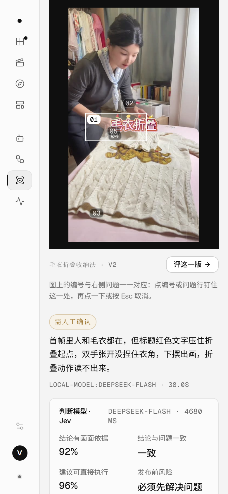

# 评审证据从「有框」到「能对照」：编号 + 钉住（v0.9.75）

## 结论

评审页以前能看见框，但**不知道哪个框是哪条问题**：框没有标签、只有鼠标悬停才亮，5 条问题同时有框时互相重叠，看的人只能猜。这一轮把「证据」做成能对照的：

- 图上的框与右侧问题行共用 **01–05** 编号（没有证据的问题不画框，但序号不跳，永远和问题行对得上）；
- **点一下钉住**：点问题行或图上编号，对应的框变成白色高亮、其余框压暗但编号仍可读；**再点一下或按 Esc 取消**；
- 键盘可用：Tab 到问题行 / 编号，Enter 或空格钉住；锚点从 `` 变成真正的 `<button>`，`aria-label` 带问题原文，`aria-pressed` 反映钉住状态；
- 顺手改掉一处会误读的文案：`锚点 85%` 实际是模型置信度，改成 **`置信 85%`**；
- 生产实测（真实评审记录 `rev_af034805`，5 条问题 / 5 个锚点）：编号 01–05 与问题行一致、钉住第 2 条后其余 4 个框被压暗、Esc 后归零、390 宽手机 5 个框无横向溢出、0 条脚本错误、0 个失败请求。**零扣费**：只读已有评审记录，没有发起任何评审。

## 为什么值得做

「视觉判断要可复查」是这个产品的底线：模型给的每条问题都带 bbox 证据（0–1 相对坐标），评审页把框画了出来，但：

| 之前 | 问题 |
| --- | --- |
| 框没有编号 | 5 个框叠在同一个区域时（这次的真实记录里 04 与 05 就几乎重合），说不清哪个框对应哪句话 |
| 只有 hover 高亮 | 鼠标一移开就灭；想边看结论边核对证据，做不到 |
| 框是 span | 不能点、Tab 不到、读屏软件读不到内容 |
| 文案「锚点 85%」 | 85% 是模型置信度，不是锚点强度，容易读成「这个框有 85% 把握」 |

这些都是「看起来有」和「真的能用」之间的差距，不需要新依赖，也不需要新接口。

## 做法

1. `src/domain/review-anchors.ts`（新增，纯函数）：`reviewAnchorMarks(observations)` 按**列表位置**给编号（`index = position + 1`），只保留宽高不全为 0 的框，NaN 归 0，缺 id 跳过；`anchorNumber()` 统一补零成两位。编号规则有单测（4 条）。
2. 评审页 `src/pages/ReviewPage.tsx`：
   - 状态从单一 `active`（悬停预览）拆成 `active` + `pinned`，显示用 `pinned ?? active`——悬停只是预览，钉住才是「现在看这一条」；
   - 钉住时把画面 `scrollIntoView({ block: 'nearest', behavior: 'smooth' })`：窄屏上问题行在画面下方，点了看不到高亮等于没点；
   - `Escape` 监听挂在 window 上，钉住期间才挂；
   - 问题行加 `role="button"`、`tabIndex=0`、Enter/空格、`aria-pressed`；框改成 `<button type="button">`，title 与 aria-label 都带问题原文。
3. 样式（`src/styles/review.css`）：编号是 16px 高的小方块（11px 等宽字体、`--radius-xs`）；钉住时**其他框只压边框与底色、编号保留 60% 不透明度**——第一版压的是整块 `opacity: .35`，截图里连编号都看不清，改掉了。

## 生产验证（真实记录，只读）

| 检查 | 结果 |
| --- | --- |
| 锚点与编号 | `.review-anchor` 5 个，编号 `["01","02","03","04","05"]`，与问题行 `.review-obs-no` 完全一致 |
| 可访问名称 | `aria-label="定位问题 1：红色标题「毛衣折叠」横跨 x0.14–0.58…"`（带问题原文，不是「锚点」两个字） |
| 钉住第 2 条 | 问题行 `aria-pressed` 只有第 2 条为 true；`is-active` 框编号 = 02；其余 4 个框压暗 |
| Esc 取消 | 钉住行数 1 → 0，压暗框数 4 → 0 |
| 390 宽手机 | 5 个框、编号 01–05、`scrollWidth == innerWidth`（无横向滚动）、钉住第 1 条后仍是 1 行高亮 |
| 控制台 | 0 条脚本异常、0 个 ≥400 的请求 |
| 版本 | `/api/version` 0.9.75、入口 `index-Bkls6jhI.js`、health ok（模板 26）、三个 unit active |

验证用的记录是生产上已有的 `rev_af034805`（毛衣折叠收纳法 · V2），没有为了截图新建评审，**余额 9950 未变**。

## 质量

`npm test` **666/666**（+4：编号不跳号 / 0 尺寸框过滤 / 空输入 / 补零）；`test/design-grid.test.mjs` 的老约束也在管这次改动——第一版用了 `border-radius: 4px` 与 `font-size: 10px`，被它拦下来改成 `var(--radius-xs)` 与 11px；oxlint 0 error / 7 warning（既有）、`tsc -b` 干净、构建通过。

## 边界

- **重叠框没有做碰撞避让**：04 与 05 几乎重合时编号会挤在一起（截图里能看到）。真要做需要布局算法，这一轮先保证「能对上号」。
- 编号跟着**列表位置**走，模型返回顺序变了编号也跟着变——这是有意的：界面上要按列表顺序念得通。
- 钉住只在本次打开期间有效，不写入评审记录（结论是模型给的，钉住只是查看状态）。
- 键盘 Esc 的验证是在无头浏览器里派发页面内 `KeyboardEvent`（CDP 的 `Input.dispatchKeyEvent` 在 headless 下没把焦点给页面）；监听挂在 window 上，真实按键等价。
- 画面原图失效的记录（比如旧的 `qa-canvas-shot.png`）仍然显示「画面已经不在了」，但锚点数据还在——这次也顺手验证了这条降级路径。

## 下一步

1. 编号重叠时做简单避让（同区域三个以上时把编号沿边排开）。
2. 评审结论里给出「这条判断命中的是整块画面的哪个区域」的尺度提示（bbox 面积占比），方便判断证据是不是足够细。
3. 把「置信」与「严重度」的解释加进评审页的空态说明，减少误读。
