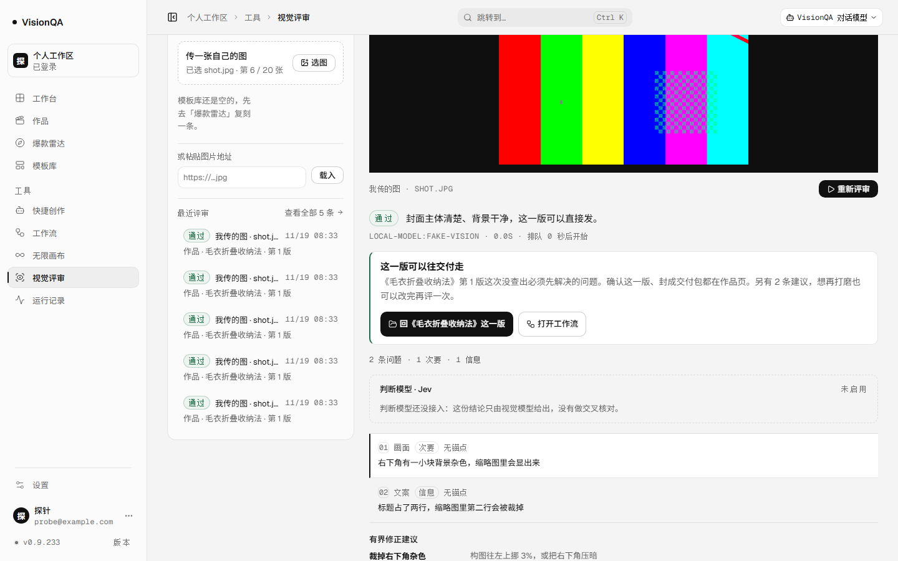
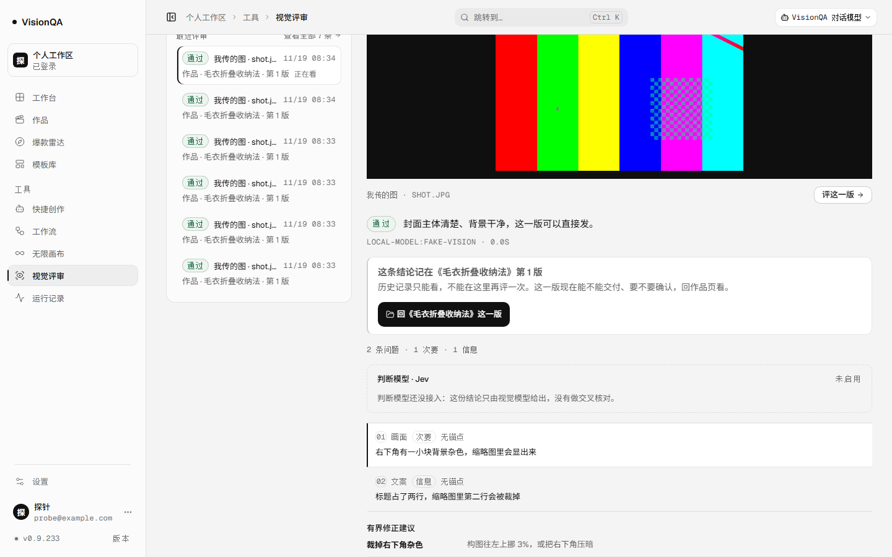

# 评完之后往哪走：结论一出来就给下一步（r251 / v0.9.234）

## 结论

评审结果页以前到「说明」那一行就结束了：**结论有了，但这条结论记在哪一版、能不能往下交付、该回作品还是回工作流改，全靠自己去别的页面找一遍。**
主线「找爆款 → 拆结构 → 复刻 → 评审 → 沉淀模板」在评审这一站是断的——上一轮把工作流跑完的「接下来」补上了（r250），这一轮补评审后的那一头。

现在结论一出来，`结果 → 结论` 下面就直接给一块「接下来」：说清这一版现在算什么状态、下一步谁动手、去哪动手。

## 顺手查出来的一个真问题

`POST /api/review` 只回结论，**不在响应里带归属**：作品与版次只有 `GET /api/review/:id` 会给（`withReviewProject` 现算）。
结果是刚评完那一眼，页面根本不知道这次结论记在《X》第几版下，只能自己猜。这和工作流 `run-end` 上一轮踩的是同一个坑，修法也一样：

- 路由层落库时本来就把 `projectId` / `version` 存进了记录，现在把同一份归属随响应回去：`project: {id, title, version, flowId} | null` + `version`；
- 没挂作品时**明确写 `null`**，不靠「字段不在」让人猜；
- `test/review-scope.test.mjs` 2 条把这件事钉住（本地假上游，0 次真实调用）。

## 结论 → 下一步：五种情形各给什么

挑出口与写文案都在 `src/domain/review-next.ts`，组件只负责画；12 条单测钉住文案与出口顺序。

| 这次评审 | 标题 | 正文写到什么程度 | 出口 |
| --- | --- | --- | --- |
| 通过 + 挂在作品上 | 这一版可以往交付走 | 《X》第 K 版这次没查出必须先解决的问题；确认这一版、封成交付包都在作品页（另有 M 条建议时补一句「想再打磨也可以改完再评一次」） | 回《X》这一版（+ 打开工作流） |
| 需人工确认 | 这一版要你拍板 | 写明这次结论是「需人工确认」并把问题数摊开（1 阻塞 · 2 主要） | 回《X》这一版（+ 打开工作流） |
| 不通过 | 先别发布这一版 | N 处必须先解决（按严重度摊开）；结构要改就打开工作流重跑，只是画面问题就换一张新画面再评 | 回《X》这一版（+ 打开工作流） |
| 单独评一张画面 | 这次评的是一张单独的图 | 它没挂在任何作品下，所以作品页看不到这份结论；下一版想留档就从作品页送评审 | 去作品流 |
| 回头看的旧记录 | 这条结论记在《X》第 K 版 | 历史记录只能看，不能在这里再评一次；这一版现在能不能交付、要不要确认，回作品页看 | 回《X》这一版 |

两条收紧的规矩：

- **不写「第 0 版」**：还没接工作流的作品没有版次，写成「《X》这次…」（与 `reviewVersionLabel` 同一条规矩）。
- **老记录没记严重度时不写「有 0 处」**：那种记录一个都不能算，改成「这次判了不通过」；需人工确认那条同样不编数字。

「回工作流」这个出口只在**这条作品真的接了工作流**时才出现（`flowId` 由服务端给），不拿一个点不动的按钮凑数。

## 历史记录是另一套（只读）

## 窄屏

## 证据（本机临时实例 + 无头 Edge 真鼠标；假视觉上游，0 次真实上游调用）

| 项 | 结果 |
| --- | --- |
| 1440 文案 | 「这一版可以往交付走 / 《毛衣折叠收纳法》第 1 版这次没查出必须先解决的问题。确认这一版、封成交付包都在作品页。另有 2 条建议，想再打磨也可以改完再评一次。」 |
| 1440 出口 | 回《毛衣折叠收纳法》这一版（主） → 打开工作流（次）；标题 15px、正文 14px、按钮高 40px |
| 真点「回…这一版」 | `#/projects/prj_a14919c0` |
| 真点「打开工作流」 | `#/canvas/flow_493ab2d6`（这条作品接的那条工作流） |
| 历史记录 | 「这条结论记在《毛衣折叠收纳法》第 1 版」+ 只读说明，只有一个出口；真点落到 `#/projects/prj_a14919c0` |
| 390 | 整页宽 390 = 视口 390、溢出 0；两个出口各占整行（高 44px）；标题与正文不被挤 |
| 1440 溢出 | 整页宽 1440 = 视口 1440、溢出 0 |

## 边界

- 「回作品这一版」**是导航**，不改任何交付状态：确认这一版、拍板、封包仍然只在作品页做，评审页不抢那个权力。
- 交付（封包 / 回执）仍在作品页，这一轮没有搬进评审页。
- 判断模型（Jev）未接入时那块照旧写「未启用」，这一轮的「接下来」不拿它当依据。
- 探针里用的是本机假视觉上游（固定 JSON），只证明链路与文案，不代表模型准确率；本轮 0 次真实上游调用、0 费用。
