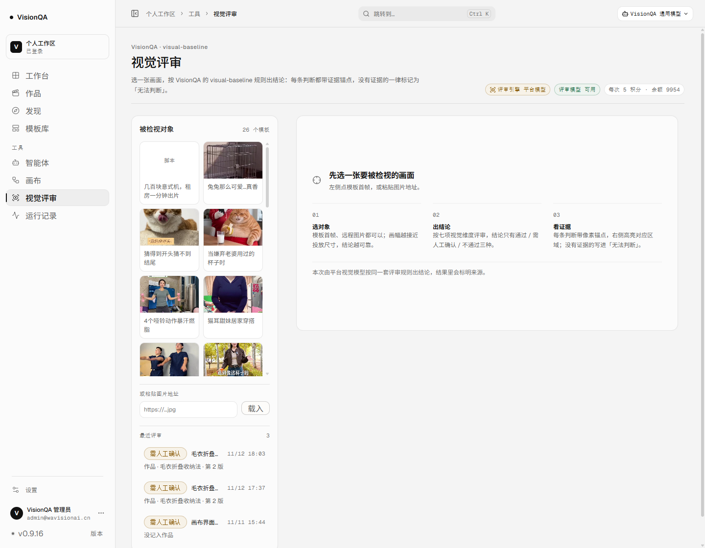
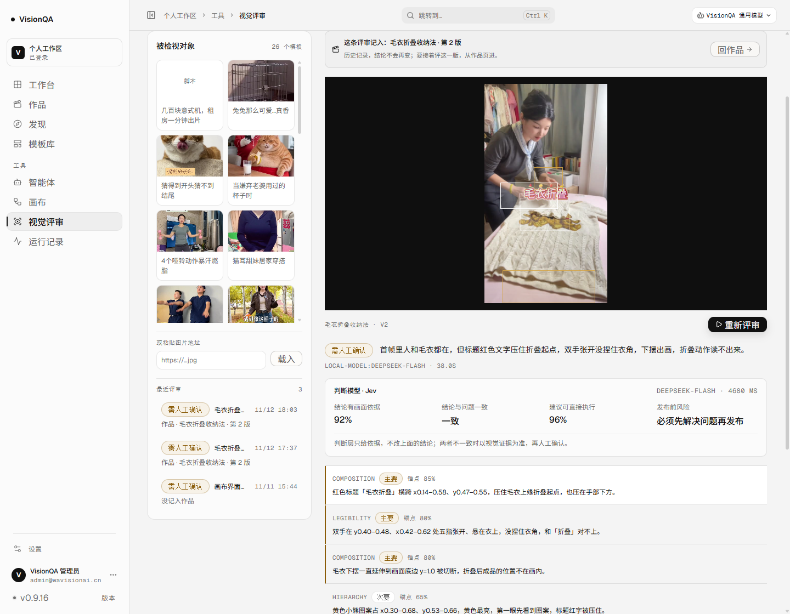
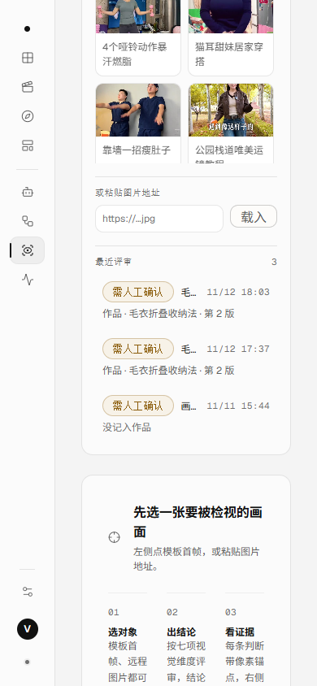

# 视觉评审也认得作品了（v0.9.16）

结论：视觉评审页左栏「最近评审」每条下面多了一行「作品 · 标题 · 第几版」；打开一条历史评审，页头会说明它记在哪条作品下，并给一条「回作品」的路。评审结论与作品连上了，不用再靠来源标签猜。

## 为什么改

评审落库时本来就记着 `projectId` 与「评审当时作品的第几版」（v0.9.2 起），可列表只显示来源标签：模板首帧的标签是「毛衣折叠收纳法 · v2」，普通远程图片是「画布界面截图」，两条记录在列表里长得一样，谁也看不出哪条挂在作品上、挂在第几版。

更实际的问题是：评审页是工具区入口，点开历史只能看结论，回不到那条作品——而作品页的「版本对照」正是按版次把评审结论分组的地方。

## 做了什么

| 之前 | 现在 |
| --- | --- |
| 历史列表只有来源标签与时间，看不出属于哪条作品 | 第二行写「作品 · 毛衣折叠收纳法 · 第 2 版」 |
| 普通评审与作品评审在列表里没有区别 | 没记入作品如实写「没记入作品」（弱色） |
| 打开历史评审后就停在这一条结论里 | 页头写明「这条评审记入：毛衣折叠收纳法 · 第 2 版」，右侧「回作品」直接进那条作品 |
| 作品改名后，历史评审的归属不会跟着变 | 标题现算：作品改名，历史评审跟着改口 |

## 三个实现决定

1. **只多一个字段，现算不回写**：`/api/reviews` 每条多 `project: { id, title } | null`，与 `/api/reviews/:id` 同一口径。评审记录里已经存着 `projectId` 与 `version`，标题从 `projects.json` 现算——两百条历史记录不用回填，作品改名后也不用批量改评审。
2. **版次用评审自己的 `version`**：评审记的是「评审发生时作品的第几版」，作品后来开新版，这条评审仍记在原来那一版（作品页的版本对照就是照这个数分组）；没有版次的老记录写「未记版次」，不冒充第 1 版。
3. **不为一条历史记录再打一次接口**：打开历史时归属从列表那一条取（列表里已经算好），页面只多一次状态更新。

## 顺手修的三处

- 生产有 26 条模板，候选网格把左栏撑到整页高度，「最近评审」要滚很久才看得到：候选自己滚（`max-height: 480px`），左栏回到一屏内。
- 390 宽下评审结论与修正建议并排挤成两条窄栏（每栏约 110px）：窄屏改单栏，状态胶囊回到自身宽度。
- 390 宽下手机候选一行三张、每张 78px，标题读不出来：改成一行两张。

## 生产实测

| 项 | 数值 |
| --- | --- |
| `/api/reviews` | 3 条：2 条挂 `prj_f38d68c6`（毛衣折叠收纳法 · 第 2 版）、1 条 `project: null`（画布界面截图） |
| `/api/reviews/:id` | 多一个 `project: {id, title}` 键，`version: 2` 与 `projectId` 同在 |
| 历史行高 | 1440 与 390 都是 66px（一行来源 + 一行归属） |
| 左栏宽度 | 1440 为 300px、390 为 258px，两档 `scrollWidth == clientWidth` |
| 打开历史 | 页头按钮就一个「回作品」；条目标题「这条评审记入：毛衣折叠收纳法 · 第 2 版」 |







## 边界

- **作品被删掉之后**：评审还在（历史不回滚），但归属会被卸掉（`detachReviewsFromProject` 会删掉 `projectId`），列表如实写「没记入作品」。若某条记录还留着指向已删作品的 `projectId`，页面写「记入的作品看不到了」，不冒充挂在某条作品上。
- **只看得到自己有权限的作品**：`listProjects` 那套规则不变（管理员看全部），别人的评审也不进我的历史（`canAccess`）。
- **列表只取最近 6 条**：评审历史存最近 200 条，页面这一栏只显示 6 条（本轮没有加「查看全部」入口）；按版次分组仍只在作品页的「版本对照」里看。
- **普通评审不编归属**：模板首帧、粘贴图片地址的试评没有 `projectId`，就写「没记入作品」，不按来源标签猜。

## 复现

```bash
npm test                 # 198/198，含 test/review-ownership.test.mjs 4 条
npx oxlint server src test
npm run build
```

本地看布局只用 `.tmp-qa` 里的临时数据目录（4 条演示评审：一条作品两个版次、另一条作品、一条普通评审）与本地演示账号；这些不入库、不进交付。生产数据本轮只读：没有新建、删除或修改评审，也没有跑新的评审（没有消耗积分）。

## 文件

- 新增：`server/review-ownership.mjs`（作品 id 索引、逐条挂载）、`src/domain/review.ts`（版次与归属那一行的写法）、`test/review-ownership.test.mjs`（4 条）、本文件与三张截图。
- 改：`server/routes/review.mjs`（列表与详情都挂 `project`）、`src/api/review.ts`（`ReviewProjectRef`）、`src/pages/ReviewPage.tsx`（历史第二行、打开历史的页头与「回作品」）、`src/styles/review.css`（归属行、历史页头、候选滚动、窄屏单栏）、`src/App.tsx`（回作品跳转）。
