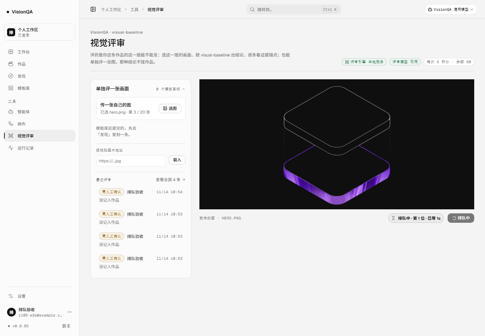
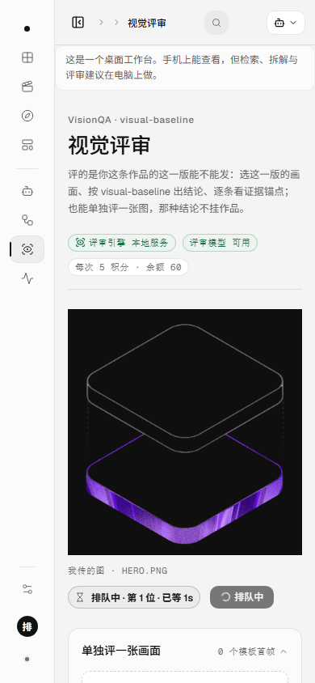

# 评审也能排队：名额满时进整机一条队（v0.9.95，2026-11-14）

> 目标：评审是产品的主付费动作（默认 5 积分一次），撞上整机重活上限时不该只回一句「服务器正忙」。
> 相关：[画布出图的排队位](./canvas-queue-visible-2026-11-14.md)、[封面缓存与两道闸门](./cover-cache-shared-2026-11-14.md)

## 一句话

v0.9.95 起，评审和画布出图一样有排队位：名额满时先排着（默认每条最多等 60 秒、最多 4 条同时排，整机一条队），
排到才扣积分、才调模型；评审页在等的时候显示「排队中 · 第 N 位 · 已等 X 秒」，排到后结论行补「排队 N 秒后开始」。

## 为什么

| | 画布出图（v0.9.80 起） | 评审（v0.9.79 ~ v0.9.94） |
| --- | --- | --- |
| 名额满时 | 先排队，排到照常生成 | 立刻 503「服务器正忙」 |
| 用户看到 | 「第 3 位 · 已等 8 秒」 | 一条错误提示，要自己再点一次 |
| 等待上限 | 90 秒 / 8 条 | 无 |
| 口径 | v0.9.93 起跨进程（整机一条队） | — |

评审一次 5 积分、同步等 300 秒，本来就等得起；名额满时让用户自己重试，是把活推回给他。
旧的「只给没有账号可挂的画布排队」这条理由（客户端自己重试更合适）在评审这条主路径上不成立。

## 做法

1. **配置按类型分**：`config.credits.reviewQueue`（`VQ_REVIEW_QUEUE_MS` 默认 60000、`VQ_REVIEW_QUEUE_MAX` 默认 4），
   画布出图的 `canvasQueue`（90000 / 8）一个字没动。
2. **`waterline.queueLimitsFor` 按类型取配置**：`canvas_gen` 与 `review` 各一条队；复刻 / 运行仍然是 0（立刻拒）。
3. **`POST /api/review` 从 `admit` 改成 `admitWaiting`**：先登记、再试名额（v0.9.93 那条队列本来就是先来先得）。
   排到才占名额 → 扣积分 → 调模型；排队期间不扣费、不调上游；客户端断开时票在 `finally` 里退掉。
4. **票号**由页面生成（`crypto.randomUUID`），放 `X-VQ-Queue-Ticket`；共享目录里只存 sha256 前 16 位（与 v0.9.93 同一条队、同一把锁）。
5. **新增只读 `GET /api/review/queue?ticket=`** 与 `waterline.queueView`：整机的 waiting / oldestWaitMs + 我的 position / ahead / waitedMs；
   票号是凭据，只进不出（聚合里看不到票号）。
6. **排到时**响应体带 `queue: { position, waitedMs }`，响应头带 `X-VQ-Queue-Position` / `X-VQ-Queue-Waited-Ms`（脚本与 curl 也看得到）。
7. **文案按类型说**：评审是「这次评审没有开始（没有扣积分）……先把这一版改一改」，不再是画布出图的「少发几张」。

界面：排队期间在画面右下角显示胶囊「排队中 · 第 N 位 · 已等 Xs」（主按钮同时写「排队中」），排到后结论行补「排队 N 秒后开始」。
间距只用 `var(--space-1/--space-2)`，圆角 `--radius-pill`，颜色只用 tokens（`--violet-soft` / `--line-strong` / `--ink`）。

## 证据 A：本地两实例（两个真进程 + 假评审上游，零真实调用、零积分）

一次性栈：同一份 `DATA_DIR` 与租约目录，实例 A（8921，生产口径）、B（8922）、C（8923，排队上限 1.2 秒）；
假服务只回一份固定结论；占位脚本在共享目录里占满整机 3 条重活名额。

| 动作 | 读数 |
| --- | --- |
| A 发起评审（票 t1） | `position 1 · ahead 0 · waiting 1 · scope lease · waitMs 60000` |
| B（另一个进程）查同一张票 | `position 1 · waiting 1` —— 两个实例看到的是同一条队 |
| B 再发一条（票 t2） | `position 2 · ahead 1`；从 A 查票 t2 也是 `position 2` |
| 排队期间 | 上游 **0 次**；余额 **不动** |
| 放掉名额 | A 200（`queue.position 1`、`waitedMs 931`、`X-VQ-Queue-Position: 1`）、B 200（`position 2`、`waitedMs 878`）；上游 **2 次**；各扣 **5** 积分 |
| 超时（C，1.2 秒上限，名额仍占着） | **503**、`SERVER_BUSY`、1221ms；文案含「评审」「没有扣积分」；`retryAfterSec 60`；上游仍 2 次、余额不动 |
| 排队中关掉页面（截图那两次） | 队里清零、余额不动、上游不动——票退了、这单没开始 |

12 条判定全过（`CHECKS ok … ` 全绿），脚本在 `.tmp-qa/r105-*`（已清）。

## 证据 B：生产只读

部署 `20261114-030137-r105-review-queue`，两个实例都是 **0.9.95**：

| 项 | 8799（对外） | 8800（内部版） |
| --- | --- | --- |
| `/api/version` | `0.9.95 VisionQA` | `0.9.95 creator-canvas-studio`（内部版按设计报包名） |
| 入口 | `index-DT6Tdzrn.js` · 200 · **569,449 B** | 同一份 dist |
| `GET /api/review/queue`（登录态） | `waitMs 60000 · maxWaiting 4 · scope lease · waiting 0 · position null` | 同一份代码同一个目录；这份会话 cookie 在 8800 上无效（两个 unit 的会话密钥不同），所以这一格只有 8799 的实测 |
| 单元 | `visionqa.service` active（User=visionqa） | `visionqa-internal.service` active（User 空 = root） |

- 两个 unit 的 `WorkingDirectory` 都是 `/opt/visionqa`；共享租约目录 `/tmp/visionqa-heavy-leases-v1`（0777）就是队列与名额的落点。
- 线上模块与本地逐字节一致：`waterline.mjs c6125a81`、`routes/review.mjs 6ddffe2f`、`invites.mjs d1d68b43`、`config.mjs cdaf77e1`；
  `routes/review.mjs` 里 `admitWaiting` 出现 3 次。
- 三个 unit（`visionqa`、`visionqa-internal`、`visionqa.socket`）都在 active；盘 72%（27G / 40G）。

## 截图

## 坑（六条）

1. **`req.destroyed` 不是「人走了」**：请求体读完之后它必为 true（IncomingMessage 读满即 autoDestroy）。
   第一版拿它当判据，每一单评审都在排队第一步退出、不写响应，客户端挂在 POST 上等不到任何东西——
   本地两实例验收**当场卡死**才发现（单测里的假 req 没有 `destroyed`，所以测不出来）。
   改成只看响应侧（`watchClientGone`：`res` 的 `close` 且 `writableEnded` 还是 false，或 `res.destroyed`），
   aborted 分支顺手 `res.destroy()`，误判也不会让人一直挂着；补了回归用例。
   顺带记一笔：gateway 那条画布队列里也有 `req.destroyed`，但它在读 body 之前就进 admit，所以现在没炸——以后调顺序要小心。
2. **邀请码 1/1024 的老 bug 被 CI 撞出来**：`normalizeInviteCode` 无条件剥 `VQ` 前缀，
   码体本身以 `VQ` 开头（如 `VQ-VQXR-TTSU`）时，用户不带前缀粘贴会被剥成 6 位、判成非法码。
   这一轮顺手修掉（只有长度正好 10 且以 VQ 开头才剥），并补成确定性用例。
3. **三个旧断言把「只有画布排队」写死了**（`waterline.test`、`gateway-queue.test`、`canvas-queue-visible.test`）：
   这一轮是有意改口径，所以改的是断言与它的理由，而不是绕过它。
4. **差点覆盖同名的既有测试**：`test/review-queue.test.mjs` 早就有，测的是「评审待办队列」（哪几条作品还等着人动手）；
   我新写的这套一开始用了同一个文件名，把 12 条既有用例覆盖掉了（全量从 873 掉到 861 才发现）。
   现在新文件叫 `test/review-admission-queue.test.mjs`，两个「queue」在文件头写清区别，原文件已从 git 恢复。
5. **票号也要进响应头**：只回 body 的话，脚本 / curl 想确认「当时排第几」还得再查一次队；`X-VQ-Queue-Position` 与
   `X-VQ-Queue-Waited-Ms` 一起给，页面与脚本各取所需。
6. **余额是账号级的**：两个实例共用一个账号做对照时，别拿「起跑线余额」当基线去判超时那单有没有扣费——
   我这轮的验收脚本就在这上面写错过一次断言（余额已因前两条成功评审变成 70，不是起跑线的 80）。

## 发现但没做

- **运行（`flow_run`）还没有排队位**：它是第四个重活，现在仍然是立刻 503；下一轮的候选
  （它走 NDJSON 流，要把「排队事件」塞进流里，比评审这条多一层）。
- 排队中**没有「取消」按钮**：关掉页面 / 刷新就退队（实测不扣费），但页面上少一个显式动作。
- 排队只报名字与时长，**不估计还要等多久**：整机 3 条重活里评审只占一条，前面可能排着画布出图，ETA 会编数字。
- 轮询间隔 1.2 秒、一次只查自己那张票；两个实例共用一个账号时，排队的是账号不是标签页。
- 多机仍然没有：队列与名额都在本机共享目录里。
- 真实评审的准确率回归仍缺一次授权（缩图前后同一张图结论是否一致）。

## 回退

- 只关评审这一档：`VQ_REVIEW_QUEUE_MS=0`（或 `VQ_REVIEW_QUEUE_MAX=0`）→ 退回 v0.9.94 的立刻 503；画布不受影响。
- 整版回退：`bash /opt/visionqa/ops/rollback.sh --to 2`（v0.9.94「封面缓存进共享目录」），无 schema、无配置改动。
- 新增的 `/api/review/queue` 是只读接口；回滚后旧版没有它，页面也只是问不到（前端只在 `running` 时轮询）。

## 数字

- 提交 `140282c`（评审排队位：服务端 + 页面 + 9 条用例 + 2 张截图）、`d6e411a`（邀请码前缀修正），
  CI **43549303455** 三个 job 全 success（`验证（Node 22.12.0）` / `验证（Node 24）` / `安全扫描`）。
- 测试 **873/873**（+9 新文件；另改 3 条旧口径断言、+1 条 `watchClientGone` 回归）；oxlint 0 error / 15 warning；
  `tsc -b` 干净；构建通过；密钥扫描 629 个文件 0 命中。
- 排队上限 60 秒 / 4 条（评审），90 秒 / 8 条（画布）——都是**整机**口径。
