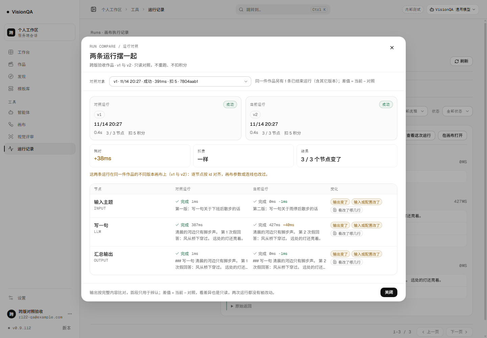
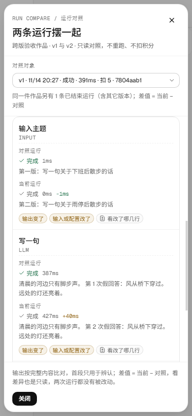

# 开了新版，上一版的运行也能拿来对照（v0.9.113）

2026-11-14 第 123 轮。运行对照从「同一张画布」放宽到「同一件作品的任意一版画布」。

## 为什么这一轮做它

v0.9.110 的对照接口写死了一条规则：

```
这两条运行不在同一张画布上（可能已经分版），不能逐节点对照
```

问题是「分版」恰恰是最需要对照的时刻：开新版通常就是为了改一版画布，改完跑一次，最想回答的是「这一版和上一版比，输出变了没有、慢在哪、多花了多少」。服务端却把上一版的运行挡在门外。

上一轮文档把这件事列为「发现但没做」，理由是「节点 id 可能相同也可能不同」。这一轮先核对了存储层：开新版走 `server/routes/projects.mjs` 的复制逻辑，`createFlow` 复制节点时保留原 id（`server/flows.mjs` 的 `id: trimText(raw?.id, 64) || 'node-' + (index + 1)`），所以同一节点可以按 id 对上；对不上的节点本来就应该标成新增 / 删除，而不是猜。

## 口径

```
scope = 同一张画布
      或 同一件作品（当前版 + 归档版）名下的任意画布
```

- 范围由 `projectsByFlow` 决定：作品的 `flowId` 与 `versions[].flowId` 都算它的。
- 没挂作品的空白画布只有自己一张，行为与之前一致。
- 不同作品之间仍然拒绝：不按画布名、不按节点标题硬凑。

## 接口

### `GET /api/runs/:id/compare`

`with=` 现在可以点名同一件作品其它版本的运行。响应新增（其余字段不变）：

- `crossVersion: boolean`：两条运行是不是同一件作品的不同 flowId。
- `project: { id, title } | null`：跨版本时是哪条作品。
- `current.project` / `previous.project`：`{ id, title, version } | null`，页面写「v1 / v2」用。
- `current.flowName` / `previous.flowName`：这一侧在哪张画布上。
- `optionsScoped: 'flow' | 'project'`：候选范围。`project` 表示候选里含其它版本。
- 候选仍按开始时间倒序、最多回 20 条；排除自己、排除 running / queued。

默认口径**不变**：不带 `with=` 时仍只找同一条画布上更早的最近一条。跨版本必须人自己点名——不替人改对照口径。

### `GET /api/runs/:id/compare/diff?with=&node=`

范围校验与对照表一致：同一张画布，或同一件作品的不同版本画布。节点两边都在才返回改动行；`+/-` 与 `truncated` 口径不变。

### 拒绝

- 自对照 → 400
- 跨作品 → 400「这两条运行不属于同一件作品：只能对照同一张画布，或同一件作品开过新版的画布」
- 对照运行还在 running / queued → 409
- 未登录 → 401（鉴权闸先于路由）

## 页面

- 「对照对象」候选标签加版本前缀：`v1 · 11/14 20:27 · 成功 · 391ms · 扣 5 · 7804aab1`。
- 两张运行卡片各带一枚版本胶囊（v1 / v2），不会只靠时间猜哪边是旧版。
- 标题写「跨版验收作品 · v1 与 v2 · 只读对照，不重跑、不扣积分」。不写箭头：当前运行可能是旧版（v0.9.111 起允许反向挑），方向交给两张卡片。
- 说明行先写「这两条运行在同一件作品的不同版本画布上（v1 与 v2）：逐节点按 id 对齐」，再看指纹补「画布参数或连线也改过」。跨版本时绝不再写「两条运行用的是同一版画布」。
- 候选提示写「同一件作品另有 N 条已结束运行（含其它版本）」。
- 空状态写「这是这张画布上最早的一条运行；默认没有更早的可对照，可以从下面挑一条运行——同一件作品的其它版本也可以。」

## 本地实测

环境：本地 8951 + 假上游 8981，3 节点（输入 → 写一句 → 汇总输出），零真实上游。流程：v1 跑一次 → 开新版（复制画布）→ 只改 v2 的输入 → v2 跑一次。

| 检查 | 读数 |
| --- | --- |
| 作品 / 画布 | `prj_5452ab94`；v1 `flow_30ce7382` → v2 `flow_75d741de` |
| 两条运行 | `run_7804aab1`（v1，391ms）→ `run_29f01473`（v2，429ms），都 success |
| 余额 / 上游 | 两次各扣 5，共扣 10；假上游共 2 次 |
| 默认口径 | 打开 v2 的对照：`comparable: false`（同画布没有更早的），候选里有 v1，`optionsScoped: 'project'`，空状态提到「其它版本」 |
| 点名跨版本 | `crossVersion: true`；current v2 / previous v1；3 个节点全部按 id 对上；`graph.changed: true` |
| 逐节点变化 | 3/3 个节点「输出变了 + 输入或配置改了」；耗时差值 +20ms；扣费差值 0 |
| 跨版本差异 | `/compare/diff?with=run_7804aab1&node=n_llm`：`+1 / -1`、`same: 2`；删除「第 1 次假回答」，新增「第 2 次假回答」 |
| 别的作品 | v2 对不相干画布的运行 → 400，写「不属于同一件作品」 |
| 1440 | 弹窗 960（left 240 / right 1200）；对照表右缘 1175；卡片版本 v1 / v2；页面 `scrollWidth 1440` |
| 390 | 弹窗 374（left 8 / right 382）；正文 `scrollWidth 372 = clientWidth 372`；差异面板 314（left 38 / right 352）；页面 `scrollWidth 390` |
| 只读 | 对照 2 次、差异 1 次，全是 GET；画布 PATCH 0、运行 POST 0 |





## 八条坑 / 决策

1. **先确认节点 id 真的保留**。开新版如果重新编号，跨版本只能按位置猜，这功能就不该做。核对 `createFlow` 后才动手。
2. **范围必须按作品，不能按「任意两张画布」**。否则两张不相干的画布也能对照，节点 id 恰好相同还会被说成「同一节点」。
3. **默认口径不动**。跨版本只是候选，不带 `with=` 仍只找同画布更早的一条；否则用户打开对照会莫名其妙看到另一版。
4. **同一个 flowId 可能挂在多条作品上**。`projectsByFlow` 的 `preferred` 规则（当前版胜过归档版，再比最近改动）继续生效，两处口径不分叉。
5. **`graph.changed: false` 不等于「同一张画布」**。复制出来的 v2 节点与 v1 完全一样时指纹相同；页面必须先判 `crossVersion`，再决定写「同一版画布」还是「不同版本画布」。
6. **不写箭头**。当前运行可能是旧版（v0.9.111 允许反向挑），`v2 → v1` 会让人误以为版本倒退了；标题写「v1 与 v2」，方向由两张卡片各自的标签回答。
7. **跨版本差异仍要按节点 id**：旧版有、新版删掉的节点没有「差异」可看，只在对照表标「这次没有」。
8. **390 的断言要同时卡页面与弹窗正文**：页面 `scrollWidth <= 390`，`.rc-body` 也要 `scrollWidth <= clientWidth`；只看页面会漏掉弹窗内部横向滚动。

## 发现但没做

- 跨版本默认不自动选中；要人从候选里挑。
- 节点被删掉后重建（id 变了）就按「这次没有 + 这次新增」处理，不做相似节点匹配。
- 不同作品之间仍不可对照；不按标题/画布名猜归属。
- 只比运行结果与指纹，不比两版画布的脚本、评审结论与交付状态。
- 输出差异仍只到行 / 160 字段落，不做字内高亮。
- 候选不显示「这一版什么时候开的 / 交付没有」，只有版本号、时间、状态、耗时、扣费。
- 没有在真实运行上验证：生产没有真实运行授权，本轮的候选与对照全部来自本地真浏览器 + 假上游。

## 生产实况

部署 `20261114-123902-r123cross`，快照 `20261114-123902-r123cross.tar.gz` **1,035,933 B**。

| 检查 | 读数 |
| --- | --- |
| 版本 / 健康 | 8799 / 8800 / 公网都 **0.9.113**；`/api/health` ok（模板 26，uptime 13s） |
| 四个 unit | 全 active |
| 入口 / 画布 / 后台 | `index-DhTG6s9L.js` 598,634 B；`CanvasPage-CixdzTS1.js` 242,014 B；`AdminConsolePage-CzmJ6SWQ.js` 201,077 B |
| 样式 | 主样式 286,283 B；画布样式 28,926 B |
| 哈希一致 | `flows 6d68aea2` / `run-compare 8dd4d965` / `routes 54a59792` / `run-ownership 9a3cf44c` / 入口 `8ec07f38` / 画布 `b542012d` / 后台 `f86f34b2` / 主样式 `4a8b3c31` / 画布样式 `b49e8586` |
| 路由已上线 | `crossVersion` 在 run-compare；`compareScopeOf` 在 routes（3 处）；`projectFlowIds` 在 run-ownership |
| 未登录 | `/compare` 与 `/compare/diff` 都 **401** |
| 心跳 / 盘 | pid 1487644 / 1487641；盘 72%；`/tmp` 清理后 351M；日志无业务 error |
| 旧记录 | 9 条运行、0 条带 graph；`run-graphs` 还没有目录 |

生产没有真实运行授权，这一版没有在真实运行上跨版本对照过；本地证据来自真浏览器 + 假上游。

## 回退

- `bash /opt/visionqa/ops/rollback.sh --to 1` → v0.9.112；`--to 2` → v0.9.111。
- 不改已有 JSON schema：版本号来自作品索引，`crossVersion` / `project` 是现算的只读响应，不新增落盘字段。
- 旧前端不读新字段；同一画布内的对照行为与 v0.9.112 完全一致。
