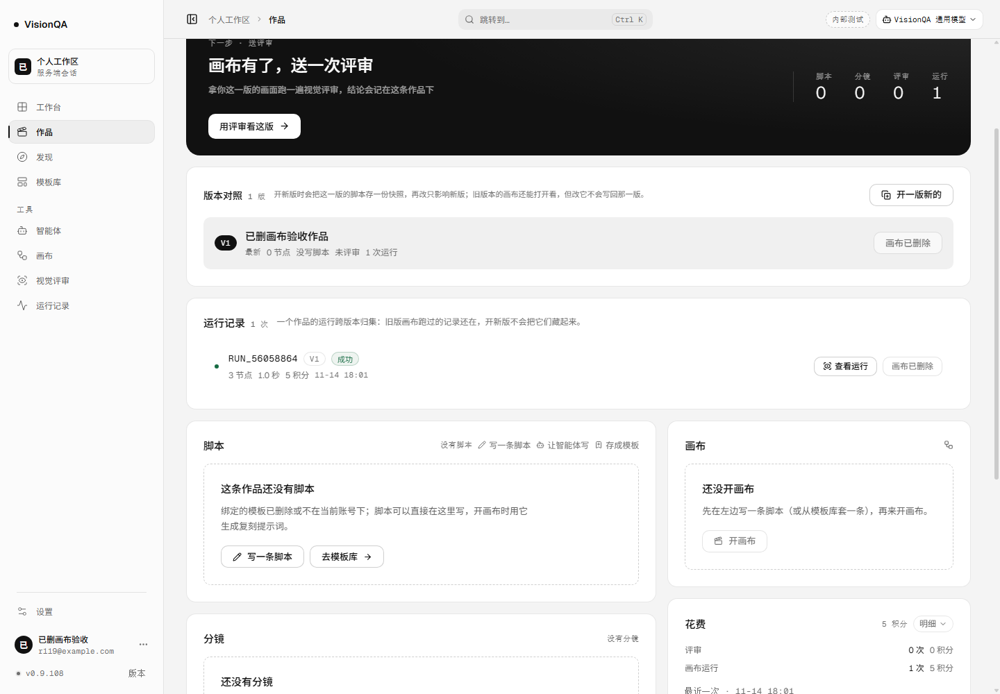
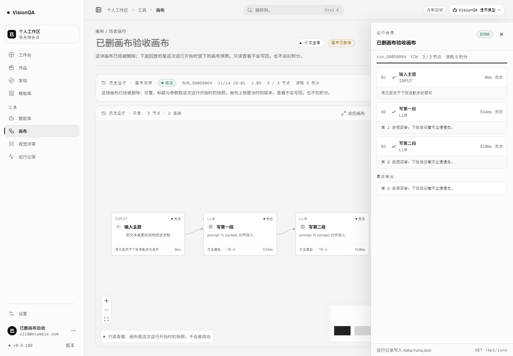
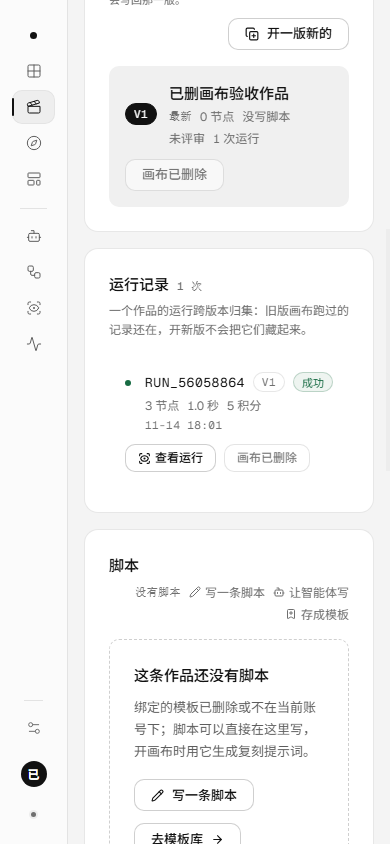
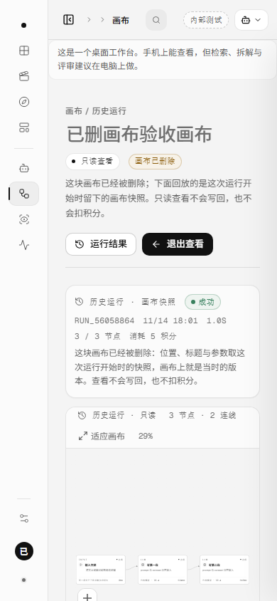
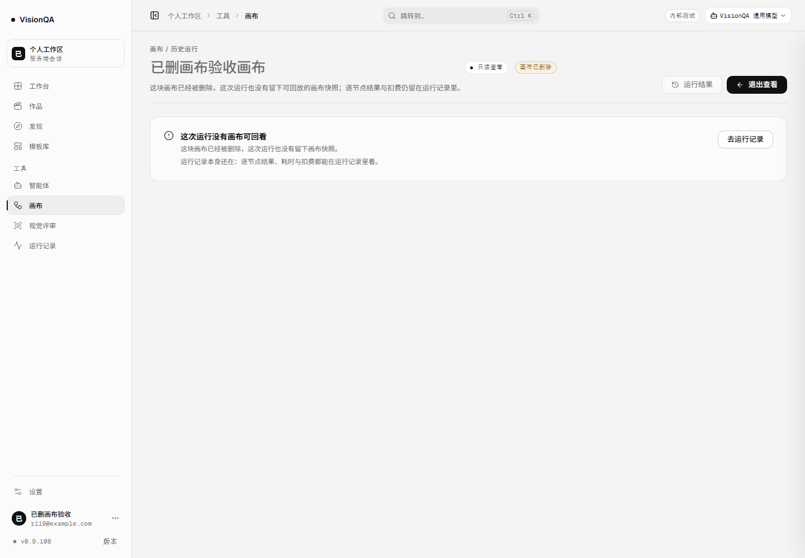

# 画布删了，运行记录还回得去（v0.9.109，2026-11-14）

## 一句话

上一轮（v0.9.108）让作品页能点开一次运行；这一轮把入口补完整：画布已经被删除、但运行开始时留下过快照的，仍能只读回看。快照也没留下的，页面不再假装能回放，直接说清并把入口还给运行记录。

## 为什么现在做

- v0.9.107 起，快照写在 `DATA_DIR/run-graphs/<runId>.json`，本来就不依赖画布还在不在；v0.9.108 的作品页入口却仍要求 `run.available`，画布一删，这条记录就只剩「画布已删除」。
- 作品页的运行记录是「这条内容跑过几次」的历史，不是画布的附属品；删掉画布不应该把历史一起变成死路。
- 反过来也要守住：没有快照时不能说「回放当时那张画布」。这一轮把「有快照」和「没快照」做成两条路，页面各说各的话。

## 改了什么

### 1. 服务端只回答「这次运行有没有快照」

- `server/flows.mjs` 新增 `hasRunGraph(runId)`：只 `stat` 快照文件，不读整张画布。
- 作品详情（`server/routes/projects.mjs`）在 `available=false` 时补一个 `hasSnapshot`；画布还在的运行不做这次 stat，列表成本不变。
- `available` 仍然只表示「现在能不能打开画布」；`hasSnapshot` 只表示「能不能只读回看」。两个事实分开，页面不用猜。

### 2. 画布页用快照重建一块只读画布

- 地址还是 `#/canvas/<flowId>/run/<runId>`。进页面先按原逻辑取画布；取不到且地址带 runId 时，读 `GET /api/runs/:id`。
- 运行属于这块画布、且有快照，就用快照的节点与连线拼出一块只读画布（名字取运行记录里的 `flowName`，作品取 `run.project`），**绝不创建「未命名流程」**。
- 标题旁出现 `画布已删除` 胶囊；说明写「下面回放的是这次运行开始时留下的画布快照」。
- 没有「当前画布」可对照，所以不显示 v0.9.108 的差异行，也不写「一致」。
- 「退出查看」不再回到一张不存在的画布：有作品回作品页，没有回运行记录。

### 3. 没有快照就停在门口

- 画布删了、快照也没了：页面写「这次运行没有画布可回看」，并说明逐节点结果、耗时与扣费仍在运行记录里；按钮是「去运行记录」，不是「重新加载」。
- 只读回看只加载一次；失败后保持失败页，不再反复请求 `/api/flows` 与 `/api/runs`。

### 4. 390 宽

- 标题行在窄屏换行：输入框占一整行，「只读查看」「画布已删除」两个标识落到下一行，不再把标题挤成一条缝。
- 作品页「查看运行」「画布已删除」并排放在正文下方；只读页的运行摘要与说明都不横向溢出。

## 本地验收

环境：本地 8945 + 假上游 8975；3 节点画布（1 个输入 + 2 个 LLM）；零真实上游。

| 步骤 | 读数 |
| --- | --- |
| 建画布 / 作品 | `flow_b62c1343` / `prj_9af9e44d` |
| 运行 | `run_56058864`，成功后 3 节点，耗时约 1.0 秒，扣 5 积分；余额 100→95；假上游 2 次（输入节点不调模型） |
| 快照 | `run-graphs/run_56058864.json` 存在，3 节点 / 2 连线 |
| 删画布 | `DELETE /api/flows/flow_b62c1343` 200 `{ok:true}`；`/api/flows` 总数 0；快照文件仍在 |
| 作品详情 | 这条运行 `available=false`、`hasSnapshot=true`、`version=1`、`status=success` |
| 作品页 1440 | 行里「查看运行」可点、「画布已删除」禁用；`scrollWidth 1440 = clientWidth 1440`；按钮 y=514 |
| 点「查看运行」 | 地址 `#/canvas/flow_b62c1343/run/run_56058864`；3 个节点回放；标题「已删画布验收画布」；胶囊「画布已删除」；说明写「这块画布已经被删除：位置、标题与参数取这次运行开始时的快照」 |
| 差异 | 没有「与当前画布比」这一块（没有当前画布可对照） |
| 只读请求 | `resume-plan` 0；画布 PATCH 0；再次运行 POST 0；运行详情 GET 5 次（两块回看页 + 无快照页）；快照文件读后仍是 3 节点 |
| 退出查看 | 回 `#/projects/prj_9af9e44d`，没有回到一张不存在的画布 |
| 390 作品页 | `scrollWidth 390 = clientWidth 390`；「查看运行」top 444 / bottom 472 / right 216，在 390×844 视口内 |
| 390 只读页 | `scrollWidth 390 = clientWidth 390`；「画布已删除」right 256；说明 right 353；标题行 `flex-wrap: wrap` |
| 无快照 | 删掉快照文件后重开同一地址：标题「这次运行没有画布可回看」，明写「没有留下画布快照」，按钮「去运行记录」；没有新建画布 |

## 踩到的坑

1. **没有 `applyFlow` 就没有 `loadedFlowRef`。** 画布删了或没有快照时，加载失败后每次渲染都会再拉一遍 `flows + run`，服务端日志是一串 404。修法是只在失败分支记下 `viewLoadRef`，成功仍交给 `applyFlow`；这样也能扛住 StrictMode 的两次挂载。
2. **404 和网络错误不能混。** 只有 404 才是「这次运行不存在 / 已被清理」，网络错误仍应显示「加载失败 + 重新加载」。
3. **失败页不能还挂着运行摘要。** 一开始错误页上方仍显示「正在读取」「0 / — 节点」和「没有留下画布快照」的旧文案；现在摘要只在 `loadState=ready` 时出现，标题说明另走 `missingSnapshot`。
4. **退出的默认目标是画布。** 画布已删除时再走 `#/canvas/<flowId>` 会顺手建一张新画布；现在退出先看作品、再看运行记录。
5. **390 的标题行会被两个标识挤爆。** 输入框、只读状态、已删除胶囊三个并排，必须让标题占一整行、两个标识换行。
6. **390 的运行抽屉会自动铺满整屏。** 要证明「画布已删除」和快照画布，截图前先点「关闭运行结果」。

## 发现但没做

- 运行 A/B 对照（两次运行之间比较）、差异导出、旧运行补快照，仍没做。
- 快照只保留最近 60 条；被挤出窗口的旧运行仍然只能看「当前画布」。
- 已删画布的回看不能续跑、不能分享成链接；「续跑」仍要求画布还在。
- 运行记录本身被清理时，快照文件没有独立入口。
- 如果旧快照缺 `flowName`，标题只能退成「已删除的画布」；这一版不反推历史。
- 真实评审回归仍缺一次授权评审。

## 回退与验证

- 回退：`bash /opt/visionqa/ops/rollback.sh --to 1` → **v0.9.108**；`--to 2` → **v0.9.107**。这一版不改 JSON schema，只新增作品运行的 `hasSnapshot` 字段与只读回看分支。
- 本地验证：`npm test`、`npm run lint`、`npm run build`、`node .tmp-qa/r119-e2e.mjs`；E2E 只在本地 8945 + 假上游 8975 跑。
- 工程数字见本轮提交说明与生产实况文档。

## 生产实况（v0.9.109）

发布 `20261114-180500-r119gone`，快照 `20261114-101009-20261114-180500-r119gone.tar.gz` **1,024,543 B**。

| 检查 | 读数 |
| --- | --- |
| 四个 unit | `visionqa` / `visionqa-internal` / `visionqa.socket` / `bdc-web` 全 active |
| 版本 / 健康 | 8799 / 8800 / 公网都是 **0.9.109**；`/api/health` ok（模板 26，uptime 50s） |
| 入口 | `index-D5C4jWoV.js` 200 · **578,588 B**；公网同一文件 200 · 578,588 B |
| 画布 / 后台 / 样式 | 246,686 B / 201,072 B / 276,467 B；画布样式 28,926 B |
| 文件一致 | `flows d9aeba53` / `routes 321505a1` / 入口 `dc801b32` / 画布 `a7de183b` / 后台 `e066f5c9` / 样式 `d86dc712` / 画布样式 `b49e8586` |
| 心跳 / 盘 | public pid 1484333 / internal pid 1484331；盘 72%；`/tmp` 357M，清回 351M |
| 旧记录 | 生产 9 条运行、`runs.json` 里 **0 条带 graph**；`run-graphs` 还没有目录 |
| 日志 | 只有 SQLite experimental 提示，没有业务 error / unhandled |

生产验证的是版本、入口、文件一致、四个 unit 健康，以及旧运行确实没有快照、仍走「取当前画布」的回退。带「已删画布仍能回看」的证据来自本地真浏览器 + 假上游；生产没有真实运行授权，这一版没有在任何真实运行上开过快照，也没有在线上删过任何画布。

- 提交 `44c355f`；CI **43583729494** 三个 job 全 success；HEAD == origin/master，工作树干净。
- 本地 `npm test` **920/920**、oxlint **0 error / 15 warning**、`tsc -b` 与 build 干净、密钥扫描 **657 文件 / 0 命中**。
- 回退：`bash /opt/visionqa/ops/rollback.sh --to 1` → **v0.9.108**；`--to 2` → **v0.9.107**。
