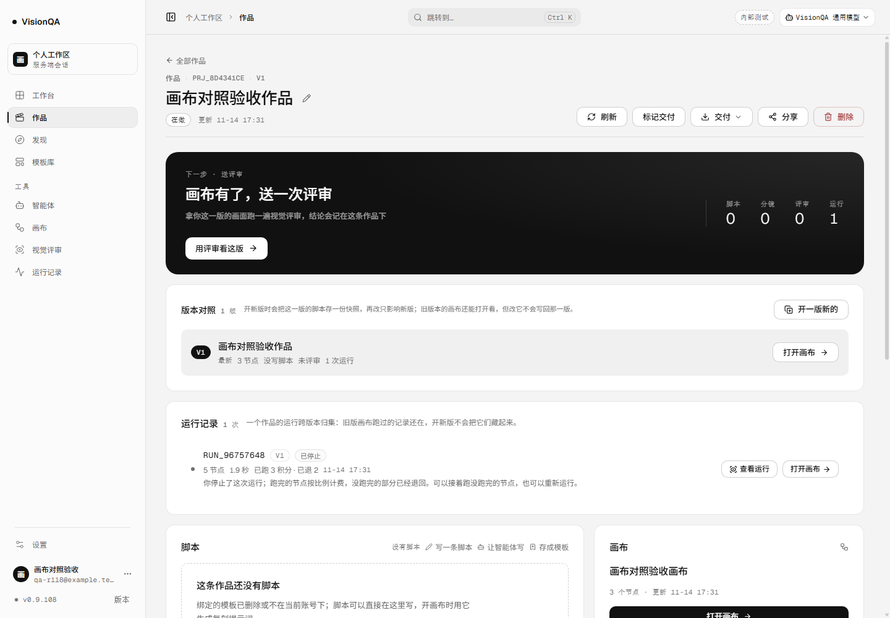
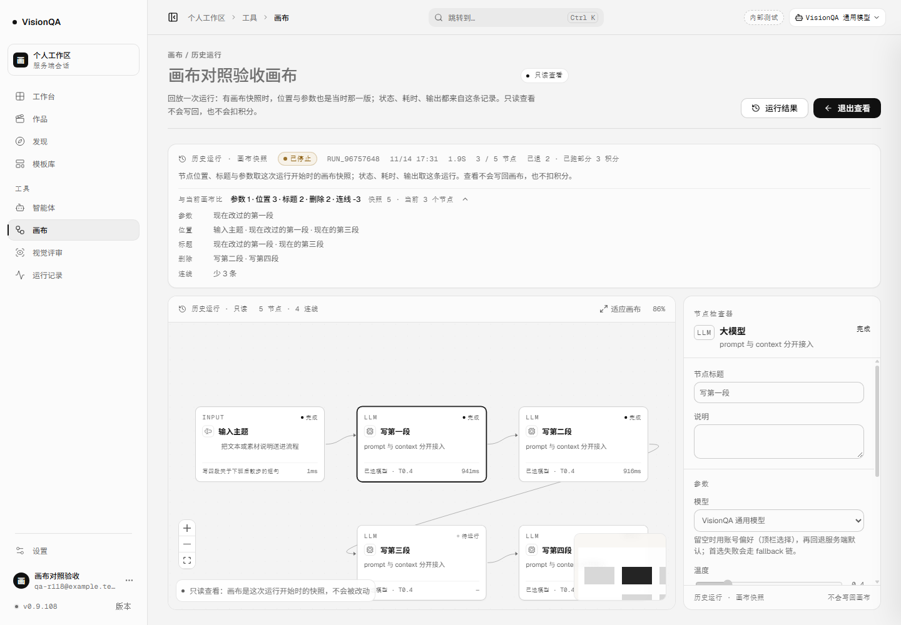
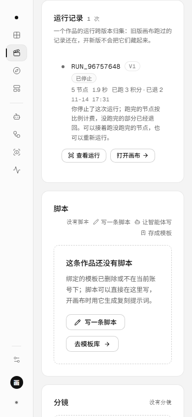
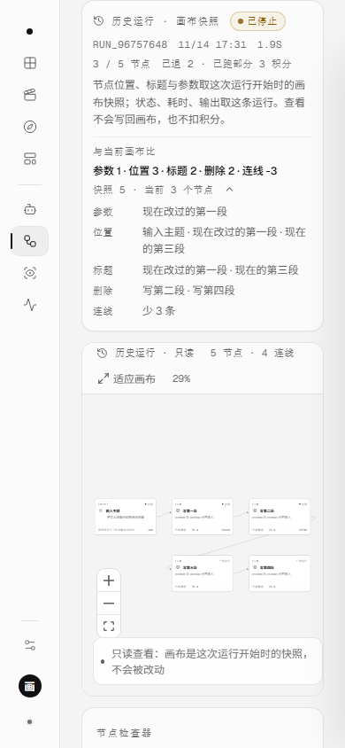

# 回看之后，知道画布改了什么（v0.9.108，2026-11-14）

## 一句话

上一轮（v0.9.107）在运行开始时留下了画布快照；这一轮把「快照」接回作品主线，并把「这之后改了什么」摊开：作品页的运行记录可以直接点「查看运行」，只读页用一张差异行分开数参数、位置、标题、新增、删除与连线。

## 为什么现在做

- 回看运行原来只有「运行记录」页一个入口；用户从作品页看到某次运行，只能「打开画布」，看不到那次运行本身。
- 快照能回放当时的 5 个节点，但页面不回答「现在这张画布和当时差在哪」；用户要自己一个一个对比，才知道继续跑会复用几个、重跑几个。
- 作品页已经把运行按版本归集成一条线，入口不该停在「打开画布」；「查看运行」才是这条记录的下一步。

## 改了什么

### 1. 作品页运行记录加「查看运行」

- `ProjectPage` 新增 `onViewRun(flowId, runId)`，由 `App` 接到 `#/canvas/<flowId>/run/<runId>`。
- 只在画布还在、且运行已经结束（不是 `running` / `queued`）时出现；画布被删的记录仍保留，但只写「画布已删除」，不假装能打开。
- 原来的「打开画布」保留；两个动作都是 28px 的小按钮，390 宽换行到正文下方，不挤标题。
- 顺手修了作品页的状态文案：`interrupted` 以前和 `error` 一起写「失败」、红点；现在服务重启打断写「已中断」、中性点，用户主动停止写「已停止」，只有真正的 `error` 仍是失败红。

### 2. 只读页的「与当前画布比」

- 新增纯函数 `src/domain/run-diff.ts`：输入快照与进页面时的当前画布，输出六类差异：
  - 参数：节点类型 / `data.config` 变了（提示词、模型、温度等）；
  - 位置：坐标按整数比较，挪一下不算参数；
  - 标题：`data.title` 变了，和参数分开记；
  - 新增 / 删除：按节点 id 对照，删除项的标题取快照里的名字；
  - 连线：按 `source + sourceHandle + target + targetHandle` 对照，节点删掉时两端连线也算减少。
- 快照进页面时会替换 `nodes / edges`；所以 `applyFlow` 先把服务端读到的当前画布留在 `previewBase`，替换后再对照。没有快照的旧运行不显示差异行，不编造「一致」。
- 页面只显示一行摘要（`参数 1 · 位置 3 · 标题 2 · 删除 2 · 连线 -3`）和两边的节点数；点开才看具体节点名。没有改动时写「一致」，点开写「位置、标题、参数与连线都没有变」。
- 差异只做事实对照，不判断能不能续跑；能不能复用仍由服务端的 `resume-plan` 按内容指纹算。

### 3. 视觉

- 差异行放在只读说明下面，用发丝线分隔；摘要用 12px 正文，标签用 11px 等宽字，明细两列（48px 标签 + 内容），全部走 4/8pt token。
- 展开箭头用 16ms 过渡旋转；不加大色块、不做渐变。
- 390 宽时摘要与明细换行；明细行不横向溢出，右边界留在视口内。

## 本地验收

环境：本地 8944 + 假上游 8974；5 节点画布，前三次各 0.9 秒；零真实上游。数据目录 `.tmp-qa/r118-run/data`，脚本与数据分开。

| 步骤 | 读数 |
| --- | --- |
| 建作品 | `prj_8d4341ce` / `flow_a7e0d015` |
| 运行 | `run_96757648` 停在前三段；`cost=5 / kept=3 / refundedAmount=2 / settled=true` |
| 改画布 | PATCH 成 3 节点：全部挪位置；第一段改标题 + 温度 0.4→0.8 + 提示词；第三段改标题；删掉第二、第四段；连线 4→1 |
| 作品页 | 运行行显示「已停止」和 5 节点；「查看运行」「打开画布」两个入口都在 |
| 点「查看运行」 | 地址 `#/canvas/flow_a7e0d015/run/run_96757648`；快照 5 节点 / 4 连线；`n_input` 仍是 `translate(80px, 120px)` |
| 差异摘要 | `参数 1 · 位置 3 · 标题 2 · 删除 2 · 连线 -3`；`快照 5 · 当前 3 个节点` |
| 差异明细 | 参数：现在改过的第一段；位置：输入主题 · 现在改过的第一段 · 现在的第三段；标题：现在改过的第一段 · 现在的第三段；删除：写第二段 · 写第四段；连线：少 3 条 |
| 只读请求 | `resume-plan` 前后 0；画布 PATCH 0；余额 100→97；假上游 3 次；只读页 `runGets=1` |
| 检查器 | 仍显示快照里的「写第一段」；抽屉 STOPPED；只读页没有运行 / 保存入口 |
| 无快照回退 | 删掉快照文件后重开：3 节点、明写「没有留下画布快照」、报「1 个节点不在当前画布上」，且**不显示差异行** |
| 390 宽 | 作品页 `scrollWidth 390 = clientWidth 390`；「查看运行」按钮在画面内（y=301）；差异块 `right 353 <= 390`、自身 `scrollW 248 = clientW 248` |









## 踩到的坑

1. **快照会换掉 `nodes`。** 差异必须在替换前留一份当前画布；从 `nodesRef` 现读容易拿到空数组，改成在 `applyFlow` 保存 `previewBase`。
2. **项目运行行的 id 是等宽大写。** E2E 用 `innerText.includes(小写 id)` 会漏；改成两边 `toLowerCase()`。
3. **作品页状态以前把中断算失败。** 这次接「查看运行」时顺手分开：`interrupted` 中性、`canceled` 写已停止、`error` 才是失败。
4. **删除节点会同时减少连线。** 摘要里会看到「删除 2 · 连线 -3」；这是事实，不该为了好看把连线藏掉。
5. **没有快照的旧运行不能显示「一致」。** 没有 `graph` 就没有对照基准，差异块整个不渲染。
6. **差异不是续跑预检。** 这里不读 `resume-plan`、不调用上游；只回答「画布改了什么」，能不能复用仍由服务端按指纹算。

## 发现但没做

- 删除画布后的运行：快照可能还在，但当前只读页需要 flow 才能打开，作品页对 `available=false` 只显示「画布已删除」。后续可以让「有快照的已删画布」也能进只读回看。
- 差异只按节点与连线；画布名、描述、作品版本的改动不在这一行里。
- 没有按版本对照两次运行（A 运行 vs B 运行）的 diff。
- 没有把差异导出成文件；快照仍只保留最近 60 条运行。
- 真实评审回归仍缺一次授权评审。

## 回退

- 回退：`bash /opt/visionqa/ops/rollback.sh --to 1` → v0.9.107（`--to 2` 是 v0.9.106）。
- 这一版不改服务端 JSON schema、不改运行记录字段；只加前端入口与对照。旧前端仍能打开运行记录页与画布。

## 验证命令

```bash
node --experimental-sqlite --experimental-strip-types --test test/run-graph-diff.test.mjs
npm test
npm run lint
npm run build
node --experimental-sqlite --experimental-strip-types .tmp-qa/r118-e2e.mjs
```

## 生产实况

发布 `20261114-173500-r118diff`，快照 `20261114-093248-20261114-173500-r118diff.tar.gz` **1,021,390 B**。

| 检查 | 读数 |
| --- | --- |
| 四个 unit | `visionqa` / `visionqa-internal` / `visionqa.socket` / `bdc-web` 全 active |
| 版本 / 健康 | 8799 / 8800 / 公网都是 **0.9.108**；`/api/health` ok（模板 26，uptime 39s） |
| 入口 | `index-C6WQq3gB.js` 200 · **578,412 B**；公网同一文件 200 · 578,412 B |
| 画布 / 后台 / 样式 | 244,824 B / 201,072 B / 276,467 B；画布样式 28,814 B |
| 文件一致 | `flows d2873833` / `routes e4a14ca7` / 入口 `b234c3c4` / 画布 `d44450ad` / 后台 `7dc5ca31` / 样式 `d86dc712` / 画布样式 `0dfbafd1` |
| 心跳 / 盘 | public pid 1483511 / internal pid 1483509；盘 72%；`/tmp` 部署后 357M，清理临时包后 351M |
| 旧记录 | 生产 9 条运行，`runs.json` 里 **0 条带 graph 字段**；`/var/lib/visionqa/run-graphs` **还没有目录** |
| 日志 | 只有 SQLite experimental 提示，没有业务 error / unhandled |

生产验证的是版本、入口、文件一致、四个 unit 健康，以及旧运行确实没有快照、仍走「取当前画布」的回退。带差异的只读回看证据来自本地真浏览器 + 假上游；生产没有真实运行授权，这一版没有在任何真实运行上开过快照。

