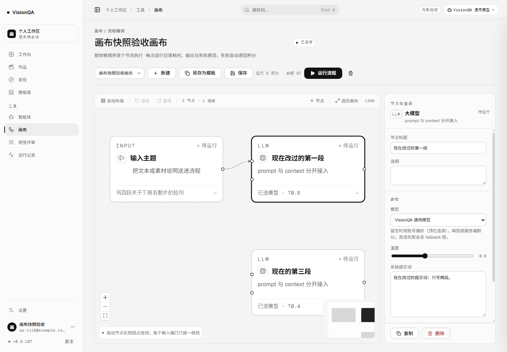
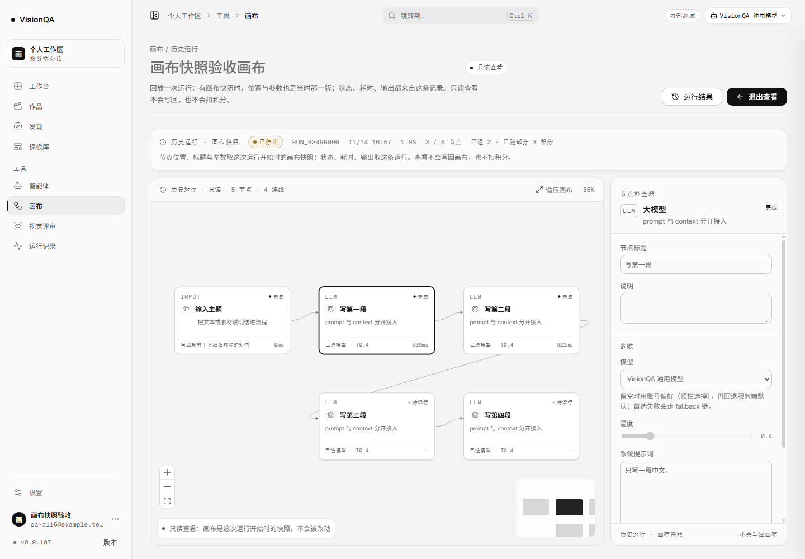
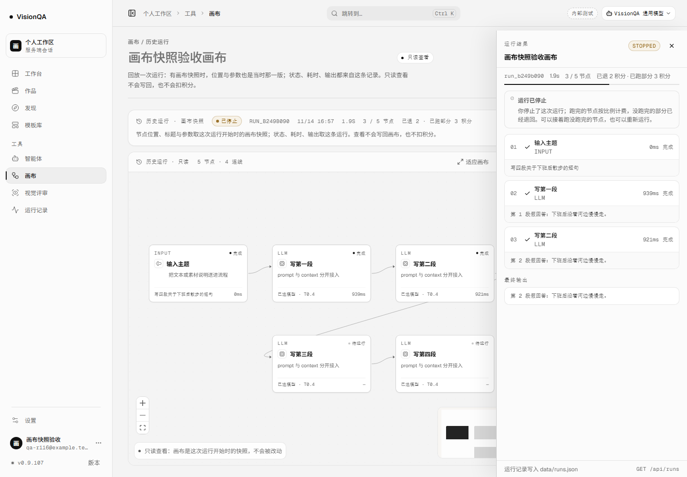
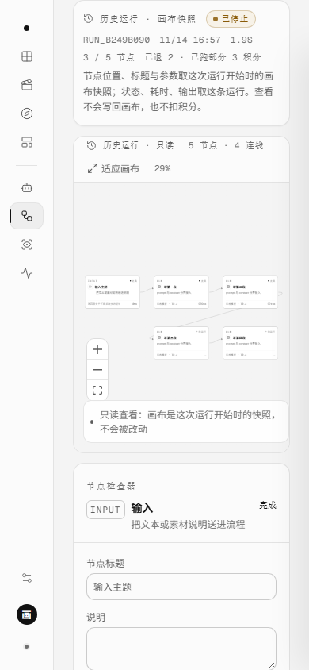
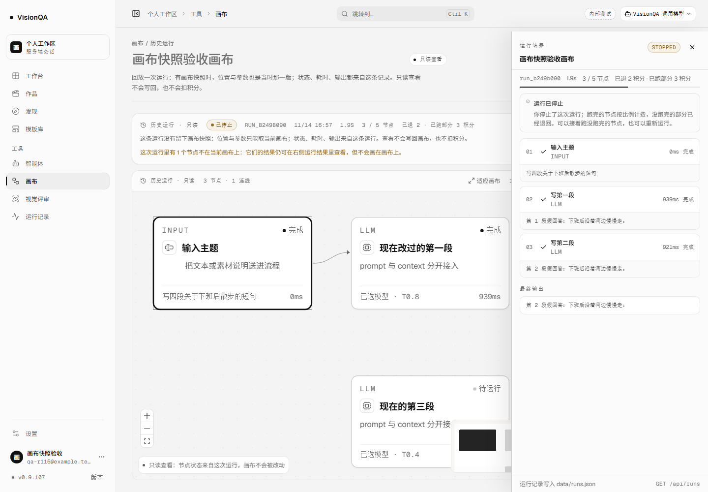

# 回看的是当时那张画布（v0.9.107，2026-11-14）

v0.9.106 的只读回放解决了「看运行结果」这件事，但页面只能拿**当前画布**去贴这些结果。画布一改，位置、标题、参数就跟着现在的版本走；删掉一个节点，它只能从画布上消失。这一版把运行开始时的画布也留了下来：有快照就回放当时的 5 个节点，没快照的旧运行仍如实退回当前画布并写明。

## 改了什么

### 服务端：运行开始时留一张最小画布快照

- 新增 `runGraphSnapshot(flow)`：只留节点 `id / type / position / data` 与连线 `source / target / sourceHandle / targetHandle`，不带运行状态、不带账号信息。
- 每次 `runFlow` 真正开始执行前写 `DATA_DIR/run-graphs/<runId>.json`，再写运行记录。快照对应的是**这次实际执行的图和配置**；留档写失败只退化为「没有快照」，不会让运行本身失败。
- 快照不塞进 `runs.json`：列表一次 20 条运行，不应该把几十张画布的节点配置一起发给页面。单条运行详情 `GET /api/runs/:id` 才带 `graph`，列表接口不带（测试里直接断言两边的差异）。
- 运行记录被 `MAX_RUNS = 60` 挤出历史窗口时，它的快照文件一起删掉；`dropRunRecord` 撤掉占位单时也清快照，不留孤儿文件。

### 画布页：有快照就用快照，没有就说清楚

- 只读回看拿到 `run.graph` 后，用快照里的节点与连线替换当前画布，再把这条运行的节点状态、耗时、输出贴到同 id 的节点上。位置是当时的 `translate(80px, 120px)`，不是改过之后的 `500, 520`。
- 有快照时只读条写「历史运行 · 画布快照」，说明写「节点位置、标题与参数取这次运行开始时的画布快照」；检查器脚注也写「历史运行 · 画布快照」。
- 旧运行没有 `graph` 时保持 v0.9.106 的行为：贴到当前画布，但只读条写「历史运行 · 只读」，说明明确写「这条运行没有留下画布快照：位置与参数只能取当前画布」。
- 只读态不再显示当前作品的「在帮《X》· 第 N 版」条：那是现在的归属，不是这次运行时的事实。标题也改用运行记录里的 `flowName`，不拿当前画布名冒充。
- 修了两个只读态的老问题：`onNodesChange` 以前把 `dimensions` 也丢了，React Flow 算不出连线端点；手柄又用 `display:none` 藏，连线直接缩成一个点。现在放行尺寸测量、手柄改成不可见但仍占位，4 条连线各自落到节点上。
- 窄屏（≤760px）隐藏小地图，避免一块白色小卡压住本就很小的节点；390 下画布仍无横向溢出。

## 本地实测

环境：本地 API `127.0.0.1:8944` + 假上游 `127.0.0.1:8974`，5 节点，前三次每次 0.9 秒；零真实上游调用。数据目录 `.tmp-qa/r117-run/data`，与验收脚本分开。

| 步骤 | 读数 |
| --- | --- |
| 运行 | `flow_568d4edf` / `run_b249b090`；停在前三段；`cost=5 / kept=3 / refundedAmount=2 / settled=true` |
| 余额 / 上游 | 开跑前 100，查看后 97（只扣留下的 3）；假上游 **3** 次 |
| 改画布 | PATCH 成 3 节点、位置全部挪到 500/520 一带、第一段标题改成「现在改过的第一段」、提示词改成「只写两段」 |
| 快照文件 | `DATA_DIR/run-graphs/run_b249b090.json` 存在；详情接口 5 个节点；列表条目没有 `graph` |
| 快照回看 | 画布 **5 节点 / 4 连线**；被删掉的第二段、第四段仍在；`n_input` 仍是 `translate(80px, 120px)` |
| 检查器 | 选中第一段显示旧标题「写第一段」、旧温度 0.4、旧提示词「只写一段中文。」；`fieldset disabled=true` |
| 节点状态 | 完成 3 / 待运行 2；抽屉 `STOPPED`；只读条「历史运行 · 画布快照」 |
| 只读请求 | 进入前 `resume-plan` 0，查看后仍 0；画布 PATCH **0**；服务端 `updatedAt` 前后一致 |
| 旧运行回退 | 删掉快照文件后重开同一条：3 节点（当前画布），说明写「没有留下画布快照」，并报「1 个节点不在当前画布上」 |
| 390 宽 | 5 节点仍可读；`scrollWidth 390 = clientWidth 390`；小地图 `display:none` |

## 生产实况

> 发布后填写。

## 踩到的坑

1. **只读态不能丢 `dimensions`。** 以前只放行 `select`，React Flow 拿不到节点尺寸，连线端点算不出来；快照节点一换，线就从画布左上角乱飞。现在放行 `select` 与 `dimensions`，拖动、删除、新增仍然丢掉。
2. **手柄不能 `display:none`。** 只读要把连接点藏掉，但 React Flow 靠手柄元素测端点；`display:none` 会让手柄尺寸归零，4 条线缩成同一个小点。改成 `opacity:0 + pointer-events:none`，看不见但仍占位。
3. **快照别塞进运行列表。** 一次 20 条、每条 60 个节点、每个节点还带提示词，列表会变成几 MB。快照放单独文件，只在单条详情带。
4. **留档失败不能拖垮运行。** 快照写失败只记日志，运行照常执行；页面回退到当前画布。
5. **快照要对应实际执行的那张图。** 写在 `runFlow` 真正开始时，而不是请求进来 / 排队登记时；否则排队期间画布被改，快照和实际跑的图会对不上。
6. **旧运行不能补快照。** 运行记录只有逐节点结果，没有历史节点，反推不出当时的位置与参数；只能如实写「没有留下画布快照」。
7. **只读页不能借当前作品和当前标题冒充历史。** 当前作品条已隐藏；标题改用运行记录里的 `flowName`。
8. **60 条窗口外要清快照。** 快照和运行记录一起淘汰，否则 `run-graphs` 只涨不跌。
9. **窄屏小地图是纯遮挡。** 390 下画布只有 272px 宽，148px 的小地图压住两列节点；≤760px 直接收起，缩放用工具条。
10. **验收要改完画布再回看。** 只在原画布上打开，看不出快照和当前画布的区别；必须挪位置、删节点、改标题后再看，才能证明回放的是当时那张图。

## 发现但没做

- 旧运行（v0.9.106 及以前）没有快照，也不做不可靠的反推；只能按当前画布回放并写明。
- 快照只跟最近 60 条运行保留，没有独立的历史版本库；同一张画布跑 61 次，最早那次的位置与参数就查不到了。
- 快照是未压缩 JSON；一张 60 节点、每节点长提示词的画布，单文件会偏大。后续可以按需 gzip，现在先保证可读与可回退。
- 只做单次运行的快照，没有「两次运行画布 diff」「分享带快照的回看链接」「跨实例 / 跨机器导出」。
- 排队中的单在开始执行前没有快照；排队时改画布，实际执行的仍是请求时那张图，但详情要等开跑后才有快照。
- iframe 内的画布出图 / 视频任务仍不在回放范围。
- 真实评审准确度回归仍缺一次授权评审。

## 回退与数字

- 回退：`bash /opt/visionqa/ops/rollback.sh --to 1` → **v0.9.106**（`--to 2` 是 v0.9.105）。这一版新增 `run-graphs` 目录与单条详情字段，不改已有 JSON schema；旧前端不认识 `graph`，会忽略并退回当前画布。
- 测试 **914/914**（+1 条快照用例：落盘、改画布后不覆盖、详情带 / 列表不带、超 60 条清理），lint、tsc、build 见收尾记录。
- 版本 **0.9.107**。
