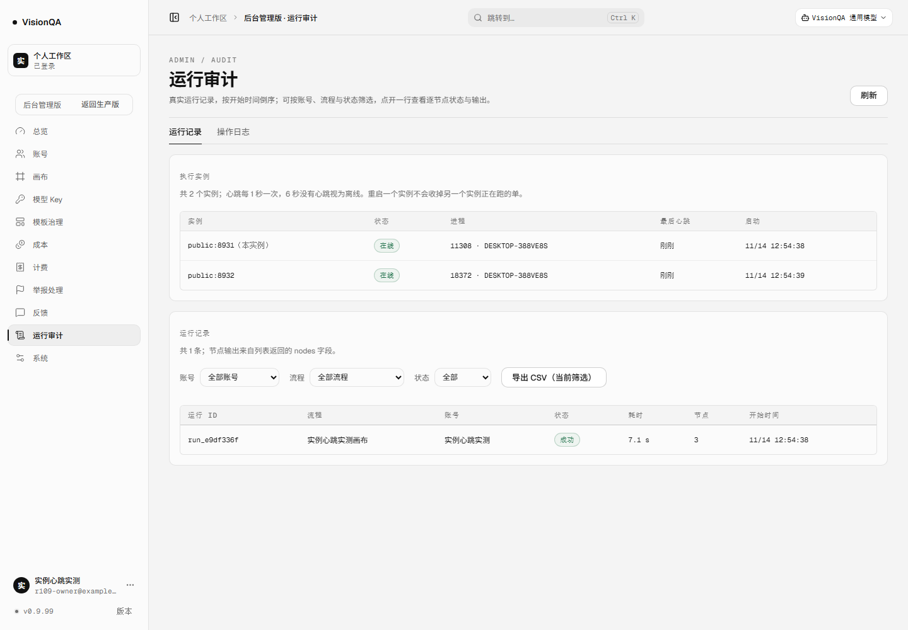
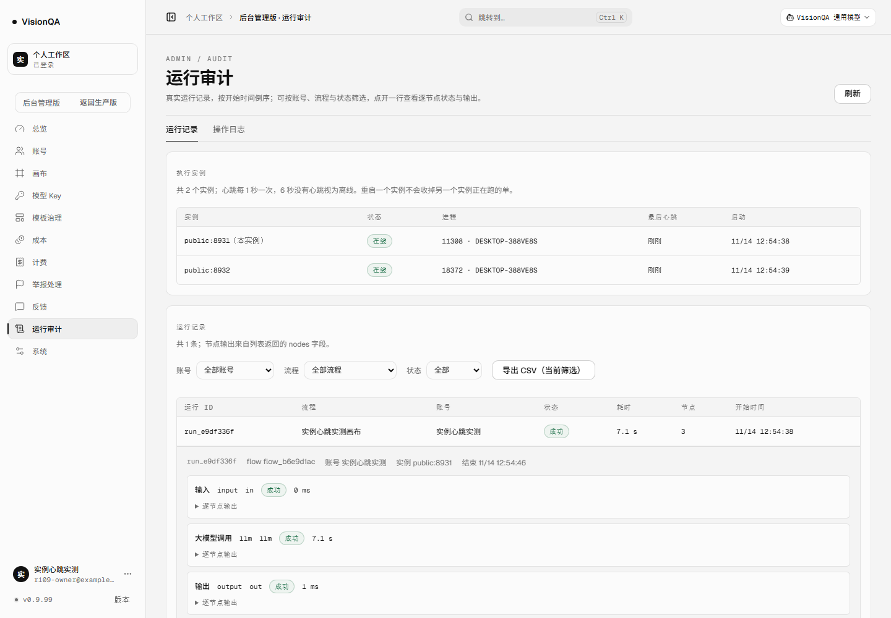

# 实例心跳：谁在跑、重启会不会误伤，现在能看见（v0.9.99，2026-11-14）

## 问题：一个一直没有被核对的「前提」

上一轮（v0.9.98）的遗留清单里写着：「两实例共享 `DATA_DIR`，单实例重启的恢复会误伤另一实例在跑的单，下轮修」。这一轮开工第一件事是核对这个前提——结果它不成立：

- `visionqa`（公网 8799）：`DATA_DIR=/var/lib/visionqa`
- `visionqa-internal`（内网 8800）：`DATA_DIR=/var/lib/visionqa-internal`（`/etc/visionqa-internal.env`）
- 两个目录各有自己的 `runs.json`，重启一个碰不到另一个的运行记录。

也就是说，**当前生产拓扑下不存在这条资损路径**；r108 报告里那句判断是错的，以这一轮的实测为准。

但「实例重启会不会收掉别人的运行」不是只对生产现状成立：本地双实例、灰度多开、将来把两个进程指向同一份数据目录，都会立刻踩到。所以这一轮仍然把「实例存活」做成共享目录里的事实，并让启动恢复只在主人真的死了时才收单；同时把「谁在跑」放到后台，排障不用再猜。

用户能直接看到的变化：

- 后台「运行审计」多了**执行实例**卡片：哪些实例活着、心跳多久没来、本实例是哪个、心跳有没有写失败。
- 运行详情多了一行**实例**：这条运行是哪个实例执行的。
- 启动 / 停机日志带 `instance` 字段：`public:8799` / `internal:8800`，两个 unit 的日志混在一起也能分清。

## 做法

1. **每个实例写一份心跳**（`server/instances.mjs`）：`DATA_DIR/instances/<sha256(id) 前 16 位>.json`，内容 `{id, pid, host, bootId, startedAt, beatAt}`；每 10 秒一拍、`unref`，先写临时文件再 rename；进程收到 SIGTERM 时删掉自己的心跳。
2. **实例身份是「角色 + 端口」**：默认 `public:8799` / `internal:8800`（可用 `VQ_INSTANCE_ID` 覆盖）。重启不换身份，才能认出自己上一次留下的记录；不带主机名，避免把内网主机名通过 `/api/runs` 带出去。
3. **活着的判据不是「心跳新」一条**：心跳新 + 同机 pid 在 + 同一次开机（`/proc/sys/kernel/random/boot_id`）才算活。进程刚崩、马上重启时旧心跳还很新，只看时间会把一条已经没人执行的记录当成「别人在跑」，永远没人收。
4. **运行记录带执行实例**：占位记录（`blankRun`）与 `runFlow` 覆盖记录时都写 `ownerInstance`。`runFlow` 会用自己造的对象覆盖同 id 的占位记录，这里漏写就会在恢复时找不到主人（和 r108 的 `queued` 字段是同一类坑）。
5. **启动恢复只收自己的 / 没有主人的单**：`ownerInstance` 为空（升级前的旧记录）或等于自己（自己重启，旧进程已死）→ 照旧标中断 / 退款 / 撤排队单；`ownerInstance` 是另一个活着的实例 → 原样保留，记 `skipped`。
6. **启动顺序先心跳后恢复**：另一个实例如果正好这时启动，才能看到我们；`listen` 日志同时写 `instance` 与 `heartbeat: ok|error`。
7. **后台可见**：`GET /api/admin/instances`（管理员）返回 `{self, beatMs, ttlMs, heartbeatError, items}`，每项带 `state / alive / ageMs / self`；运行审计页用现有卡片 / 表格样式渲染。运行详情显示 `ownerInstance`。
8. **目录与失败处理**：两个生产 unit 以不同用户跑，心跳目录 `0777` 且每次启动 chmod 一次；写失败只记 `heartbeatError`，不挡服务启动；超过 7 天的死心跳在启动时清掉。

状态口径：

| state | 含义 | 恢复时 |
| --- | --- | --- |
| `alive` | 心跳 ≤60s、pid 在、同一次开机 | 跳过它名下的 running / queued |
| `dead` | 心跳还新但 pid 没了（崩溃后马上重启） | 照收 |
| `stale` | 60 秒没有心跳 | 照收 |
| `restarted` | 机器重启过（boot id 变了） | 照收 |
| `bad` | 心跳文件半截 / 读不出来 | 当作没有主人，照收 |

## 本地实测（两个真进程共用一份 DATA_DIR，零真实上游）

环境：A=8931、B=8932 同 `DATA_DIR=.tmp-qa/r109/data`；假上游 `127.0.0.1:8961` 故意延迟 7 秒；心跳 1s / TTL 6s（生产 10s / 60s）；一条 `input → llm → output` 流程。

| 时刻 | 读数 |
| --- | --- |
| A 开始跑 | `run_e9df336f` status `running`，`ownerInstance=public:8931`，余额 100 |
| **A 还在跑时重启 B** | B 重启日志：`runs.recovered {"recovered":0,"refunded":0,"dropped":0,"skipped":1}`——看到 A 活着，没动它的单 |
| A 跑完 | `success` · **7054ms** · 3 个节点 · 实例 `public:8931`；余额 100 → **98**；扣费 1 笔、退款 0 笔 |
| 实例心跳 | 两个文件都 `alive`：`public:8931` pid 11308、`public:8932` pid 18372；age 429ms / 695ms |
| 对照（单测） | 把心跳改成过期、或 pid 已死，同一条记录立刻 `recovered 1 / refunded 1`——旧代码无条件走的就是这条分支 |

新增 `test/run-instance-recovery.test.mjs` 7 条：心跳写入 / 自识别 / 退出摘除；活着的另一实例不收回、不退款；排队单也不撤；心跳新但 pid 已死照收；旧记录与自己记录照收；`runFlow` 覆盖不丢实例归属；死心跳 7 天后清理、新鲜心跳保留。

## 生产核对（实测，不是按上一轮的判断抄的）

| 检查 | 读数 |
| --- | --- |
| 两个 unit | `visionqa` active · `visionqa-internal` active |
| 版本 | 8799 / 8800 都 `0.9.99`；公网 `/api/version` `0.9.99` |
| 数据目录 | 8799 `/var/lib/visionqa`；8800 `/var/lib/visionqa-internal`——**各自独立** |
| 心跳文件 | `/var/lib/visionqa/instances/*.json` 与 `/var/lib/visionqa-internal/instances/*.json` 各一份 |
| 心跳内容 | `public:8799` pid 1477021、`internal:8800` pid 1477188，host/bootId 一致，beat 每 10s |
| 重启内网实例 | 公网 pid 仍是 1477021、心跳文件不变、`/api/health` uptime 94→98；内网 pid 换新并继续心跳 |
| 停机日志 | `{"t":"shutdown","signal":"SIGTERM",...,"instance":"internal:8800"}`——新字段在线上生效 |
| 后台接口 | 一次性会话读 `/api/admin/instances`：1 项 `public:8799` `alive`；logout 204 后同一 cookie 401 |
| 文件逐字节一致 | `instances.mjs 4d1dd78e` · `flows.mjs 8e8bdce0` · `index.mjs 7495fabb` · `routes/admin.mjs bab85751` · 入口 `00401a2d` · 后台 chunk `93551994` |
| 公网入口 | `index-pf_kUpu9.js` 200 · **571,700 B**；旧入口 `index-BSqJvpCr.js` 404 |
| 盘 / 临时文件 | 72%（27G/40G）；`/tmp` 里 r109 文件已清 |

**诚实说明**：因为生产两个实例的数据目录是分开的，生产上并没有一条「别的实例正在跑」的记录可以让恢复去跳过；这条路径的证据来自本地双进程实测 + 7 条单测。生产这边验证的是：心跳与实例身份真的落盘、重启互不影响、后台能看见、文件与本地逐字节一致。

## 坑（这一轮踩到 / 差点踩到的）

1. **前提也要验证**：上一轮把「两个生产实例共用 DATA_DIR」当成事实写进了遗留清单。这一轮 `systemctl cat visionqa visionqa-internal` + `grep DATA_DIR` 才发现是两份独立目录。跨实例的行为，先看 unit 的 `EnvironmentFile` 再改代码。
2. **心跳新 ≠ 活着**：崩溃后 60 秒内重启，旧心跳还在 TTL 里。只按时间判断，会把一条已经没人执行的记录当成「别人在跑」，永远留在 running。必须核对 pid（和 boot id）。
3. **同 id 重启必须收自己的单**：不能只判断「主人活着就跳过」。自己重启时旧进程已经死了，若还跳过，自己的旧记录就永远不回收；所以 `ownerInstance === self` 一律走恢复。
4. **`runFlow` 覆盖占位记录**：实例归属只在 `blankRun` 写一次不够，`runFlow` 会用自己的对象覆盖同 id 记录（r108 的 `queuedMs / queuedAt` 也在这里丢）。本轮把 `ownerInstance` 写回并加了用例。
5. **两个用户写同一个目录**：`visionqa` 与 root 写同一个心跳目录，目录必须 `0777`，chmod 失败要吞掉；心跳写失败只降级为「后台看得见错误」，不能挡住服务启动。
6. **旧记录没有 `ownerInstance`**：升级窗口里照旧按旧规则收——两个 unit 几乎同时收到 SIGTERM，实际不会有活着的旧记录被误收；这条写在这里避免下次误判。
7. **Windows 的 SIGTERM 是强杀**：本地重启 B 时不会走优雅停机、也不会摘心跳，所以本地靠 pid 判死；生产 systemd 才会走 `shutdown` 并删除心跳文件。别把本地行为当生产行为。
8. **跨机器共 DATA_DIR 不支持**：默认 id 是角色 + 端口，同 hostname/port 会撞；pid 与 boot id 也只在同一台机器上有意义。

## 发现但没做

- **挂死进程不会自动收尸**：启动恢复只在启动时跑；一个事件循环卡住、但进程还在的实例，它名下的 running 记录会一直挂着（心跳会变 `stale`，但没有巡检去收）。要做需要周期巡检 + 更谨慎的活性判据，不能顺手加。
- 后台实例表是只读的，没有「手动收尸 / 清理死实例」按钮；内网 8800 的数据目录独立，它的卡片只看得到自己，要跨实例看需要汇总视图。
- r108 遗留的排到之后真中断、`queuedMs` 入终态、ETA、票号绑账号、跨机器，仍未做。
- 生产没有一条真实运行来触发 skip 路径（零授权上游）；需要一次真实运行授权才能补上这块线上证据。
- 实例心跳没有接告警：心跳写失败只在后台卡片里可见，没进 webhook（等告警地址）。

## 回退

`bash /opt/visionqa/ops/rollback.sh --to 2` → v0.9.98（快照 `20261114-042857-20261114-123000-r108-que.tar.gz`）。无 schema、无接口破坏：`ownerInstance`、心跳文件都是新增的，老前端忽略；旧版本不读 `DATA_DIR/instances`，目录留着也不影响。

## 数字

- 测试 **899/899**（+7）；oxlint 0 error / 15 warning；`tsc -b` 干净；构建入口 `index-pf_kUpu9.js` 571,700 B、后台 chunk `AdminConsolePage-DH64Z1GT.js` 200,520 B、样式 `index-cGfb30jh.css` 275,109 B；密钥扫描 637 文件 0。
- 提交 `926fe3f`（代码 + 用例 + 两张截图 + 0.9.99）；CI **43559220282** 三 job 全 success（Node 22.12 / 24 / 安全扫描）。
