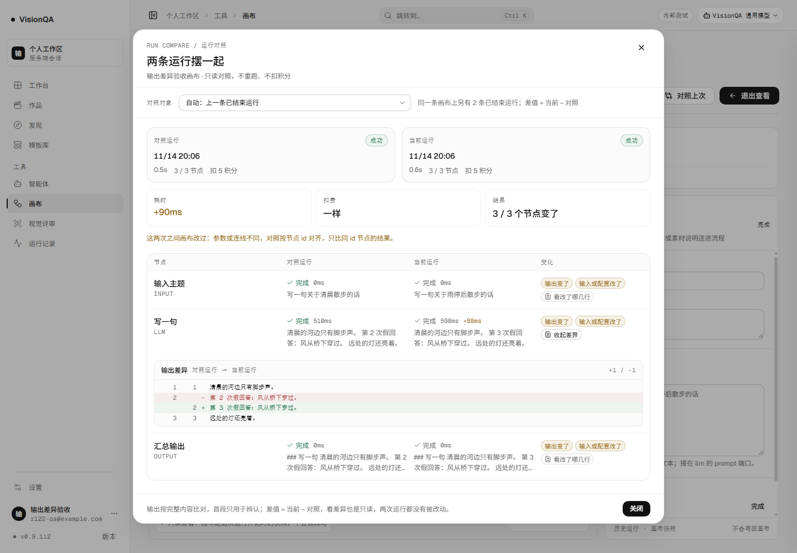
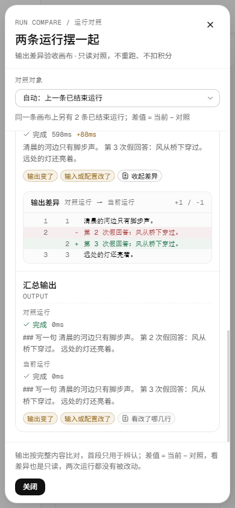

# 知道输出变了，还得看见改了哪几行（v0.9.112，2026-11-14）

运行对照到 v0.9.111 已经能回答「哪几个节点变了、慢了多少、多花了多少」，但「输出变了」后面仍然只有两段各 180 字的预览。人真正要判断的是：这次改的那一句话，到底改成了什么；上一版和这一版的结构差在哪。这一轮补上这个洞：**对照表里的每个「输出变了」节点，都能就地展开改动附近的几行**。它仍然只读，不重跑、不扣费，也不把完整输出再搬一遍。

## 一、改了什么

- **单独一条只读接口**：`GET /api/runs/:id/compare/diff?with=<对照运行>&node=<节点 id>`。只对点名的节点现算，不带整份输出。
- **行级差异**：两边输出先转成可比较的文字（字符串或 `output.text` 按文本；其它对象按键排序后的 JSON 展开），再按行 / 160 字折行做 LCS。返回新增、删除、未变行与「N 行未变」的跳过标记。
- **有上限，且如实说**：每边最多比 2.4 万字符、1200 行，差异最多返 260 行；任一上限触发就写 `truncated: true`，页面提示「只比了前面一部分」。
- **入口只在有差异时出现**：「输出变了」的节点在「变化」一格多一个「看改了哪几行」；点开就地展开，不弹第二层弹窗，再点收起。换对照对象时自动收起并丢弃晚到的旧请求。
- **只读不变**：不算积分、不写画布、不写运行记录、不触发模型；对照与差异请求全是 GET。

## 二、接口形状

```
GET /api/runs/run_62d87725/compare/diff?with=run_9bf5e702&node=n_llm
```

返回：

```json
{
  "ok": true,
  "nodeId": "n_llm",
  "title": "写一句",
  "kind": "llm",
  "outputKind": "text",
  "stats": { "same": 2, "added": 1, "removed": 1 },
  "lines": [
    { "op": "same", "text": "清晨的河边只有脚步声。", "oldNo": 1, "newNo": 1 },
    { "op": "del", "text": "第 2 次假回答：风从桥下穿过。", "oldNo": 2 },
    { "op": "add", "text": "第 3 次假回答：风从桥下穿过。", "newNo": 2 },
    { "op": "same", "text": "远处的灯还亮着。", "oldNo": 3, "newNo": 3 }
  ],
  "truncated": false
}
```

`outputKind` 是 `text` / `json` / `empty` / `mixed`。`lines` 里只包含改动前后各 3 行的上下文，远处未变内容压成一条 `{ "op": "skip", "count": N }`。

错误口径与对照一致：缺 `with` 或 `node` 400，自对照 400，跨画布 400，对照运行还在跑 / 排队 409，节点两边都不存在 404；未登录由鉴权闸先返回 401。

## 三、本地实测

环境：本地 8951 + 假上游 8981，3 节点（输入 → LLM → 输出），零真实上游；同一张画布跑三次，假上游每次只改中间一行。

| 检查 | 读数 |
| --- | --- |
| 画布 / 三次运行 | `flow_ab79236a`；`run_598e3c41` → `run_9bf5e702` → `run_62d87725`，都 success |
| 余额 / 上游 | 100 → 85（三次各扣 5）；假上游共 3 次 |
| 对照 | 第三条对第二条，3 个节点都标「输出变了」 |
| 差异接口 | `+1 / -1`，`same: 2`，`lines: 4`，`outputKind: text`，`truncated: false` |
| 差异内容 | 删除 `第 2 次假回答…`，新增 `第 3 次假回答…`，前后两行原样保留 |
| 1440 | 弹窗 960 宽、top 53 / bottom 947；差异面板 884 宽（left 278 / right 1162）；页面无横向溢出，弹窗正文不需要滚动 |
| 390 | 弹窗 374 宽、left 8 / right 382；差异面板 314 宽（left 38 / right 352）；行宽 312；正文可滚动；页面 `scrollWidth 390 = clientWidth 390` |
| 只读 | 对照 2 次、差异 2 次，全是 GET；画布 PATCH 0、再次运行 POST 0 |
| 请求量 | 一次差异约 1 个短请求，只有展开的那个节点；不展开不请求 |





## 四、测试

- `test/run-compare.test.mjs` 新增 1 条纯函数用例、扩 1 条接口用例：文本 +1/-1、上下文保留、JSON 按字段排序、长行折到 160 字、超 2.4 万字符标 `truncated`；接口缺参数 / 自对照 / 缺节点 / 跨画布的 400 与 404。
- 全仓 **924/924**；`tsc -b` 与 build 干净；oxlint **0 error / 15 warning**（与上一轮同一批基线）。
- 最终包：入口 `index-p7pTDTVG.js`（597,162 B）、画布 `CanvasPage-Bq-cXI16.js`（242,014 B）、后台 `AdminConsolePage-DB2or-RG.js`（201,077 B）、主样式 `index-yX8RGvWa.css`（286,057 B）、画布样式 `CanvasPage-BX48Ugxj.css`（28,926 B）。入口比 v0.9.111 多 3,109 B，样式多 2,483 B；没有新增第三方依赖。

## 五、踩到的坑

1. **不能直接在完整输出上做 LCS**。1200 × 1200 已是 144 万格；先按 2.4 万字符 / 160 字折行 / 1200 行裁好，再做 DP，内存才可控。
2. **单行几千字会把界面撑坏**。中文 AI 输出经常一段到底；不折行时一条「删除」就是整段几千字，既看不清也溢出。现在按 160 字折开，差异仍能落在具体一段。
3. **差异面板放在 grid 行里要跨满四列**。只加一个普通子节点会挤进「变化」一格；`.rc-diff { grid-column: 1 / -1; }` 后才在整行下方展开。
4. **E2E 不能拿第一个「看改了哪几行」判断展开状态**。第一行输入节点也有按钮；要点开的是「写一句」那一行，断言应找「收起差异」而不是固定第一个。
5. **换对照对象时旧差异请求可能晚到**。只按节点 id 写状态，晚到的旧结果会盖掉新对照；加了请求序号，换对象时作废旧请求。
6. **对照主接口不能顺手把完整输出带上**。差异是第二条按需接口，主对照仍只给指纹与 180 字预览；测试专门断言返回里没有 `"output":`。
7. **对象里有 `text` 时按文本比，不按整块 JSON 比**。否则字段顺序、无关元数据会把文字差异淹没；代价是「文字一样、其它字段变了」时只能如实说差异在其它字段里，不假装列出了字段。
8. **390 下不要只断言页面宽度**。差异面板在已经可滚动的弹窗正文里，还要断言面板 left/right 在弹窗内、行宽不超过面板、正文确实可滚。

## 六、发现但没做

- **不做字内差异**：只到「行 / 160 字段落」，不逐词高亮；同段只改一个字仍显示整段删除 + 新增。
- **不做对象字段级并排**：`output.text` 以外的字段只用来判断「输出变了」，不展开哪个字段改了。
- **不做差异复制 / 导出**：没有「复制这段差异」「下载 diff」。
- **不跨画布版本**：对照仍限定同一条画布；分版后旧画布是另一个 flowId。
- **不记录看过哪些差异**：没有阅读状态，也不影响任何统计。
- **不做语法高亮**：JSON / Markdown 都按等宽纯文本显示，避免引入高亮依赖。
- **未做键盘焦点管理**：展开后面板可读，但焦点仍留在按钮上，没有把焦点送进差异区。

## 七、回退与兼容

- 回退：`bash /opt/visionqa/ops/rollback.sh --to 1` → **v0.9.111**；`--to 2` → **v0.9.110**。
- 不改已有 JSON schema：差异是现算的只读响应，不新增落盘字段；旧前端不请求 `/compare/diff`，对照弹窗照旧。
- 新接口是增量路由；不传 `with` / `node` 一律 400，不会误算整条运行。

## 八、生产

发布 `20261114-2012-r122diff`，快照 `20261114-121211-20261114-2012-r122diff.tar.gz` **1,032,864 B**。

| 检查 | 读数 |
| --- | --- |
| 版本 / 健康 | 8799 / 8800 / 公网都 **0.9.112**；`/api/health` ok（模板 26，部署后 uptime 19s） |
| 四个 unit | 全 active |
| 入口 / 画布 / 后台 | `index-p7pTDTVG.js` 597,162 B · 200；`CanvasPage-Bq-cXI16.js` 242,014 B · 200；`AdminConsolePage-DB2or-RG.js` 201,077 B |
| 样式 | 主样式 `index-yX8RGvWa.css` 286,057 B · 200；画布样式 `CanvasPage-BX48Ugxj.css` 28,926 B |
| 文件一致 | `flows fd83b1ab` / `run-compare e26536e1` / `routes 3102fca8` / 入口 `ae7b310b` / 画布 `c32160bf` / 后台 `576c88f5` / 主样式 `be1c301c` / 画布样式 `b49e8586` |
| 路由已上线 | `RUN_COMPARE_DIFF` 在 routes 第 44 行、`buildRunOutputDiff` 在第 341 行；未登录 `/compare` 与 `/compare/diff` 都返回 **401** |
| 心跳 / 盘 | pid 1486920 / 1486916，beatAt 12:12:24Z；盘 72%；`/tmp` 352M；日志没有业务 error |
| 旧记录 | 9 条运行、0 条带 graph；`run-graphs` 还没有目录 |

生产没有真实运行授权，这一版没有在真实运行上展开过差异；差异证据来自本地真浏览器 + 假上游。
