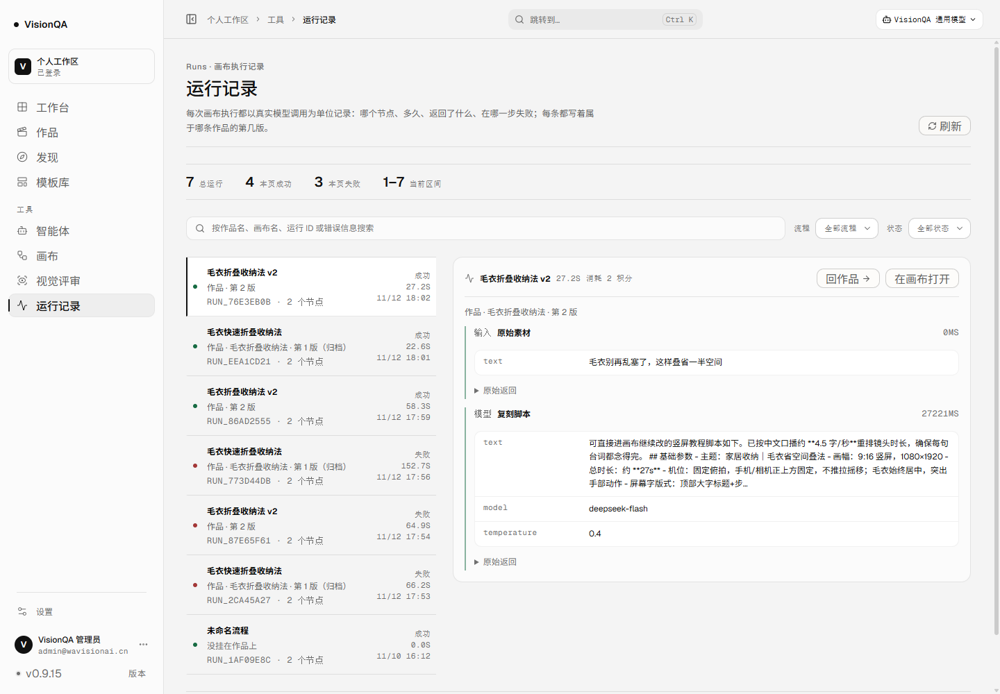
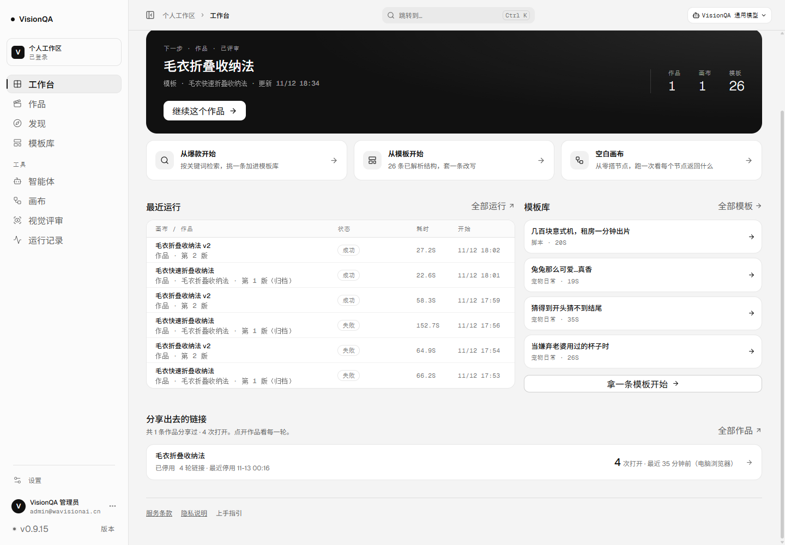
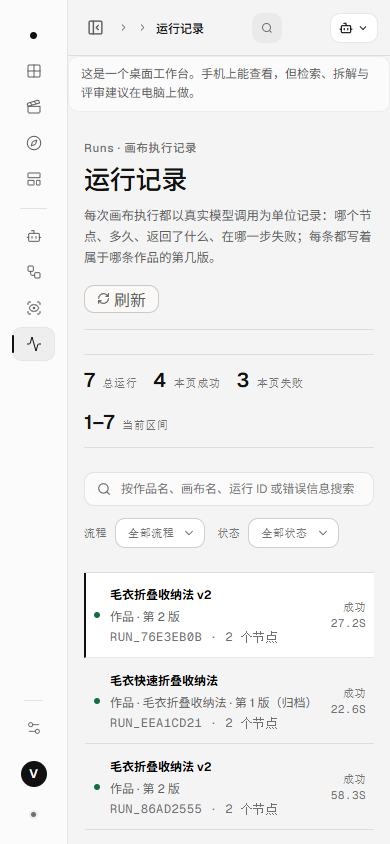

# 运行记录认得作品了（v0.9.15）

结论：**运行记录页每条运行下面多一行「作品 · 第几版」，详情页头多一个「回作品」。**
空白画布直接跑的写「没挂在作品上」，归档版本的运行标「（归档）」。搜索框现在也能按作品名
搜到运行——画布改过名之后照样找得到。工作台「最近运行」同一行、同一口径。

## 一、为什么做这一片

运行记录只记 `flowId`（画布在流程服务里），页面上写的是画布名。从作品开画布时画布名自动取
作品标题，所以看着像认得出；但只要改过名、或者一条作品开过两版，就分不清了：

| 画布名（运行记录里原本只写这些） | 其实是 |
| --- | --- |
| 毛衣折叠收纳法 v2 | 作品「毛衣折叠收纳法」第 2 版（当前） |
| 毛衣快速折叠收纳法 | 同一条作品第 1 版（已归档） |
| 未命名流程 | 不属于任何作品，空白画布直接跑的 |

反方向早就通了：作品页有「运行记录」区块（v0.2.4），当前版与归档版的运行合成一条时间线。
缺的是回来那一步——在运行记录里看见一条两点的失败，没有路回到「是哪条作品、哪一版」，
只能自己去作品列表里挨个点开。

## 二、现在长什么样

- 列表每一行三行：**画布名 / 作品与版次 / 运行 ID 与节点数**。第二行是这次新加的。
- 画布名里**已经带着**作品标题时，第二行只写版次（「作品 · 第 2 版」）——同一行把标题抄两遍
  是重复；画布被改过名才补上作品名（「作品 · 毛衣折叠收纳法 · 第 1 版（归档）」）。
- 归档那一版的运行标「（归档）」，不会被当成当前这一版。
- 空白画布直接跑的运行写「没挂在作品上」：这不是错误，只是没作品。
- 详情页头右侧两个动作：**回作品** / 在画布打开；详情里写全「作品 · 标题 · 第 N 版」。
- 搜索框：按**作品名**、画布名、运行 ID、错误信息都能搜。

生产截图（1440 / 390，真实数据：7 条运行、1 条作品）：







## 三、三个实现决定

1. **现算，不落库。** 运行记录里不加 `projectId`。作品那侧已经存着两张画布指针
   （当前版 `flowId` + 归档 `versions[].flowId`），反过来建一次索引就够了。
   复制一份到运行上，之后改作品名、开新版就得两地同步，迟早一处是旧的。
2. **列表只加一个字段。** `/api/runs` 每条多 `project: { id, title, version, archived } | null`，
   不带脚本、不带分享凭证、不带节点输出；单条 `/api/runs/:id` 用同一口径，页面不用两处判断。
3. **搜索走“补充命中集”。** `listRuns({ flowIds })` 只扩大**关键词**的命中范围，
   归属过滤、状态筛选、按画布筛选一条都没动。这样画布改名之后，搜作品名仍然命中；
   原来按画布名搜索的行为也不变（两条路都在，命中集取并集）。

## 四、生产实测（2026-11-13）

| 项目 | 结果 |
| --- | --- |
| 版本 / 入口 | v0.9.15 / `index-DBbjP6fs.js` |
| release 快照 | `20261112-164329-v0.9.15.tar.gz` |
| `/api/health` | ok，templates 26 |
| 服务 | `visionqa` / `visionqa-internal` 均 active |
| 服务端文件 | `flows.mjs` `a532a7ca…`、`routes/flows.mjs` `99ea472a…`、`run-ownership.mjs` `9477addb…`、`index.mjs` `5591bf1e…` 与本机一致 |
| `/api/runs` | 7 条：4 条第 2 版（当前）、3 条第 1 版（归档）、1 条 `project: null` |
| 单条 `/api/runs/:id` | 同样带 `project` |
| 搜索「毛衣」 | 命中 6 条（第 7 条是「未命名流程」，不命中是应该的） |
| 1440 | 列表宽 360px、单行 85px、详情 746px，`scrollWidth == clientWidth` |
| 390 | 单行 290px、行高 85px，三行不换行、无横向滚动 |
| 工作台最近运行 | 1440 行高 46px、390 行高 61–77px |

## 五、边界（说清楚，不含糊）

- **一张画布只挂一条作品**：同一张画布被两条作品绑过时（复制画布后手动绑过），取「当前版优先、
  再看最近改动」的那条；页面不会同时写两个作品名。
- **只看自己看得到的作品**：归属规则与作品列表一致（管理员看全部，未登录本地演示不隔离）。
- **运行记录本身不改**：不迁移、不补 `projectId`，历史运行的归属是算出来的；删掉作品之后，
  它的运行会变成「没挂在作品上」——运行记录不跟着消失，这是 v0.2.4 起就有的口径。
- **搜索是纯包含匹配**：不做拼音、不做模糊、不搜脚本内容。
- 运行记录最多 60 条、列表每页 12 条的轮转与分页不变。

## 六、复现

```bash
# 本地：空数据目录 + 一份数据即可看效果（不需要模型调用）
DATA_DIR=.tmp/demo node server/index.mjs
npm run dev        # 打开 #/runs

# 生产
curl -s -H "cookie: vq_session=$TOKEN" https://visionqa.wavisionai.cn/api/runs?limit=8 | jq '.items[].project'
```

## 七、涉及文件

- 新增：`server/run-ownership.mjs`（画布 → 作品索引、逐条挂载、按作品名找画布）、
  `src/domain/run.ts`（版次与「作品 · …」文案全站一处）、
  `test/run-ownership.test.mjs`（5 条）、本文件与三张截图。
- 改动：`server/flows.mjs`（`listRuns` 的 `flowIds` 补充命中集）、
  `server/routes/flows.mjs`（列表与单条都挂 `project`）、`src/api/flows.ts`（`RunProjectRef`）、
  `src/pages/RunsPage.tsx`（第二行、回作品、搜索提示）、`src/pages/OverviewPage.tsx`（第二行与列名）、
  `src/App.tsx`（传 `onOpenProject`）、`src/styles/runs.css`。
