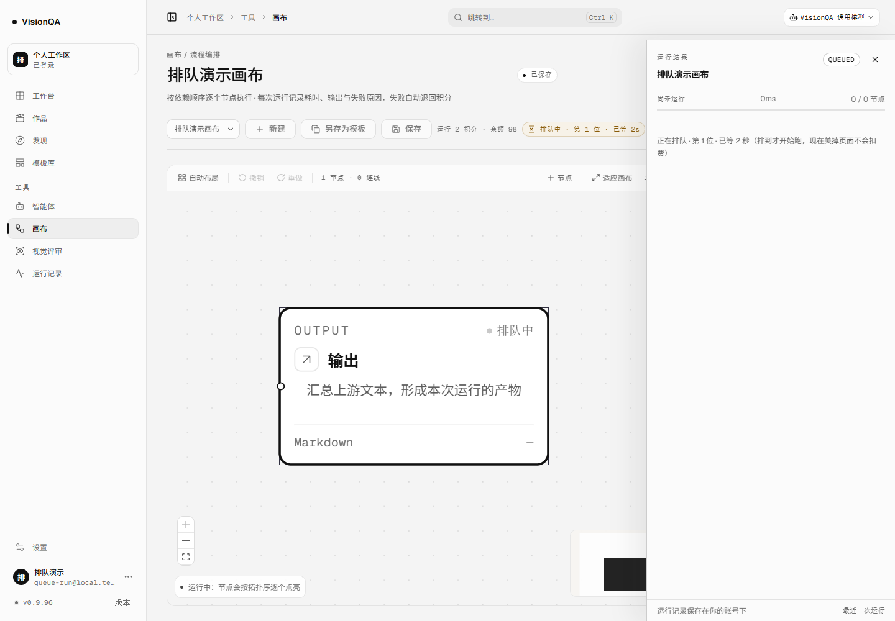
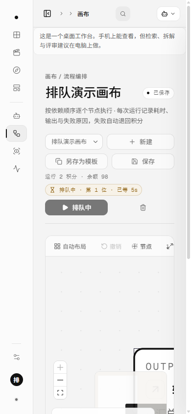

# 画布运行也能排队：名额满时进整机一条队（v0.9.96，2026-11-14）

> 目标：运行一条流程是这里最重的一件重活（默认 3 积分一次，要下载并分析多张图），
> 撞上整机 3 条重活上限时不该只回一句「服务器正忙」。
> 相关：[评审也能排队](./review-queue-2026-11-14.md)、[画布出图的排队位](./canvas-queue-visible-2026-11-14.md)

## 一句话

v0.9.96 起，运行和画布出图、评审共用同一条整机排队位：名额满时先排着（默认每条最多等 60 秒、最多 4 条同时排），
排到才占名额、才扣积分、才跑流程；画布顶栏显示「排队中 · 第 N 位 · 已等 X 秒」，运行抽屉同时把状态写成 QUEUED，
并说清「排到才开始跑，现在关掉页面不会扣费」，排到后运行结论里补「排队 N 秒后开始」。

## 为什么

| | 画布出图（v0.9.80 起） | 评审（v0.9.95 起） | 运行（v0.9.79 ~ v0.9.95） |
| --- | --- | --- | --- |
| 名额满时 | 先排队，排到照常生成 | 先排队，排到才扣费 | 立刻 503「服务器正忙」 |
| 用户看到 | 「第 3 位 · 已等 8 秒」 | 「第 N 位 · 已等 X 秒」 | 一条错误提示，自己再点一次 |
| 等待上限 | 90 秒 / 8 条 | 60 秒 / 4 条 | 无 |
| 口径 | v0.9.93 起跨进程（整机一条队） | 同一份 | — |

运行本来就是「点下去、看着节点逐个点亮」的动作，等得起这一档；名额满时把它推回给用户重试，
是把一次没花钱的等待变成一次失败的点击。

## 做法

1. **配置再多一段**：`config.credits.runQueue`（`VQ_RUN_QUEUE_MS` 默认 60000、`VQ_RUN_QUEUE_MAX` 默认 4），
   画布出图（90000 / 8）与评审（60000 / 4）一个字没动；写 0 就退回立刻拒。
2. **`waterline` 三类各读自己那一段**：`QUEUE_CONFIG` 加 `flow_run`，`queueLimitsFor` 仍然按类型取；
   复刻（`replicate`）保持 0——它没有「用户在页面上等着」这一层。
3. **文案按类型说**：运行是「这次运行没有开始（没有扣积分）……等这条流程跑完再试」，
   不借用画布出图的「少发几张」，也不借用评审的「先把这一版改一改」。
4. **`POST /api/flows/:id/run` 从 `admit` 换成 `admitWaiting`**：先登记再试名额；
   排队期间不扣费、不跑流程、不碰上游；排到之后才 `charge` → `runFlow`。
5. **票号**由页面生成（`crypto.randomUUID`），放 `X-VQ-Queue-Ticket`；共享目录里只存 sha256 前 16 位。
6. **排到时**：响应头带 `X-VQ-Queue-Position` / `X-VQ-Queue-Waited-Ms`；
   流式响应的**第一条**是 `{"type":"run-queue","position":N,"waitedMs":M}`，之后才是 `run-start`；
   非流式响应体多一个 `queue: { position, waitedMs }`。
7. **新增只读 `GET /api/runs/queue?ticket=`**（与 `/api/review/queue` 同一个 `waterline.queueView`）：
   整机的 waiting / oldestWaitMs + 我的 position / ahead / waitedMs；票号只进不出。
8. **界面**：顶栏胶囊「排队中 · 第 N 位 · 已等 Xs」+ 主按钮同刻写「排队中」；
   运行抽屉的状态胶囊写 **QUEUED**，空状态写「正在排队 · 第 N 位 · 已等 X 秒（排到才开始跑，现在关掉页面不会扣费）」；
   排到之后抽屉元信息补「排队 N 秒后开始」。
   间距只用 8px 级、圆角 `--radius-pill`、颜色只用 tokens（`--warn` / `--warn-soft` / `--line`），和画布出图那颗胶囊同一套做法。

## 证据 A：本地（真进程 + 共享租约目录，零上游调用）

一次性栈：本地实例 8921（生产口径、要登录）、同一个 `DATA_DIR` 与租约目录；另一个进程在共享目录里占满整机 3 条重活名额。
画布只有一个 `output` 节点（不发任何上游请求）。

| 动作 | 读数 |
| --- | --- |
| 空闲 | `waitMs 60000 · maxWaiting 4 · waiting 0 · scope lease` |
| 发起运行（票 e2e-a），名额仍被占着 | `position 1 · ahead 0 · waiting 1 · waitedMs 1602`；余额 **100 没动**；运行记录已落盘（status running） |
| 放掉名额 | 200（1776ms）；`X-VQ-Queue-Position: 1`、`X-VQ-Queue-Waited-Ms: 1760`；第一条事件 `run-queue {position:1, waitedMs:1760}`，之后 `run-start → node-start → node-end → run-end` |
| 跑完 | 运行 status `success`、`durationMs 2`；`credits { cost: 2, refunded: false, balance: 98 }`；余额 **100 → 98**，只扣一次 |
| 排队位收尾 | 我的票 `position: null`、`waiting 0`、`served 1` |
| 排队中关掉页面（票 e2e-abort，等了 1.2 秒后 abort） | 队里清零（`position null · waiting 0`）；余额 **98 没动**；运行记录条数 **1 → 1**（占位记录被撤掉） |

另有 9 条自动化用例（`test/flow-run-queue.test.mjs`）盯住：默认参数、排到才占名额、两张票先来先到、
排队位满（文案说「运行」不说「生成」）、等超时（503 不扣费不占名额）、客户端断开（499）、
关掉排队立刻拒、`GET /api/runs/queue` 的口径与「票号不回声」、以及路由层「排队期间不扣分、响应头带名次、流首条是 run-queue」。

## 证据 B：生产只读

> 登录门内的读接口（`GET /api/runs/queue`）用服务器本机一次性会话读了一次（等于登录一次，读完立刻销毁；
> 未改任何业务数据，票号与会话 token 都不落日志），所以这一格是真实响应，不是照代码推断。

部署 `20261114-032136-20261114-112100-r106-run`，两个实例都是 **0.9.96**：

| 项 | 8799（对外） | 8800（内部版） |
| --- | --- | --- |
| `/api/version` | `0.9.96 VisionQA` | `0.9.96 creator-canvas-studio` |
| 入口 | `index-BoDTNJr0.js` · 200 · **569,550 B** | 同一份 dist |
| `GET /api/runs/queue`（登录态） | `waitMs 60000 · maxWaiting 4 · scope lease · waiting 0 · position null` | 同一份代码同一个目录；这份会话 cookie 在 8800 上无效（两个 unit 的会话密钥不同），这一格只有 8799 的实测 |
| 单元 | `visionqa.service` active（User=visionqa） | `visionqa-internal.service` active（User 空 = root） |

线上模块与本地逐字节一致：``waterline 856b9656`、`routes/flows 0dfa32cf`、`routes/review 8f1b043d`、`config 403c6615`、`wait-queue 76c95733``。
三个 unit 都在 active；盘 72%（27G / 40G）。

## 截图

## 坑（六条）

1. **等超时的拒绝会缺 status**（v0.9.95 就潜伏着）：`admitWaiting` 的 timeout 分支是 `{ ...last, ... }`，
   而 `last` 上一轮可能停在「前面还有人，这轮让出去」那一支（只记 `ahead`，没有 status）。
   这时调用方拿到的拒绝没有状态码，`sendJson(res, undefined, …)` 会把响应写坏。
   v0.9.95 的两实例验收恰好每次都从 `admit` 那一支进入，所以没撞上；这一轮的等超时用例一跑就露了。
   修法：timeout 分支显式写 `status: 503` 与 `lease: null`。
2. **前端会丢弃已移除的节点类型**：`fromFlowNodes` 只留 `input/llm/kb/tool/condition/output`，`review` 这类旧节点加载时被丢掉。
   拿 `review` 节点造演示画布，画布会显示「0 节点」，点运行直接提示「画布还没有节点」——排队根本没发生。
   演示数据要用仍在编的种类；这次换成单个 `output` 节点（顺手保证零上游调用）。
3. **同 hash 的 `Page.navigate` 不重新加载**：截图脚本第二次进同一页，状态还是上一次的（0 节点），
   先 `about:blank` 再进入才拿到新数据。
4. **运行抽屉会盖住顶栏右半**：1440 宽、抽屉打开时，「排队中」按钮在抽屉下面，胶囊右缘也被压住。
   所以排队名次要同时写进抽屉（QUEUED + 一句「正在排队 · 第 N 位 · 已等 X 秒」），
   截图也给抽屉开着的真实状态——用户等的时候眼睛本来就在抽屉里。
5. **测试里放掉名额后要等头名真的排到**（≤ 2 秒）再收尾：等 50ms 就收尾，那条 waiter 会以「还在等」的样子留在队里，
   把后面几条用例的名次全挤后一位（v0.9.93 那组排队用例是同款教训）。
6. **票号是凭据**：`/api/runs/queue` 的响应里不带票号，只有名次与等待时长；用例直接断言 JSON 里不含票号字符串。

## 发现但没做

- **排队中还没有取消按钮**：关掉页面就退队（实测不扣费），但页面上没有「不等了」的显式出口。
- **不给 ETA**：前面可能排着画布出图或评审，隔着不同任务估时就是编数字。
- 轮询 1.2 秒、一次只问自己那张票；票号绑账号，不绑标签页（两个标签页会各排各的）。
- **运行记录在排队期间仍是 `running`**（还没有独立的 `queued` 状态）：页面抽屉写 QUEUED，运行记录列表还显示「运行中」。
- 排到之后仍要过**账号并发闸门**（同一账号第 2 条运行 429 `CONCURRENCY_LIMIT`）：拦在扣费之前，钱不扣；
  这一条是「排到才拒」，和排队位不是同一层。
- 仍然只跨进程不跨机器（同一台机器的共享目录）；多机计数是 B2 的最后一项。
- 评审缩图前后一致性仍缺一次真实评审授权。

## 回退

- 只关运行这一档：`VQ_RUN_QUEUE_MS=0`（或 `VQ_RUN_QUEUE_MAX=0`）→ 退回 v0.9.95 的立刻 503，画布出图与评审不受影响。
- 整版：`bash /opt/visionqa/ops/rollback.sh --to 2`（v0.9.95），无 schema、无配置改动。

## 数字

- 测试 **882/882**（新增 9 条；另改 3 条旧断言——`waterline` / `gateway-queue` / `review-admission-queue` 里那句「运行不排队」）。
- oxlint **0 error / 15 warning**；`tsc -b` 干净；构建入口 **index-BoDTNJr0.js**（**569,550 B**）；密钥扫描 **631 文件 / 0 命中**。
