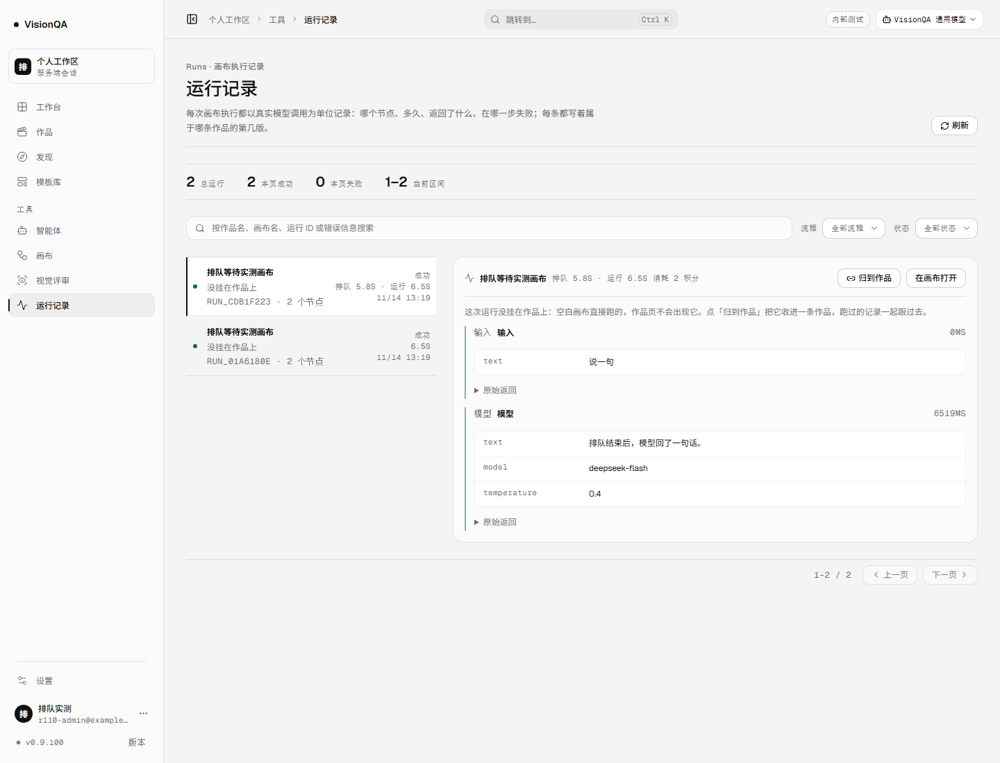
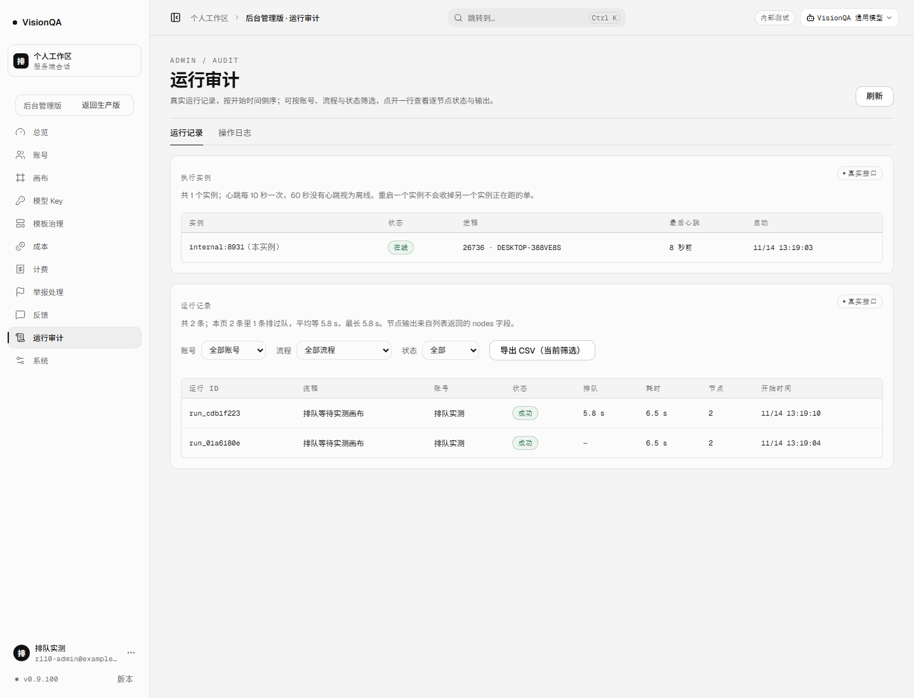
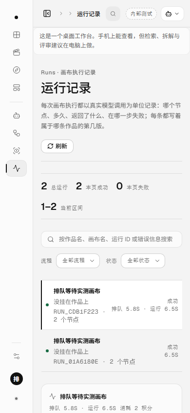

# 排队等了多久，跑完还查得到（v0.9.100，2026-11-14）

## 问题：代码已经算出了等待时长，然后把它扔了

v0.9.96 运行开始排队时，页面会写「排队 6s」；v0.9.98 起占位记录也有 `queuedAt`。但一条运行跑完之后，记录上只剩节点耗时：

- 用户在外面等了 5.8 秒，运行详情写「6.5s」——看起来像只跑了 6.5 秒，等待凭空消失。
- 后台按耗时排查「为什么慢」时，只能看到执行时间，看不到排队在拖谁。
- 更具体的浪费：`markRunStarted()` 在排到名额、扣完费之后**已经算好了** `queuedMs`（`server/flows.mjs`），但 `runFlow()` 会用自己造的对象覆盖同 id 的占位记录，终态对象里没有这两个字段——算完就丢。

这和 v0.9.99 的 `ownerInstance` 是同一类坑：**占位记录上的字段，必须在覆盖时显式带过去**。这一轮把这条链路补完，并把等待放回三个界面。

用户能直接看到的变化：

- 运行记录列表 / 详情：跑完的记录写「排队 5.8s · 运行 6.5s」；没排过队仍只写「6.5s」。
- 作品页的运行归集：多一段「排队 5.8 秒」，看一条作品跑过几次时不用再猜。
- 后台「运行审计」：表格多一列「排队」；顶部写明「本页 N 条里几条排过队、平均等多久、最长多久」；CSV 多一列「排队 ms」。
- 1 秒以内的等待不写成「排队 0.0s」——那只是占位记录到扣费之间的 20–30ms，不是用户真的在门口等；原始毫秒仍留在记录与 CSV 里。

## 做法

1. **终态记录接住占位字段**（`server/flows.mjs`）：`runFlow()` 在构造运行对象之前先按 `runId` 读一次占位记录，把 `queuedAt` / `queuedMs` 写进终态对象。只改这一个函数：路由、流式与非流式、成功与失败都走同一条。
2. **摘要也要带**（`runSummary()`）：作品页与运行记录读的不是同一条查询，摘要漏字段会让作品页单独失去等待时长。
3. **前端一个口径**（`src/domain/run.ts` 的 `runSpentText()`）：运行记录列表、详情头、作品页共用；HTTP 返回的毫秒是原始数，展示只在 ≥1s 时提等待。
4. **后台按页统计，不冒充全量**：平均 / 最长只算当前加载的 50 条，文案写「本页」；要全量趋势得另做服务端聚合，这一轮没做。
5. **CSV 存真**：导出保留 `排队 ms` 原始值，表格与页面才做 1 秒门槛与四舍五入。

字段与显示口径：

| 场景 | 记录 `queuedMs` | 页面 |
| --- | --- | --- |
| 没排队 | 0 / 缺省 | 只写「运行 6.5s」 |
| 占位 25ms 就进门 | 25 | 不写排队（原始数仍在接口 / CSV） |
| 真排队 5.8s | 5842 | 「排队 5.8s · 运行 6.5s」 |
| 升级前旧记录 | 缺省 | 只写运行耗时，不拿 `startedAt` 反推 |

## 本地实测（零真实上游）

环境：本机 8931，假 LLM 延迟 6.5 秒；`VQ_GLOBAL_HEAVY=1`（整机只留一条重活名额），同一账号先后点两次运行；数据在 `.tmp-qa/r110`。

| 运行 | 排队 | 运行 | 时间线 |
| --- | --- | --- | --- |
| `run_01a6180e` | 25ms（进门） | 6538ms | 13:19:04.273 开始 → 13:19:10.811 结束 |
| `run_cdb1f223` | **5842ms** | 6520ms | 13:19:05.151 开始等 → 13:19:10.994 才开跑 → 13:19:17.514 结束 |

- 两条记录都 `success`；第一条结束（10.811）早于第二条开跑（10.994），排队确实发生在门口，不是并发跑。
- 假上游只被调用 **2** 次：排队期间没有提前打模型。
- 页面实测文字：`排队 5.8s · 运行 6.5s`；后台摘要：`本页 2 条里 1 条排过队，平均等 5.8 s，最长 5.8 s`，另一行排队列显示 `—`。
- 390 宽：`scrollWidth 390 = clientWidth 390`，行、详情、按钮都在画面内。

## 测试

- 扩展 `test/flow-run-queue.test.mjs` 的路由用例：排到后从 `run-end` 与落盘记录两处核对 `queuedMs >= 150`、`queuedAt` 存在、`startedAt >= queuedAt`。
- 新增一条纯函数用例：`runSummary()` 保留 `queuedMs`；旧记录缺字段时写 0。
- 全仓 **900/900**（+1 条新用例；原有路由用例增加了断言），oxlint 0 error / 15 warning，`tsc -b` 干净。

## 生产（v0.9.100）

| 检查 | 读数 |
| --- | --- |
| 发布标签 | `20261114-133000-r110-queue-wait`；快照 `/opt/visionqa/releases/20261114-052804-20261114-133000-r110-que.tar.gz` |
| 两个 unit | `visionqa` active · `visionqa-internal` active |
| 版本 | 8799 / 8800 都 **0.9.100**；公网 `/api/version` 0.9.100 |
| 入口 | `index-B01dXERS.js` 200 · **571,904 B**；旧 `index-pf_kUpu9.js` 404 |
| 后台 chunk / 样式 | `AdminConsolePage-Da6YCQ1K.js` 201,076 B；`index-cGfb30jh.css` 275,109 B |
| 文件一致 | `flows.mjs ec962b5c` · 入口 `882d577d` · 后台 `b592fbc2` · 样式 `3ce4fed3`，与本地一致 |
| 心跳 | `public:8799` pid 1477771 · `internal:8800` pid 1477769，各自数据目录 |
| 盘 / 临时文件 | 72%（27G/40G）；`/tmp` 的发布包与临时目录已清 |

**诚实说明**：生产这次没有真实运行（零授权上游），所以线上还没有一条「排过队」的新记录可以展示；生产验证的是版本、入口、文件一致、两个实例健康。排队等待的线上效果来自本地两个真进程 + 假上游，以及路由级用例。

## 坑

1. **`runFlow` 覆盖占位记录**：`queuedMs`、`queuedAt`、`ownerInstance` 都只在占位对象上，覆盖时不带走就永远丢。这一轮先读占位记录再构造终态，治的是根，不是再在路由补一次。
2. **不能把 25ms 写成「排队 0.0s」**：占位到扣费之间本来就有几十毫秒；页面必须设显示门槛，否则每条运行都像排过队。
3. **摘要是一条单独的序列化边界**：`runSummary()` 不补 `queuedMs`，作品页就会单独看不到等待——接口和运行记录页都正常，最难发现。
4. **后台统计只能说「本页」**：页面只加载 50 条，写成「全部」就是假话；要全量得另做服务端聚合。
5. **`formatDuration(0)` 是「0 ms」不是「—」**：表格要显式判断，不然没排队的运行会显示 0 ms。
6. **旧记录没有这个字段**：不能拿 `startedAt - createdAt` 反推，终态记录根本没存 `createdAt`；没有就写「只跑了多久」。
7. **CSV 与页面口径不同是故意的**：CSV 存原始毫秒，页面做 1 秒门槛与四舍五入；两边都能解释。
8. **改完前端必须重新 build 再截图**：这一轮截图前重新 build 了两次（中间修过一次可选字段类型报错，最后又因 1 秒门槛重建了一次），截图里页面底部版本号是 0.9.100，和线上一致。

## 发现但没做

- **不给 ETA**：运行、画布出图、评审共用一条整机队但耗时差异很大，按历史均值估一个秒数就是编数字；这一轮只记录已经发生的等待。
- **交付稿 / A4 打印稿的运行表还只写耗时**：`project-deliverable.mjs` 里没有排队列；作品页看得到，交出去的纸还看不到。
- **评审 / 画布出图的等待没有进各自记录**：这轮只补运行记录；两类任务仍是「等过但没留档」。
- **历史记录不能回填**：v0.9.100 之前的运行没有 `queuedMs`，页面不反推。
- **后台没有跨页 / 按时间段的排队趋势**：只有当前页的平均与最长。
- 排到之后的真中断、票号绑账号、跨机器仍没做。
- 生产没有真实运行授权，线上排队效果未实测。

## 回退

`bash /opt/visionqa/ops/rollback.sh --to 2` → v0.9.99。无 schema、无接口破坏：`queuedMs` 是新增可选字段，旧前端忽略；`runFlow` 读占位记录只多一次内存缓存读取，旧版本不认识这个字段也不会受影响。
