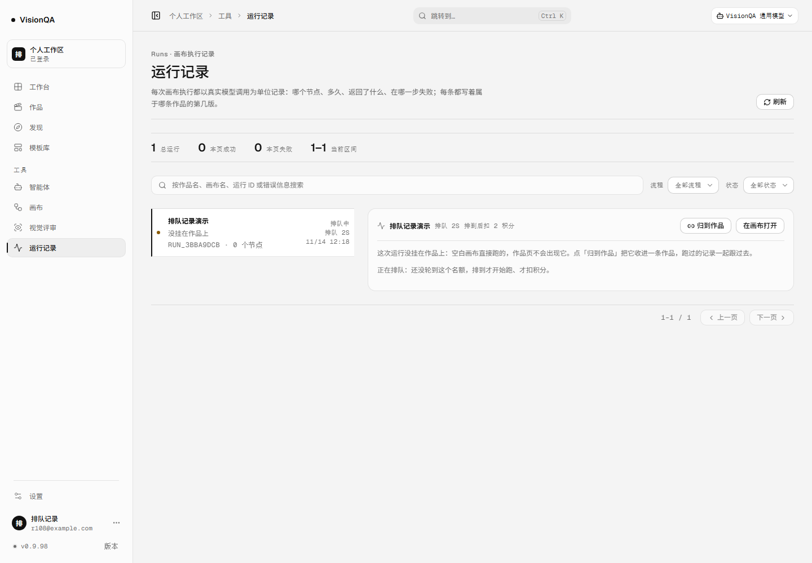
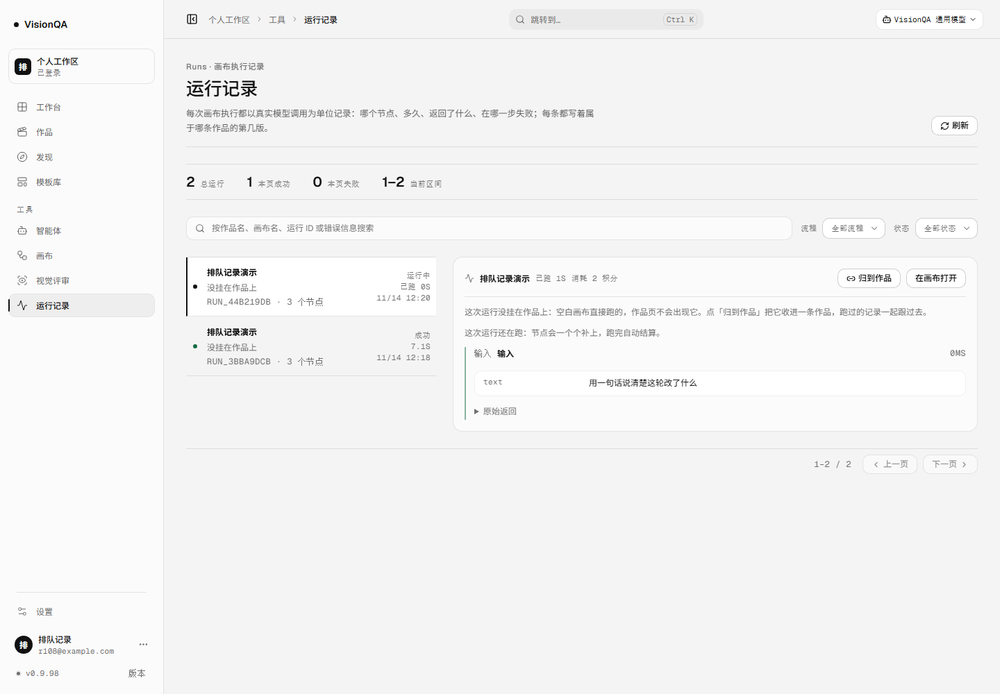
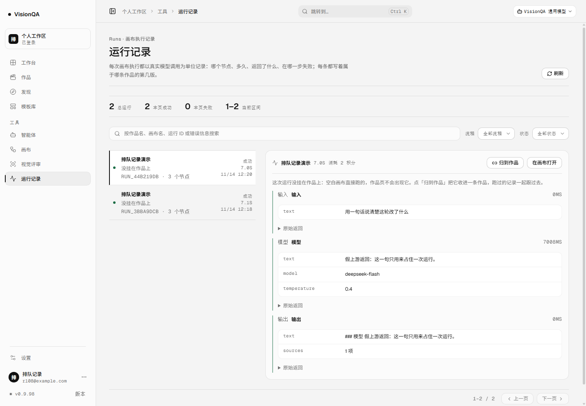
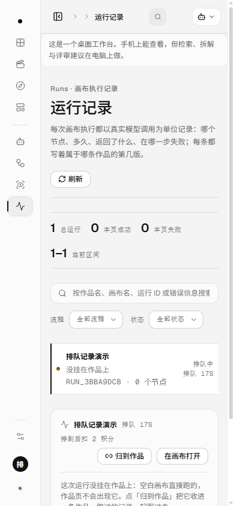

# 运行记录不再把「排队中 / 运行中」说成失败（v0.9.98，2026-11-14）

## 为什么

v0.9.96 起画布运行也能排队，v0.9.97 起排错了可以自己退出来。但运行记录这一页一直没跟上：

- 运行一开始就把记录写成 `running`，哪怕它还在队里等名额；
- 运行记录页把所有「不是成功」的状态都画成红点 +「失败」，还补一句「这次运行失败了，积分原路退回」。

于是排队那 60 秒里，一条**一分钱没扣、一步没跑**的等待，在页面上看起来像已经失败并退了钱。
正在跑的那条也一样。数据是对的，页面在撒谎；这轮把这一页改成说实话。

## 改了什么

1. **记录先落「排队中」**：`startFlowRun` 多一个 `queued` 选项，写 `status: 'queued'` 与 `queuedAt`（从哪一刻开始等，页面据此算「排队 12s」）。本地演示（无账号、不排队）仍是 `running`。
2. **排到、扣完费立刻翻「运行中」**：`markRunStarted` 把 queued 翻成 running，记下开始时间与排队时长；已经翻过的记录不再改开始时间。为什么不等 `runFlow` 自己落盘：扣费已经发生，进程若在这两步之间被杀，启动恢复只能按记录状态判断——记录还写着 queued 就会被当「没花过钱」清掉，账对不上。
3. **路由两条路径都翻**：流式（SSE/NDJSON）与普通 JSON 运行都在扣费成功后、执行之前翻状态。
4. **启动恢复认排队单**：`recoverInterruptedRuns` 对 queued 记录先按账本净额退一次（正常为 0，极端时序才真退），再撤掉记录，不留一条永远「排队中」的行；running 记录照旧标中断并退款。
5. **放弃运行认排队单**：`abandonRun` 对 queued 同样标失败、退款，不会把它留在排队状态。
6. **状态文案全站一处**：新的 `runStatusMeta` 统一定义「成功 / 运行中 / 排队中 / 已中断 / 失败」的颜色与说明，运行记录页的行与详情、工作台「最近运行」、后台审计三处都读它（后台另有一个更全的状态表，补了 queued）。
7. **在跑的行会自己跟上**：运行记录页只要当前页有 running / queued 的行，就每 3 秒安静刷新一次——不整页重载、不把选中项跳回第一条、不闪「读取运行记录…」，跑完自动停。
8. **排队时不说「消耗」**：排队中的详情写「排到后扣 2 积分」；只有真正开始并结束后才写「消耗 2 积分」。

## 本地实测（真进程 + 零真实上游）

环境：本机 `server/index.mjs`（端口 8931）真实进程；假上游 7 秒才回（只为把「运行中」留久一点）；
另起一个进程通过共享租约目录占满整机三条重活名额（真实名额，不是打桩）；全程没有一次真实模型调用。

| 时刻 | 读数 |
| --- | --- |
| 排队中 | 记录 `status: queued`、带 `queuedAt`；页面一行「排队中 · 排队 2s · 排到后扣 2 积分」+「正在排队：还没轮到这个名额，排到才开始跑、才扣积分」；统计里成功 0 / 失败 0；余额 100 一分没动 |
| 失败筛选 | `GET /api/runs?status=error` 不命中这条排队单（它没失败，也没退过钱） |
| 排到之后 | 页面同一行变「运行中 · 已跑 0s · 消耗 2 积分」，输入节点已经出现在详情里；另一条更早的运行仍是「成功 7.1s」 |
| 同一张页面 9 秒后（不刷新） | 两行都是「成功」，详情 7.0s、三个节点全在；统计「2 本页成功」；余额 96（这次运行扣 2） |
| 排队等到 60 秒上限 | 503 `SERVER_BUSY`：「这次运行没有开始（没有扣积分）：排队等了 60 秒还没轮到。」记录消失、余额不动 |
| 排队中重启服务 | 重启前：1 条 queued + 2 条成功、余额 96；重启后：只剩 2 条成功，余额仍是 96，`/api/runs/queue` waiting 0 —— 启动恢复把这条没扣钱的排队单撤掉了 |
| 390 宽 | `scrollWidth 380`，不横向溢出；行、详情、按钮都在画面内 |

单元/路由用例（`test/run-queued-state.test.mjs`，4 条，零上游）：

1. 排队单先写 queued、带 queuedAt；排到翻 running 且开始时间晚于排队时间；重复翻不改开始时间。
2. 启动恢复撤掉排队单：dropped 1、refunded 0、记录查不到；重复恢复 dropped 0。
3. 极端时序（排队单已扣钱）：恢复 refunded 1、余额原样退回、记录撤掉。
4. 路由层：排队期间列表看得到 queued、失败筛选不命中、余额不动；排到后同一记录 success、只扣一次、队里清零。

## 生产（只读）

发布标签 `20261114-123000-r108-queued-record`，快照 `20261114-042857-20261114-123000-r108-que.tar.gz`。

| 项 | 读数 |
| --- | --- |
| 两个 unit | `visionqa` active · `visionqa-internal` active |
| 版本 | 8799 与 8800 都回 0.9.98；公网 `/api/version` 0.9.98 |
| 公网入口 | `index-BSqJvpCr.js` 200 · **571,700 B**；旧入口 `index-DRgO9ONA.js` 404 |
| `GET /api/runs/queue`（登录态） | `waitMs 60000 · maxWaiting 4 · scope lease · waiting 0 · entered 0 / served 0 / timedOut 0` |
| `GET /api/review/queue`（登录态） | 同上 |
| 一次性会话 | 读到后 `POST /api/auth/logout` 回 204，同一份 cookie 再访问 `/api/credits` 回 **401** |
| 文件逐字节一致（本机 = 生产） | `flows.mjs 6f7caefa` · `routes/flows.mjs 81c82e48` · 入口 `7a9659bf` · 样式 `3ce4fed3` |
| 盘 | 72%（27G/40G） |
| 服务器 `/tmp` | 部署包与检查脚本已清（0 个 r108 文件） |

回退：`bash /opt/visionqa/ops/rollback.sh --to 2` → 0.9.97 快照 `20261114-035327-…-r107-can.tar.gz`。

## 坑

1. **「记录是 queued 但钱已经扣了」的窗口**：恢复逻辑唯一的判据是记录状态。扣费成功之后拖到 runFlow 才写 running，一旦在这里被杀，恢复会把这条当没花钱的单撤掉，账上就少了 2 积分。所以 `markRunStarted` 必须在扣费成功与执行之间，且要单测极端时序。
2. **runFlow 会用自己造的对象覆盖同一条记录**：排队单翻成 running 后，排队时长（queuedMs）留不到终态记录里；排队时长以路由层推给页面的 queue 事件为准，别指望终态记录里还有。
3. **「非成功 = 失败」是这轮真正的坏味道**：一条记录有三种「没跑完」——排队中、在跑、已中断，语义完全不同；共用一个红点会让「失败 + 已退款」变成假话。
4. **轮询不能复用手动 refresh**：原来的 `load()` 会把选中项跳回第一条并闪「读取运行记录…」。轮询要单独一个安静刷新，保住选中项，失败也不弹错。
5. **排队单写「消耗 2 积分」也是假话**：排队期间一分没扣，文案必须写「排到后扣」。这类文案要跟着状态走，不能只看 `credits.cost`。
6. **启动恢复要按状态分流**：queued 撤、running 标中断退款，两条路径都按账本净额退一次——重复恢复不能多退，这点旧用例已经盯着。

## 发现但没做

- **排到之后的真中断**：要在节点边界停、按已跑部分算账，一条被关掉的连接表达不了。
- **启动恢复分不清「另一个实例正在跑」**：两个生产实例共享 `DATA_DIR`，只重启其中一个时，恢复逻辑会把另一个实例正在跑的记录标成中断并退款（随后跑完又写回成功，等于这次白跑）。真实风险，下一轮用「实例心跳」修。
- 终态记录里没有排队时长（`queuedMs` 只在翻状态那一刻存在）。
- 不给 ETA；票号绑账号不绑标签页；队列仍只跨进程不跨机器。
- 移动端仍是「这是一个桌面工作台」的提示。

## 回退

整版 `bash /opt/visionqa/ops/rollback.sh --to 2`（v0.9.97）。这轮没有 schema 与接口破坏：新增字段全部可选，老前端忽略；服务端对 queued 的处理老数据也读得懂（没有 queued 记录时行为与 0.9.97 一致）。

## 数字

- 测试 **892/892**（+4 条新用例），oxlint **0 error / 15 warning**，`tsc -b` 干净。
- 构建入口 `dist/assets/index-BSqJvpCr.js` **571,700 B**，样式 `index-cGfb30jh.css` 275,109 B。
- 密钥扫描 635 个文件，0 命中。
- 截图四张在本目录：排队（1440 / 390）、运行中、同页结算后。
- 提交 `183338b`（代码、用例、四张截图），CI **43556570789** 三 job 全 success；发布标签 `20261114-123000-r108-queued-record`。
