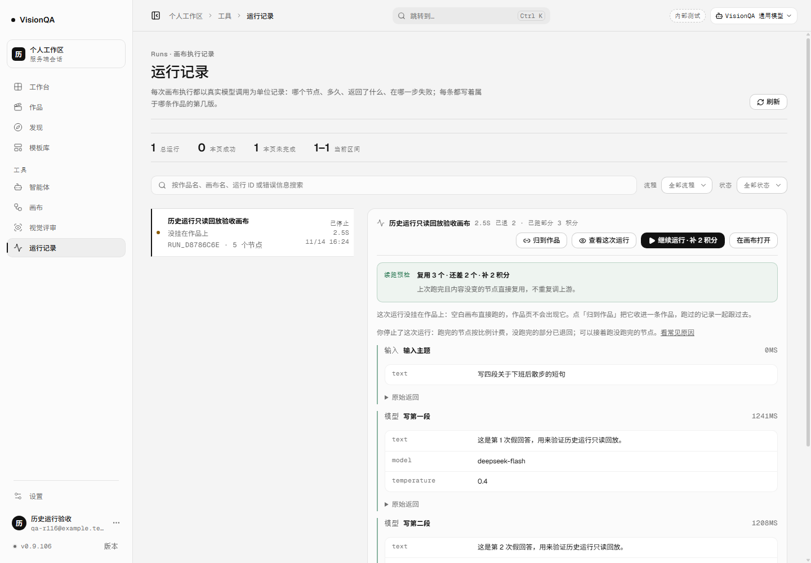
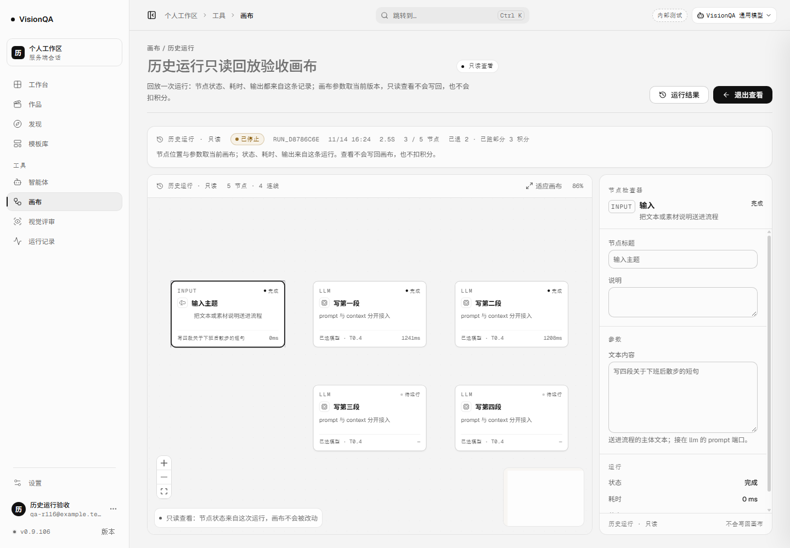
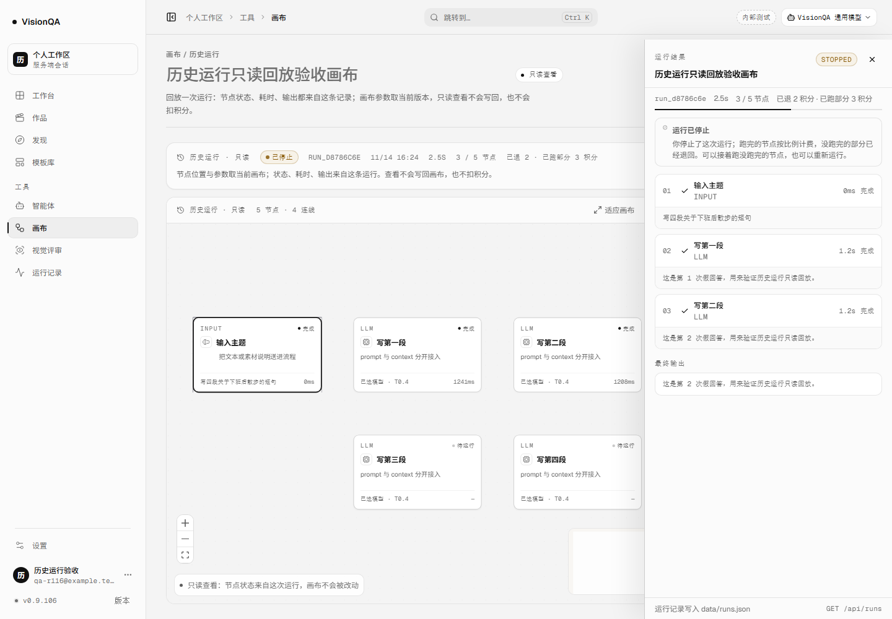
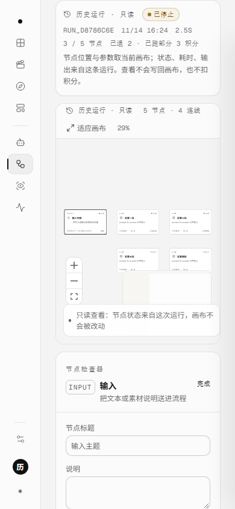

# 回看这次运行，不动现在的画布（v0.9.106，2026-11-14）

## 为什么做

v0.9.104 让「继续运行」可以写进地址 `#/canvas/<flowId>/resume/<runId>`，v0.9.105 又在运行记录页把「还能复用几个、补多少」先算清。但这两个入口都只服务**还能续跑的运行**：

- 运行记录页的详情能逐节点看输出，却看不到节点在画布上的位置与状态；
- 「在画布打开」打开的是**当前**画布，不是这条运行；
- 成功的运行没有续跑按钮，也就没有一种从记录回看画布的入口；
- 如果直接复用 `resume` 地址看一条成功的运行，地址语义会把「查看」和「继续执行」混在一起，用户改一下画布就可能落到另一件事上。

这一轮把「看」和「续」彻底分开：

```text
#/canvas/<flowId>/run/<runId>       只读查看这次运行
#/canvas/<flowId>/resume/<runId>    从这次运行继续跑
```

## 交付

### 运行记录页

选中一条终态运行（成功 / 失败 / 已停止 / 已中断）时，详情动作里出现「查看这次运行」。它和原来的两个出口并列，含义各自独立：

- **查看这次运行**：进画布只读回放，不写画布、不扣费；
- **继续运行**：只有记录说可续、且预检也允许时才出现，进入续跑地址；
- **在画布打开**：打开当前可编辑画布，不打开历史运行。

### 画布只读页

页面顶部先回答「看的是哪条运行」：

- `历史运行 · 只读` 标识、运行状态胶囊、运行 id、开始时间、耗时、节点数；
- 结算摘要（例如「已退 2 · 已跑部分 3 积分」）；
- 一句口径：**节点位置与参数取当前画布；状态、耗时、输出来自这条运行；查看不写回、不扣费**；
- 如果这次运行里有节点已不在当前画布，额外写明「有 N 个节点已不在当前画布」，结果仍可在右侧运行抽屉里查看。

只读模式同时收掉所有会改变画布的东西：

- 页头：不显示运行、保存、新建、另存、删除、流程切换；只留「运行结果」和「退出查看」；
- 画布：不能拖节点、不能连线、不能拖入节点、双击不弹节点面板；只接受选中态；
- 键盘：Ctrl+Z / Ctrl+Y / Delete / Backspace 不改画布；Ctrl+S 只提示「只读查看中，画布没有改动」；
- 右侧检查器：字段用 `fieldset disabled` 整组禁用，底部不给复制 / 删除；
- 保存链路：自动保存 effect 在只读模式直接返回，`saveNow()` 也拒绝写；续跑预检不会在查看页发起；
- 运行抽屉：续跑源与预检都传空，不出现「继续运行」。

「退出查看」回到普通画布地址，App 按模式重新挂载画布，旧运行状态不会挂到编辑态上。

### 地址与路由

- `src/domain/canvas-run-link.ts` 同时负责 `run` 与 `resume` 两种地址的拼装 / 解析；坏链接、缺段、多段、未知模式都退回普通画布。
- 路由的 `viewRunId` 与 `resumeRunId` 分开；`toHash` / `routeKey` 都认识 `viewRunId`。
- 画布页初次加载与 `applyFlow` 都保留 `viewRunId`，刷新、前进后退、从记录页重进都还在同一条运行上。
- App 的画布 key 带「查看 / 续跑 / 编辑」模式：进出只读查看时重挂一次，避免把只读状态或旧运行状态带进另一种模式。

## 本地实测

环境：本地 API 8944 + 假上游 8974；5 节点，前三段每次 1.2 秒、第四段 4.5 秒；零真实上游。

| 检查 | 读数 |
| --- | --- |
| 第一次运行 | 跑到 3/5 时停止；`run_d8786c6e` · interrupted · canceled |
| 结算 | `cost=5 / kept=3 / refundedAmount=2 / settled=true`；查看前后余额都是 **97**；假上游 **3** 次 |
| 运行记录页 | 详情同时出现「查看这次运行」与「继续运行 · 补 2 积分」；点查看后地址 `#/canvas/flow_7ab1b8bf/run/run_d8786c6e` |
| 只读条 | `历史运行 · 只读` / `已停止` / `3 / 5 节点` / `已退 2 · 已跑部分 3 积分` |
| 节点状态 | `完成 / 完成 / 完成 / 待运行 / 待运行`；画布上 5 张卡都在 |
| 抽屉 | `STOPPED`；逐节点输出仍是这次运行的结果 |
| 编辑入口 | 运行流程 / 保存 / 流程切换都不在；检查器 `disabled=true` |
| 只读请求 | 进入查看页没有再发 `resume-plan`（点查看前 1 次、查看后仍 1 次） |
| 画布写入 | 查看期间 `PATCH /api/flows` **0** 次；画布 `updatedAt` 前后一致 |
| 退出查看 | 地址回 `#/canvas/flow_7ab1b8bf`；运行、保存、流程切换都回来；只读条消失 |
| 390 宽 | 只读条与画布工具栏换行，`scrollWidth 390 = clientWidth 390` |

截图：









## 生产实况（2026-11-14）

发布标签 `20261114-163500-r116-vie`（发布脚本截断 31 字符，完整意图 `20261114-163500-r116-view`）；快照 `20261114-083553-20261114-163500-r116-vie.tar.gz` 1,018,437 B。

| 检查 | 读数 |
| --- | --- |
| unit | `visionqa` / `visionqa-internal` / `visionqa.socket` / `bdc-web` 全 active |
| 版本 / 健康 | 8799 / 8800 / 公网都是 **0.9.106**；`/api/health` ok（模板 26，uptime 46s） |
| 入口 | `index-BLZHxoce.js` 200 · **577,823 B**；公网同一文件 200 · 577,823 B |
| 画布 / 后台 / 样式 | 240,467 B / 201,072 B / 276,220 B；画布样式 27,191 B |
| 文件一致 | `flows 6b8d3ed9` / `routes f6236d72` / 入口 `e4f32c43` / 画布 `4b2e737c` / 后台 `b3876415` / 样式 `c3755b30` / 画布样式 `053f2024`，全部与本地一致 |
| 心跳 / 盘 / 临时文件 | 1482139 / 1482135；盘 72%；`/tmp` 清回 351M；近 15 分钟只有 SQLite experimental 提示 |

生产没有真实运行授权，线上没有真实「停止 → 查看 → 退出」记录；生产验证的是版本、入口、文件一致与四个 unit 健康。

## 踩到的坑

1. **不能复用 `resume` 地址做查看**：地址是用户能复制、能刷新、能后退的对象；同一地址如果既能查看又能续跑，页面状态一抖就可能把「看」变成「执行」。
2. **路由解析和页面字段必须同名**：r114 的坑是解析返回 `runId`、页面读 `resumeRunId`，hashchange 后入口被规范化掉；这次把 `viewRunId` 一路命名到底。
3. **App 的 key 要带模式**：只加 `viewRunId` prop、不重挂，退出查看时旧的运行状态与只读分支会留在同一个实例里；key 带 `view / resume / edit`，进出都从头挂。
4. **`applyFlow` 会把地址写回**：初次加载如果不把 `viewRunId` 一起写回，刷新一次只读入口就没了；查看和续跑只能保留一个，不能互相覆盖。
5. **只读不能只靠 CSS**：自动保存 effect、`saveNow`、键盘、拖放、连线、双击面板、运行入口、检查器都要分别关；只把按钮藏起来挡不住 Ctrl+S 和拖拽。
6. **检查器用 fieldset 一次禁用**：逐个给 input / textarea / select / range 加 `disabled` 容易漏；`fieldset disabled` 会传导到全部表单控件，但仍要给禁用态补可读颜色。
7. **React Flow 只留选中态**：`nodesDraggable=false`、`nodesConnectable=false` 还不够，`onNodesChange` 也要过滤掉拖动 / 删除，只放行 `select`。
8. **画布图不是历史快照**：运行记录只存节点结果，没有当时的位置和参数；页面必须明说「位置/参数取当前画布」，不能用现在的内容冒充当时的画布。
9. **当前画布可能少了当时的节点**：节点 id 对不上时不能默默少画；条上写明「N 个节点已不在当前画布」，抽屉仍能看那些结果。
10. **查看页不能发续跑预检**：预览只读运行不需要 `resume-plan`；发了既多一次请求，也容易让人以为这里能续跑。
11. **窄屏工具栏会叠字**：只读标识 + 节点数 + 适应画布 + 缩放，在 390 宽装不下；`justify-content: space-between` 会让两组压在一起，必须在 760 以下 `flex-wrap: wrap`。
12. **E2E 要关上手引导并禁用缓存**：引导弹窗会盖住详情动作；不禁缓存时刷新可能复用上一页的 DOM / 请求计数。脚本先点「关闭引导」，`Network.setCacheDisabled` 后再 reload。
13. **退出后要能看到编辑入口回来**：只断言地址变化不够；脚本同时检查「运行流程 / 保存 / 流程切换」都重新出现、只读条消失。

## 发现但没做

- 只在选中的记录详情里提供查看，没有给列表每一行加「查看」图标；一页 12 行都挂按钮会把列表挤乱。
- 没有保存历史画布快照：只读页的位置与参数仍取当前画布；当前画布已删的节点只能在抽屉里看结果，不能补画回画布。
- 只读页不轮询：从地址直接打开一条还在 `running` 的记录，页面看到的是打开那一刻的快照，不会继续长出新节点。正常入口只给终态运行。
- 没有从只读页直接「继续运行」的按钮；查看与续跑保持两个地址、两个动作，避免只读页变成执行页。
- 没有共享链接、跨实例 / 跨机器回看、iframe 出图 / 视频任务的历史回放。
- 生产仍没有真实运行授权；线上没有真实「停止 → 查看 → 退出」记录，功能证据来自本地真浏览器 + 假上游。

## 回退

```bash
bash /opt/visionqa/ops/rollback.sh --to 1   # v0.9.105
bash /opt/visionqa/ops/rollback.sh --to 2   # v0.9.104
```

这一轮只新增前端路由的一段、运行记录页一个按钮、画布只读分支、检查器禁用态与样式；没有新增接口、字段或 schema。旧前端不认识 `/run/<runId>` 这一段，会把地址退回普通画布打开当前内容，不会白屏。

## 质量

- 全仓 **913/913** 通过（+1：`test/canvas-run-link.test.mjs` 增加查看地址与坏模式用例）。
- oxlint **0 error / 15 warning**（与上一轮同一批基线，无新增）。
- `tsc -b` 与 `npm run build` 干净。
- 本地构建：`index-BLZHxoce.js` 577,823 B；`CanvasPage-Dt0nFjJ-.js` 240,467 B；`AdminConsolePage-Dbp0Sf07.js` 201,072 B；`index-txSBUiKZ.css` 276,220 B；`CanvasPage-DWwXKjc4.css` 27,191 B。
- 密钥扫描 **652 文件 / 0 命中**。
- 提交 `c1bf16c`，CI **43576215738** 三 job 全 success。
