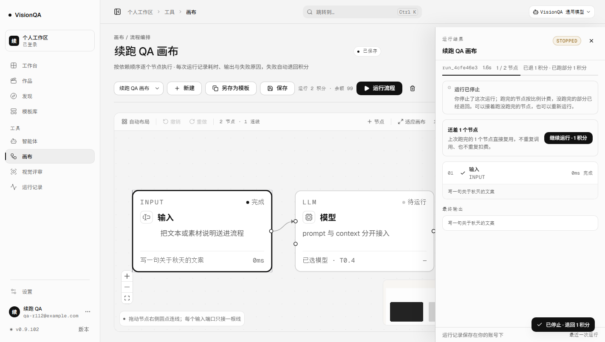
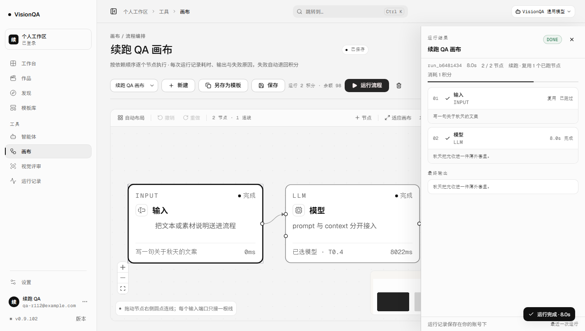
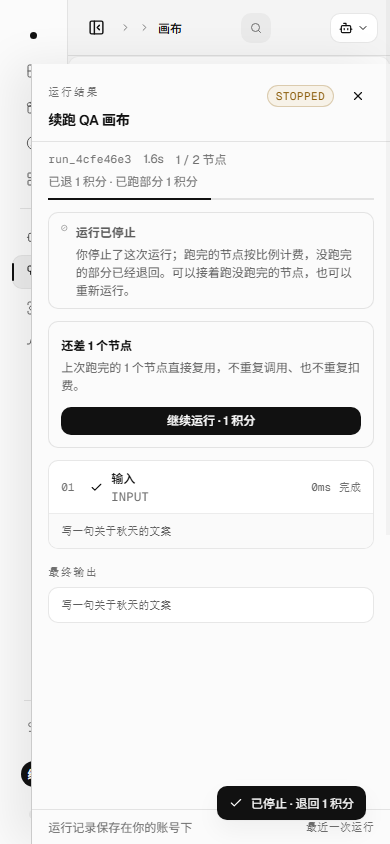

# 停下来的运行，接着跑没跑完的节点（v0.9.102）

## 问题

v0.9.101 让用户能在运行中停下来：当前上游被中止，跑完的节点按比例计费，没跑完的部分退回。
但停完之后只有「重新运行」——它会从头再跑：

- 已经跑完、已经付过钱的输入节点、检索节点、模型节点，会被再次调用上游；
- 用户再付一次整张画布的钱；
- 对于一条 8 个节点、卡在第 7 个的画布，前 6 个节点的钱和时间都白花了。

停下来按节点结算，本来就是在说「跑过的节点值这个钱」。不能从那里接着跑，这句结算文案就只兑现了一半。
这一轮把「接着跑」做成运行抽屉里的一个动作：复用上次已经跑完的节点，只补没跑完的，
只收上次没付过的那部分。没有新页面，没有新表。

## 做了什么

### 1. 一条 resumeOf，复用 /api/flows/:id/run

不新开接口。运行请求体多一个可选的 resumeOf（上次运行的 id），服务端在扣费之前校验：

| 检查 | 不通过时 |
| --- | --- |
| 这条运行存在、属于当前账号 | 404 |
| 它和当前画布是同一条 | 400 |
| 已结束、至少跑完一个节点、还有没跑的节点 | 409 |
| 画布内容指纹与上次运行一致（位置移动不算改） | 409，提示重新运行 |
| 能复用的节点不是 0 个，也不是全部 | 409 |

校验放在扣费前：被拒绝的续跑不会留下占位记录，也不会扣一分钱。

### 2. resumeSeedFor：只复用真跑完的节点

- 只认 success / unsupported；失败节点和它的下游必须重跑。
- 条件节点的分支结果一起带回来，否则续跑会按新上下文重新判断，可能走错已经走过的分支。
- 只认当前画布里仍然存在的节点：画布删了节点，旧结果自然不复用。
- 复用的节点不重新调用上游；结果、输出、条件分支都直接放回运行上下文。

### 3. 画布指纹，防止把旧提示词的结果接到新画布上

flowRevisionOf(flow) 只对节点 id / 类型 / 配置和连线做 SHA-256 前 16 位，不算节点位置。
用户只是挪了一下节点，仍然可以续跑；改了提示词、模型、检索词或连线，服务端拒绝复用。
这比按 updatedAt 判断可靠：保存一次画布会刷新 updatedAt，但内容没变时不该拦。

### 4. 钱：只补上次没付的那部分

- 上次是主动停止：已经按跑完节点结算，续跑价 = 上次原价 − 已留下的 kept。
- 上次是失败 / 服务重启：已全额退回，续跑价按剩下节点占全图的比例收，不按整张画布再收一遍。
- 新运行有自己的运行 id、自己的账本 ref，settled 仍防止终态收尾时再全额退一次。
- 新运行单独记 billTotal / billFinished：复用节点算「已跑完」给页面看，但不进这次计费的分母。

| 场景 | 上次扣/留/退 | 续跑价 | 全部跑完一共付 |
| --- | --- | --- | --- |
| 2 节点，跑完 1 个后停止（2 积分） | 扣 2 / 留 1 / 退 1 | 1 | 2 |
| 2 节点，第 1 个节点失败（2 积分） | 扣 2 / 退 2 | 1（按剩余 1/2） | 1 |
| 4 节点，跑完 1 个后停止（2 积分） | 扣 2 / 留 1 / 退 1 | 1 | 2 |
| 3 节点，续跑中又停（续跑价 1） | 扣 1 / 留 1 / 退 0 | 0（该段已付满） | 上次已付 + 1 |

### 5. 页面：停止之后有下一步

- 运行抽屉在 STOPPED / ERROR 且还有未跑节点时，出现「还差 N 个节点」「上次跑完的 N 个节点直接复用」
  和「继续运行 · N 积分」。
- 复用节点在运行列表里写「复用 · 已跑过」，不显示假的 0ms；时间线仍然按拓扑序。
- 运行元信息写「续跑 · 复用 N 个已跑节点」；运行记录详情写「续跑自 run_x」。
- 如果所有节点都已经有结果才收到停止请求，终态按成功收尾，不再显示 STOPPED、也不再留全部钱。

## 本地实测（零真实上游）

本机 8931 + 假上游 8961（固定 8 秒才回），Chrome headless 真实点击。

| 检查 | 读数 |
| --- | --- |
| 第一次运行 | 运行 1.4 秒后停止；run_4cfe46e3 · interrupted · canceled · 1.6s |
| 节点 | 2 个节点，1/2 跑完；finishedNodes=1；模型节点没有拿到结果 |
| 停止结算 | cost=2 / kept=1 / refundedAmount=1 / settled=true；余额 100 → 99 |
| 续跑入口 | 抽屉「还差 1 个节点」「继续运行 · 1 积分」 |
| 续跑运行 | run_b6481434 · success · 8.0s · resumeOf=run_4cfe46e3 · reusedNodes=1 |
| 复用 | 输入节点标「复用 · 已跑过」；模型节点重新调用，最终输出来自模型 |
| 计费 | 新运行 cost=1 · billTotal=1 · billFinished=1 · 余额 99 → 98 |
| 上游调用 | 整个流程只调了 2 次：第一次 1 次，续跑 1 次；输入节点没有重复调用 |
| 账本 | flow_run -2（source）+ flow_run-refund +1（source）+ flow_run -1（resume） |
| 390 宽 | scrollWidth 390 = clientWidth 390；续跑按钮整行可点，不横向溢出 |

## 生产实测

发布标签 `20261114-143300-r112-resume`；快照 `/opt/visionqa/releases/20261114-063319-20261114-143300-r112-res.tar.gz`（1,012,835 B）。

| 检查 | 读数 |
| --- | --- |
| 四个 unit | `visionqa` / `visionqa-internal` / `visionqa.socket` / `bdc-web` 全 active |
| 版本 | 8799 / 8800 / 公网 `/api/version` 都 **0.9.102** |
| 健康 | `/api/health` ok（模板 26，uptime 21s） |
| 入口 | `index-Dyt6TrgG.js` 200 · **573,264 B** |
| 画布 / 后台 / 样式 | `CanvasPage-B-J7bEYt.js` 234,055 B；`AdminConsolePage-Imb_ZQK4.js` 201,075 B；`index-C09qhU_5.css` 275,246 B；`CanvasPage-Bl8EQwWL.css` 25,441 B |
| 文件一致 | `flows 7dc1eca4` · `routes/flows 1cf6b56d` · 入口 `c37b8129` · 画布 `0d35b917` · 后台 `3cdf0ddf` · 样式 `574a59b5` · 画布样式 `46f87b93`，与本地一致 |
| 心跳 | `public:8799` pid 1479312 · `internal:8800` pid 1479310 |
| 盘 / 临时 / 日志 | 72%；`/tmp` 发布包与临时目录已清；近 10 分钟无 warning |

**旧资源要说真话**：发布目录现在只有新的 `index-Dyt6TrgG.js`，上一版 `index-CVwkH9QU.js` /
`index-B01dXERS.js` 已不在 `dist/assets`。请求旧入口 URL 会得到 **200 + text/html**（729 B 的
nginx SPA 兜底 index.html），这不是旧 JS 还在，也不能当缓存兼容的证据。已经在旧标签页里打开、
不刷新的页面会去请求已经不存在的旧哈希；刷新一次就拿到新入口。前几轮把这 200 读成「合并部署
保留旧哈希」是误判，这轮改正。**诚实边界**：生产没有真实运行授权，线上没有一条真实续跑记录；
生产验证的是版本、入口、文件哈希、实例健康与日志。续跑效果来自本地真浏览器 + 假上游，以及
路由级用例。

## 坑

1. 不能复用失败节点：失败节点的 output 多半是空的，复用它等于把下游建在空气上；只认 success / unsupported，失败节点和下游一起重跑。
2. 条件节点的边要一起复用：只复用节点结果、不恢复 edgeActive，续跑会在条件节点处重新判断分支，可能把上次没走的分支走一遍。
3. 复用节点算「跑完」但不能进这次计费的分母：所以运行记录同时保留 finishedNodes 与 billTotal / billFinished，页面看前者，结算看后者。
4. 不能按整张画布再收一次钱：失败 / 重启是全额退，续跑按剩余节点比例收；主动停止按「原价 − kept」补。两条路径分开算，是这一轮最容易写错的地方。
5. 不能只按 updatedAt 判断画布变没变：保存一次画布就刷新时间，但只挪了节点位置时，旧结果仍然有效。用内容指纹，并忽略位置。
6. 续跑前页面还会保存一次画布：保存会刷新 updatedAt，也会走一遍 normalize；指纹必须对归一化后的节点配置稳定，否则用户刚停就续跑会被自己刚保存的画布判成「改过」。
7. 账本 ref 要开新的：续跑是新运行 id，不能把上次的扣费/退款记到新运行上；否则 outstandingCharge 会把两次运行混成一条。
8. 先校验再扣费：画布改过、没有可复用节点这些拒绝都必须在 charge 之前；否则用户被拒一次还扣一次钱。
9. 复用事件也要推：页面在运行开始时清空节点列表；服务端如果不为复用节点补 node-end，抽屉会从「1/2」直接跳到新节点，看起来像丢了一步。
10. 全部节点都有结果时停止要按成功收尾：否则会出现一条已经跑完、却写着 STOPPED、还留了全部钱的记录。用「所有节点都有结果」判断，而不是 finishedNodes === total（跳过节点不算完成）。
11. 改完 CSS 要重新 build 再截图：抽屉元信息在窄宽度下曾把「2 / 2 节点」拆成两行，第一版截图就抓到了；统一给 span 加 nowrap 并允许整行换行后才重拍。

## 发现但没做

- 画布改过之后不能「保留没受影响的节点、只重跑受影响的部分」——目前整条续跑被拒绝，用户只能重新运行。按节点依赖做局部失效是更大的工程。
- 画布 iframe 里的出图 / 视频任务不在这条链路；它们有自己的排队与取消，续跑只覆盖内置流程节点。
- 不能从运行记录页 / 后台直接续跑：入口只在画布运行抽屉，因为它需要当前画布的上下文。
- 不能跨实例 / 跨机器续跑：和停止一样，只认当前进程里能恢复的节点记录。
- 没有「续跑也失败后自动再续」；每次都要用户点。
- 生产没有真实运行授权，线上没有一条真实续跑记录可展示。

## 回退

bash /opt/visionqa/ops/rollback.sh --to 1 → v0.9.101（--to 2 是 v0.9.100）。

无 schema、无接口破坏：resumeOf、reusedNodes、billTotal、billFinished、flowRevision 都是新增可选字段；
老前端不传 resumeOf 时走原来的整图运行。旧运行记录没有 flowRevision 时仍允许续跑（升级前的记录），
有指纹之后才做严格校验。
