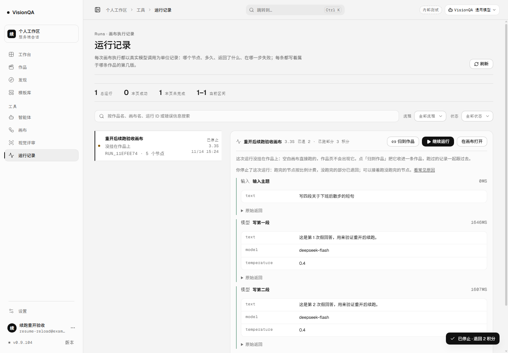
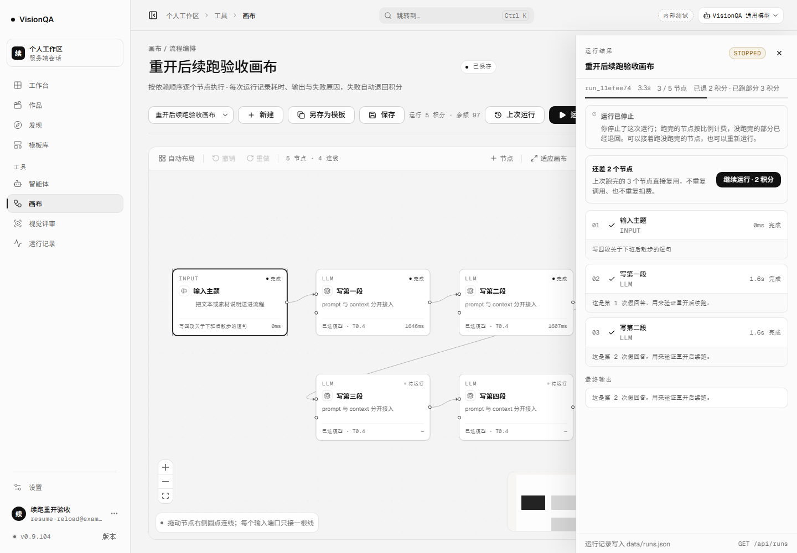
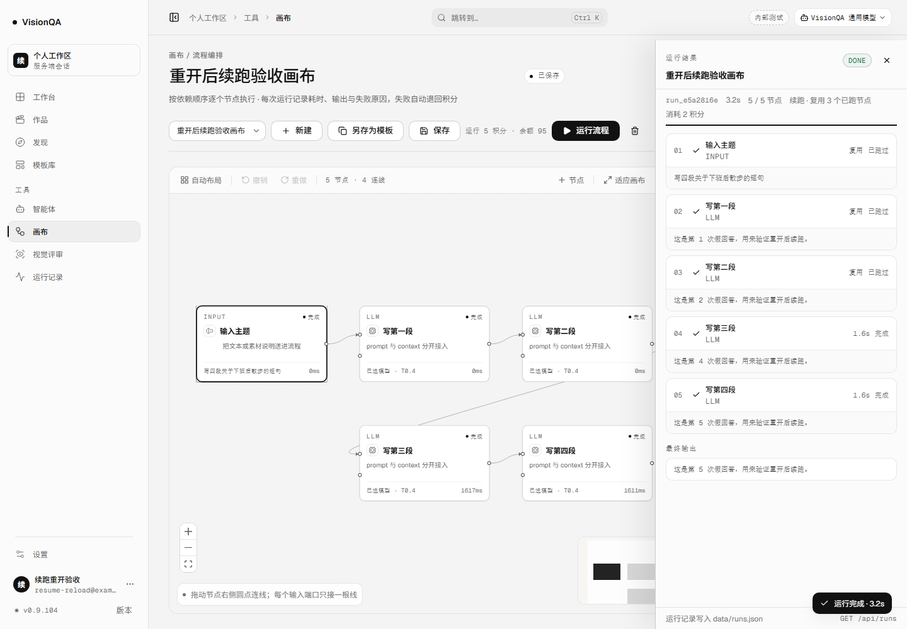
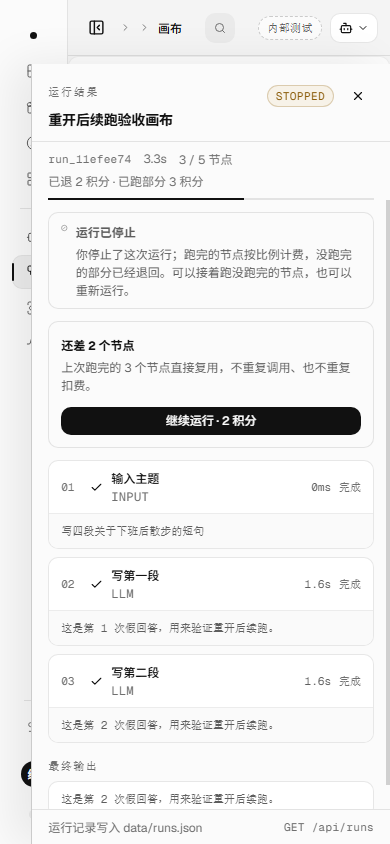

# 关掉页面之后，从运行记录接着跑（v0.9.104，2026-11-14）

## 这一轮补的是什么

v0.9.103 让「画布改过之后只重跑改过的节点」成立，但入口仍只在画布页的内存里：停止后关掉抽屉去改画布，顶栏还有「上次运行」；**一旦刷新、关标签页、换一台电脑，这条入口就没了**。运行记录页能打开画布，却不能把某一条运行放回抽屉；用户在记录里看到「已停止 · 3/5 节点」，只能自己记住跑了几个、再回画布重新点。

这一轮把「继续跑哪一条」写进地址：

```
#/canvas/<flowId>/resume/<runId>
```

- 运行记录页的已停止 / 失败记录，详情里出现「继续运行」；点它回到画布，抽屉直接按这条记录打开。
- 地址是凭证也是刷新点：刷新、前进后退、复制到另一个浏览器，只要还是这个账号，都会回到同一条运行和同一份续跑预检。
- 画布页仍只做它原来会做的事：读画布、保存、算预检、跑流程；没有新增页面，也没有新增数据表。

## 三条边界

1. **地址只点名，不承诺能复用。** URL 里的 runId 只负责把记录读回来、把抽屉打开；还能复用几个节点、要补多少积分，仍由 `GET /api/flows/:id/resume-plan` 按当前画布现算。画布改到没有可复用节点时，抽屉照旧写「这次没有能原样复用的节点」并给「从头运行」。
2. **单条运行是只读的。** 画布打开记录走 `GET /api/runs/:id`（本来就存在，按账号隔离）；预检也仍是只读。打开旧运行不扣费、不写记录、不改画布。
3. **新运行开始后，地址让位给画布。** 点「继续运行」、服务端发出 `run-start` 后，地址从 `/resume/<旧 runId>` 换回 `#/canvas/<flowId>`。之后再刷新，不会把已经过时的旧记录又盖回抽屉；最新那条在运行记录页。

## 页面怎么走

| 之前 | 现在 |
| --- | --- |
| 停止后关闭抽屉，顶栏有「上次运行」；刷新即丢失 | 记录页有「继续运行」，地址带 runId；刷新后抽屉仍在 |
| 运行记录页只能「在画布打开」，打开的是空画布 | 「继续运行」打开画布 + 这条记录 + 续跑预检 |
| 记录页自己判断「已停止、还差几个」，但回画布要重找 | 记录页只给入口；真实可复用数仍由画布按节点指纹现算 |
| 换设备 / 第二天再来，要凭记忆找上次停在哪 | 把地址存下来，或从运行记录点进去 |

记录页按钮只在**终态且还能续**时出现：`running` / `queued` 不给，避免把一条还在跑的单当成可续；`success` 也不给。按钮文案是「继续运行」，旁边的「在画布打开」保持不变，给只想看画布的人。

## 地址语法

`src/domain/canvas-run-link.ts` 把拼装和解析放在一处：

```ts
canvasRunLinkHash('flow_7c68', 'run_6a8e')
// '#/canvas/flow_7c68/resume/run_6a8e'

canvasRunLinkFromSegments(['canvas', 'flow_7c68', 'resume', 'run_6a8e'])
// { flowId: 'flow_7c68', resumeRunId: 'run_6a8e' }
```

- 不是画布、缺 flowId、缺 runId、多一段，都返回 `null`，路由退回普通画布地址；坏链接不把画布本身挡住。
- `#/canvas/project/<画布ID>` 是画布服务里的画布项目，不会被误认成续跑地址。
- 两个 id 都做 URL 编码；服务端签发的是 `flow_xxx` / `run_xxx`，正常不会带特殊字符，但地址层不赌这个。
- 路由的 `toHash`、`routeKey` 都带 `resumeRunId`：同一个 run 重复打开不会多压历史，不同 run 能正确区分。

## 画布怎么把记录放回抽屉

`CanvasPage` 新增 `resumeRunId`：

1. 初次加载仍按 `flowId` 取画布；`applyFlow` 把地址写回时**保留** `resumeRunId`，否则刚打开就被自己规范化掉（这一轮真踩过，见坑 1）。
2. `loadState === 'ready'` 后，按 `flowId:runId` 只读一次单条运行；路由重渲染、保存后的 effect 重跑都不会重复拉。
3. 校验 `run.flowId === 当前画布` 才应用；不属于当前画布就 toast 并把地址退回普通画布。
4. 把节点结果画回画布（success → done，其余原状态）；当前画布里已经不存在的节点清成待运行，不把旧结果挂到新节点上。
5. 设置 `runRecord / runNodes / runMeta / canceled`，有可续节点就设 `resumeSource`，清空旧预检，打开抽屉。
6. 抽屉仍走 v0.9.103 的那条预检 effect：等画布保存完再请求，返回后写「还差 N 个节点」「复用 N 个、改过 N 个和下游重跑」「继续运行 · N 积分」。

## 本地实测（8931 + 假上游 8971，每节点 1.6 秒，零真实上游）

5 个节点：输入主题 → 写第一段 → 写第二段 → 写第三段 → 写第四段。跑到 3/5 时停止，然后把画布页关掉，从运行记录页重开。

| 步骤 | 读数 |
| --- | --- |
| 第一次运行 | 跑到第三段时停止；`run_11efee74` · interrupted · canceled |
| 节点 / 结算 | 5 个节点 3/5 跑完；`cost=5 / kept=3 / refundedAmount=2 / settled=true`；余额 100 → 97 |
| 运行记录页 | 详情出现「继续运行」；点它后地址 `#/canvas/flow_3671fc37/resume/run_11efee74` |
| 抽屉 / 预检 | 自动打开；「还差 2 个节点」「继续运行 · 2 积分」；`reused=3 / rerun=2 / stale=0 / cost=2` |
| 刷新 | 地址不变；整页重载后抽屉重新打开，仍写「还差 2 个节点」 |
| 续跑 | `run_e5a2816e` · success · 3.2s · `resumeOf=run_11efee74` · `reusedNodes=3` |
| 计费 / 上游 | 本次 `cost=2 / billTotal=2 / billFinished=2`；余额 97 → 95；假上游总共 **5** 次，前 3 个节点没有重复调用 |
| 开始后续跑 | 地址回到 `#/canvas/flow_3671fc37`，不再挂旧 runId |
| 390 宽 | 抽屉铺满，`scrollWidth 390 = clientWidth 390`，预检与按钮都在画面内 |










## 坑（这一轮真踩到的）

1. **路由字段名必须和 Route 对齐。** 第一版让 `canvasRunLinkFromSegments()` 返回 `{ flowId, runId }`，路由直接 `...runLink`，于是 Route 上是 `runId` 而页面读 `resumeRunId`。拼出来的地址是对的，`parseRoute` 也认，但 `toHash` 看不到 `resumeRunId`，`hashchange` 立刻把地址规范化回普通画布。表现是「点了没反应，抽屉永远不出现」。修法是让纯函数返回 `{ flowId, resumeRunId }`，并让测试直接断言这个字段。
2. **hashchange 的规范化在导航之后。** `navigate` 先写 hash，再 publish；画布页在 hashchange 之前就可能挂载并写地址。任何字段不一致都会在用户看到之前被改掉，日志里只剩一条 replaceState。排查要看实际地址与 Route，不要只看按钮。
3. **`applyFlow` 必须保留 runId。** 打开画布会写回规范地址；如果这里只写 `flowId`，刚点进来就被自己清掉。地址是这一轮的唯一真源，不能只存在 state 里。
4. **运行开始后要主动摘掉旧 runId。** 否则续跑成功后再刷新，抽屉会重新打开**上一条**已停止运行，看起来像「跑完了又回到停止」。在 `run-start` 时换回普通画布地址。
5. **单条运行要校验属于当前画布。** URL 可以被手改；拿 A 画布的 runId 打开 B 画布，不能把 A 的节点结果画到 B 上。
6. **当前画布里没有的节点要清状态。** 旧运行跑过、后来被删掉的节点不能再显示「完成」；新加的同名节点也不能继承旧结果。
7. **应用记录要等 `loadState === 'ready'`。** `applyFlow` 会先清空 run state；太早应用会被它覆盖，太晚又会把用户刚编辑的内容改掉。
8. **同一个 flow+run 只拉一次。** 路由重渲染、保存后的 effect 重跑都很常见；用 ref 记住已应用的 key，避免重复 GET 和重复开抽屉。
9. **预检不能拿旧记录冒充。** 打开记录后先把 `resumePlan` 清空，等保存完成再请求；否则会短暂显示旧数字，或者拿没落盘的画布报价。
10. **记录页按钮只给终态。** `running` / `queued` 不给「继续运行」；老记录没有 `resumable` 字段时用 `runResumeInfo()` 的回退，但仍要排除这两种活状态。
11. **验收脚本自己会删自己。** 这轮的 E2E 第一版把数据目录设为 `.tmp-qa/g114`，而脚本也在里面；开头 `rm -rf` 把脚本删了，Node 已加载还能跑完，下一次就找不到文件。数据目录与脚本目录要分开。
12. **默认画布价是 2 积分。** 5 个节点 3/5 跑完时 `kept = ceil(2×3/5) = 2`，续跑价就是 0；看起来像「免费续跑」，其实是价格设小了。E2E 显式设 `VQ_CREDIT_FLOW_RUN=5`，才能验到「补 2 积分」。
13. **截图必须用最终 build。** 改完状态守卫又重建了一次，资产哈希从 `index-D7IODsGq` 换到 `index-qDgCDllX`；截图、README 和文档都按最终哈希写。

## 发现但没做

- 运行记录页的按钮仍按**记录里存着的** `resumable` 判断，不逐条请求预检。画布改过之后点进去，可能看到「这次没有能原样复用的节点」；数字是准的，但按钮文案没有提前说「不能复用」。逐条预检要 N 个请求，这一轮没做。
- 只有「继续运行」一个入口；没有给任意运行一个「查看这次运行」的只读地址（成功记录也能通过手拼 URL 打开，但页面上没有按钮）。
- 共享给别人的链接仍不带运行记录：地址只在本人账号下有效，别人打开会被账号隔离拦下。
- 不支持跨实例 / 跨机器读节点结果；run 记录在本数据目录，换机器打开只能看到画布，不能复用节点。
- 续跑失败后不会自动再续；每次都要用户点。
- iframe 里的出图 / 视频任务仍不在这条链路。
- 生产仍没有真实上游授权，线上没有真实「停止 → 重开 → 续跑」记录。

## 回退

```bash
bash /opt/visionqa/ops/rollback.sh --to 1   # v0.9.103
bash /opt/visionqa/ops/rollback.sh --to 2   # v0.9.102
```

新增的是路由的一个可选段、一个纯函数、记录页一个按钮、画布一段只读加载；`GET /api/runs/:id` 与 `resume-plan` 都是既有接口。旧前端遇到 `#/canvas/<flowId>/resume/<runId>` 只会把 `flowId` 当路径尾部，丢掉 `/resume/...` 后打开这块画布，不会白屏。数据库与运行记录格式没有变化。

## 质量

- `npm test` **907/907**（+2 条 `test/canvas-run-link.test.mjs`：地址拼装/解析/编码、缺段与多段回退）。
- oxlint **0 error / 15 warning**（与上一轮同一批基线警告），`tsc -b` 干净，build 干净。
- 构建：入口 `index-qDgCDllX.js` **574,416 B**；画布 `CanvasPage-BUmESs0z.js` 236,466 B；后台 `AdminConsolePage-C6FfLg_I.js` 201,066 B；样式 `index-C09qhU_5.css` 275,246 B；画布样式 25,578 B。
- 密钥扫描在提交前重跑；本轮没有新增真实凭据。
