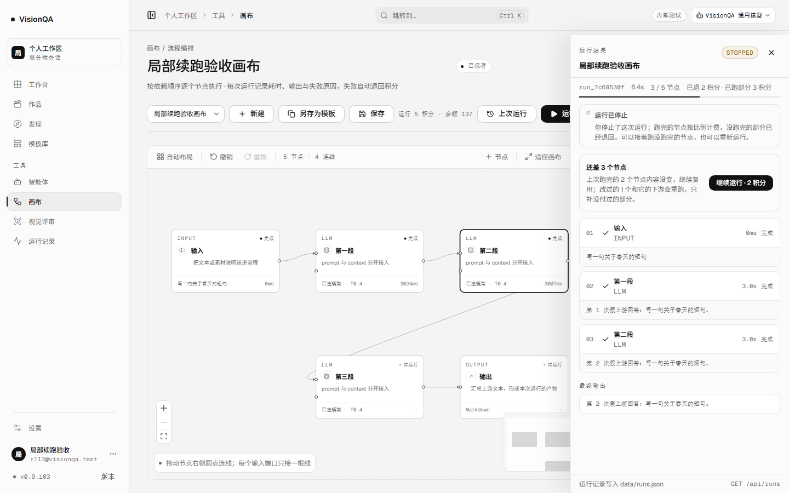
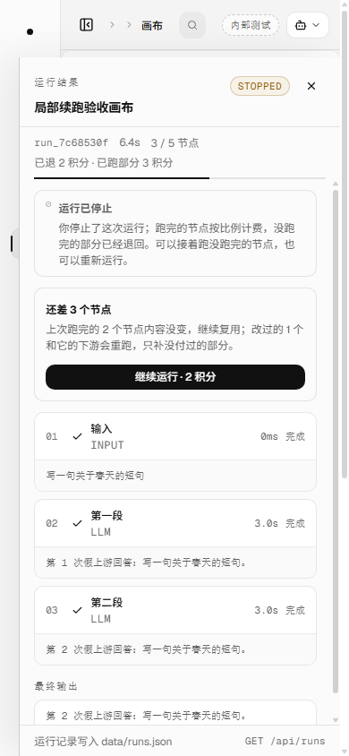
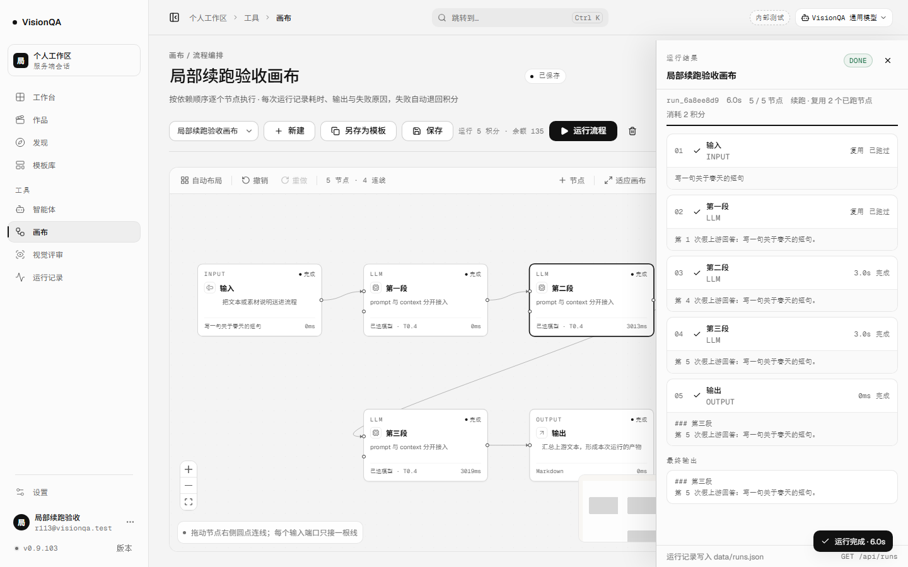

# 画布改过之后，还能接着跑没改的节点（v0.9.103，2026-11-14）

## 问题

v0.9.102 让停止后的运行可以接着跑，但判断标准是**整张画布的内容指纹**：提示词、模型、连线任何一处变了，
整条续跑就被 409 拒绝。用户改的往往只是最后一个节点的文案，前面已经跑完、已经付过钱的输入、检索、
模型节点却跟着一起作废，只能从头再调一遍上游、再付一次整张画布的钱。

这一轮把「能不能复用」从整张画布下放到**每个节点**：只重跑自己改过的节点和它的下游，没改的上游继续复用。

## 做法

### 1. 逐节点内容指纹

`server/flows.mjs` 新增 `nodeRevisionsOf(flow)`：按拓扑序，对每个节点算 SHA-256 前 16 位。

指纹内容：

- 节点自己的 `id`、`type`、`config`；
- 每根入线的 `source` / `sourceHandle` / `targetHandle`；
- **所有上游节点的指纹**（递归带进来）。

因此：

- 改第二段的提示词 → 第二段失效，第二段的下游（第三段、输出）一起失效；输入、第一段不变；
- 只挪节点、改标题、改说明 → 不算内容，仍可复用；
- 加一根入线、换分支 handle → 这个节点失效；
- 配置按 key 排序后再哈希（`stableJson`），不靠对象属性顺序碰运气。

### 2. 只复用内容没变的节点

`resumeSeedFor(run, flow)` 现在逐条检查：

1. 只有 `success` / `unsupported` 才可能复用；失败节点不复用；
2. 节点必须还在当前画布上；
3. 有 `nodeRevisions` 的新运行：节点 id 的上次指纹必须等于当前指纹；
4. 没有 `nodeRevisions` 的旧运行（v0.9.102 及以前）：退回整图 `flowRevision` 比对——画布没改就整批复用，改了就没有可证明没变的节点；
5. 条件节点仍按上次的 `branch` 恢复分支边，避免续跑走错分支。

同时返回 `staleCount`：上次跑完了、但这次因为自己或上游改了而失效的节点数。页面靠它说清「改过的 1 个会重跑」。

### 3. 续跑预检：只说真数

新增只读接口：

```
GET /api/flows/:flowId/resume-plan?runId=run_x
```

返回 `total / reused / rerun / stale / cost / resumable / reason`。它不扣费、不写运行记录，
并且和 `POST /api/flows/:id/run { resumeOf }` 调用同一个 `resumePlanFor()`——页面看到的数就是真正会执行的数，
不会出现「页面说复用 3 个、服务端只复用 2 个」。

### 4. 页面

- 停止 / 失败后关掉抽屉去改画布，顶栏保留 **「上次运行」** 按钮；改完还能回到这条运行，不会因为抽屉关了就没有续跑入口。
- 抽屉里的提示改成真数：**「还差 3 个节点」** + 「上次跑完的 2 个节点内容没变，继续复用；改过的 1 个和它的下游会重跑，只补没付过的部分。」
- 没有可复用节点（全改过 / 全删了）时不再显示「继续运行」，改为虚线卡片 **「这次没有能原样复用的节点」** + **「从头运行」**。
- 预检在画布保存完成后才发；保存失败时 `handleRun` 会在发请求前停住，保留上一次成功保存的预检，不拿没落盘的画布去报价。
- 没有新增页面、没有新增数据表，也没有改运行记录的存储结构；新增字段都是可选字段。

### 5. 钱与分母

- 续跑价仍是 `上次原价 - 已经留下的 kept`；失败 / 重启已全额退的，按剩余节点比例收。
- 新运行的 `billTotal = 当前画布节点数 - 本次复用数`；`billFinished` 只加这次真正执行的节点。
- 停止时 `settleCanceledRun()` 继续用 `billTotal / billFinished`；复用节点上次已经付过，不进这次的分母。
- `settled` 继续防二次全额退。

## 本地验收（8931 + 假上游 8963，零真实上游）

5 个节点：输入 → 第一段 → 第二段 → 第三段 → 输出；每次上游固定 3 秒。

| 步骤 | 读数 |
| --- | --- |
| 第一次运行 | 跑到第三段时停止；`run_7c68530f` · interrupted · canceled · 6.4s |
| 节点 | 5 个节点，3/5 跑完（输入、第一段、第二段）；第三段中止，无结果 |
| 停止结算 | `cost=5 / kept=3 / refundedAmount=2 / settled=true`；余额 140 → 137 |
| 改画布 | 只改第二段提示词；输入、第一段、第三段、输出不动；保存成功 |
| 预检 | `total=5 / reused=2 / rerun=3 / stale=1 / cost=2 / resumable=true` |
| 页面 | 「还差 3 个节点」「上次跑完的 2 个节点内容没变…改过的 1 个和它的下游会重跑」「继续运行 · 2 积分」 |
| 续跑 | `run_6a8ee8d9` · success · 6.0s · `resumeOf=run_7c68530f` · `reusedNodes=2` |
| 计费 | 本次 `cost=2` · `billTotal=3` · `billFinished=3`；余额 137 → 135 |
| 上游次数 | 整个流程 **5** 次：第一次 3 次（第三段被中止）、续跑 2 次（第二段、第三段）；输入与第一段没有重复调用 |
| 复用标记 | 抽屉里输入、第一段标「复用 · 已跑过」；画布上两节点 0ms |
| 390 宽 | `scrollWidth 380 = clientWidth 380`，预检卡片与按钮都在画面内 |
| 数据 | `nodeRevisions` 在第一次运行落盘；改第二段后只有第二段、第三段的指纹变了，输入、第一段不变 |







全仓 **905/905**（+1 条新用例，路由续跑用例增加预检断言），oxlint **0 error / 15 warning**，`tsc -b` 与 build 干净；入口 `index-DnGsbMLY.js`（573,349 B）、画布 `CanvasPage-Bmrdz7tp.js`（235,387 B）、后台 `AdminConsolePage-DvxwfNs4.js`（201,080 B）、样式 `index-C09qhU_5.css`（275,246 B）、画布样式 `CanvasPage-Dm0sJKqc.css`（25,578 B）；密钥扫描 **646 文件 / 0 命中**。

## 生产核对

部署标签：`20261114-150500-r113-par`（发布脚本按 31 字符截断，完整意图是 `20261114-150500-r113-partial-resume`）；快照 `20261114-070231-20261114-150500-r113-par.tar.gz` 1,013,657 B。

- `visionqa` / `visionqa-internal` / `visionqa.socket` / `bdc-web` 全 active；
- 8799 / 8800 / 公网 `/api/version` 都是 **0.9.103**；`/api/health` ok（模板 26，uptime 37s）；
- 入口 `index-DnGsbMLY.js` 200 · **573,349 B**；
- 画布 `CanvasPage-Bmrdz7tp.js` 235,387 B；后台 `AdminConsolePage-DvxwfNs4.js` 201,080 B；
- 样式 `index-C09qhU_5.css` 275,246 B；画布样式 `CanvasPage-Dm0sJKqc.css` 25,578 B；
- 服务端 `flows.mjs 6b8d3ed9` / `routes/flows.mjs f6236d72`，入口 `2ca3ee64`、画布 `21201ba6`、后台 `b2137aac`、样式 `574a59b5`、画布样式 `d6430808`，全部与本地一致；
- 两个实例心跳 `public:8799` pid 1480032 / `internal:8800` pid 1480031 在线；
- 盘 72%；本轮上传包、stage 与核对脚本已清，`/tmp` 剩 351M 是 11 月 4–13 日其他项目的旧发布包，没有动；
- 近 15 分钟 journal 无 warning；
- 生产**没有真实运行授权**，线上没有真实停止 / 续跑记录；功能证据来自本地真浏览器 + 假上游、905 条测试与路由级预检用例。

## 踩到的坑

1. **逐节点指纹必须带上游指纹**。只哈希自己的配置，改第一段后第二段仍会被复用，等于把旧输入接在新提示词后面。
2. **入线的 handle 也要进指纹**。条件分支的 true / false 是两个不同的输入，漏了会把分支接反。
3. **位置、标题、说明不算内容**。把位置算进去，用户挪一下画布就全失效；这正是上一版整图续跑最容易被骂的地方。
4. **旧运行必须保留整图回退**。v0.9.102 的记录没有 `nodeRevisions`；没有回退就只能一律拒绝，老记录永远续不上。
5. **`staleCount` 要把删掉的节点也算进去**。只数「还在画布上但指纹变了」的话，用户删掉一个已跑节点，页面会少报一个重跑。
6. **预检和真正续跑必须共用一份实现**。两处各写一遍判断，迟早出现页面说 2 个、服务端只复用 1 个。
7. **预检要等保存完成**。在 900ms 自动保存的脏状态下发请求，服务端拿到的是旧画布，报价会立刻过期。
8. **抽屉一关，续跑入口不能跟着消失**。加「上次运行」按钮，用户才能「停止 → 关抽屉 → 改画布 → 回来续跑」。
9. **保存失败时不能拿没落盘的画布续跑**。`handleRun` 会在发请求前停住；预检保留上一次成功保存的结果，既不清空抽屉，也不按没保存的内容报价。
10. **计费分母用当前画布减复用数**，不是上次的 total；停止收尾必须继续读 `billTotal / billFinished`。
11. **改完 UI 必须重新 build 再截图**。这次截图前把版本升到 0.9.103 并重建，截图里侧栏版本号与发布包一致。

## 发现但没做

- 不能复用「内容没变但上游被跳过」的节点；目前只认上次真正 success / unsupported 的节点。
- 不能按节点名告诉用户「哪几个会重跑」，预检只给数量，不返回 id 列表。
- 不能从运行记录页 / 后台直接续跑；入口仍只在画布，因为需要当前画布上下文。
- 不能跨实例 / 跨机器续跑；运行记录里的节点结果仍然只在本进程 / 本数据目录可用。
- 没有「续跑失败后自动再续」；每次都要用户点。
- iframe 里的出图 / 视频任务仍不在这条链路，画布内置节点之外的任务不能局部复用。
- 生产没有真实上游授权，线上没有真实续跑记录。

## 回退

```
bash /opt/visionqa/ops/rollback.sh --to 1   # v0.9.102
bash /opt/visionqa/ops/rollback.sh --to 2   # v0.9.101
```

新增的 `nodeRevisions`、`resume-plan`、`stale`、`resumePlanFor` 都是增量：旧前端不请求预检、不带 `resumeOf` 时，
仍走原来的整图运行；老运行没有 `nodeRevisions` 时按整图指纹回退。
