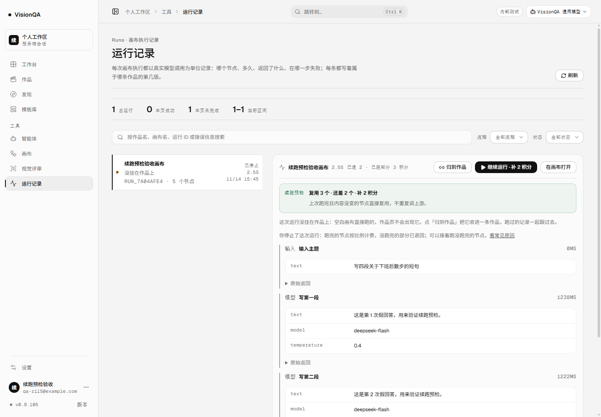
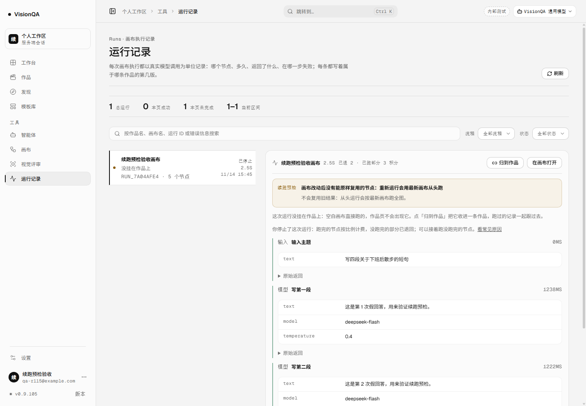
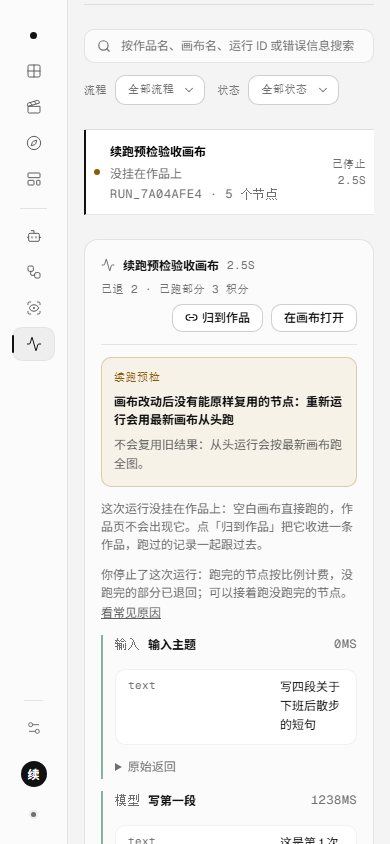

# 运行记录页先算清，再点「继续运行」（v0.9.105，2026-11-14）

## 这一轮补的是什么

v0.9.104 把续跑入口写进了地址，运行记录页也出现了「继续运行」。但按钮仍按**记录里存着的** `resumable` 判断：那是上次收尾时的结论。画布改过之后，记录还写着「3/5、还差 2 个」，当前画布却可能只剩 2 个能复用、甚至一个都不剩。用户点进画布，才发现预检说「没有能原样复用的节点」——入口和结论对不上。

这一轮在运行记录页本身补一次只读预检：

- 选中一条已停止 / 失败的运行，页面请求 `GET /api/flows/:id/resume-plan?runId=run_x`。
- 用**当前画布**算出「复用几个、还差几个、其中几个改过、补多少积分」，直接写在按钮上方；按钮也带「补 N 积分」或「不再扣费」。
- 预检说不能续时，收掉「继续运行」，把服务端给的原因写清楚；不再让用户点进去才发现没有可复用节点。
- 预检失败（网络 / 服务端临时错误）时如实写「这次没能核对」，保留按记录估算的按钮，并给「重新核对」；真正运行时服务端还会再判一次。

没有新增页面、接口或数据表；`resume-plan` 与 v0.9.103 完全同一个只读接口。

## 页面怎么走

| 之前 | 现在 |
| --- | --- |
| 按钮只看记录里的 `resumable`，画布改过也显示「继续运行」 | 选中记录后按当前画布现算，按钮跟着 plan 出现 / 消失 |
| 记录写「还差 2 个」，画布实际可能还差 3 个 | 数字以当前画布为准：`reused / rerun / stale / cost` |
| 不能续时点进去才看到原因 | 记录页就地写原因，按钮直接收掉 |
| 预检失败时没有说法 | 写「这次没能核对」，给重试，不冒充已核对 |
| 每行都预检会打 N 个请求 | 只预检当前选中的一条；换一条再问 |

## 预检只问选中的那一条

运行记录页一页 12 条，逐条预检就是 12 个请求；而且绝大多数行用户不会点。实现上只对**当前选中、终态、记录说还能续**的运行发一次请求：

```
current.status !== 'running' && current.status !== 'queued' && runResumeInfo(current).resumable
```

`runResumeInfo()` 仍是记录侧的回退：老记录没有 `resumable` 字段时，按「已有 success / unsupported 节点且还有没跑的」推算。真正的复用数、失效数、补价都由服务端 `resumePlanFor()` 现算。

## 三个状态

1. **核对中**：按钮显示「继续运行 · 核对中」并禁用；预检条写「正在按当前画布核对能复用几个、还要补多少积分」。
2. **核对完成、能续**：预检条转通过色，写「复用 3 个 · 还差 2 个 · 补 2 积分」或「复用 2 个 · 还差 3 个（其中 1 个改过） · 补 2 积分」；按钮写「继续运行 · 补 2 积分」。
3. **核对完成、不能续**：预检条转待确认色，写服务端原因，例如「画布改动后没有能原样复用的节点：重新运行会用最新画布从头跑」；按钮消失，「在画布打开」仍保留。

补价为 0 时写「不再扣费」，不写「补 0 积分」。

## 本地实测（8943 + 假上游 8973，前三段 1.2 秒，零真实上游）

5 个节点：输入主题 → 写第一段 → 写第二段 → 写第三段 → 写第四段。第三段跑完后停止，第四段还在等上游。

| 步骤 | 读数 |
| --- | --- |
| 第一次运行 | 3/5 停止；`run_7a04afe4` · interrupted · canceled |
| 节点 / 结算 | `cost=5 / kept=3 / refundedAmount=2 / settled=true`；余额 100 → 97；假上游 **3** 次 |
| 第一次预检 | `reused=3 / rerun=2 / stale=0 / cost=2`；页面写「复用 3 个 · 还差 2 个 · 补 2 积分」 |
| 改第三段 | 只改上次跑完的第二段模型提示词；预检变 `reused=2 / rerun=3 / stale=1 / cost=2` |
| 页面（改过） | 「复用 2 个 · 还差 3 个（其中 1 个改过） · 补 2 积分」；按钮仍是「继续运行 · 补 2 积分」 |
| 再改输入 | 三段跑过的结果全部失效；预检变 `reused=0 / rerun=5 / stale=3 / resumable=false` |
| 页面（不能续） | 写「画布改动后没有能原样复用的节点…」；「继续运行」按钮消失，「在画布打开」仍在 |
| 只读 / 扣费 | 预检前后余额都是 97；没有写运行记录、没有调上游 |
| 浏览器预检请求 | 页面加载 / 两次刷新共 **4** 次 `resume-plan`；没有逐行预检 |
| 390 宽 | `scrollWidth 390 = clientWidth 390`，预检条与按钮都在画面内 |








## 坑（这一轮真踩到的）

1. **记录里的 `resumable` 会过期。** 它是上次收尾时的结论；画布改过之后，记录仍是 3/5，当前画布可能只剩 2 个可复用。页面必须按当前画布现算，不能拿旧字段当按钮的唯一依据。
2. **不能在 effect 里同步写「核对中」。** 第一版 `useEffect` 一进来就 `setResumePlan({ state: 'loading' })`，oxlint 的 `react(set-state-in-effect)` 立刻亮；后来改成在渲染时按 `runId` 判断「还没有当前这条的 plan 就是 loading」，effect 只发请求、只在异步回调里写结果。少一轮渲染，也少一条基线警告。
3. **旧 plan 不能挂到新选中的行。** 预检结果按 `runId` 存；渲染前先核对 `plan.runId === current.id`，不等 effect 清空。否则从 A 切到 B 的一帧里，B 会短暂显示 A 的「复用 3 个」。
4. **按钮要跟着 plan 收。** 只改文案不够：plan 说 `resumable=false` 时按钮必须消失，否则用户仍会点进画布，看到抽屉里的「没有能原样复用的节点」。这是这一轮的主要用户价值。
5. **预检失败不能说成「已核对」。** 网络 / 服务端错误时写「这次没能核对」，保留记录估算与「重新核对」；真正运行时服务端还会再判一次。把失败静默成旧数字，等于又回到这一轮要修的问题。
6. **只预检选中的一条。** 一页 12 条逐条问就是 12 个请求；用户通常只看一条。预检是按需的只读请求，不是列表的必备字段。
7. **预检不能扣费。** `resume-plan` 只读；E2E 在停止后、页面加载后、两次刷新后都对余额，始终 97。没有写运行记录，也没有调假上游。
8. **「补 0 积分」很怪。** 默认画布价 2 积分时，5 节点 3/5 的 `kept` 可能正好等于原价，补价为 0；页面写「不再扣费」，并有用例钉住。
9. **改第三段不是 3 个 stale。** 旧记录已完成的是输入、第一段、第二段；改第二段只会让第二段失效，第三、四段本来就没跑完。`stale=1`、`rerun=3` 才对；若把「还差」直接当成「改过」，数字会说谎。
10. **390 宽要重排。** 预检条在桌面是「标签 + 数字」两列，窄屏改成单列；否则标签会占掉一行，原因文本被挤成很窄的一条。
11. **截图前先关上手引导。** 新账号第一次进运行记录页会盖一层欢迎弹窗，第一版截图整页都是弹窗；验收脚本先点 `button[aria-label="关闭引导"]`，再截页面。
12. **预检要禁用浏览器缓存。** 同一地址刷新时，浏览器可能复用上一次的 `resume-plan`；CDP 开 `Network.setCacheDisabled`，三次页面状态才都是当次现算。
13. **截图要用最终 build。** 这轮入口是 `index-Cw9B36D9.js`；改完代码重新 build 后再跑 E2E，截图、README、文档都按这个哈希写。

## 发现但没做

- 没有给列表每一行做预检，也没有在行上显示「可续 / 不可续」；只有选中后在详情里算。
- 预检在页面加载 / 切换选中时发；页面开着时在另一个标签页改画布，不会自动重算，要刷新或重新选中。
- `running` / `queued` 不做预检；它们本来就没有可复用的旧结果。
- 预检失败时仍允许按记录估算点「继续运行」，极端情况下仍可能在画布抽屉里看到「没有可复用节点」；服务端会再判一次，但入口没有百分之百拦住。
- 没有任意运行的「查看这次运行」只读入口、共享链接、跨实例 / 跨机器续跑、失败后自动再续、iframe 出图 / 视频任务续跑。
- 生产仍没有真实上游授权，线上没有真实停止 / 续跑 / 预检记录；功能证据来自本地真浏览器 + 假上游与 5 条文案用例。

## 回退

```bash
bash /opt/visionqa/ops/rollback.sh --to 1   # v0.9.104
bash /opt/visionqa/ops/rollback.sh --to 2   # v0.9.103
```

这一轮只改运行记录页、一个文案纯函数和一段 CSS；没有新增接口、字段或 schema。旧前端不会请求 `resume-plan`，记录页按钮照旧按 `resumable` 出现；服务端接口保持兼容。

## 质量

- `npm test` **912/912**（+5 条 `test/run-resume-plan-view.test.mjs`：能续 / 改过 / 补 0 / 不能续 / 还没拿到 plan）。
- oxlint **0 error / 15 warning**（与上一轮同一批基线），`tsc -b` 与 build 干净。
- 构建：入口 `index-Cw9B36D9.js` **576,982 B**；画布 `CanvasPage-CQ0gMZ8M.js` 236,466 B；后台 `AdminConsolePage-QZeYGMxf.js` 201,066 B；样式 `index-txSBUiKZ.css` 276,220 B；画布样式 25,578 B。
- 密钥扫描 **649 文件 / 0 命中**。
