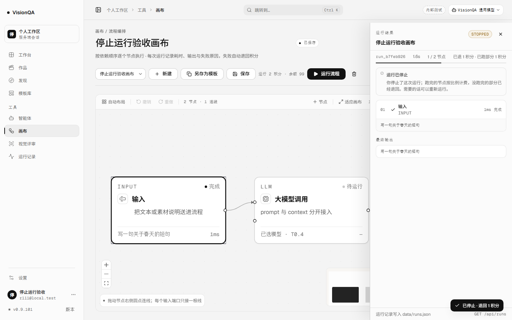
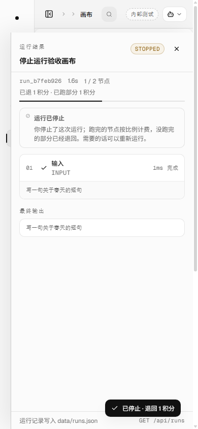

# 跑到一半想停，这次真能停（v0.9.101，2026-11-14）

## 问题：关掉连接只是不听了，服务端还在跑

v0.9.97 能取消「还在排队」的运行：关掉连接、退票、不扣钱。但排到名额、扣完费、开始跑之后，页面上的「取消」就不见了；用户只能关页面。关页面会发生什么：

- 服务端把响应写不出去，但 `runFlow` 不会因此停下——节点继续跑、上游继续调、积分照扣。
- 页面回来后看到一条 `success`，钱花掉了，用户却以为自己已经取消。
- 更糟的是上游卡住：`chatCompletion` 在传了外部 signal 时**不再设自己的超时**（旧实现），一条运行可以一直挂着。

这一轮补的是「已经开跑之后」的停止：一条明确接口、一个中止信号、一套按已跑节点结算的账。

用户能直接看到的变化：

- 画布顶栏在运行开始后出现「停止运行 3s」；点它，当前上游立刻中止。
- 运行抽屉的状态是 **STOPPED**（不是 ERROR），写清「你停止了这次运行；跑完的节点按比例计费，没跑完的部分已经退回」。
- 抽屉元数据写「已退 1 积分 · 已跑部分 1 积分」，不再笼统写「已退回 2 积分」。
- 运行记录、作品页的运行归集把这次叫「已停止」，不是「失败」；花费只算留下的部分。
- 页面被关掉 / 连接断开也走同一条停止逻辑，不让它在后台偷偷烧钱。

## 做法

1. **明确接口**（`POST /api/runs/:id/stop`）：只认当前进程里正在跑的记录；不属于当前账号 403；已结束 / 还在排队 409（排队仍走关连接退队，不扣钱）。停止请求只置 `aborted + stopReason` 并 abort 控制器，**不直接改终态**——终态由 `runFlow` 收尾，避免正在跑的节点返回后把记录覆盖回去。
2. **信号穿到底**：`runFlow` → `executeNode` → `runLlm` / `runReview`；文本调用进 `callTextModel` → `chatCompletion`；评审的图片下载、插件服务调用与隔离 worker 都接同一条 signal。
3. **超时与停止是两个源**（`server/chatcall.mjs`）：`AbortSignal.any([外部 signal, AbortSignal.timeout(...)])`，谁先到谁生效。外部 signal 中止时不再换 Key、不再换模型，直接交给运行层收尾。
4. **评审 worker 真终止**（`server/isolate.mjs`）：停止时 `#failSlot` 杀掉接了这单的 worker，任务以 `REVIEW_CANCELED` 收尾；只 reject Promise 会让 worker 继续占着池位和内存。
5. **按跑完的节点结算**（`settleCanceledRun`）：`kept = ceil(cost × finishedNodes / total)`，封顶 cost；一个节点都没跑完则全额退。`settled=true` 后，通用收尾 `refundRunCredits` 直接返回 0，防止第二次全额退。
6. **花费归集看 kept**：作品页的运行花费只加「留下的部分」，不是把停止运行当成没花钱。
7. **页面只认 run-start 之后的 id**：按钮在拿到 run id 后才出现；停止成功后继续读同一条流，直到 `run-end`，状态不会被前端提前写死。

账与状态：

| 场景 | 终态 | 积分 |
| --- | --- | --- |
| 排队中取消 | 不写记录 / 不扣费 | 0 |
| 开跑后一个节点都没跑完就停 | interrupted · canceled | 全额退 |
| 跑完 1 / 2 个节点后停（cost 2） | interrupted · canceled | 留 1、退 1 |
| 全部节点跑完再停 | interrupted · canceled | 留全部（当前实现，见「发现但没做」） |
| 服务重启 / 停机 | interrupted · 非 canceled | 全额退（原有路径） |

## 本地实测（零真实上游）

环境：本机 8931 + 假上游 8961（固定 8 秒才回），Chrome headless 真实点击；数据在 `.tmp-qa/r111`，验收完删除。

| 检查 | 读数 |
| --- | --- |
| 流程 | `flow_4d87a28a`，2 个节点（输入 → 模型），本次 2 积分 |
| 点击 | 运行 1.4 秒后点「停止运行 1s」 |
| 运行记录 | `run_b7feb926` · `interrupted` · `canceled=true` · 1.6s · 1 / 2 节点 |
| 节点计数 | `startedNodes=2` · `finishedNodes=1` |
| 积分 | `cost=2` · `kept=1` · `refundedAmount=1` · `settled=true`；余额 100 → 99 |
| 账本 | `flow_run -2` + `flow_run-refund +1`，同一个 ref |
| 页面 | 有「已停止」「已跑部分 1 积分」；LLM 节点回到「待运行」，不再挂「运行中」 |
| 390 宽 | `scrollWidth 380 = clientWidth 380`，无横向溢出；元数据整项换行，不把「1/2 节点」拆开 |

## 测试

- 新增 `test/flow-run-stop.test.mjs` 两条：
  - 运行中停止：上游请求已到、停止后 `runFlow` 在 155ms 内收尾；终态、节点计数、kept/refund、账本、重复收尾不多退全部核对。
  - 路由：流式运行拿到 `run-start.id`，`POST /api/runs/:id/stop` 返回 200，页面仍收到 `run-end`，钱只退 1。
- 全仓 **902/902**（+2），oxlint 0 error / 15 warning，`tsc -b` 干净，build 通过。

## 生产（v0.9.101）

| 检查 | 读数 |
| --- | --- |
| 发布标签 | `20261114-135800-r111-stop-run` |
| 两个 unit | `visionqa` active · `visionqa-internal` active |
| 版本 | 8799 / 8800 都 **0.9.101**；公网 `/api/version` 0.9.101 |
| 入口 | `index-CVwkH9QU.js` 200 · **572,408 B**；旧 `index-B01dXERS.js` 404 |
| 画布 / 后台 chunk | `CanvasPage-C296cgVR.js` 232,929 B；`AdminConsolePage-u2BMgAO6.js` 201,071 B |
| 样式 | `index-C09qhU_5.css` 275,246 B |
| 文件一致 | `flows.mjs db877283` · `chatcall.mjs 3feca24c` · `review.mjs 4a6c9d0d` · `isolate.mjs 29095ae8` · 入口 `59a5d29e`，与本地一致 |
| 心跳 | 两个实例各自数据目录，pid 见验收记录 |
| 盘 / 临时文件 | 部署后清理 `/tmp` |

**诚实说明**：生产没有真实运行（零授权上游），所以线上没有一条「已停止」的新记录可展示；生产验证的是版本、入口、文件一致与两个实例健康。停止行为来自本地真浏览器 + 假上游，以及路由级用例。

## 坑

1. **客户端 abort ≠ 服务端停止**：关连接只让人听不到响应，`runFlow` 照跑照扣。必须有一条带 run id 的明确停止接口。
2. **停止要有 id**：run-start 才带 run id；按钮提前出现就是「点了没反应」。现在只在 `runMeta.id` 有值后显示。
3. **外部 signal 会把超时挤掉**：旧 `chatCompletion` 写了 `signal ? null : new AbortController()`，传了停止信号就没有超时；必须两个信号合并。
4. **中止不是「上游失败」**：照旧走换 Key / 换模型会继续烧钱；两处 catch 都先判 `signal.aborted` 再决定是否重试。
5. **计费按 finished，不按 started**：按 started 会把「正在跑、结果没拿到」的那个也算钱，用户点了停止反而付全款。
6. **settled 是防二次退款的闸**：终态通用路径会按账本净额再退一次；不设 settled，用户停止会拿回全款。
7. **花费归集要看 kept**：只判断 `refunded` 会把「留 1 退 1」算成 0 花费，作品页的花费少算。
8. **在跑的节点没有 node-end**：前端不能等它，终态 interrupted 时要把 running / pending 清掉，否则节点永远写着「运行中」。
9. **评审 worker 要杀，不是只 reject**：隔离池的槽位与内存都还占着；`#failSlot` 终止后池会补新的。
10. **跨实例停不了**：`activeRuns` 只在当前进程；请求打到另一个实例会 409。生产两个实例数据目录独立，账号只会命中自己的实例。
11. **窄屏元数据会拆词**：390 宽下「1/2 节点」曾被拆成两行；给 meta 加 `flex-wrap` + 每项 `nowrap`。

## 发现但没做

- **停止后不能续跑**：只能重新运行；没有「从断点继续」。
- **全部节点跑完再点停止，仍标 interrupted**：这时其实没有可退的钱（kept=cost）。更准确的做法是发现已无剩余节点就按成功收尾，这一轮没做。
- **画布出图 / 视频任务不在这个链路**：它们在 iframe 的画布服务里，有自己的排队与取消；这里只停内置画布运行。
- **管理后台不能代停**：只有运行所属账号能在画布上停；后台只读。
- **没有墙钟上限**：用户不点、页面不断开，一条卡死的运行仍会跑到上游自己的超时（默认 5 分钟 × 候选数）。自动兜底没做。
- **评审 worker 被直接杀**：停止时正在评审的那张图不会留下部分结论；这是刻意的取舍，但要写清。
- **跨机器停止**、票号绑账号仍没做。
- 生产没有真实运行授权，线上停止效果未实测。

## 回退

`bash /opt/visionqa/ops/rollback.sh --to 1` → v0.9.100（`--to 2` 是 v0.9.99）。无 schema、无接口破坏：停止接口是新增；终态多 `canceled / startedNodes / finishedNodes / credits.kept / credits.refundedAmount` 都是可选字段，旧前端忽略；旧运行记录没有这些字段时页面按原样显示。
