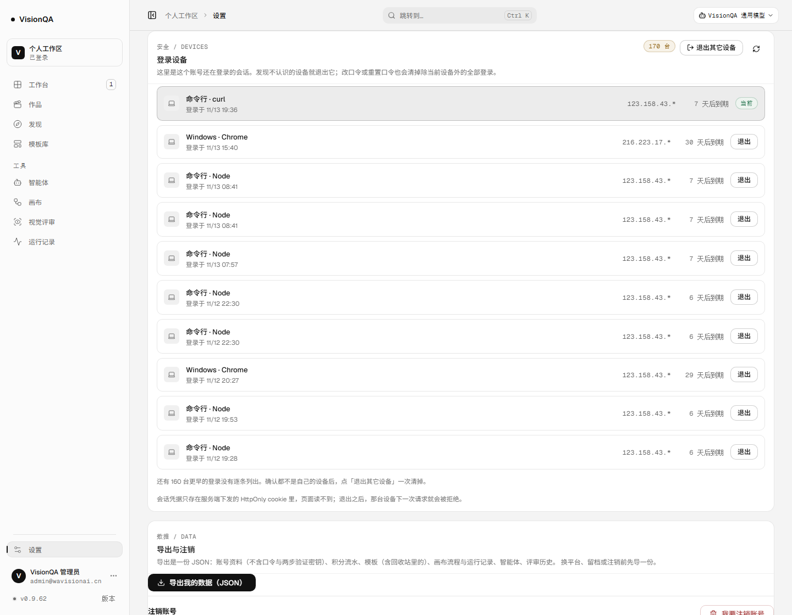

# 登录设备：自己能看到、能踢掉的那几台（v0.9.62）

## 为什么做这一篇

B7 一直写着「2FA 已有，但没有设备列表、没有异地提醒」。没有列表意味着：口令如果在别处泄露，账号主人无从知道有谁在用这个账号；改口令虽然会清掉其它会话，但那是一刀切，代价是所有设备重新登录。

这一轮先做**能自己核对与处理**的那一半：列出这个账号还在登录的会话、单独踢掉某台、一次退出其它所有设备。异地登录邮件提醒需要 SMTP 凭据（还没给），留给那一项。

## 做了什么

- **服务端只给主人看自己的会话**（`server/auth.mjs`）：`listLoginSessions()` / `revokeLoginSession()`。对外 id 是 `token_hash` 的派生值（16 位十六进制），**不是** token，也反推不出 token；响应里没有 `token_hash`、没有 token。
- **三条接口**（`server/routes/auth.mjs`）：`GET /api/auth/sessions`（要登录）、`DELETE /api/auth/sessions/:id`、`POST /api/auth/sessions/revoke-others`；后两个写 `session-revoke` / `session-revoke-others` 事件。当前设备不能从列表里踢——那是「退出登录」的事，避免按钮点错把自己踢下线；踢别人的会话一律 404。
- **列表口径**：只列未过期会话，**当前这条永远排第一**；最多列 10 条，但总数说真话（生产上是 170 台，界面写「还有 160 台更早的登录没有逐条列出」，并提示用「退出其它设备」一次清掉）。
- **设备名与 IP**（`src/domain/device.ts`，纯函数）：Windows / Mac / iPhone / iPad / Android / Linux / ChromeOS × Chrome / Edge / Safari / Firefox / Opera；`node`、`curl`、`python-requests`、`qa-screenshot` 这类脚本登录标成「命令行 · Node / curl / Python」，不再一律叫「未知设备」；IP 只露到网段（`123.158.43.*`、`2408:8207:…`），本机写「本机」。
- **设置页新增「登录设备」卡**（`src/components/SessionsCard.tsx`）：当前设备高亮 + 「当前」胶囊，别的设备一行一个「退出」；标题有两个动作：「退出其它设备」和刷新。放在两步验证下面、导出与注销上面。

## 生产验收（v0.9.62）

| 动作 | 结果 |
| --- | --- |
| `/api/version` | `0.9.62` |
| `GET /api/auth/sessions`（登录态） | `total 170`、`sessions 10`、第一条 `current: true` |
| 设置页渲染 | 10 行设备，当前行高亮，其它行都有「退出」；计数胶囊「170 台」 |
| `DELETE` 当前会话 | **400** `{"error":"当前设备请用「退出登录」"}`，会话不变 |
| 之后 `/api/auth/me` | 200（没有被误踢） |
| 控制台报错 | 0 |

## 一个真实的发现

生产上这个账号积了 **170 条未过期会话**（11/09 起，绝大多数是自动化脚本 node / curl / Python 登录留下的，7 天或 30 天有效期）。以前没有任何界面能看到这件事，现在能了。

我**没有**在生产上点「退出其它设备」：那会连用户浏览器里可能正在用的会话一起注销。这条留给用户确认后自己点（一次点击、可重新登录）。

## 测试

新增 `test/sessions.test.mjs` 6 条：只列本账号且当前条目标出、id 是派生值（不含 token / token_hash）、踢掉后 token 立刻失效、当前设备与别人的会话踢不到、路由 401 / 200 / 400 / 404 与一键退出、老会话积压时只列 10 条但总数说真话，以及设备名 / IP / 到期天数的纯函数口径。

全套 **549/549**；oxlint 0 error / 7 warning（无新增）；`tsc -b` 干净；构建通过（入口 `index-BCZlZ4-S.js`）。

## 边界

- 没有「最后活动时间」：要每请求写库，成本与收益不划算；这一版只显示登录时间与到期时间。
- 没有异地登录邮件提醒（A5 SMTP 凭据未给）。
- 列表只列最近 10 条，更早的只能整批退出，不能逐条核对。
- IP 只露到网段，无法凭 IP 精确定位设备；会话记录里也不含浏览器指纹。

## 回滚

`bash /opt/visionqa/ops/rollback.sh`；无数据迁移（只多读了一次 `sessions` 表）。
