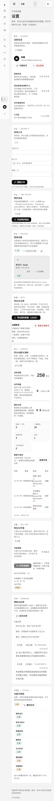
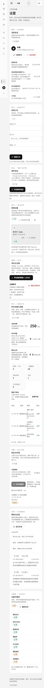
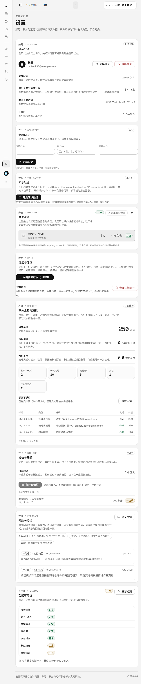
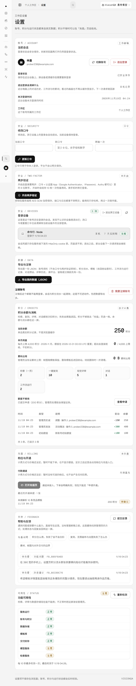
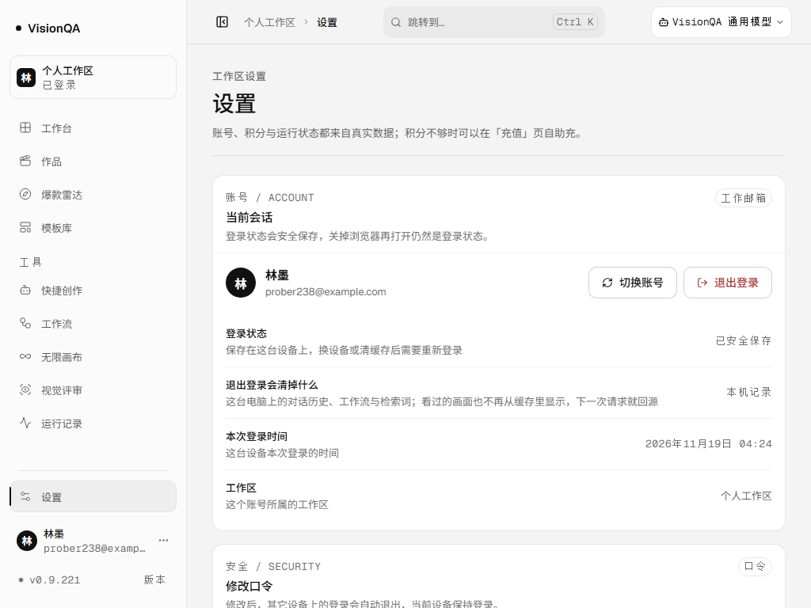

# 设置页：手机与平板把小字抬到 13px、点按区抬到 40/44px（r238 / v0.9.222）

2026-11-19 用无头 Chromium 在 390 / 768 / 1024 上量设置页：这一页几乎全是原子组件，
小字都停在 11.5–12.5px（卡头 mono 12、`Tag` / `Pill` 12、口令说明 11.5、会话 IP 11.5、
流水表头 12、价格标签 11.5、反馈时间 11.5、健康行 12.5），点按区停在 28–32px
（按钮 32、图标按钮 32、口令输入 32、帮助链接 31）。这一版按 r236 / r237 的同一套档位收口：
**1080 以下小字 13px、按钮手机 44px / 平板 40px，桌面（1081 起）一个字段没动。**

## 结论

| 宽度 | 小于 13px 的文字（改前 → 改后） | 不到 40px 的点按区（改前 → 改后） | 页面高度 |
| --- | --- | --- | --- |
| 320 | 未单独量 → **0** | 未单独量 → **0** | 8119px，scrollWidth == clientWidth |
| 390 | 69 → **0** | 18 → **0** | 5679 → 5947px |
| 768 | 67 → **0** | 18 → **0** | 3717 → 3849px |
| 1024 | 67 → **0** | 18 → **0** | 900px（外壳内部滚动，同改前） |
| 1440（不动） | 74 → 74 | 32 → 32 | 900px |

没有横向溢出（320 / 390 / 768 / 1024 的 `scrollWidth` 都等于 `innerWidth`，容器内也没有越界元素）。
390 页面高度 +268px（+4.7%）是字大了一档、按钮从 32 到 44 的代价，没有靠收行距或压 padding 换回来。

改前的 69 处比上一轮路线图里记的 49 处多：那次只量到新账号的空白设置页，这次种了 3 条积分流水、
1 张开通单据、2 条反馈、3 个档位、每月额度 4000，行变多了，同一页的小字也多了。
设置页的小字数量跟这个账号有多少数据有关，不是固定值。

## 改了什么

规则全部挂在 `.vq-page--settings` 下（设置页根元素新加的修饰类），写在新建的
`src/styles/settings.css`，在 `credits.css` 之后加载——只影响设置页，别的页面与后台管理台一条都不生效。

| 位置 | 改前 | 改后（≤1080 / ≤560） |
| --- | --- | --- |
| 卡头 mono（账号 / 安全 / 积分 / 充值 / 支持 / 可用性） | 12px | **13px** |
| `Tag`（工作邮箱 / 口令 / 按次计费 / 未开通 / 功能问题） | 12px，高 20 | **13px，高 24** |
| `Pill`（未开启 / 1 台 / 当前 / 待确认 / 待处理 / 正常 / 注意） | 12px，高 22 | **13px，高 24** |
| 表单字段标签（当前口令 / 新口令 / 再输一次） | 12px | **13px** |
| 口令输入框 | 32px，12.5px 字 | **40px / 44px，14px 字** |
| 口令说明、两步验证说明、会话说明、单据说明、本月花费说明 | 11.5 / 12px | **13px** |
| 会话「登录于」、IP、到期时间 | 11.5px | **13px** |
| 积分流水表头 | 12px | **13px** |
| 积分流水时间 / 类型（手机上原本被压到 12） | 11.5 / 12px | **13px** |
| 价格五格（检索 / 一键复刻 / 视觉评审 / 对话 / 工作流运行） | 11.5px | **13px** |
| 开通单据时间、反馈时间、健康行耗时 | 12 / 11.5 / 12px | **13px** |
| 健康检查行标题 | 12.5px | **13px** |
| 帮助链接（三枚说明胶囊） | 31px 高 | **40px / 44px** |
| 页面内所有按钮（切换账号 / 退出登录 / 更新口令 / 开启两步验证 / 退出其它设备 / 导出数据 / 注销账号 / 查看申请 / 打开充值页 / 提交反馈 / 重新检测） | 28–32px | **40px / 44px**（`--btn-h`、`--btn-h-sm` 两个 token 一起抬） |
| 图标按钮（刷新登录设备） | 32×32 | **40×40 / 44×44** |

## 门禁与生产

| 项 | 结果 |
| --- | --- |
| 测试 | npm test 见下方发布记录（本轮新增 `test/settings-mobile.test.mjs` 7 条） |
| lint / 类型 | 见发布记录 |
| 构建 | 见发布记录 |
| 生产 | 见发布记录 |

## 截图（390 / 768，生产模式，临时实例样例数据）

## 边界

1. 只按 Chromium（Edge 157）无头实测，没有真机触屏 / Safari / Firefox；量了 320 / 390 / 768 / 1024 / 1440，561–767、769–1079 未逐档量（规则按 1080 / 560 两个断点收口）。
2. 截图与量测都在本机临时实例（`.tmp-r238-dta`）+ 样例数据上：3 个档位、每月额度 4000、3 条积分流水、1 张开通单据、2 条反馈、健康检查真探活。不是生产数据。
3. 探针跑的是生产模式（`VQ_UI_MODE` 未设），所以健康行的「详情」「耗时」两列没有渲染；`.vq-health-row .ms` 的 13px 只由单测锁住，界面里没截到（内测模式才显示）。
4. 积分流水仍是 5 列表格：手机上隐藏「余额」列（沿用旧规则），「说明」列会折 3–5 行；这次只抬字号，没有把表格改成卡片。要改结构是另一件事。
5. 设置页之外的页面没动：`.vq-page--settings` 是新增修饰类，`credits.css` / `shell.css` 的基样式没改；后台管理台与雷达页的输入框、胶囊尺寸与原样一致（未复量后台）。
6. 桌面 1440 只做了元素级对照（小字 74 / 点按区 32，改前改后完全一致），没有逐像素比图。
7. 帮助链接从 31 到 44 之后，反馈卡片的「先看说明」一行在 390 上会占三行（原来两行），卡片更高。
