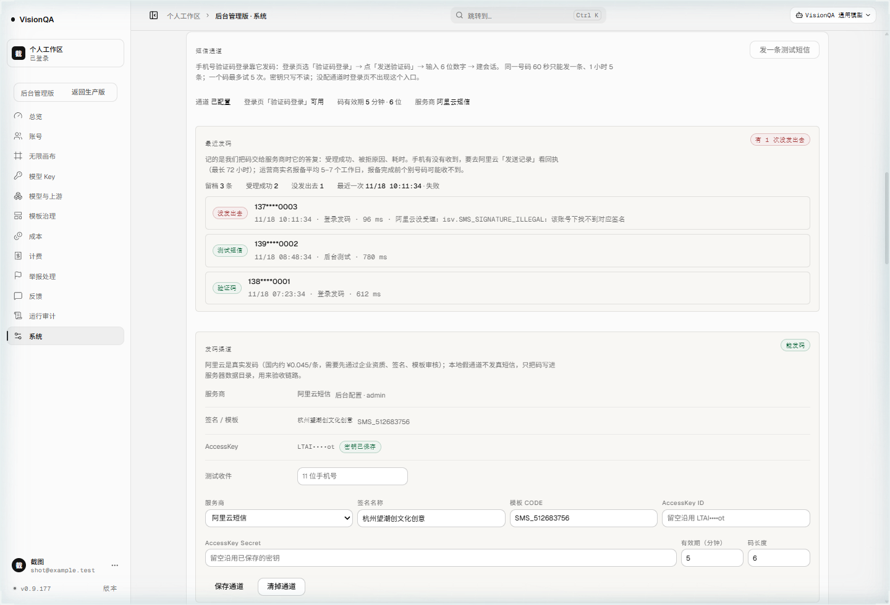
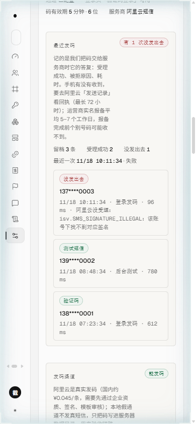

# 发码结果留档：后台自己就能看见「最近发了几条、哪条没发出去」（2026-11-18，0.9.177）

## 为什么加这个

短信验证码登录 2026-11-18 上线后有一块盲区：**发码失败时，错误只回给那个点「发送验证码」的人，后台不知道**。而运营商实名报备还没走完（阿里云口径：平均 5–7 个工作日，部分 7–10 个），报备完成前个别号码本来就可能收不到——这种「无事发生」的失败，运维这边没有任何地方能看见。

运营要能一句话回答：今天发了几条？有没有被拒？为什么被拒？

## 做了什么

| 位置 | 改动 |
| --- | --- |
| `server/sms-usage.mjs`（新） | `DATA_DIR/sms-usage.json`，最多留 50 条；`0600`、临时文件 + rename 原子替换；**只存掩码号码**（138\*\*\*\*0001），明文不落盘、不出响应；文件坏了或没写过都当空，不让一份日志把后台搞崩 |
| `POST /api/auth/sms/send` | 成功与失败都记一条（`source=login`），失败带服务商错误码与原因；没账号的号码不发码，也就不记（避免日志变成账号探针的旁路） |
| `POST /api/admin/sms/test` | 同样记一条（`source=test`） |
| `GET /api/admin/sms` | 多回一个 `usage`：留档总数 / 受理成功 / 没发出去 / 最近一次 / 最近 5 条明细 |
| 后台「系统 → 短信通道」 | 新增「最近发码」一块：右上徽标说有没有失败，每行是「结果 + 掩码号码 + 时间 + 来源 + 耗时 + 失败原因」 |
| `scripts/sms-send-test-once.mjs` | 顺手修掉打错字段：原来打 `sent.bizId`，真实字段是 `requestId`，BizId 一直是空的；这个运维脚本现在也记一条 |

### 截图

1440 宽（整张卡）：

390 宽：

> 截图里的号码与毫秒数是**临时实例手写的样例数据**（三个假号码，一条故意做成签名被拒），不是生产真实发码记录。生产这份要等真实登录发码后才长出来。

## 真实验证（生产 + 阿里云发送记录）

| 时间（2026-11-18） | 收件（掩码） | 阿里云发送状态 |
| --- | --- | --- |
| 10:08:07 提交 / 10:08:21 回执 | 133\*\*\*\*5476 | **发送成功**（14 秒） |
| 10:17:51 提交 | 197\*\*\*\*5116 | **发送中**（已到运营商网关，回执最长 72 小时） |

发送结果取自阿里云「发送记录」，流水号形如 `524414994968271466^0`；两条都是本次用 `scripts/sms-send-test-once.mjs` 发的，脚本已补记一条进 `sms-usage.json`。

## 边界

- **这里记的是「服务商受理」，不是「手机收到」**。有没有真到手机，只能看阿里云发送记录的回执；运营商侧没有给我们回调接口。
- 自定义签名「VisionQA」**未通过**（2026-11-17 17:43:14 提交，17:43:44 未通过，工单 20095877624）——30 秒就出结果，属于资质与签名名不匹配那类。阿里云自己推荐直接用企事业单位全称/简称的赠送签名（报备更快、通过率更高），所以继续用赠送签名，不再折腾自申请那条。
- 阿里云发送明细只保留 90 天；我们这份只留 50 条，是给人看的「最近怎么样」，**不是审计流水**。
