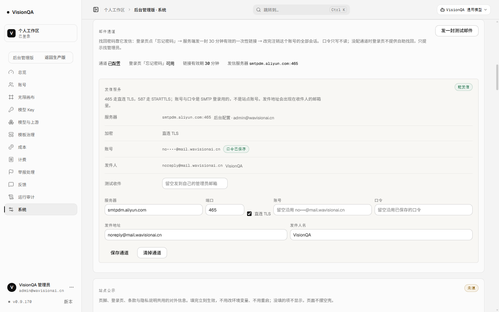
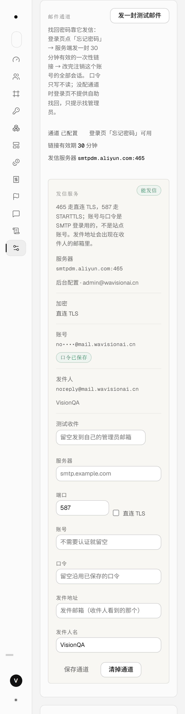

# 邮件通道落地：阿里云邮件推送 + 生产第一次真发信（2026-11-17）

找回密码一直卡在「没有 SMTP 凭据」。这轮把它办完：开通服务、加 DNS、建发信地址、设 SMTP 口令，配进 VisionQA 后台，**并从生产真发出去、在真实收件箱里收到了**。

## 一、为什么是阿里云邮件推送（DirectMail）

到动手前有三个候选：阿里云 DirectMail、腾讯云 SES、Resend / SendGrid 这类海外 SaaS。选 DirectMail 的三条理由，按权重排：

1. **同一套账号同一片网络**：生产 ECS 在阿里云（`139.196.123.28`），域名 `wavisionai.cn` 的 NS 本来就指向阿里云（`dns29/dns30.hichina.com`）。加解析、开服务、看发信日志都在一个控制台里，不用再把 DNS 授权给第二家。
2. **出网限制少**：阿里云 ECS 默认封 25 端口，DirectMail 给的是 **465 直连 TLS / 587 STARTTLS / 80**，其中 465 从 ECS 出网不受限（本轮实测走的就是 465）。
3. **免费额度够用**：日 2,000 封 / 月 62,000 封，免费额度共 2,000 封。找回密码这个量级（每次一封）几年都用不完，不必先谈商务。

## 二、开通与配置（都在用户自己的阿里云账号里）

| 步骤 | 结果 |
| --- | --- |
| 开通邮件推送 | 订单 `2008555321250135`，**0 元**；用户状态「正常」，信誉等级 2 |
| 额度 | 日 **2,000** 封 / 月 **62,000** 封；免费额度 2,000 封，开通当日剩余 200 封 |
| 发信域名 | `mail.wavisionai.cn`（二级域名，不占主域的企业邮箱）→ **验证通过**（2026-11-17 13:49） |
| DNS 记录 | 4 条加在 `wavisionai.cn` 的云解析里，原有 5 条 A 记录一条没动 |
| 发信地址 | `noreply@mail.wavisionai.cn`，类型 **触发邮件**（注册激活、密码找回这一类），状态 正常 |
| SMTP 口令 | 在控制台「SMTP 设置」里生成并保存（不落仓库、不落文档） |

**4 条 DNS 记录**：

| 主机记录 | 类型 | 值 |
| --- | --- | --- |
| `mail` | MX（优先级 10） | `mx01.dm.aliyun.com` |
| `mail` | TXT | `v=spf1 include:spf1.dm.aliyun.com -all` |
| `aliyun-cn-hangzhou._domainkey.mail` | TXT | DKIM 公钥（`v=DKIM1; k=rsa; p=MIGf…`） |
| `_dmarc.mail` | TXT | `v=DMARC1;p=none;rua=mailto:<举报邮箱>` |

> `mail` 这条 MX 是给**退信**用的（`@mail.wavisionai.cn` 的退信回到阿里云），它不等于主域 `wavisionai.cn` 能收信——这个区别后来正好解释了一次「测试信显示失败」。

## 三、VisionQA 后台填的是什么

`PUT /api/admin/mail/channel`：

```json
{
  "host": "smtpdm.aliyun.com",
  "port": 465,
  "secure": true,
  "user": "noreply@mail.wavisionai.cn",
  "fromAddress": "noreply@mail.wavisionai.cn",
  "fromName": "VisionQA",
  "enabled": true
}
```

配好之后后台表单会把「除口令以外」的字段填回来（服务器、端口、直连 TLS、发件地址、发件人名），账号只给掩码并留空——**留空即沿用**，只改端口不用重打账号、也不会把口令弄丢（0.9.170 起；之前账号空着重存会报「填了口令就要填账号」）。

口令只在这一次请求里出现，之后后台只回掩码（`no••••@mail.wavisionai.cn` + `hasPassword:true`），明文只落在生产 `/var/lib/visionqa/mail.json`（`0600`）。

填完这两个开关跟着变：`mail.configured:true`、`passwordReset:true`（登录页「忘记密码」从「找管理员」变成真发信，链接 30 分钟有效）。



## 四、验证：不是「保存成功」，是「对方收到了」

1. **后台测通道**：`POST /api/admin/mail/test` 两次都是 **200**（`ms` 156 / 204），不是「已保存」那种假成功。
2. **真实收件箱**：把测试信发到一个外部临时邮箱（`api.mail.tm` 建的账号），**2 秒内收到**：主题「VisionQA 邮件通道测试」、发信人 `VisionQA <noreply@mail.wavisionai.cn>`、正文中文完整（base64 编码没把中文弄坏）。
3. **服务商侧对账**：阿里云「发送详情」里这两封是 **成功 / `250 Send Mail OK`**（14:35:49、14:36:11）。

## 五、踩到并留下的三个事实

1. **口令设完要等 1~2 分钟**：刚设完立刻用，SMTP 回 `535 Authentication failure`（`ms` 266 / 64）；几分钟后同一口令 `235 Authentication successful`。后台报错里写的是「AUTH PLAIN（账号或口令不对）」，别急着改口令，先等两分钟。
2. **`admin@wavisionai.cn` 收不到信**：测试信第一、二封默认发到管理员邮箱，两封都 失败——`收信域名 MX 地址不对`。因为主域 `wavisionai.cn` 至今没有 MX（我们只给 `mail.wavisionai.cn` 加了解析）。**要让管理员自己也能收「忘记密码」的信，得换一个真实可收信的邮箱，或者给主域配一套邮箱**。→ 已按用户提供的真实邮箱换掉（改 users.email，kind 仍是 admin，口令不变）：新邮箱登录 200，测试信 200 / 160 ms。**这个地址属于个人信息，不入仓库、不写进文档与截图。**
3. **两个普通账号的邮箱是占位符**：`login_name` 是用户名（手机号），邮箱字段是 `@login.visionqa.local` 占位，所以**它们的找回密码永远发不出去**。真实用户注册时填了真邮箱才有用。

## 六、窄屏现状（未修，记在这）

后台「系统」页在 **390 宽**下虽然能用（侧栏收成图标栏、卡片单列），但正文列只有约 215 px，中文会在词中间断行（下图）。这是后台壳层的既有问题，不在本轮范围。



## 七、回滚

```bash
# 停用这条通道（登录页立刻退回「找管理员」）
curl -X DELETE -b "<admin cookie>" https://visionqa.wavisionai.cn/api/admin/mail/channel
```

服务商侧：控制台「发信地址」可停用/删除 `noreply@mail.wavisionai.cn`；「邮件推送」整体可退订（0 元订单，无违约金），DNS 4 条记录删掉即回到原状。
