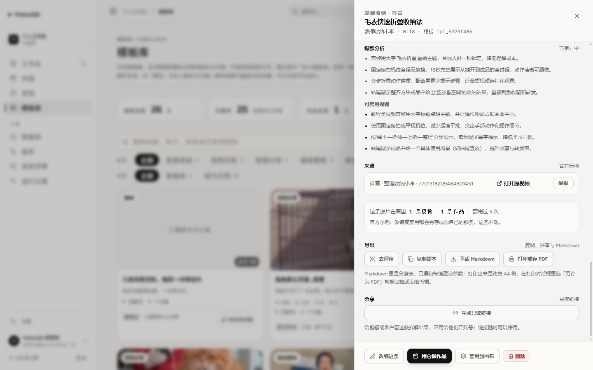
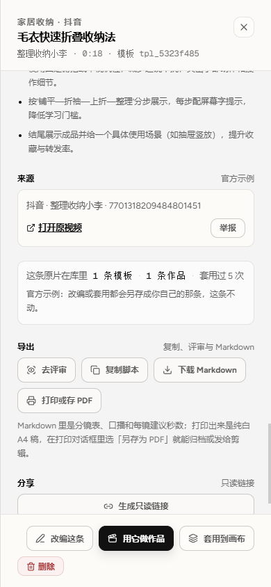
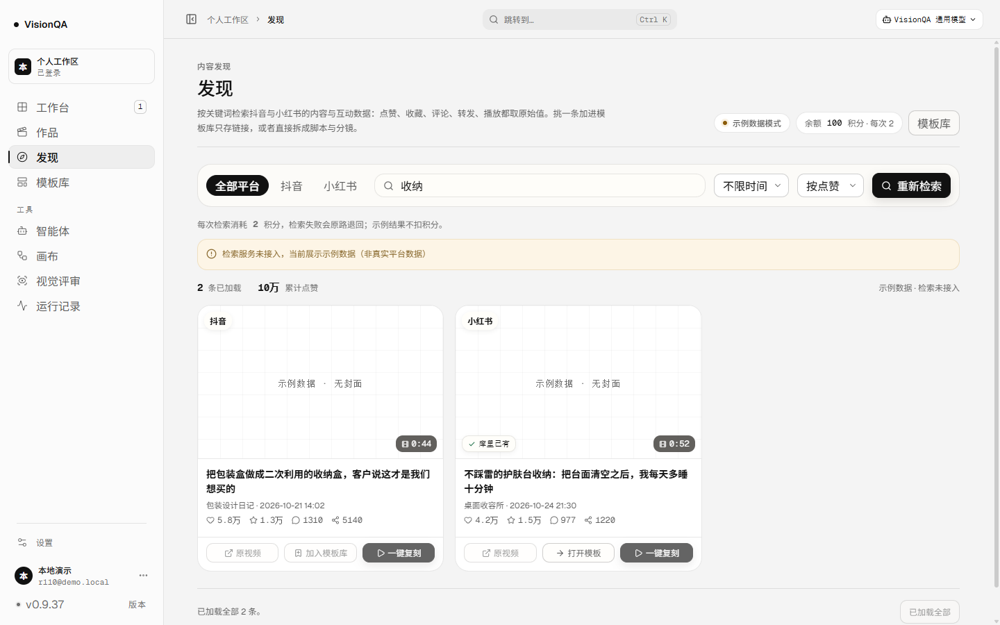
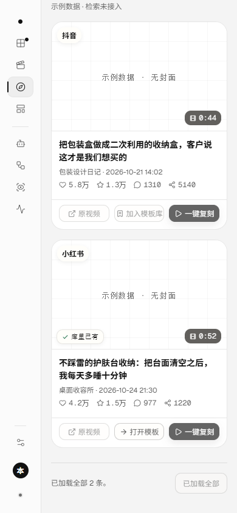
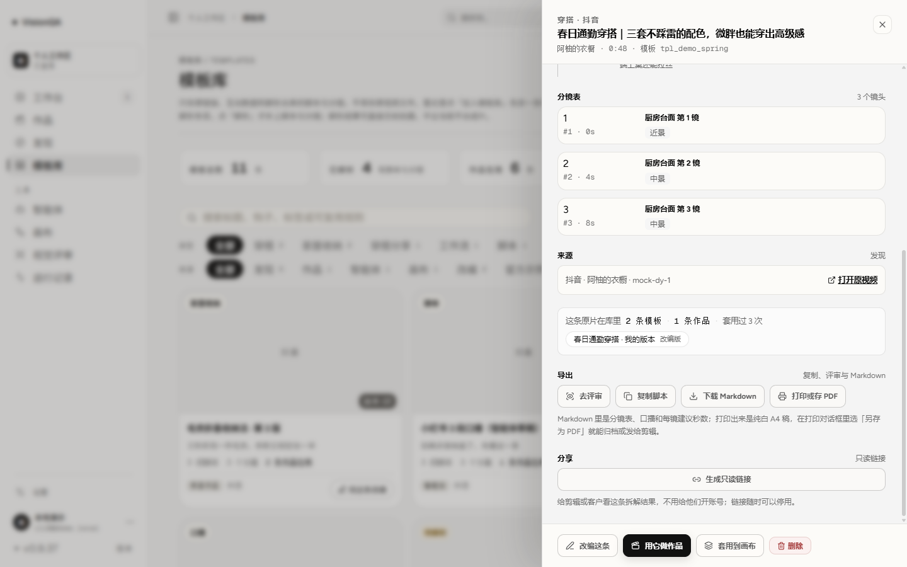

# 同一条原片，库里已经留下了什么（v0.9.38）

版本 0.9.38 / 发布包 20261112-235114-2026-11-13-library-origi.tar.gz / 入口 index-DhPC7_xe.js（501,676 字节）

结论：来源 → 模板 这一段以前缺一个回答——**「这条我是不是已经有了？」**。
发现页的检索卡片只有「加入模板库」，收过的内容再点一次只会退成一句「这条已经在模板库里了」，
然后没有出路；模板详情只看得见「这条模板名下的作品」，以它为底改编出的那条是另一条模板，
看上去像两条不相干的来源。这一轮把「一条原片在库里的足迹」做成一套口径，铺在两个地方。

## 一、认原片的口径（server/source-footprint.mjs）

- **平台 + 平台 id 优先**：链接会被加分享参数、末尾斜杠或 #，平台 id 不会。模板侧的 sourceId 与检索条目的 id 是同一个东西。
- 没有平台 id 时**退回规范化链接**，与发现页「库里的原片」共用 `originKey`，不另写第二份规则。
- 画布 / 智能体 / 作品沉淀出来的模板本来就没有原片，identity 为 `null`：两个地方都不出现，不假装它们有来源。
- 统计只现算、不落库：`templateCount`（含当前这条）、`siblings`（其余同源模板）、
  `workCount`（一条作品多版只算一条；同一条作品出现两次取最近改动的那行）、
  `applied`（组内 reuseCount 之和）、`shared`（整组都是官方示例）、`lastAt`（模板与作品里最近一次变动）。
- 命中的代表条目**先挑有作品的，再挑自己的，最后才是最近存进来的**：改编过的原片不会把你指回官方示例那条。

## 二、两个界面

1. **模板详情 · 来源**：多一块「这条原片在库里」——
   `2 条模板 · 1 条作品 · 套用过 3 次`，下面是把同源模板做成胶囊（点一下切到那条）；
   只有一条时写明「这条原片在库里只有这一条模板」，官方示例写明「改编或套用都会另存成你自己的那条，这条不动」。
2. **发现页 · 检索卡片**：封面左下角一枚「库里已有」（有作品时写「库里已有 · 1 条作品」），
   操作行里的「加入模板库」换成「打开模板」，点进去就是已有的那条，不必先落一次库再被去重。

接口（都只读现算，不检索、不扣积分）：

- `GET /api/templates/<id>` 多一段 `footprint`（没有原片的模板为 `null`）。
- `POST /api/library/marks`：一次最多问 50 条（一页 24 条，翻两页也够）。非 POST 405、未登录 401、没身份的条目不命中。

## 三、验收

- 生产 **v0.9.38**、入口 `index-DhPC7_xe.js`（501,676 字节）、release `20261112-235114-2026-11-13-library-origi.tar.gz`、
  `/api/version` 0.9.38、`/api/health` ok（templates 26）、`visionqa` 与 `visionqa-internal` 两服务 active。
- **生产零写入**：核对前后 `/api/projects`、`/api/templates`、`/api/flows` 的 id/version/updatedAt 完全一致（1 / 26 / 7）。
- 生产 `GET /api/templates/tpl_5323f485` → footprint：1 条模板 · 1 条作品（毛衣折叠收纳法 v2）· 套用过 5 次 · shared true（官方示例）。
  生产 `GET /api/templates/tpl_8cfe9e23`（智能体草稿）→ `footprint: null`，没有原片的模板不出这块。
- 生产 `POST /api/library/marks`：用三条真实平台 id（取自库里模板自己的 sourceId）→ total 3 / matched 3、返回的 templateId 与库里那条对得上；
  一条库里没有的 id → matched 0；没有平台 id 也没有链接的条目 → matched 0；未登录 401、GET 405。
- 1440 与 390 打开模板详情：`scrollWidth == clientWidth`（1440/1440、390/390）。
- 本地演示数据（非生产，示例数据、不扣积分）：检索「收纳」两条里被收过的那条带「库里已有」，
  未收过的那条仍是「加入模板库」；同一张卡片点「打开模板」进 `#/templates/tpl_demo_desk`；
  检索「通勤」时那枚标记写「库里已有 · 1 条作品」；模板 `tpl_demo_spring` 的抽屉里读出
  「2 条模板 · 1 条作品 · 套用过 3 次」+ 同源胶囊「春日通勤穿搭 · 我的版本（改编版）」；390 上胶囊不自叠（与时长互不重叠）。
- `npm test` **369/369**（新增 `test/source-footprint.test.mjs` 14 条）、oxlint **0 error / 6 warning**（既有文件）、`tsc -b` 干净。

## 四、截图

## 五、边界

- **这一轮没有发起真实检索**（检索按次计费 2 积分）：卡片上的标记在本地示例数据上验，生产用真实平台 id 直接打接口验；
  两边说的是同一套口径，但「生产检索结果里的标记」本身还没有实拍。
- 标记只是标记：不自动收录、不自动去重、不改库里任何一条模板；点「打开模板」才走已有的路由。
- 没有原片的模板（画布 / 智能体 / 作品沉淀）不出现这块，也不出现在检索卡片的命中里。
- 只回答「库里有没有这条原片」，不回答「这条内容值不值得收」。

## 六、提交与 CI

- `341c998`（代码 + 测试）：口径 `server/source-footprint.mjs`、两个接口、模板详情与检索卡片。
- `39275f6`（文档 + 截图）：这一页、README 第一百零七节、产品结构文档 v0.9.38 块、5 张截图。
- CI `43332606520` **success**。
