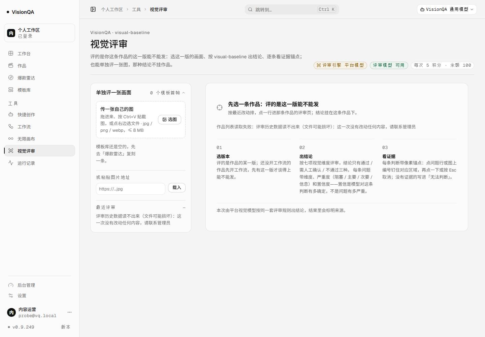
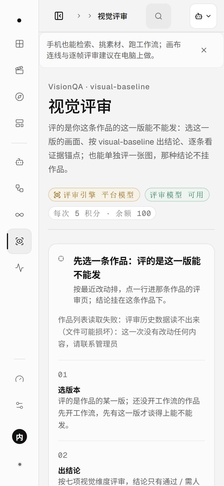

# 用户数据存储读不出来时不再当空库（r267 / v0.9.249）

接 r265。上一轮把「读失败一律当空库」这条规矩先用在模板库、作品库、工作流、运行记录上，这一轮把剩下的用户数据补齐，并修掉两处在界面上自相矛盾的写法。

## 一、为什么还要做一轮

这些存储都是同一个写法：整份读出来 → 改一条 → 整份写回。读失败时 `catch { cache = [] }`，
于是文件坏一次（JSON 写坏、权限不对、盘上留了半个文件），页面就显示「一条都没有」；
用户随手新建一条，整份历史被这一条覆盖 —— **数据静默丢失，没有任何提示**。

r265 只收了四份。剩下的评审历史、智能体运行记录、检索历史、已看过、人工拍板、举报、
反馈、前端异常、告警及外推队列，仍然是老写法。

## 二、这一轮收进哪些存储

| 文件 | 存储 | 读不出来时用户看到 |
| --- | --- | --- |
| `reviews.json` | 评审历史 | 视觉评审页「最近评审」报读不出来 |
| `agent-runs.json` | 智能体运行记录 | 运行记录列表报错 |
| `search-history.json` | 检索历史 | 爆款雷达的历史读不到（本地空列表，检索本身照常） |
| `review-acks.json` | 评审「已看过」 | 待办里的已看过状态读不出来 |
| `review-decisions.json` | 人工拍板 | 拍板记录读不出来 |
| `reports.json` | 举报队列 | 后台「举报处理」报错 |
| `feedback.json` | 应用内反馈 | 后台「反馈」报错 |
| `client-errors.json` | 前端异常记录 | 后台「系统」该块报错 |
| `alerts.json` | 告警 | 后台告警页报错 |
| `alert-outbox.json` | 告警外推队列 | 队列读不出来（对象形态，单独判） |

写法与 r265 一致：`loadAll` 改用 [server/json-store.mjs](server/json-store.mjs) 的 `readStoreArray`，
只有 ENOENT 算空库；`persist` 开头一句 `if (readError) throw readError` —— **这一次读失败过就不许写回**，
一个字节都不动。文件修好后下一次请求自动恢复，不用重启。

外推队列不是数组，所以单独判：ENOENT → 空队列（没配通道时就是没有这份文件），
读不动或不是合法 JSON → 抛 `STORE_UNREADABLE`，`persistOutbox` 同样拒绝写回。

## 三、顺手修的两处

1. **未 await 的告警会把进程带走**：`server/service-state.mjs` 里 `void recordAlert(...)` 没有 `catch`。
   告警存储要是一份坏文件，模型失败这条路径会留下一个未处理的 Promise 拒绝。
   现在补上 `.catch(() => {})`——**告警写不进去不该把请求也打挂**。
2. **报错旁边还写着「一条都没有」**：视觉评审页「最近评审」在读取失败时，
   下面照样渲染「还没有评审记录；评审成功一次就会出现在这里」，标题旁还写一个「0」。
   现在失败只报读不出来，计数显示「—」，不再同时说「没有」和「读不出来」。
   证据在下面两张图里：整屏只有一句读不出来的说明，没有「0」、没有「还没有」。





## 四、上线前先核对了生产数据的形状（只读）

收紧读取条件之前，先确认线上这些文件本来就是数组/对象，不会因为「顶层不是数组」被误判成损坏：

```
reviews.json        array:3      agent-runs.json     array:14
search-history.json array:2      review-acks.json    array:1
review-decisions.json array:0    reports.json        array:0
feedback.json       array:4      client-errors.json  array:21
alerts.json         array:16     alert-outbox.json   object: items,sent
```

## 五、验收

- 新增 `test/store-corrupt-user-data.test.mjs` 7 条：十份文件同时写坏，逐个断言「读要报错 + 写被拒 + 文件一个字节没动」；其中告警那条断言 `recordAlert` 返回 `null`（它自己绝不往上抛）。
- 扩 `test/store-missing.test.mjs` 2 条：同样的文件不存在时是空库，第一条记录照常落盘。
- 全量 **1760/1760**、lint 0 error / 25 warning（635 文件）、`tsc -b` 干净、build 入口 `index-sCbYe-at.js`、密钥扫描无命中。
- 本机临时实例真跑：`GET /api/reviews?limit=6` 在文件写坏时回 500 与
  「评审历史数据读不出来（文件可能损坏）：这一次没有改动任何内容，请联系管理员」，
  页面两张截图即上面那两张。

## 六、边界（没做的）

- `agents.json`（自建智能体）仍是「坏文件改名备份 + 内存空列表」，没改成抛错：
  智能体列表几乎是每个创作页的入口，直接抛错会让整站不可用；改名备份至少保住了原件。
  这一条留作后续按「界面上说明并给修复入口」的方式再处理。
- 前端异常、检索历史这类偏「便利」的数据，读不出来时前端是静默空列表（不弹错），
  只有后台那几页会明说读不出来。
- 没做自动修复、没做坏文件的界面恢复入口，也没改并发写（仍是单进程内串行）。
- 本轮 0 次真实上游调用、0 费用。
