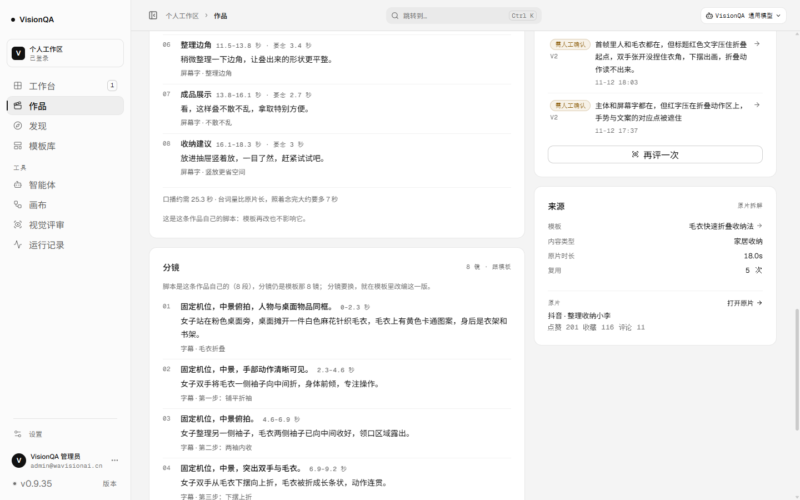
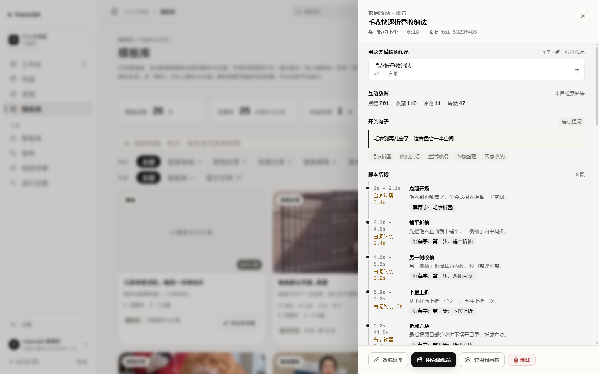
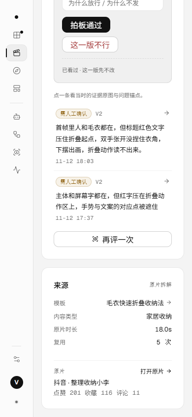
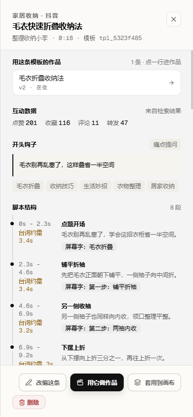
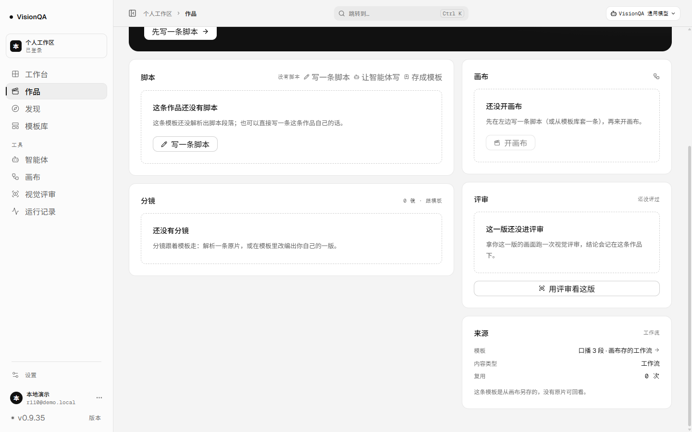

# 模板有了地址：作品页的来源能点回模板与原片（v0.9.35，2026-11-13）

版本 0.9.35 / 发布包 `20261112-225654-2026-11-13-template-addr.tar.gz` / 入口 `index-CD52kt6I.js`（493,197 字节）/ 提交 `f7f4f74` + `2b62d9b` / CI run 43324838179 success

结论：**作品主线走到 v0.9.34，六个页面都认自己的作品了，但「来源」这一段还是断的**——作品页右栏写着「模板 · 毛衣快速折叠收纳法」，点不开；原片是谁、多少赞也看不到。模板是全站唯一没有地址的内容对象（作品、评审、运行、画布都有）。这一轮做两件事：**模板成为可寻址对象（`#/templates/<id>`）**，**作品页的来源面板点得进那条模板，并看得到原片**。不新增页面、不落库、不调模型。

## 1. 为什么是「给地址」而不是「再做一个详情页」

模板早就有完整的抽屉：脚本结构、分镜、互动数据、用它做过的作品、改编与导出。缺的不是内容，是**能指**——不能刷新、不能后退、不能从别处直接点进来。

| 对象 | 现在的地址 |
| --- | --- |
| 作品 | `#/projects/<作品 id>` |
| 评审记录 | `#/review/<评审 id>`、`#/review/project/<作品 id>` |
| 画布 | `#/canvas/<流程 id>`、`#/canvas/project/<画布 id>` |
| **模板** | **`#/templates/<模板 id>`（本轮新增）** |

地址指向**同一个抽屉**，不复制一份「模板详情页」：一屏里改的东西只有一处，两处详情早晚对不上。

## 2. 三个口径决定

1. **地址是唯一真源**。页面自己不另存「开着哪条」：进页面按地址取详情，点卡片先改地址、抽屉跟着地址开。关抽屉用 `replace` 回 `#/templates`——后退回到**进来之前那一页**（比如作品页），而不是把刚关掉的模板重新打开。
2. **打不开就说打不开**。地址里那条模板被删了、或不在当前账号下：弹一句明话，地址换回 `#/templates`，不挂一个空壳抽屉在地址栏上。慢返回不覆盖新点击（`lastRequested` 记录正在为哪条取详情）。
3. **来源只说事实**。`server/project-source.mjs` 现算「这条模板从哪来」：有原片链接才算原片（带平台、作者、发布时间、互动数）；画布另存的、智能体草稿存的写「没有原片可回看」；老数据没有来源信息就**整块不显示**，不编「来源未知」。原片时长只在有原片时写——画布模板写 `0.0s` 是编的。

## 3. 改了什么

| 文件 | 改动 |
| --- | --- |
| `server/project-source.mjs`（新） | `templateOrigin()` / `originStats()`：纯函数，判定与折算全在这里，测试不用起服务 |
| `server/routes/projects.mjs` | 作品详情里的 `template` 多一个 `origin`（每次现算，不落库） |
| `src/router.ts` | `#/templates/<id>` 的 parse / toHash / routeKey |
| `src/pages/TemplateLibraryPage.tsx` | 抽屉跟着地址开合；点卡片、点行内「用这条改编」都先改地址 |
| `src/pages/ProjectPage.tsx` | 来源面板：模板名可点（`#/templates/<id>`），下面是原片 / 没有原片的实情 |
| `src/App.tsx`、`src/styles/projects.css`、`src/domain/project.ts` | 接线、类型与版式 |

模板抽屉里本来就有「用这条模板的作品 · 1 条 · 点一行进作品」——现在这条回路是**双向**的：作品 → 模板 → 那条作品。

## 4. 验收

生产 **v0.9.35**、入口 `index-CD52kt6I.js`（493,197 字节）、release `20261112-225654-2026-11-13-template-addr.tar.gz`、`/api/version` 0.9.35、`/api/health` ok（templates 26）、两服务 active。**这一轮生产零写入**：截图前后各取一次 `/api/projects`、`/api/templates`、`/api/flows`，作品的 `version` / `updatedAt`、模板的 `updatedAt`、七块画布的 `updatedAt` 与归属全部一致。

生产实测（作品 `prj_f38d68c6`《毛衣折叠收纳法》→ 模板 `tpl_5323f485`）：

| 动作 | 结果 |
| --- | --- |
| 来源面板原文 | 模板 毛衣快速折叠收纳法 · 内容类型 家居收纳 · 原片时长 18.0s · 复用 5 次 · 原片 打开原片 → · 抖音 · 整理收纳小李 · 点赞 201 收藏 116 评论 11 |
| 点模板名 | 地址变 `#/templates/tpl_5323f485`，抽屉打开，第一条是「用这条模板的作品 1 条 → 毛衣折叠收纳法 v2 · 在做」 |
| 关抽屉 | 地址回 `#/templates`，列表可见，抽屉收起 |
| 再后退 | 回 `#/projects/prj_f38d68c6`（回到进来之前那一页） |
| 直接开 `#/templates/tpl_5323f485`（1024） | 抽屉 580 宽直接打开，`scrollWidth == clientWidth`（1024 / 1024） |
| 390 作品页 | 来源面板 290 宽，`scrollWidth == clientWidth`（390 / 390），互动数不拆行 |
| 地址里那条模板不存在 | toast「模板不存在」+ 地址换回 `#/templates`，抽屉不打开 |

本地演示数据（`.tmp-qa/r115data`，6 条作品）把五种来源形态都过了一遍：

| 作品 | 绑的模板 | 来源面板写什么 |
| --- | --- | --- |
| `prj_radar` | 原片拆解模板（有链接） | 原片块：抖音 · 小厨房日记 + 点赞 8.6万 收藏 3.2万 评论 2100 + 打开原片 |
| `prj_canvas_tpl` | 画布另存模板 | 这句「这条模板是从画布另存的，没有原片可回看。」，不给原片时长 |
| `prj_own` | 智能体草稿模板 | 这句「这条模板是智能体草稿存的，没有原片可回看。」 |
| `prj_follow` | 改编版、无原片链接 | 只有模板 / 内容类型 / 复用三行，不编来源 |
| `prj_bare` | 没有模板 | 「绑定的模板已被删除或不在当前账号下」 |
| `prj_radar` 点模板名 | — | `#/templates/tpl_r_radar1` 抽屉；刷新仍在；关闭回列表；后退回作品页 |

截图：

## 5. 测试与边界

`npm test` **336/336**（新增 5 条 `test/project-source.test.mjs`：有链接才算原片、待解析条目照样有原片、画布 / 智能体如实说没有、老数据不编、互动数只认正数且全 0 时是 `null`），oxlint **0 error / 6 warning**（都是既有文件）、`tsc -b` 干净、构建通过。这一轮不调模型、不扣积分。

边界：不新增页面（地址指向同一个抽屉）、不新增存储字段（`origin` 每次现算）、不改模板的保存口径；没有原片就不写原片。
