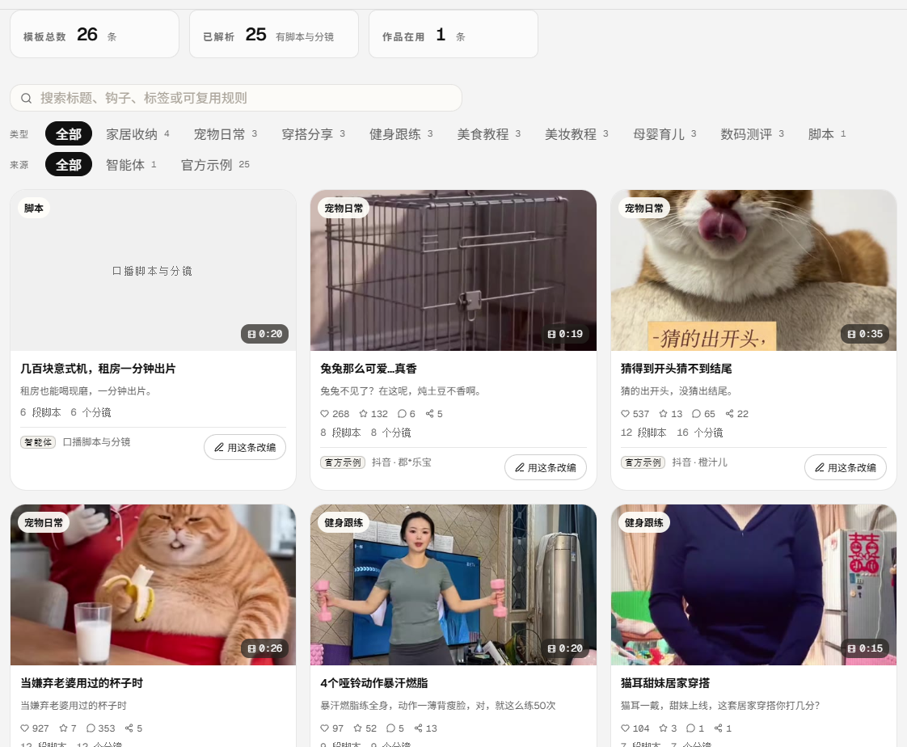
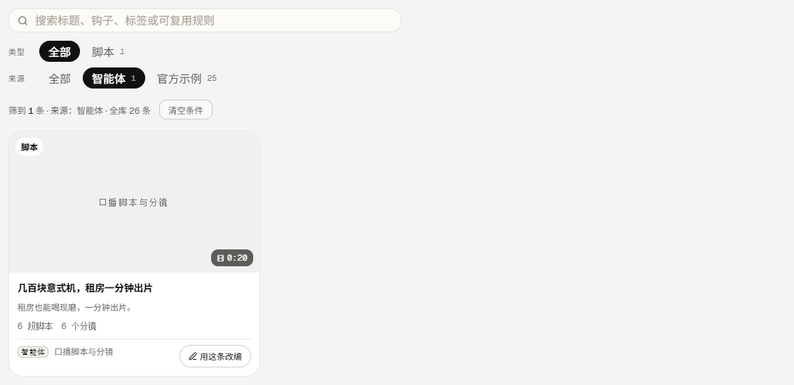
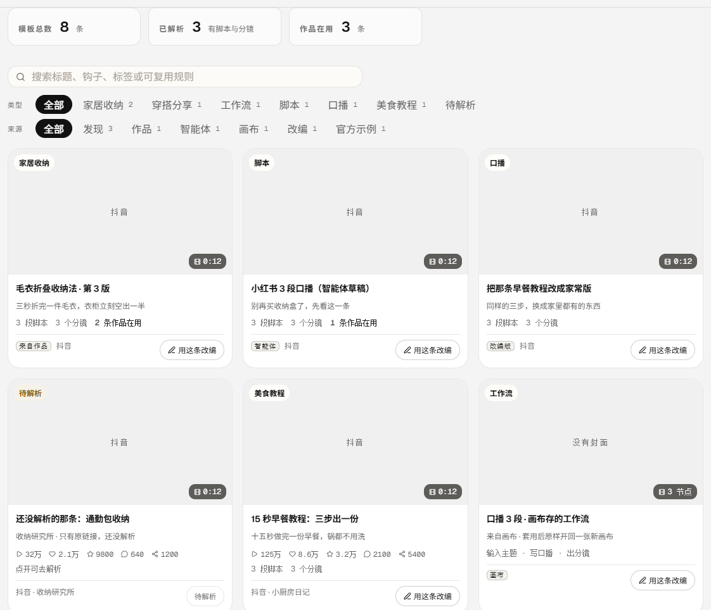
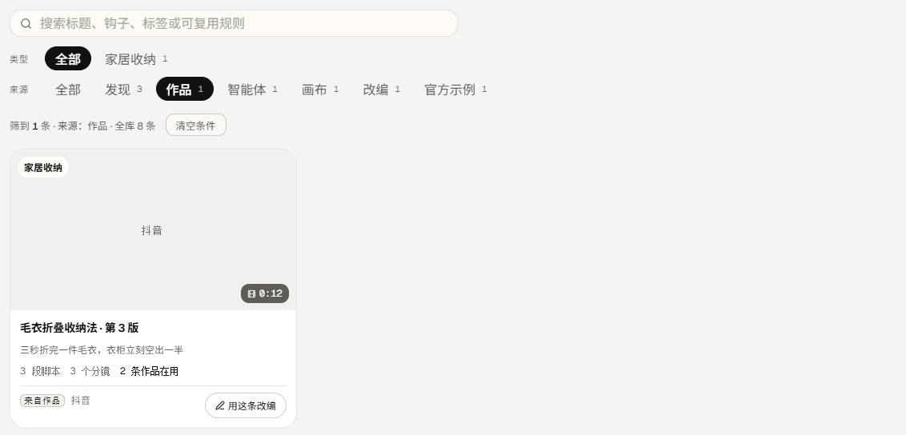
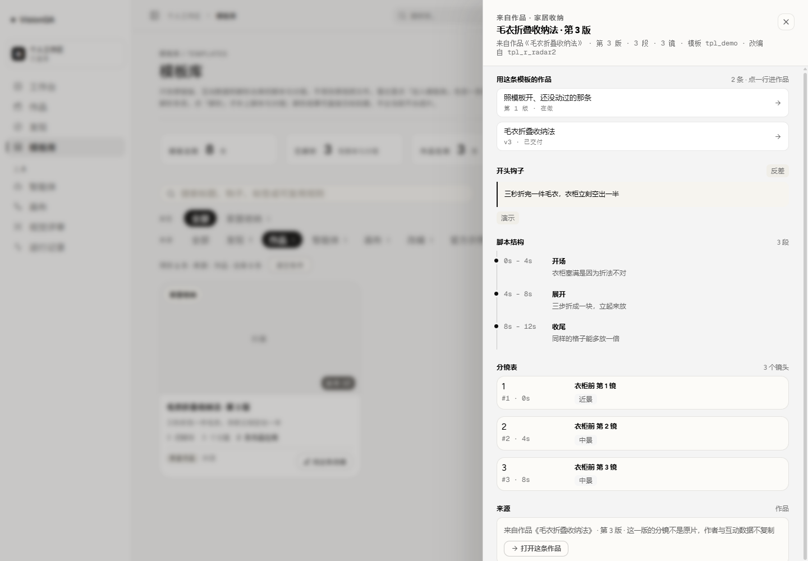
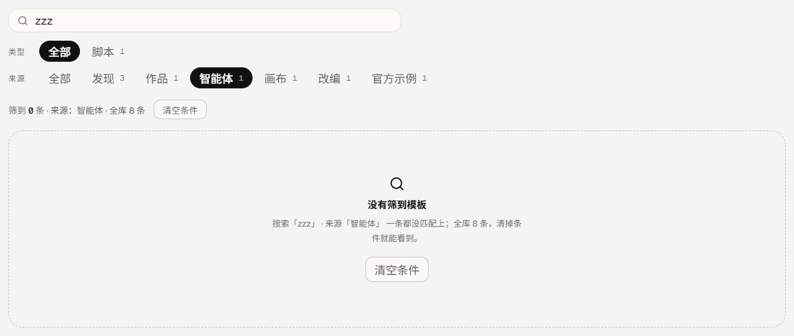
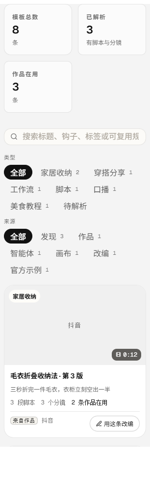

# 模板库的「来源」筛选（v0.9.33）

- 版本：**0.9.33**
- 发布包：`20261112-222013-2026-11-13-template-sour.tar.gz`
- 前端入口：`index-DBLdMQWQ.js`（491,325 字节，含「来源」「筛到 1 条 · 来源：智能体 · 全库 26 条」「没有筛到模板」）
- 提交：`59f2ffc`（代码）+ `6828b4a`（文档）+ 补号提交；CI run **43319348399 success**
- 生产：`https://visionqa.wavisionai.cn`，两服务 active，`/api/health` ok（templates 26）

## 一、为什么要做

模板库现在有五条入口：雷达检索解析出来的、画布另存的工作流、智能体存的草稿、以另一条模板改编出来的、
做完的作品沉淀回来的（v0.9.31），另外还有运营放进来的官方示例。到这一轮之前，它们在同一个网格里长得几乎一样，
**只有「类型」一排胶囊**（家居收纳 / 美食教程 / 脚本 …）——回答的是「这条是什么」，回答不了「这条从哪来」。

于是实际用起来是这样：想找「我自己做完那条作品沉淀下来的模板」，得把 26 条一条条点开看抽屉抬头；
想清理「从我攒的爆款里留下的那些」，官方的 25 条示例混在里面，分不开；想确认「这条是不是智能体写的」，也只能点开。
「从哪来」本来就是模板库里最有用的一个坐标——它决定了这条能不能直接拍、要不要回作品、是不是样例。

## 二、现在能做什么

| 之前 | 现在 |
| --- | --- |
| 只有「类型」一排胶囊，分不清来源 | 多一排「来源」：全部 / 发现 / 作品 / 智能体 / 画布 / 改编 / 官方示例，每个胶囊后面是**全库**里这个来源有几条 |
| 「作品沉淀的模板」只能一条条点开看抬头 | 点「作品」就只剩那几条；卡片脚注写着「来自作品」 |
| 类型胶囊的数字是全局的，选了来源也对不上 | 类型的数字跟着当前来源算：来源=作品时只剩这个来源里真有的类型，「待解析」也只在真有没解析的条目时出现 |
| 顶部「模板总数」写的是筛到的条数 | 写全库条数；筛的时候另起一行「筛到 N 条 · 来源：作品 · 全库 26 条」，并给「清空条件」 |
| 筛不到时写「模板库还是空的」（其实库里有 26 条） | 写「没有筛到模板」，并把是哪几个条件没匹配上列出来 |
| 抽屉里「来源」那一格对所有模板都写平台 + 作者 + 原链接 | 按来源分开说：来自作品《…》第 N 版（带「打开这条作品」）、智能体的草稿、画布工作流、改编自哪条、官方示例、检索原片 |
| 从作品来的模板被写成「原链接缺失（示例数据或直链测试）」 | 它本来就没有原片，不是链接丢了：这一格改成「这一版的分镜不是原片，作者与互动数据不复制」 |





## 三、来源怎么认、数字怎么算

**一张卡片只属于一个来源**，顺序即优先级（`server/templates.mjs` 的 `templateSource`）：

1. `shared`（官方示例）——运营放进来的公共样例，哪怕它是检索解析出来的，也不冒充「我发现的」；
2. `project`（作品）——做完的作品沉淀回来的那一版，`kind` 仍是 `adapted`，靠 `origin === 'project'` 或 `projectId` 认；
3. `agent`（智能体）——智能体存的结构化草稿；
4. `canvas`（画布）——画布另存的工作流；
5. `adapted`（改编）——以另一条模板为底改出来的；
6. `radar`（发现）——雷达检索来的（`saved` 待解析 + `replica` 已解析），以及 v0.9.2 之前没有 `kind` 的老条目。

五个来源的 key 与文案由服务端一处给出（`TEMPLATE_SOURCES`），卡片标签、筛选胶囊、抽屉抬头都用它，前端不另写一份分类表。

**两个数字不能混**：

- 「来源」胶囊后面的数字按**全库**算（它是一组胶囊的底数，切到别的来源不该让其它数字跟着变小）；
- 「类型」胶囊与「待解析」按**当前来源**算（来源=作品时不该还挂着只有雷达条目才有的类型）；
- 顶部「模板总数 / 已解析 / 作品在用」永远是全库，筛选只改下面筛到的条数。

**认不出来的来源直接 400**，不静默退化成「全部」——否则链接里写错一个 key，用户看到整整一库模板，还以为筛过了：

```
GET /api/templates?source=agent
200 { items: [ … ], total: 26, byType: { 脚本: 1 }, pending: 0,
      sources: [ { key: 'radar', label: '发现', count: 0 }, … ] }

GET /api/templates?source=bogus
400 { error: "不认识的来源：bogus；可用：radar / project / agent / canvas / adapted / shared" }
```

列表项与详情都多带一个 `source` 字段；详情里的 `source` 让抽屉那句「这条从哪来」与胶囊用的是同一套口径。



## 四、顺手修的三处

1. **「模板总数」写的是筛到的条数**。选一个类型之后它跟着变小，等于把「总数」写成了「筛到几条」。
   现在它读全库总数，筛选另起一行写「筛到 N 条 · 来源：作品 · 全库 8 条」，旁边一个「清空条件」。
2. **「待解析」不在当前来源里也挂着**。类型胶囊的数字改成跟着来源算，没解析条目的计数也跟着来源算：
   来源=作品时不再出现「待解析」这个点不出东西的胶囊。
3. **筛不到就说「模板库还是空的」**。库里有 26 条、只是这次条件没匹配上，写「空的」是假话。
   现在换成「没有筛到模板」+ 把条件列出来（搜索「zzz」· 来源「智能体」）+ 一句「全库 26 条，清掉条件就能看到」。
4. **抽屉里的「来源」对谁都写原链接**。从作品 / 智能体 / 画布来的模板没有原片，却被写成
   「原链接缺失（示例数据或直链测试）」——看起来像数据坏了。现在按来源分开说，作品那条还带一个「打开这条作品」，
   把「作品 → 模板 → 回作品」这一圈接上。









## 五、验收

**生产**（v0.9.33、入口 `index-DBLdMQWQ.js` 491,325 字节、release `20261112-222013-2026-11-13-template-sour.tar.gz`、
`/api/version` 0.9.33、`/api/health` ok templates 26、两服务 active）。这一轮**生产零写入**，全部是只读核对：

- `GET /api/templates` → `total 26`，`sources` 为
  `radar 0 / project 0 / agent 1 / canvas 0 / adapted 0 / shared 25`，**六个来源加起来 26，等于 total**（同一张卡片不会被两个来源各算一次）；
  列表项的 `source` 只有 `agent` 与 `shared` 两种，与计数一致。
- `GET /api/templates?source=agent` → `items 1`（`tpl_8cfe9e23`）、`total 26` 不变、`byType { 脚本: 1 }`、`pending 0`。
- `GET /api/templates?source=shared` → `items 25`、`total 26`、`byType` 是 9 个内容类型的全套计数（官方示例里真有的类型）。
- `?source=project` / `radar` / `canvas` / `adapted` → `items 0`、`total 26`、`byType {}`（生产还没有这几类条目，不编数据）。
- `?source=bogus` → **400**，报的是可用值清单。
- `GET /api/templates/tpl_8cfe9e23` → `source: "agent"`、`kind: "agent"`。
- 工作台 / 作品 / 评审的计数没有变化：模板 26、作品 1、运行 7、评审 3、队列 1。

**本地演示数据**（`.tmp-qa/r113data`：8 条模板覆盖六个来源、4 条作品）：默认视图六排来源计数
「发现 3 / 作品 1 / 智能体 1 / 画布 1 / 改编 1 / 官方示例 1」；点「作品」→ 1 条、类型收成「家居收纳 1」、
那行写「筛到 1 条 · 来源：作品 · 全库 8 条」；打开那条模板抽屉，来源写「来自作品《毛衣折叠收纳法》· 第 3 版」并带「打开这条作品」；
来源=智能体 + 搜索 `zzz` → 「没有筛到模板」，条件如实列出来。1440 与 390 的 `scrollWidth == clientWidth`（390 / 390，页面高度 3671）。

**测试与检查**：`npm test` **329/329**（新增 4 条 `test/template-source.test.mjs`：
每条模板只属于一个来源的映射 / 按来源筛且只给当前账号看得见的 / 来源计数按全库算而类型与待解析跟着来源算 /
认不出来的来源交回 unknown 并由接口回 400），oxlint **0 error / 6 warning**、`tsc -b` 干净、`npm run build` 通过。
这一轮不调模型、不扣积分。

## 六、边界

- **只读**：这一轮生产没有写入，没有任何数据被改动；模板与作品都只是被筛出来看。
- **不新建页面**：产品结构锁定四项导航，来源筛选挂在模板库自己的工具条里。
- **不合并来源**：一条模板仍然只属于一个来源（官方示例优先），不做「既是发现又是官方示例」的双重身份——
  否则计数加起来会超过总数，用户更算不清。
- **不靠前端猜分类**：key、文案、计数都在服务端算，前端只渲染；认不出来的来源回 400 而不是退化成全部。
