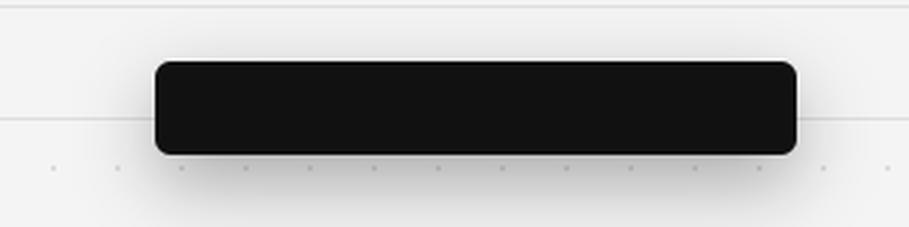
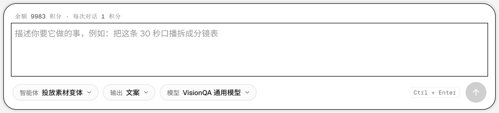
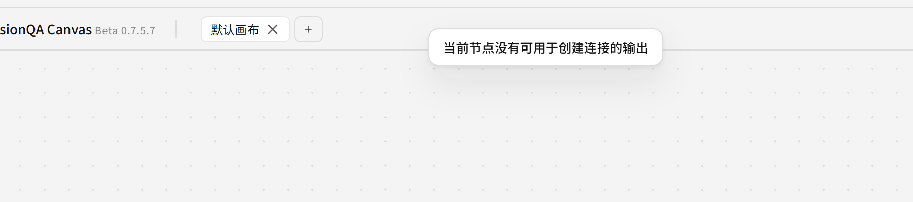
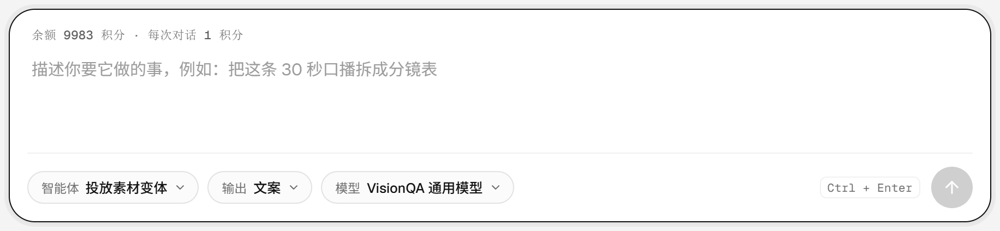

# 两处「看着像 bug」的界面修复（2026-11-12，v0.1.3）

用户在两处截图里指出：画布上「节点拉出线」之后会明确冒出一块黑框；智能体对话框的卡片是圆角、里面却是一个直角框。
两处都不是「观感不好」，是实打实的样式缺陷，各有一个明确根因。

## 一、画布拖出连线后的黑框

### 现象

从节点右边缘的端口拖一条线出来、在空白处松手，画布顶部中间会弹出一块 **约 240×35 的纯黑圆角块**，里面没有字（第一张对比图左边就是它）。

### 根因

黑框不是菜单，也不是连线本身，是 **BD Canvas 的 toast 变成了黑底黑字**：

```ts
// bd-canvas: src/features/feedback/dialogToastHelpers.ts
export const TOAST_STYLE =
  'position:fixed;top:20px;left:50%;transform:translateX(-50%);' +
  'background:var(--generate-btn);color:var(--text-primary);' +   // ← 两个变量在我们主题里都是 #111111
  'padding:8px 16px;border-radius:6px;font-size:13px;...'
```

VisionQA 的浅色主题把「强调色」整组翻成了近黑（`--generate-btn: #111111`），正文色也是近黑（`--ui-text-primary / --text-primary: #111111`）。
两者叠在一起就是**黑底黑字**：文字其实一直在，只是完全看不见，所以看起来像一块空的黑框。
触发路径也符合「拉出线之后」——松手在空白处时 BD Canvas 会尝试弹「创建下游节点」菜单，
这个节点没有可创建的下游（源是素材/主图节点），于是退化成一句 toast：`当前节点没有可用于创建连接的输出`。
按 13px 字号算 16 个汉字 + 32px 内边距，宽度正好 238px，和截图的量尺一致。

### 修法

主题覆盖层 `deploy/bd-canvas/vq-theme.css` 第 4 节（主按钮白字）后面补一条：

```css
.snap-toast {
  color: #111111 !important;
  background: #ffffff !important;
  border: 1px solid rgb(17 17 17 / 14%) !important;
  border-radius: 10px !important;
  padding: 8px 14px !important;
  font-size: 12.5px !important;
  font-weight: 500 !important;
  box-shadow: 0 2px 4px rgb(17 17 17 / 6%), 0 16px 32px rgb(17 17 17 / 8%) !important;
}
```

- toast 的样式是 **内联 cssText**，所以必须 `!important` 才压得住；
- 不做成「黑底白字」而是**白底墨字**：画布里的菜单、面板、卡片全是纸面白 + 发丝线，toast 跟着走才是一套；
- 圆角 10px、字号 12.5px、投影尺度对齐宿主（VisionQA）的胶囊与卡片，不另起一套。

### 部署

画布是 Vite 开发服务器（`bdc-web.service`，:6677）直接从源码目录服务，`public/vq-theme.css` 是静态旁路文件，
所以**只替换那一个文件**即可生效，不用重建、不用重启：

```
scp deploy/bd-canvas/vq-theme.css root@<host>:/tmp/vq-theme.css
ssh root@<host> "cp /opt/bdcanvas/public/vq-theme.css /opt/bdcanvas/public/vq-theme.css.bak-20261112 \
  && install -m 644 /tmp/vq-theme.css /opt/bdcanvas/public/vq-theme.css"
```

回退：把 `.bak-20261112` 拷回去即可。

## 二、智能体对话框「外圆内方」

### 现象

输入卡是 24px 圆角，点进去（输入框拿到焦点）时，卡片内部会浮出一圈 **1px 直角方框**，正好框住输入区。

### 根因

`src/styles/agents.css` 里给页面内所有表单元素的键盘焦点统一画了描边：

```css
.agx-page textarea:focus-visible { outline: 1px solid var(--ink); outline-offset: 2px; }
```

`outline` 永远沿着元素自己的盒子直角走、不吃 `border-radius`，于是「外圆内方」。
devtools 实测聚焦后 `outline: rgb(17,17,17) solid 1px; outline-offset: 2px`。

### 修法

输入卡本身就是**一个**输入控件（它的边框、投影、`focus-within` 都在表达焦点），里面那层不再重复画：

```css
.agx-composer .agx-textarea:focus-visible { outline: 0; }
```

焦点提示留给卡片自己：`.agx-composer:focus-within { border-color: var(--ink); box-shadow: var(--ring-soft), var(--shadow-card) }`（墨色描边 + 柔光）。
其余字段（智能体编辑器里的输入、下拉等）仍保留原来的描边焦点，辅助功能没丢。

## 验收（生产 v0.1.3，入口 `index-BBTGNX2-.js`）

| 项 | 实测 |
| --- | --- |
| 服务 | `visionqa` / `visionqa-internal` 均 active，`/api/health` ok（templates 25） |
| 画布黑框 | 拖线松手后 toast 为白底墨字「当前节点没有可用于创建连接的输出」，字号 12.5，圆角 10px |
| 输入区焦点 | 聚焦后 `outline: none 0px`；卡片 `border-color: rgb(17,17,17)`，`box-shadow: 0 0 0 4px rgba(17,17,17,.05)` |
| 构建 / 静态检查 / 单测 | `tsc -b` + `vite build` 通过；`oxlint` 0 error（8 条既有 warning）；`node --test` 43/43 |

### 改之前





### 改之后





## 边界

- 只动了两处样式：宿主 `src/styles/agents.css` 一条规则、画布主题 `deploy/bd-canvas/vq-theme.css` 一条规则。服务端、数据、积分口径未动。
- BD Canvas 的 toast 是它自己的组件，这里只做配色与尺度覆盖，不碰它的结构与文案（Source-Available License 3.2 自用修改边界内）。
- 画布内部其余仍按第三方主题走，深色主题依旧没做。
