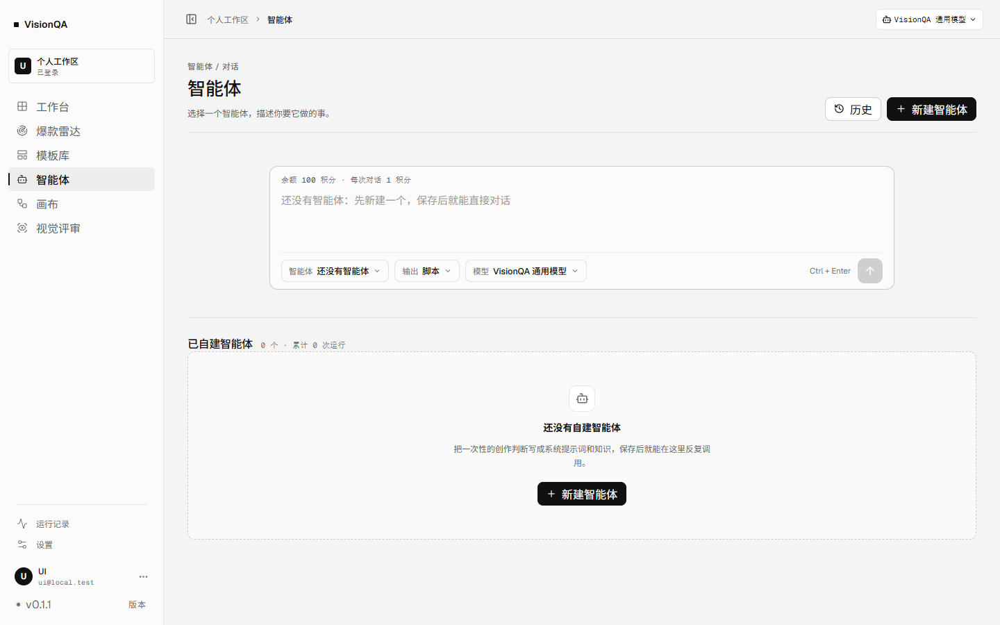
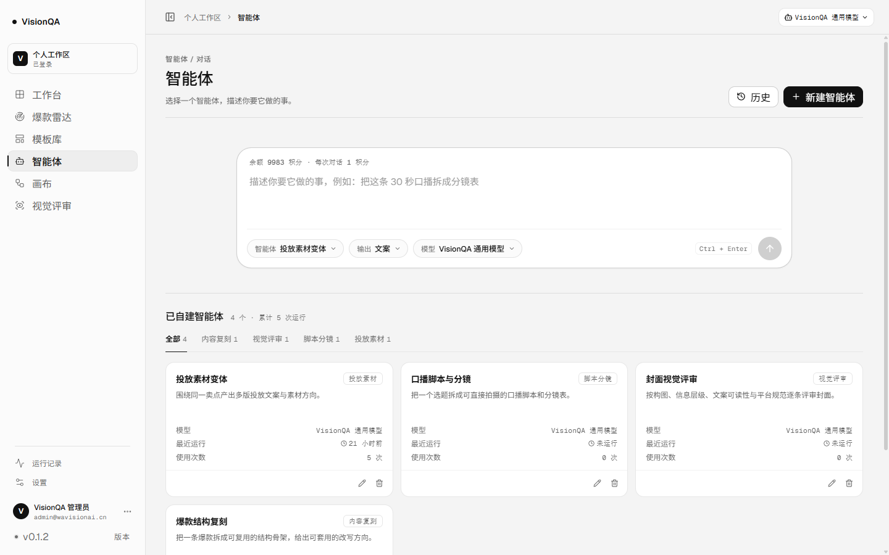
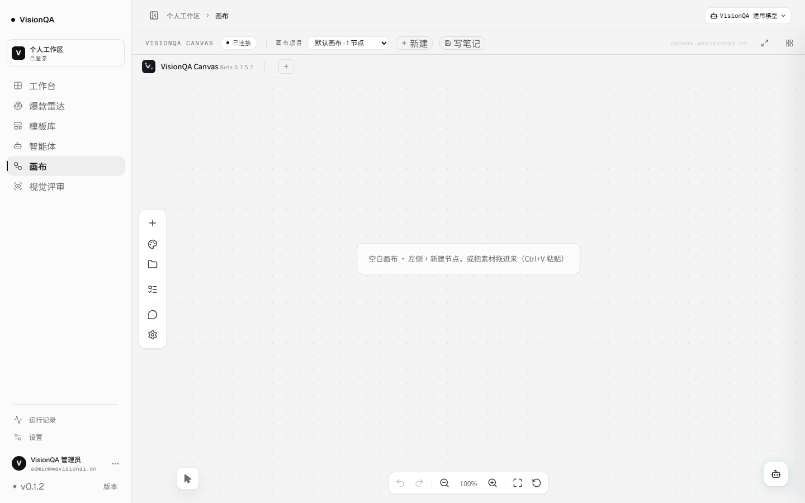
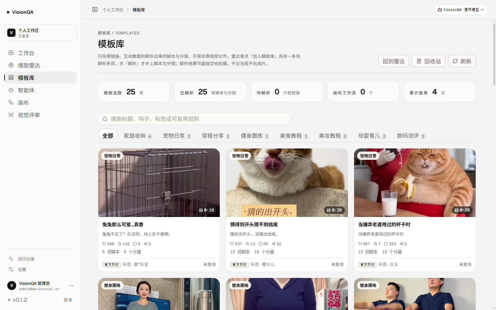
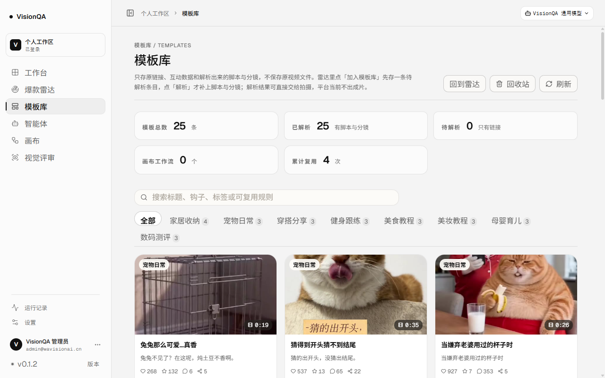
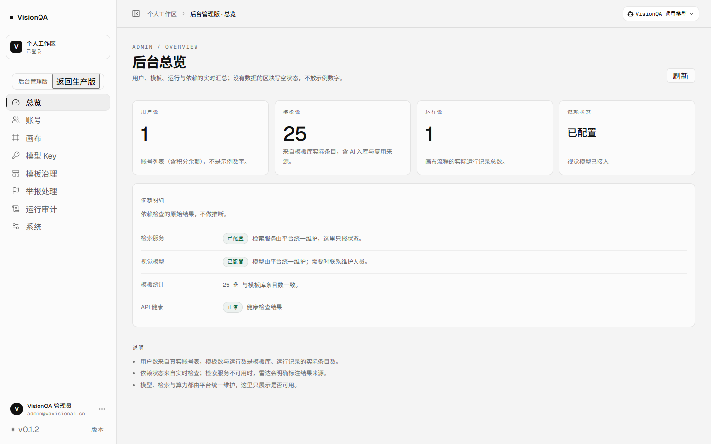

# 界面统一与观感整理（2026-11-12）

> 范围：只动前端样式与画布路由/加载逻辑，不动服务端数据、定价与权限。
> 上线：生产 v0.1.2，入口 `index-dvca6tvh.js`，两服务 active，`/api/health` ok（templates 25）。

## 一、逐条对应

| 你提的 | 怎么改的 | 位置 |
| --- | --- | --- |
| ① 输入区那个角太生硬 | 智能体输入卡从 12px 圆角改成全局「主输入区」档 24px；内边距回到 16/12 栅格；聚焦时不再是一圈 3px 灰影，而是墨色描边 + 柔光 | `src/styles/agents.css`（`.agx-composer`）、`tokens.css` |
| ② 画布页别乱跳、别反复加载 | 进画布会「重挂一次」：页面把 flowId 写回地址栏，而 `App` 把 flowId 放进了 `key`，于是自己把自己重挂、画布闪一下、`/api/flows` 连打几遍。现在 key 只随「画布项目」变；已在画布上再点侧栏「画布」不再重置当前流程；列表请求做了单飞（并发同一份只发一次） | `src/App.tsx`、`src/pages/CanvasPage.tsx`、`src/api/flows.ts` |
| ③ 圆角与间距统一 | 先立尺度再清扫：一套 6 / 10 / 14 / 20 / 24 / 999 的圆角 token，全仓 270 处字面量（3/4/5/7/8/9/11/12/13px）一次性换成 token；模板库工具条从「居中孤零零一颗胶囊」改回左对齐的胶囊筛选条；统计卡在 1280 上不再把「已解析」挤成「已解 / 析」 | `tokens.css`、`App.css`、`shell.css`、`agents.css`、`canvas.css`、`legacy-fix.css`、`radar.css` |
| ④ 画布顶栏状态胶囊 | 「已保存 / 已连接」原来是裸文字 + 小点，现在和全站状态胶囊同一套：24px 高、999 圆角、发丝线、等宽微字；脏/错状态各带语义底色 | `src/styles/canvas.css`（`.cv-save`、`.cv-bdc-state`） |
| ⑤ 自由发挥 | 按下统一 1px 位移、键盘聚焦统一柔光、切页只淡入不位移；主按钮/发送键 hover 抬起、按下回弹；卡片 hover 用中性投影（原来是暖棕色的旧阴影）；滚动条与选区从米黄改中性墨色；侧栏选中态加内描边；骨架屏与下拉菜单补了进场动效；空画布不再挂一块空白小地图 | `tokens.css`、`shell.css`、`App.css`、`agents.css`、`CanvasPage.tsx` |

## 二、圆角尺度（改一处即全站生效）

| token | 值 | 用在哪 |
| --- | --- | --- |
| `--radius-xs` | 6px | kbd、微标签、菜单里的小方块 |
| `--radius-sm` | 10px | 按钮、输入框、下拉项、侧栏项 |
| `--radius-md` | 14px | 卡片、列表项、面板 |
| `--radius-lg` | 20px | 大面板、弹窗、抽屉 |
| `--radius-xl` | 24px | 主输入区（智能体输入卡） |
| `--radius-pill` | 999px | 状态胶囊、筛选条、标签、发送键 |

动效只留三档：`--dur-1` 120ms / `--dur-2` 180ms / `--dur-3` 260ms，缓动统一 `--ease-out`；`prefers-reduced-motion` 下全部关掉位移与动画。

## 三、顺手修掉的两个真问题

1. **进画布闪一下、请求打两遍**：`App` 里 `CanvasPage` 的 key 带上了 flowId，而画布页加载完会把 flowId 写回地址栏 → key 变 → 整页重挂 → 再加载一次。现在 key 只跟「画布项目 id」走，flowId 回灌时用 `loadedFlowRef` 挡住二次加载。生产包里实测：进画布只发一次 `/api/flows`，再点一次侧栏「画布」零请求。
2. **模板库统计卡在 1280 笔记本上糊成一团**：写死 `repeat(5, 1fr)`，每张只剩 180px，标题被从词中间断开；改成 1440 以上五张、以下三张、1024 以下两张，卡片内部改成「标签一行 / 数字+单位一行」。

## 四、边界

- 只改样式与前端路由逻辑，服务端接口、数据、积分口径一处未动。
- 第三方画布（`canvas.wavisionai.cn`，走 iframe）内部的顶栏是它自己的主题文件，这次只统一了宿主这一条状态条；要改画布内部的胶囊得动 `deploy/bd-canvas/vq-theme.css` 并重新发布那份静态包。
- 深色模式目前没有单独主题，本轮未引入。

## 五、截图（生产实拍，1440×900 与 1280×800）

改之前（输入区 12px 圆角、参数是一排方角按钮）：

改之后：

