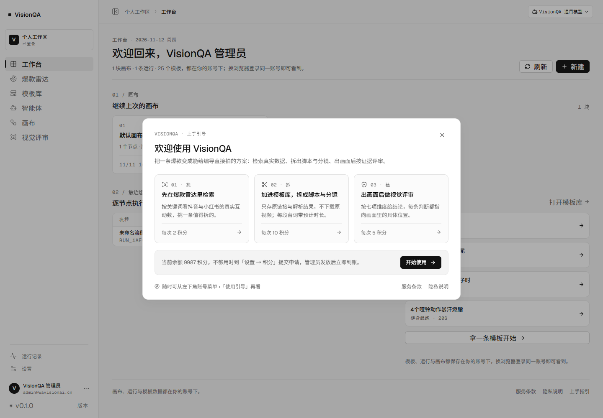
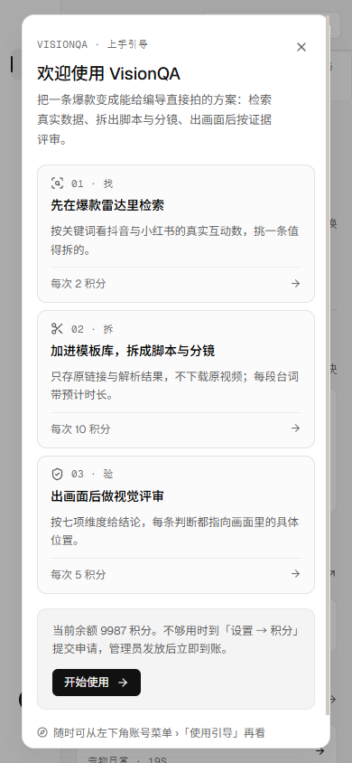
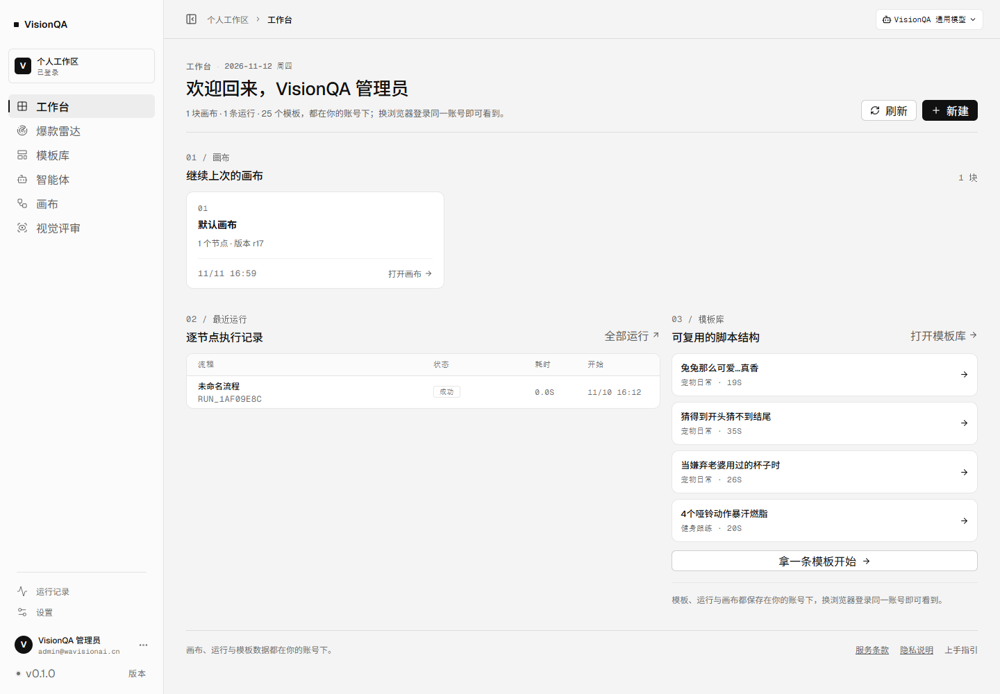
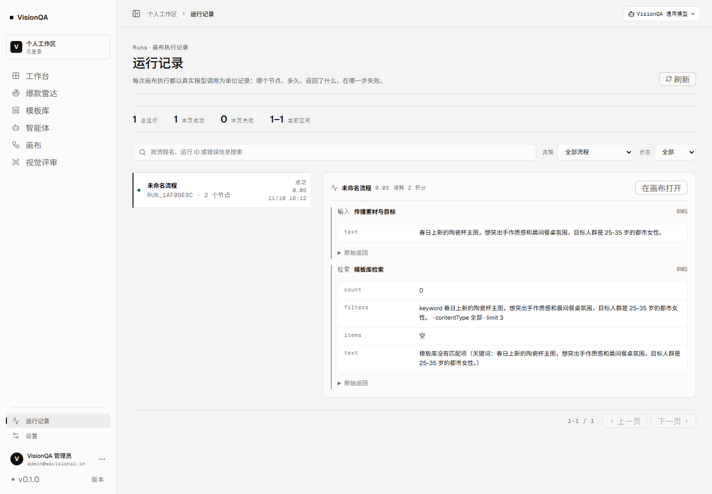
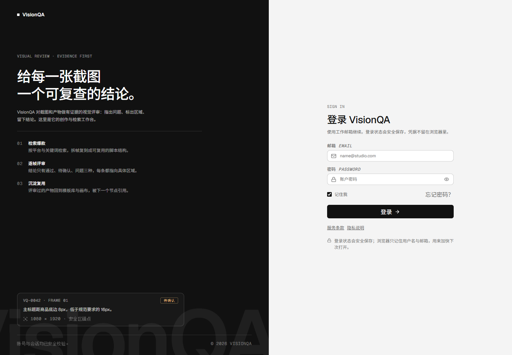

# 引导改弹窗、用户端 UI 收口与剩余缺口审计（2026-11-12）

这一批三件事：**把新用户引导从独立页面改成工作台里的弹窗**、**按「用户在看」的标准收一遍界面**、**重新审计除邮箱/手机号验证与真实模型测试之外还差什么**。

结论先行：
1. 引导不再是 `/#/welcome` 一页，改成工作台内弹窗；旧链接自动落回工作台，不再出现单独一屏。
2. 用户端 9 处具体问题已改（登录页产品名写错、工作台标题与页脚、运行记录裸 JSON、设置页开发者口吻等），全部在生产复查。
3. 审计结论：**对外收费上线还差 5 件外部输入 + 2 件工程**；产品功能缺口里最该先补的是「模板/脚本导出」和「检索历史」。

---

## 一、引导页 → 工作台弹窗

### 为什么改

引导原来是一整页：一登录就被换到一个没有侧栏、没有顶栏的空白页，看完点「直接进工作台」再跳回来。三个问题：
- 用户一进门先被拦一屏，看不到产品本身长什么样；
- `#/welcome` 会留在地址栏里，刷新、后退都会回到那页；
- 引导页和工作台是两套排版，维护两处。

### 现在是什么样

| 项 | 之前 | 现在 |
| --- | --- | --- |
| 形态 | 独立路由 `#/welcome`，整屏渲染 | 工作台内弹窗（`src/components/WelcomeGuide.tsx`），背景压暗、底下的工作台可见 |
| 触发 | 首进 `#/overview` 自动跳 `#/welcome` | 首进工作台自动弹出（按账号记，看过就不再弹） |
| 关闭 | 只有「直接进工作台」一个出口 | Esc / 点遮罩 / 右上角 × /「开始使用」，任一出口都记「看过」 |
| 回看 | 工作台页脚「上手指引」链到 `#/welcome` | 账号菜单「使用引导」（常驻）+ 工作台页脚「上手指引」 |
| 旧链接 | — | `#/welcome` 已从路由删除，访问时 hash 自动规范成 `#/overview`，落回工作台 |

内容没变：三步「01 找 → 02 拆 → 03 验」，单价与余额仍然取真实接口（每次 2 / 10 / 5 积分、当前余额 9987），点任意一步直接进对应页面。另外补了键盘与滚动细节：打开时焦点落在关闭按钮、Esc 关闭、`body` 滚动锁定。

### 实测（生产，2026-11-12）

| 检查 | 结果 |
| --- | --- |
| 首进工作台自动弹出 | 弹窗存在，标题「欢迎使用 VisionQA」，三步卡片 3 个 |
| 关闭后写标记 | `vq_welcome_seen:usr_DHZnmjNxrF0e = 1`，`body.overflow` 恢复 |
| 刷新不再自动弹 | 整页 reload 后无弹窗，H1 是「欢迎回来，VisionQA 管理员」 |
| 账号菜单回看 | 菜单项：使用引导 / 账号设置 / 切换账号 / 退出登录；点「使用引导」弹窗重新出现 |
| 旧链接 `#/welcome` | hash 变成 `#/overview`，渲染工作台，无空白页 |
| 390 宽 | `scrollWidth = 390`，无横向溢出，弹窗内可滚动 |
| JS 异常 | 0 |

---

## 二、用户端 UI 收口

原则一条：**这一屏是给用户看的，不是给我看的**。所以只改用户能看见、会误解的地方，不动后台、不动信息架构。

| # | 位置 | 问题 | 改成 | 证据 |
| --- | --- | --- | --- | --- |
| 1 | 登录页 | 标题写着「登录 **Workbench**」——产品叫 VisionQA，Workbench 是内部代号 | 「登录 VisionQA」 | 生产登录页 H2 实测 |
| 2 | 工作台 H1 | 一整行是「1 块画布 · 1 条运行 · 25 个模板」，像仪表盘标题，不像给用户的问候 | 「欢迎回来，{显示名}」，三个数量下沉到说明行 | 截图 |
| 3 | 工作台「最近运行」 | 表头网格是 **6 列**、实际只渲染 4 格 → 「状态」白占一大列、「开始」被挤到 62px 里换行 | 网格改回 4 列（流程 / 状态 / 耗时 / 开始），时间回到一行 | 截图 |
| 4 | 工作台页脚 | 三个链接没有间距，连起来读成「服务条款隐私说明上手指引」 | 右侧入口加 16px 间距与换行规则 | 截图 |
| 5 | 工作台模板区 | 「拿一条模板开始」悬在列表外，像掉出来的一行按钮 | 与列表同宽、上间距 12px，读作「下一步」 | 截图 |
| 6 | 运行记录 | 节点返回是**裸 JSON**，编导看不懂；节点类型显示 `INPUT` / `KB` | 返回按字段展开成两列表格，嵌套对象拆成「键 值 · 键 值」；原始 JSON 收进「原始返回」折叠；类型显示「输入 / 检索 / 模型 / 视觉 / 输出」 | 截图；实测 5 个字段行 + 折叠区 |
| 7 | 设置页 | 三处开发者口吻：「本次登录的时间，用于判断登录是否过期」「细节在后台『系统』页」（普通用户没有后台）、「结果缓存 10 秒」 | 「这台设备本次登录的时间」「不正常时把这屏发给管理员」「每 10 秒最多检测一次」 | 截图 |
| 8 | 设置页页脚 | `VisionQA · Workbench` | `VisionQA` | 截图 |
| 9 | 引导弹窗标题 | 原方案直接用「欢迎，{名}」，和背后页面 H1 重复 | 「欢迎使用 VisionQA」 | 截图 |

---

## 三、剩余缺口审计

口径：**不含邮箱/手机号验证**（上一轮已确认不做，需要 SMTP 与公司主体）、**不含真实模型测试**（出图/出视频、多供应商回退、权重比例，用户明确暂缓）。以下每一条都在代码或生产环境里核过。

### A. 对外收费上线前必须补

| 项 | 现状（证据） | 影响 | 谁来解 |
| --- | --- | --- | --- |
| ICP 备案号 | `VQ_ICP` 未配置，页脚与合规页不显示 | 境内对外经营需要展示备案号 | 用户给号，我填环境变量 |
| 客服邮箱 | `VQ_SUPPORT_EMAIL` 未配置；登录页只写「找工作区管理员」 | 用户遇到问题没有对外求助路径 | 用户给邮箱 |
| 支付/定价 | `billing.enabled = false`，充值按钮 disabled，档位 0 个 | 只能靠「申请 → 管理员发放」，收不了钱 | 用户定价格，我接通道 |
| 告警外推 | `VQ_ALERT_WEBHOOK` 未配置；三类告警只进后台队列 | 夜里挂了没人知道，要有人主动去看后台 | 用户给 webhook |
| 备份异地 | 备份在 `/var/backups/visionqa`，与数据同一台机器 | 整机故障时数据和备份一起没 | 我加异地/对象存储（需用户给桶） |

### B. 产品功能缺口（影响成单与留存，按建议顺序）

| 项 | 现状（证据） | 影响 |
| --- | --- | --- |
| **模板/脚本导出** | 模板详情抽屉只能屏幕上看；全站只有后台审计页有 CSV 导出 | 编导拿不到可打印/可传阅的脚本，复刻结果没法离屏使用 |
| **检索历史/收藏** | `RadarPage` 里没有任何 history / 收藏实现，每次都要重搜、重新花 2 积分 | 多花积分、重复劳动 |
| 模板删除无回收站 | 详情抽屉「删除」直接调接口移除，没有撤销 | 误删不可恢复 |
| 模板编辑无版本历史 | `updateTemplate` 直接覆盖 | 改坏了回不去 |
| 无团队协作/分享 | 一个账号一个人，模板按 `ownerId` 隔离（公共模板除外） | 工作室无法多人协作 |
| 出图/出视频 | `VQ_GATEWAY_OPEN` 默认关，请求 503 明示未开通 | 画布里的生成节点实际不可用（已如实告知，不算缺陷） |

### C. 工程与运维

| 项 | 现状（证据） | 影响 |
| --- | --- | --- |
| 无 CI、无自动化测试入库 | 仓库里没有 `.github/workflows`，也没有测试文件；回归脚本都在 `.tmp-qa/`（gitignore） | 每次改动手动回归，靠人记 |
| 前端异常不回收 | 只有 `ErrorBoundary` 本地兜底，没有 Sentry 类上报 | 用户白屏我看不到 |
| 日志无保留策略 | 没有单独的轮转/保留配置，排障靠 `journalctl` | 出事后证据留存靠系统默认 |
| 部署无回滚 | 手工 `tar + scp + rm -rf dist + restart`，不留上一版产物 | 发布坏了只能重新构建 |
| 单机单进程 | 8799/8800 两个服务，一台 2 核机器 | 当前规模够用，放量要拆 |

### D. 合规与安全

| 项 | 现状（证据） | 影响 |
| --- | --- | --- |
| 注册无同意留痕 | 注册表单没有勾选「已读条款」，后端也不记时间戳 | 举证时说不清用户是否同意 |
| 无二次验证 | 只有口令，8 位 + 字母数字 | 口令泄露即丢号 |
| 无自助数据导出/删号 | 删号要联系管理员 | 用户权利请求靠人工 |
| 公共模板版权口径 | 25 条公共模板含第三方平台缩略图与作者名 | 对外收费前需确认素材可用范围 |
| 无 UGC 审核流 | 公共模板靠管理员手工收回 | 有人乱投内容时处理靠人盯 |

### 不算缺口的（核过，别再列进待办）

- **注册开放被滥用**：`VQ_REGISTRATION` 默认关闭，生产未设置 → `/api/auth/config` 返回 `registrationEnabled:false`，不存在「谁都能注册领 100 积分刷模型额度」。
- **备份能不能恢复**：2026-11-11 已用真实档案演练，读出 users 1 / admins 1 / keys 2 / templates 25。
- **窄屏能不能看**：390 宽十屏无横向溢出，且有「桌面工作台」提示——产品定位就是桌面工具，不做移动端操作。

---

## 四、复验

- `npx tsc -b` 通过；`npm run build` 通过（入口 `index-CWYzkTFm.js`）；`npx oxlint src` 0 error（3 条既有 warning，都在设置页旧的 `setState in effect` 写法上）。
- 生产 `visionqa` / `visionqa-internal` 均 active，`/api/health` → `templates:25`。
- 本轮新拍的生产截图 5 张，均 1440×1000（窄屏 390×844），0 JS 异常。

## 五、下一步建议

1. **先补「模板导出」**：这是产品价值的最后一公里——拆出来的脚本现在只能屏幕上看，编导拿不走。做成 Markdown / 印刷友好的一页，成本低、感知强。
2. **再补「检索历史」**：每次重搜要花 2 积分，用户会心疼；把最近 10 次关键词留在本地，重开就能接着做。
3. **把 `.tmp-qa` 里的巡检脚本收进仓库**：现在这套「10 屏巡检 + 0 异常」的脚本只能我本机跑，进仓库后每次发布都能自动跑一遍。
