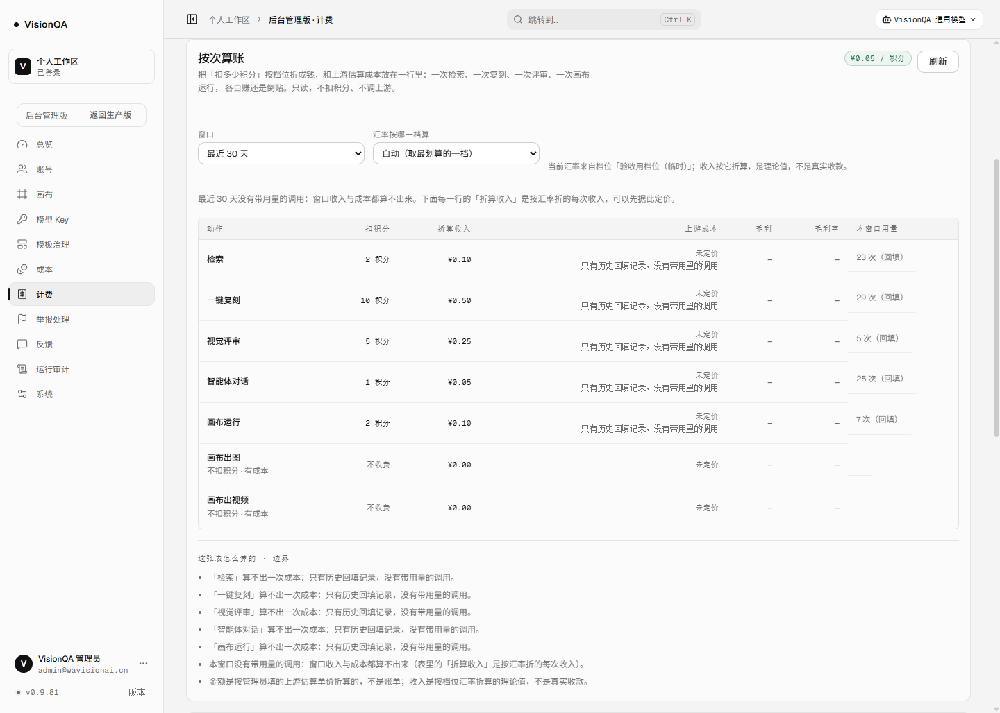
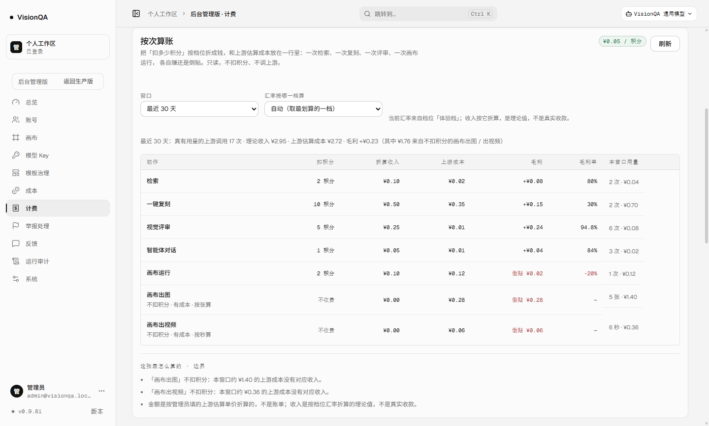

# 按次算账：一次检索 / 复刻 / 评审赚多少，谁在倒贴（v0.9.81）

结论先行：定价这件事卡住的不是「价格数字」，而是**没有一张能把钱算出来的表**。这一轮在后台「计费」页加了只读的「按次算账」——把档位汇率（多少钱换多少积分）和 `usage_events` 的上游估算成本放进同一行，每个动作给：扣几次积分、折成多少钱、一次上游成本、毛利、毛利率、本窗口用量。

它有三件事绝不糊弄：

1. **没有汇率就不出钱**：没有档位、也没手填汇率时，整张表的金额是「—」，页面写「还没有汇率」，不拿积分倍率冒充金额（v0.9.58 定下的规矩）。
2. **算不出成本就写「未定价 + 为什么」**：只有历史回填记录、上游没回 token、单价没填——三种原因分开写，毛利是 null。**不写 0.00**：0 成本会让每一行的毛利率变成 100%，那是骗自己。
3. **不扣积分的通道单独成行**：画布出图 / 出视频现在收 0 积分、却占真实上游成本，表里标「倒贴」，并按**张 / 秒**摊成本（一次请求出 3 张时，按请求摊会把「一张多少钱」抹平）。

生产已上线 **v0.9.81**（入口 `index-Bi2s3PIl.js`，release `r93-pricing` → `r93-pricing2`）。生产的真实现状是：**89 条用量记录全是被回填的「只有次数」**，所以成本一行都算不出来——这不是缺陷，是事实：生产至今没有一条带 token / 张数的真实调用记录。要看到真实毛利，需要你点头跑一次真实出图或评审。

## 一、为什么现在做

上线缺口清单的 A8 一直挂着三件没做完的事：**配额的数**（等你定）、**10 次真实复刻的平均成本**（要真跑）、**单次成本 vs 售价表**（代码能先搭好）。前两件都卡在外部输入，第三件是这一轮能替你做掉的部分。

现状证据（本轮实测，都来自生产只读接口）：

| 页面 | 回答什么 | 不回答什么 |
| --- | --- | --- |
| 计费 → 档位表 | 多少钱换多少积分（每积分单价） | 一个动作收多少、平台花多少 |
| 成本页（v0.9.58） | 平台花在哪个能力 / 模型 / 天 | 收回来多少 |
| 账号 → 积分页 | 积分是虚拟倍率，**故意不折钱** | — |
| **按次算账（本轮）** | 一次动作：折算收入 / 上游成本 / 毛利 / 毛利率 | 真实收款（支付没接）、真实账单（单价是估算） |

生产当前状态：档位 **0** 个、上游估算单价全 **0**、用量 **89** 条（文本 25 / 视觉 5 / 检索 23 / 复刻 29 / 画布运行 7）且 `measuredCalls = 0`。也就是说：**这张表在今天是「先搭好、等你填数」的状态**，而不是「已经能告诉你赚多少」。

## 二、被否掉的三条路

1. **把积分直接当钱**（1 积分 = 1 元）：等于凭空造一个汇率，和档位的真实定价冲突；改价那天全表就错了。
2. **让成本页顺带算收入**：成本页的定位是「平台花了多少」。混进收入之后，「未定价」到底指成本还是收入就说不清了——现在这张表把两者分开写。
3. **等填完真实上游单价再上线**：那这轮又变成「等外部输入」。改成「有档位用档位、没有就手填汇率试算」，今天就能算。

## 三、做法（口径）

1. **汇率只有一个来源**：手填 > 指定档位 > **最划算的一档**（每积分最便宜的那档）。默认取最便宜是故意的——收入宁可低估，不虚报毛利。赠送档（价格 0）与停用档不参与折算。
2. **成本不在本模块里估**：仍然来自 `usage_events` × `usage-prices`（管理员在成本页填的估算单价），`server/pricing.mjs` 只做换算。
3. **分母只数「带用量」的调用**：`measuredCalls`（live 且成功）。回填条目只有次数、没有 token 与张数，算进分母会把一次成本摊薄成假的。
4. **算不出来就说清是哪一种**：`costKnown=false` + 原因（只有历史回填记录 / 这些调用没有可折算的用量 / 窗口里没有这类调用）。窗口内一次带用量的调用都没有时，**总量收入与毛利也是 null**，不是 0——0 会被读成「真的收了 0 元」。
5. **不收费通道按单位摊**：画布出图 ¥/张、出视频 ¥/秒，动作名下写「不扣积分 · 有成本 · 按张算」，毛利写「倒贴 ¥x」。
6. **只读**：新接口 `GET /api/admin/pricing/estimate?days=&plan=&rate=`（管理员），不扣积分、不调上游、不写任何数据；窗口与汇率都是查询参数，改档位刷新即按新档算。
7. 表在后台「计费」页、档位表下面；窄屏沿用后台既有的「表格自己横向滚动」，页面本身不横向溢出。

## 四、本地验收（本地演示数据，不是生产）

`.tmp-qa/r93data`：17 次带用量的调用 + 两档定价（体验档 ¥50/1000 积分 = **¥0.05 / 积分**、专业档 ¥300/5000 积分 = ¥0.06 / 积分）+ 一组示例估算单价。

| 动作 | 扣积分 | 折算收入 | 上游成本 | 毛利 | 毛利率 | 本窗口 |
| --- | --- | --- | --- | --- | --- | --- |
| 检索 | 2 | ¥0.10 | ¥0.02 | +¥0.08 | 80% | 2 次 · ¥0.04 |
| 一键复刻 | 10 | ¥0.50 | ¥0.35 | +¥0.15 | **30%** | 2 次 · ¥0.70 |
| 视觉评审 | 5 | ¥0.25 | ¥0.01 | +¥0.24 | 94.8% | 6 次 · ¥0.08 |
| 智能体对话 | 1 | ¥0.05 | ¥0.01 | +¥0.04 | 84% | 3 次 · ¥0.02 |
| 画布运行 | 2 | ¥0.10 | ¥0.12 | **倒贴 ¥0.02** | −20% | 1 次 · ¥0.12 |
| 画布出图 | 0 | ¥0.00 | ¥0.28 / 张 | 倒贴 ¥0.28 | — | 5 张 · ¥1.40 |
| 画布出视频 | 0 | ¥0.00 | ¥0.06 / 秒 | 倒贴 ¥0.06 | — | 6 秒 · ¥0.36 |

合计：真有用量的调用 **17** 次 · 理论收入 **¥2.95** · 上游估算成本 **¥2.72** · 毛利 **+¥0.23**（其中 **¥1.76** 来自不扣积分的画布出图 / 出视频）。

这张表当场答了两件一直在猜的事：

- **复刻是收费动作里毛利率最低的**：10 积分折 ¥0.50，示例成本 ¥0.35，只有 30%；同样一次上游成本，检索是 80%。
- **画布运行收钱还倒贴**：2 积分折 ¥0.10 < 示例成本 ¥0.12（−20%）。

（示例单价只是为了让机制看得见，不是 SeeAPI / DeepSeek 的真实账单——见「边界」。）

## 五、生产实测（v0.9.81）

部署：`bash /opt/visionqa/ops/deploy.sh /tmp/vq-r93.tgz r93-pricing` → `r93-pricing2`。版本 0.9.80 → **0.9.81**，入口 `index-DsA0BU0f.js` → **`index-Bi2s3PIl.js`**；对外实例与内部实例同版本、health ok（模板 26）、三个 unit active、journal 无 error。

| 步骤 | 结果 |
| --- | --- |
| 无档位（生产原本状态） | `estimate` 200：`rate.source = none`、7 行、全部折算收入 null；页面「还没有汇率」 |
| 临时加档位「验收用档位（临时）」¥50 / 1000 积分 | `rate = ¥0.05 / 积分`（`source = plan`）；折算收入：检索 ¥0.10、复刻 ¥0.50、评审 ¥0.25、对话 ¥0.05、画布运行 ¥0.10、出图 / 出视频 ¥0.00 |
| 同一时刻的成本与毛利 | 每一行都是「未定价 + 只有历史回填记录，没有带用量的调用」；毛利 / 毛利率「—」；窗口总量 measured 0 → 收入与毛利 **null**（不是 0） |
| 再填一组临时估算单价（8 个字段全给） | **结果完全不变**：仍是「未定价 / 回填」。填了单价也不会把 0 token 的调用摊成 ¥0.00 成本——这是本轮最重要的一条验证 |
| 清场 | 删档位、单价清回 0：`plans 0`、`priced false`、`estimate rate none`；审计里留下 `plan.save` / `usage.prices.save` / `plan.delete` / `usage.prices.save` 四条；**余额 9950 未变**（这一轮没有任何真实调用、也没有扣费） |

也就是说：这张表现在在生产上是**能算的部分已经算了**（汇率 → 每次收入），**不能算的部分如实写着为什么**（89 条回填记录、没有 token）。它离「真实毛利」只差一次真实调用。

## 六、证据链

| 事实 | 证据 |
| --- | --- |
| 汇率优先手填、其次指定档位、默认最便宜档；赠送档 / 停用档不参与 | `test/pricing.test.mjs` 第 1 条 |
| 收入 = 积分 × 汇率，成本分母只数带用量的调用 | 同上第 2 条（手算核对：−50 / −100 / −450 毫元） |
| 没有汇率时收入与毛利是 null，不是 0 | 同上第 3 条 |
| 只有回填 → `costKnown=false` + 原因，`unitCostMilli=null`，窗口收入 null | 同上第 4 条 |
| 真实 `recordUsage` → `usageSummary` → `pricingEstimate` 全链路数字对得上（6 / 50 / 44 / 88%） | 同上第 5 条（端到端） |
| 管理员只读、非管理员 403、汇率非法 400、天数夹到 90、未知档位退回最便宜档 | 同上第 6 条 |
| 生产：填了单价也不会把 0 token 摊成 0 成本 | 第五节表格第 4 行（`r93-prod-estimate-prices.json`） |
| 生产：验完清场、余额未变 | 第五节表格第 5 行（`r93-prod-cleanup` 输出 + `/api/credits` 9950） |

## 七、踩到的坑（如实记）

1. **「窗口收入 ¥0.00」会撒谎**：有汇率、但窗口里一次带用量的调用都没有时，总量被算成 0，读起来像「真的收了 0 元」。改成 null + 一句「本窗口没有带用量的调用」。为此多发了一版（`r93-pricing2`），生产截图是第二版。
2. **按请求摊会把「一张多少钱」抹平**：画布出图最初按请求摊（一次请求 2—3 张），一张的成本被算成「一次请求」的成本；改成按张 / 秒，并给动作名加「按张算」。
3. **PowerShell 5.1 里 `??` 与 `&&` 混写直接 SyntaxError**：本地清场脚本编译期就挂了（没有半截写入，反而安全），改成括号 / 分开判断。
4. **部署后本地实例还跑着旧模块**：第一次截图看到的是旧服务端算出的旧数字（没有 `perUnit` 字段）。截图前先确认服务是新起的（这次是重启本地 8899 后重截）。

## 八、边界

- **不是账单**：成本是管理员填的估算单价 × usage 记录；收入是按档位汇率折的理论值。支付通道没接，一分钱都没真实收过。
- **生产现在没有可用数据**：89 条全是回填（只有次数），所以成本一行都算不出来；要真实毛利率，得先跑一次真实出图 / 评审（本轮按规矩没有发起任何真实调用）。
- **画布出图 / 出视频仍不扣积分**：这轮只是把它显性化（标「倒贴」），计不计费是产品决定，而且画布在另一个仓库。
- 汇率只有「档位 / 手填」两种，没有按账号 / 按渠道的差异化定价、阶梯价、折扣码。
- 窗口最多 90 天（与成本页同一口径）；只覆盖 `usage_events` 里记过的能力，画布服务端自己的 LLM 节点不在表里。
- 表是只读视图：改价还在档位表；截图里那两处「未定价 / 回填」会随着真实调用自动消失。

## 九、回退

- 整表回退：`bash /opt/visionqa/ops/rollback.sh --to 2`（列表里第 2 个 = 部署前给 0.9.80 打的快照，入口 `index-DsA0BU0f.js`）。
- 只关这张表：不动版本也可以——它没有任何写入路径，进「计费」页不看即可；要彻底不显示，回退版本是唯一方式（没有加开关，避免「关掉了但没人记得为什么」）。

## 十、下一步 / 还在等

- **等你**：定价数字（每档多少钱换多少积分）+ 商户号；一次真实出图或评审的授权（有了这一步，表里才会第一次出现真实毛利率）。
- 下一轮候选：画布 `flow_run` 压测、缩图前后评审结论一致性（需授权）、多机名额协调、C4「素材来源与下架通道」页。
