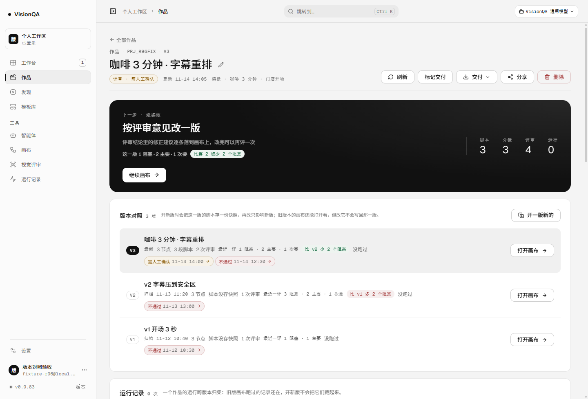
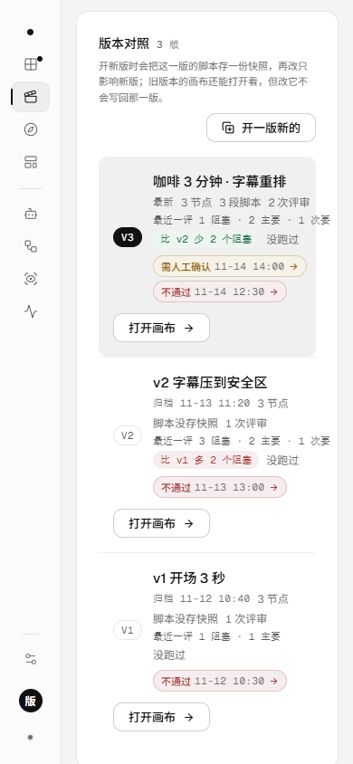
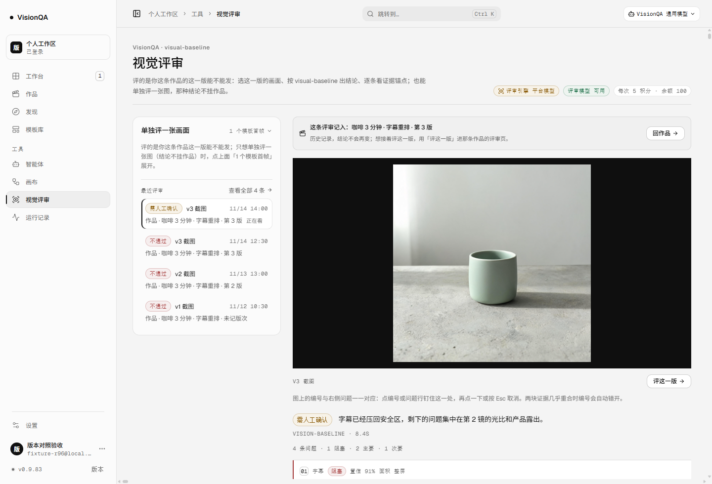

# 改一版到底有没有变好：每版问题数按严重度对着看（v0.9.84）

> 结论先行：评审页回答「这一版能不能发」，作品页现在回答「比上一版好在哪」。
> 每一版写清最近一次评审的问题数（1 阻塞 · 2 主要 · 1 次要），相邻两版都评过时写一句
> 「比 v2 少 2 个阻塞」；数字全部从评审结果里的 severity 现算，老记录没记严重度就
> 不写、也不比，绝不把「没记」写成「0 个阻塞」。

## 一、为什么要做这件事

产品的核心循环是「评审 → 按意见改 → 再评审 → 交付」。第三轮以后页面能回答三件事：
这一版**评过没有**（胶囊）、**结论是什么**（通过 / 需人工确认 / 不通过）、**下一步点哪里**
（主卡）。但用户真正关心的第四件事一直没有答案：**改的这一版到底有没有变好**。

以前要回答它，只能一条条翻两次评审的 observations，自己在脑子里数「上一版 2 个阻塞、
这一版 1 个」。数字散在两页里，人不会去数；不会数，就不知道改得值不值。

## 二、放弃的三条路

1. **做一个「综合评分」**（0–100 分）。模型从没给过分，评分只能由我们自己加权编出来
   （阻塞 ×3 + 主要 ×2 …）。编出来的分数比没有分数更糟：它看起来客观，实际上权重是
   产品经理拍的，出了偏差也没法对账。**放弃**。
2. **让模型在评审时自己写「比上一版如何」**。那要把上一版的结论喂给模型，结论会跟着
   模型的措辞漂移；而且每次评审都多一段提示词、多一层不一致的风险。**放弃**。
3. **前端自己从 observations 里现数**。评审历史列表只回摘要（observations 是个数字），
   作品页要拿全量正文才行——每开一次页面多拉几十 KB，还得改列表接口的返回体。
   **放弃**，改成服务端在生成摘要时顺手数一遍（同一遍循环，零额外读取）。

## 三、做法

口径只有一个：**一次评审的问题数 = 它的 observations 按 severity 分组**。

- `server/reviews.mjs` 新增 `severityCounts(result)`：数出 blocker / major / minor / info
  各几条，并分两个数记：`counted`（认得严重度的条数）与 `observations`（一共几条）。
  老记录没有 severity 字段时 `counted < observations`——界面据此写「另有 N 条没记严重度」。
- 评审摘要（`toSummary`）与按版本的统计（`reviewSummaryByVersion`）都带上 `issues`。
  **同一版重评两次取最近一次**，不相加（同一批问题会被数两遍）。
- 版本划分之前的老评审（version 0）照旧折进 v1；`reviewsForVersion` 挑 issues 与
  `lastVerdict` 用同一个「最近一次」。
- 客户端纯函数在 `src/domain/review.ts`：`issueCountsOf`、`issueLine`、`issueGap`、
  `issueCompare`。比较只比阻塞 / 主要 / 次要（信息级本来就是「不确定算不算问题」），
  从重到轻取第一个有变化的——一次只说一件事，不堆一串数字；两边持平就不写。
- 界面三处：
  - 作品页主卡「下一步」下面一行：`这一版 1 阻塞 · 2 主要 · 1 次要` + 胶囊
    `比第 2 版少 2 个阻塞`（只在算得出来时出现）；
  - 「版本对照」每行：`最近一评 1 阻塞 · 2 主要 · 1 次要` + `比 v2 少 2 个阻塞`；
  - 评审记录页结论下面：`4 条问题 · 1 阻塞 · 2 主要 · 1 次要`，没记严重度的另起一句；
    「出结论」步骤补上严重度与置信度的解释（**置信是模型对这条判断有多确定，不是问题有多严重**）。

## 四、本地验收（一次性实例 + 种数据）

本机起一次性实例（8905，临时 `DATA_DIR`），种一条三版作品 + 四条评审（v0、v2、v3×2），
用部署后的 `dist` 在无头 Chrome 里真渲染。数据是种的——本机与生产都没有真实评审，
这一节只证明渲染与口径，不冒充真实用量。

| 检查 | 结果 |
| --- | --- |
| 接口 `versionCounts` | v3：两次评审、取最近一次 `1 阻塞 / 2 主要 / 1 次要`；v2：`3 阻塞 / 2 主要 / 1 次要`；version 0 老记录保留 `1 阻塞 / 1 主要` |
| 评审摘要 | 第一条（v3 最新）带 `issues` 四个数 + counted 4 / observations 4 |
| 主卡对比行 | `这一版 1 阻塞 · 2 主要 · 1 次要` + `比第 2 版少 2 个阻塞` |
| 版本对照 | v3 `比 v2 少 2 个阻塞`、v2 `比 v1 多 2 个阻塞`、v1 没有上一版所以不写 |
| 评审记录页 | `4 条问题 · 1 阻塞 · 2 主要 · 1 次要`；「出结论」步骤写明严重度四级与置信度含义 |
| 390 小屏 | `docSW 390`（不横向滚）、三个胶囊宽 133/117/117 px、版本行 `scrollWidth` 256 ≤ 内容区 |
| 测试 | 734/734（+9 条 `test/project-version-issues.test.mjs`；另把 `project-status.test.mjs` 的期望补上 `issues`） |

9 条测试盯住四件容易退化的事：认不出的 severity 不算；同一版重评不相加；持平不编一句话；
version 0 折进 v1 时口径与服务端一致。

## 五、生产实测（v0.9.84）

- 版本：`/api/version` 0.9.84；入口 `index-CeWXFvsF.js`；四个 unit 全 active；
  `journalctl -p warning --since '-5 min'` 无条目；盘 72%。
- 真实例只读：`/api/projects` 与 `/api/reviews` 匿名都是 **401**（读数据必须登录）。
- 用**部署后的代码**在生产机起一次性实例（8784，`/tmp/r96data`，不碰 `/var/lib/visionqa`）：
  `versionCounts` 与本地逐项一致——v3 `1 阻塞 / 2 主要 / 1 次要`（count 2）、v2
  `3 阻塞 / 1 主要`、version 0 `1 阻塞 / 1 主要`；评审历史第一页第一条带同一份数字；
  四条断言全部 ✓。跑完实例与临时目录都清掉（`/tmp/r96*` 0 个），临时目录里没有真实数据。
- 线上 bundle 里确认带新逻辑（`vq-project-issue-line`、`最近一评`、`比第`、`另有`）。
- **没有任何真实上游调用**：这次验收不起评审、不调模型、不扣积分。

## 六、踩到的坑

1. **按元素坐标裁图裁到了文档顶部**：作品的滚动发生在中间那个容器里，`window.scrollY`
   一直是 0；CDP 的 clip 用的是文档坐标，滚了容器之后裁出来还是页头。改成「滚到位 →
   截视口整屏」，图里就是用户看到的样子。
2. **同一个页面里换 hash 不会重新挂载**：从 `#/review/<id>` 跳到 `#/review`，记录还留在
   屏幕上，看不到「没选记录」的空状态；补一次 `Page.reload` 才拿到步骤说明。
3. **加字段把老测试撞红了**：`project-status.test.mjs` 原来对 `reviewsForVersion` 做
   `deepEqual`，多一个 `issues: null` 就失败。这是有意的返回体变化，改测试把新形状写清楚，
   并顺手加一条「问题数跟着最近一次走」的断言。
4. **生产机 8787 已经被别的服务占着**：一次性实例直接 `EADDRINUSE`，登录打到别人身上
   返回 404。换 8784 后一次通过——在生产机起临时端口前先确认端口空闲。
5. **种的证据框用了 `width/height`**：锚点契约是 `w/h`（像素），字段名写错时记录页会显示
   「面积 0%」。截图前先看一眼，改回像素框后才像真的。
6. **deploy 标签会被截断**：`20261114-081500-20261114-r96-version-issues` 生成的快照名是
   `20261114-000759-20261114-081500-20261114`（前缀 + 截断）。回滚不要靠记名字，用
   `--to <序号>`。

## 七、边界与没做的

- 数字来自模型给的 severity：模型把问题分错级，数字也会跟着错。这一版只是**把已有的
  事实数清楚**，不是让评审更准。
- 只比**相邻两版**，且两版都评过、都记了严重度；v1 没有上一版，什么都不写。
- 只比阻塞 / 主要 / 次要；信息级不参与；两边持平不写一句话。
- 同一版重评取最近一次，不相加——「这一版现在还剩几个问题」，不是「历史上被指出过几次」。
- 没做跨作品聚合（哪个模板出的片子问题最少）、没做趋势图、没做团队对比。
- 生产还没有真实评审数据，所以线上页面现在看不到非零数字；等第一次真实评审跑完，
  这一行才会第一次出现真实数字。

## 八、回退

```bash
bash /opt/visionqa/ops/rollback.sh --to 2   # 回到 v0.9.83 的快照
```

接口变化是加字段（`issues`），老前端读不到它也不会坏；不需要开关。

## 九、图






