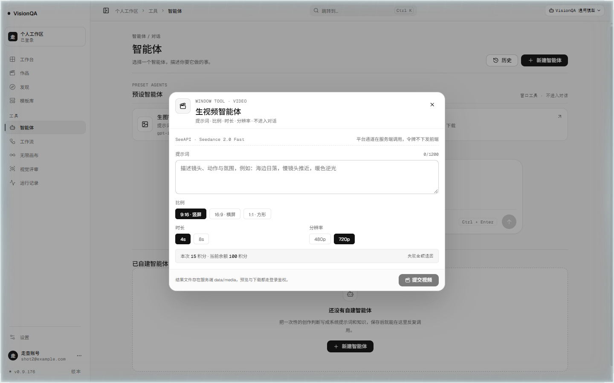
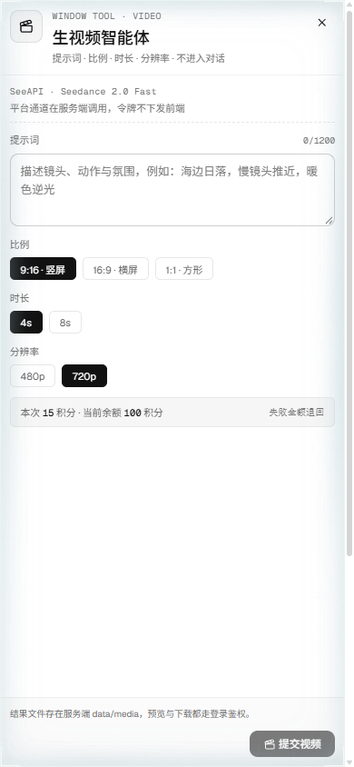

# 生视频窗口补上比例；Key 冷却不再误报「请补一把 Key」（0.9.176，2026-11-18）

## 一句结论

上一轮修掉了「生视频请求漏传 `aspect_ratio`」这个真 bug，但**界面还是没有比例控件**——等于所有人只能出竖屏。这一轮把比例做成可见的三档（9:16 / 16:9 / 1:1），顺手把「Key 刚被上游打挂、正在冷却 60 秒」从「平台还没接入出图模型，请联系管理员补一把 Key」里拆出来，改成「等一会儿再点一次」。

## 1. 生视频窗口：比例变成一等公民

改动（4 个文件）：

| 文件 | 改了什么 |
| --- | --- |
| `src/api/media-gen.ts` | 新增 `VideoRatio = '9:16' | '16:9' | '1:1'`；`generateMediaVideo` 的入参必须带 `ratio`（服务端要的字段是 `aspect_ratio`） |
| `src/pages/AgentsPage.tsx` | 生视频窗口新增「比例」一行（默认 9:16 竖屏）；副标题从「提示词 · 时长 · 分辨率」改成「提示词 · 比例 · 时长 · 分辨率」 |
| `src/styles/agents.css` | 未改：沿用 `.agx-media-seg` / `.agx-media-pair`，比例单独占一行、时长与分辨率仍并排两列；390 宽自动落成一列 |
| `server/routes/media-gen.mjs` | 未改（上一轮已校验并透传 `aspect_ratio`，默认 9:16） |

为什么不让服务端「猜」一个有画面的比例：比例决定构图，猜错等于白花 15 积分重来一次。

### 真实渲染截图（本机临时实例、同一份 `dist` 产物、普通 account 账号）

后台侧栏里没有「后台管理」，因为这张截图用的就是普通账号（`kind=account`），与生产上的隔离行为一致。

### 出片真的竖着：8s / 720p 真实视频的第 2 秒

从生产上那条真实调用（184.5 秒、3,009,531 字节 MP4）里抽的第 2 秒帧：**720×1280**，竖屏，画面内容与提示词一致（窗台上打盹的橘猫）。这条证据说明「比例 9:16」不只是把字段传对了，解码出来的确是竖片。

## 2. Key 冷却不再误导管理员

原来的 `missingKeyError()` 只有两种说法：「池里一把都没有」和「有 Key 但没声明这个模型」，两种情况都在叫人「补一把 Key」。但真调当时遇到的是第三种：**唯一那把出图 Key 被上游连续打挂 3 次、进入 60 秒冷却**，界面照样回「平台还没接入出图模型，请联系管理员补一把出图 Key」——照这句话去补 Key 是白折腾，真正该做的是等一分钟再点。

改法：

- `server/keyvault.mjs`：`planRoute()` 的每一行多给一个 `cooldownSec`（原来只有中文 `reason`「冷却中，还需 N 秒」，程序读不到数字）。
- `server/gateway.mjs`：`missingKeyError()` 先问 `planRoute()`，只要冷却里的 Key 就是 `503 KEY_COOLING`，文案「出图 Key 刚被上游拒过，正在冷却，约 N 秒后再点一次」，带 `retryAfterSec`；`detail` 写清哪几把、各剩几秒。冷却、缺 Key、模型不匹配三种情况这才分得开。
- 前端不用改：生成失败时窗口展示的就是任务里的 `error` 原文；积分照旧全额退回。

## 3. 验证

| 项 | 结果 |
| --- | --- |
| 单测 | **1335 / 1335**（新增 1 条：连续 3 次上游拒绝 → 第 4 次必须说「冷却 / 再点一次」，且**一次都不许再打上游**、积分全额退回，断言里显式禁止出现「补一把」「还没接入」） |
| lint / tsc | 0 error · 16 warning / 干净 |
| 密钥扫描 | 829 个文件无命中 |
| 构建 | `npm run build` 通过，入口 `index-ATvcwEXB.js` |
| 生产 | **0.9.176** 已上线，`/api/version` 与公网一致，health ok templates 26，`visionqa`/`visionqa-internal` 均 active |
| 回滚点 | `20261118-015446-20261118-1055-r191videor`（`ops/rollback.sh --to 1` 回 0.9.175） |
| 提交 | `c923379` 已推送 |

## 4. 边界（别把这些当成已完成）

- **16:9 出视频当时没走我们网关真调过**（2026-11-18 已补测通过，见 `docs/video-16x9-through-gateway-2026-11-18.md`）：单测只证明 `aspect_ratio: '16:9'` 会透传、上游侧 11-17 曾接受过 16:9（当时是直连探测脚本），但「界面选横屏 → 平台通道 → 出片」这条完整的没花钱验证（估 ¥1.4 / 条）。
- **冷却提示只在单测里复现**：生产没有人为把 Key 打挂去触发 60 秒冷却，真实界面看到的是同一条 `error` 文案链路。
- 截图来自**本机临时实例**（`DATA_DIR` 指向临时目录、临时账号、同一份 `dist` 产物），没有碰生产数据；临时实例与临时账号在收尾时已清理。
- 390 宽下窗口是整屏（沿用既有响应式），表单填完到页脚之间会留白——那块留给生成进度与结果，不是布局塌陷。
