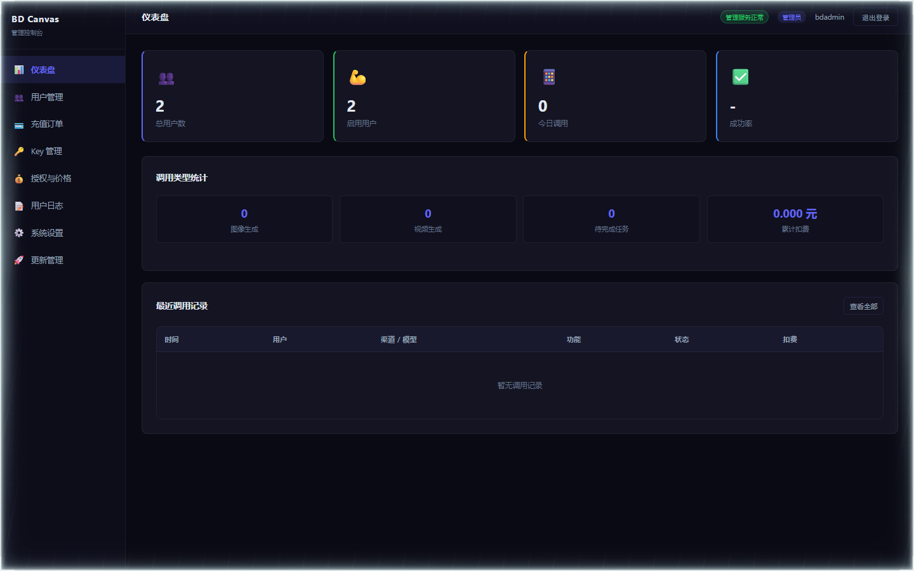
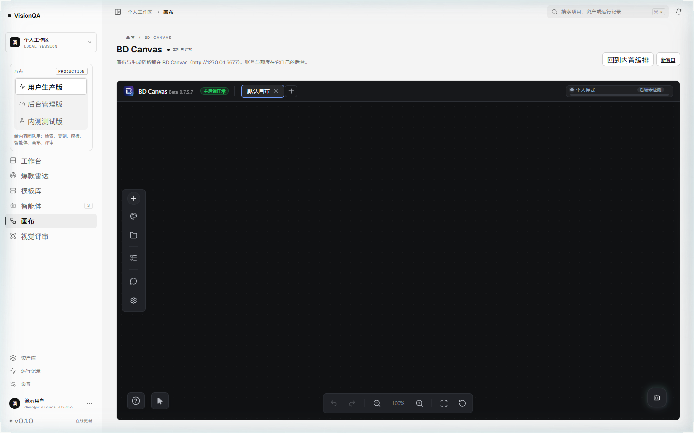
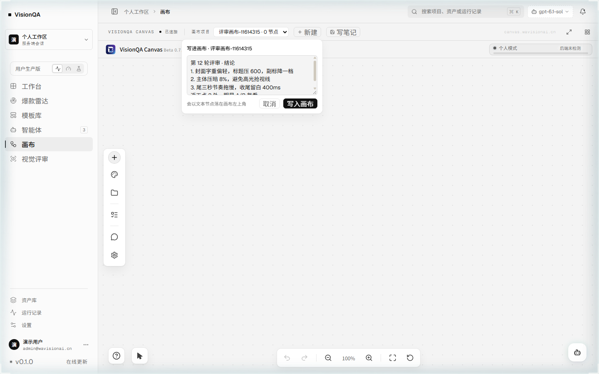
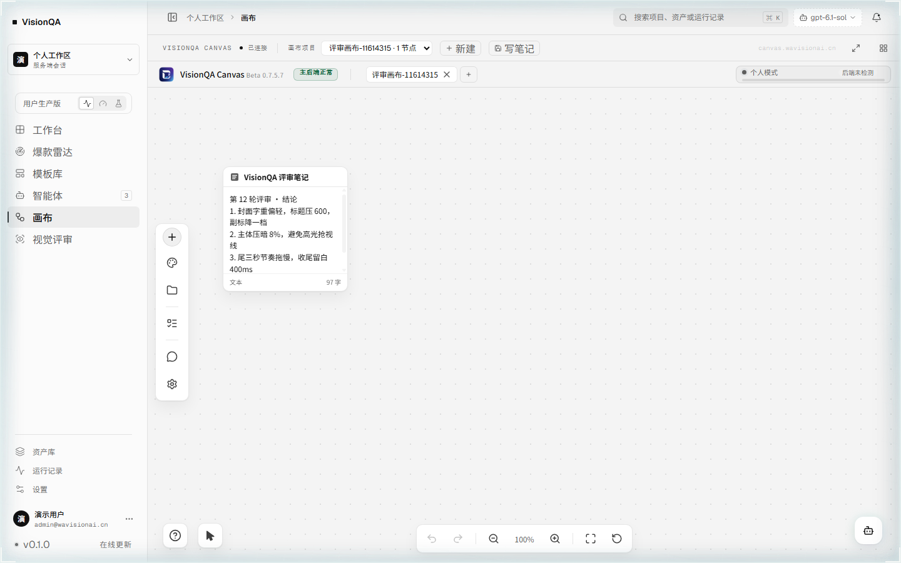

# VisionQA Canvas 部署与接入记录（上游 BD Canvas 源码，不入仓）

日期：2026-11-04 · 状态：**已在本机部署并接入画布页**；生成链路还差模型 Key

## 一、结论先行

1. VisionQA Canvas 已解压到 `D:\Projects\bd-canvas`（仓库外），三个端口都在跑：5312 后端 / 5313 后台 / 6677 网页入口，实测都返回 200。
2. 工作台画布页已改成 **VisionQA Canvas 本体**：进「画布」直接是 VisionQA Canvas，本仓库那套节点编排退成「回到内置编排」的备选。
3. `bdadmin` 初始密码已按手册要求改掉（新密码不入任何文件、不入仓库）。
4. **还差一步**：后台「Key 管理」里没有任何渠道 Key，所以出图 / 出视频还没通。需要你给一个上游 Key（可选渠道：CGCM、火山方舟、火山语音、百炼）。

## 二、实测事实

| 检查 | 结果 |
| --- | --- |
| `GET http://127.0.0.1:5312/` | 200 |
| `GET http://127.0.0.1:5313/admin/` | 200 |
| `GET http://127.0.0.1:6677/` | 200（Vite 5.4.21，冷启动约 6s） |
| `GET http://127.0.0.1:8787/api/bdc/status` | `{"web":{"up":true,"status":200},"admin":{"up":true,"status":200},"api":{"up":true,"status":200},"deployed":true}` |
| `POST /enterprise/api/admin/auth/login` | 200，返回 JWT（不是 cookie） |
| 后台用户列表 | 2 个：内置保底超管（不可改）+ `bdadmin` |
| `npm install` | 239 个包，约 2 分钟 |
| 后台仪表盘 | 「管理服务正常」，2 个用户，今日调用 0 |



## 三、执行时踩到的三个坑（复现必看）

### 1. 本机 PATH 里没有 Python

`启动.vbs` 按顺序找第一个存在的 `pythonw.exe`，**候选 0 就是项目内的 `python\pythonw.exe`**。本机没有系统 Python，所以直接把 Python 3.12 复制到 `D:\Projects\bd-canvas\python\`，三个候选路径里第 0 个就命中了。

注意别用 `python -m venv`：venv 的可执行文件在 `python\Scripts\` 下，而 VBS 只认 `python\pythonw.exe`，找不到就弹「Python not found」。

### 2. `requirements-backend.txt` 不全，缺两个包

按手册只装 `requirements-backend.txt` 时：

- `5313` 直接起不来：`enterprise_server/recharge.py` → `wechat_pay.py` 里 `from cryptography import x509`，**没有 cryptography**。
- `启动.vbs` 双击无反应：`launcher.py` 用 pystray 做托盘，**没有 pystray**，pythonw 静默退出，连 `launcher-crash.log` 都不写。

补装：

```powershell
.\python\python.exe -m pip install cryptography pystray
```

### 3. 项目根的 `.env` 没有任何代码读取

手册让你把两个 SECRET 填进项目根 `.env`，但 `enterprise_server/config.py` 只读 **`enterprise_server/.env.wechat-pay`**，全仓库没有别处加载根 `.env`（Flask 启动时还会提示 `There are .env files present. Install python-dotenv`，说明它也没被读）。

不处理的话两个 SECRET 会回落成源码里的 `change-me-*`。本次做法：根 `.env` 保留给人看，把同样是随机生成的 48 字符两个值**同步写进 `enterprise_server/.env.wechat-pay`**，这样不管从启动器还是直接起进程，读到的都是真随机值。

## 四、许可证边界（没变）

BD Canvas 是 Source-Available License v1.0：可自用、可改、可商用，但**禁止以任何形式再分发源码或修改版（免费也不行），禁止 SaaS 转售**。所以本仓库：

- 不 vendor、不提交、不打包 BD Canvas 的任何源码或产物；
- 只探活 + 内嵌，不复制代码；
- 文档只写部署方式与接口事实。

## 五、工作台这边的改动

- `GET /api/bdc/status` 探活超时：网页入口给 **5s**（Vite 开发服务器冷启动就要几秒，原来 1.2s 会把已部署误判成未部署），后台与后端仍 1.2s。
- 画布页：`deployed=true` 时**默认直接进 VisionQA Canvas**（全宽 iframe），页头换成 42px 紧凑状态条「画布 / VISIONQA CANVAS + 连接状态 + 当前地址 / 新窗口 / 回到内置编排」；未部署时仍是原来那套节点编排。
- 环境变量可覆盖默认地址：`BDC_WEB_URL` / `BDC_ADMIN_URL` / `BDC_API_URL`。



## 六、画布与工作台数据打通（2026-11-06）

工作台不再只是「嵌一个 iframe」：左边是工作台，右边那块画布的数据也在同一台机器上，两边读写同一批画布。

### 接口（工作台服务端代理，不直接暴露画布端口）

| 方法 | 路径 | 行为 |
| --- | --- | --- |
| GET | /api/bdc/canvases | 代理 `GET /api/canvas/list`，返回 `{ok, canvases:[{id,name,nodeCount,revision,updatedAt}]}` |
| POST | /api/bdc/canvases | `{name}`，先在本地生成 `vq-<时间戳36进制>` 的 id，再 `POST /api/canvas/save` 存一份空文档 |
| POST | /api/bdc/canvases/note | `{canvasId, text, title?}`：读出画布 → 追加一个文本节点 → 带 `expected_revision` 回存（画布返回 409 `CANVAS_STALE` 时工作台报错而不是覆盖） |





代码在 `server/bdc.mjs`（`listCanvases` / `createCanvas` / `appendCanvasNote`）与 `server/index.mjs` 的三个路由分支；前端 `src/api/bdc.ts` + `src/pages/CanvasPage.tsx` 状态条里的 `画布项目` 下拉、`新建`、`写笔记`。

### 三个硬点（都实测踩过）

1. **公网访客模式只读 localStorage。** 上游 `src/features/startup/runtimeMode.ts` 的 `isPublicWebClient()` 把任何非内网 Host 判成公网访客，`loadCanvasFromServer()` 直接改读 `_loadProjectData()`——服务端存的画布永远加载不出来，深链名字会变成 `Load failed: <id>`。修法：`runtimeMode.ts` 里加 `TRUSTED_HOSTS`（默认 `canvas.wavisionai.cn`，可用 `VITE_TRUSTED_HOSTS` 覆盖），命中就走服务端 workspace。
2. **一次性入口会吃掉查询串。** `/__auth?k=…&loadCanvas=<id>` 一律 `return 302 /`，深链参数丢失。nginx 补两行：

   ```nginx
   if ($arg_loadCanvas) { return 302 /?loadCanvas=$arg_loadCanvas; }
   return 302 /;
   ```

3. **文本节点正文在 `prompt`，不在 `params.text`。** 照上游 `createTextNode`：`{ type:'text', prompt: 正文, model:'text', params:{ _width:360, _height:220, _agentTextNode:true }, refs:[], status:'idle' }`。写进 `params.text` 的节点能创建、能保存，但卡片上显示「0 字」。

### 空文档的形状（新建画布用）

`{ id, name, createdAt, updatedAt, thumbnail: null, nodes: [], connections: [], groups: [], annotations: [], annotationTool: 'node-select', viewport: { x:0, y:0, zoom:1 }, nodeCounter: 0 }` —— 注意 viewport 的字段是 `zoom` 不是 `scale`。

## 七、重启方式

三个进程都是本次部署拉起的，重启机器要再起。手工起步：

```powershell
cd D:\Projects\bd-canvas
$env:PYTHONUNBUFFERED=1; $env:BD_CANVAS_DEV_ISOLATED=1
$env:BD_CANVAS_USER_DATA_DIR="$PWD\.tmp-dev-user-data-enterprise"
.\.\python\python.exe -u server_v2.py --port 5312 --host 127.0.0.1 --dev
$env:ENTERPRISE_PORT="5313"; $env:ENTERPRISE_HOST="127.0.0.1"
$env:ENTERPRISE_ALLOWED_ORIGINS="http://127.0.0.1:6677"
.\.\python\python.exe -u -m enterprise_server.app
node .\node_modules\vite\bin\vite.js --host 127.0.0.1 --port 6677
```

也可以双击 `启动.vbs` 开图形启动器，但它的面板**需要手动点「全部启动」**（不会自动起服务）；上面三条已经在跑时再点会撞端口。

## 八、部署载荷、主题清理与仓库归属（2026-11-06）

### 8.1 顶栏的「后端」状态要报真话

- 品牌旁边那颗小胶囊（`#local-backend-status`）探的是 `/api/health`（5312 画布数据后端），5s 超时，30s 一轮，标题里带真实状态码与耗时。
- 顶栏右侧那颗「连接」胶囊属于管理服务（`/enterprise/api`）状态。没登录管理账号时它一直是 `unknown`，于是永远显示「后端未检测」——现在由宿主把手探到的数据后端状态写进 `EnterpriseSessionManager.setConnectionProbe()`，未登录时显示真实结果（后端正常 / 后端断连），不再是永久「未检测」。

### 8.2 部署载荷走 ntfy 公有主题：规则与收尾

服务器上没有 SSH，无法 git pull（GitHub 在该机器上时通时不通，实测 `Failure when receiving data from the peer`），所以改用「ntfy 公有主题 + base64 分片 + `setsid nohup`」把文件送上去：

- 主题名每次随机（`vqck+序号` 这类），消息默认 **12 小时**过期，过点即清；
- 载荷里**不放凭据**——这一点踩过：一次为了 clone 私有仓库，把带 token 的部署脚本塞进了主题，等于把 token 公开了 12 小时。之后所有载荷只装源码/样式，不再带 token，`data/tok.txt` 也已删除；
- 载荷体积控制：单个 `.mjs`/`.ts` 文件打包 ~250KB 要拆 100 片，ntfy 免费档有速率限制，必须分片**限速**（约 1.2s 一片），否则会静默丢片；只改几个文件时优先只传这几个文件，不要整包传。

### 8.3 私有仓库保留决定

`dingchenhui0618-arch/bd-canvas-deploy`（private）**保留**，定位是「上游源码快照 + 我们改过的那几个文件」：

- 上游 BD Canvas 是 Source-Available License v1.0，禁止再分发，因此**不能**进公开仓库；
- 公开仓库只放我们自己的东西：`deploy/bd-canvas/vq-theme.css`（主题覆盖层，纯 CSS，本地编写）、`docs/` 文档与截图、`server/` 代理代码；
- 判定口径：凡是「从上游拷来的文件」一律只进 private 仓库；「我们自己写的文件」才可以公开。

## 九、还没做 / 需要你决定

1. **模型 Key**：后台「Key 管理 → 新建 Key」三字段 `name` / `provider` / `key`，provider 下拉是 CGCM（全部视频/图像模型）、火山方舟、火山语音、百炼。给一个 Key 我就能配完并跑出图验收。
2. **能力分配（assignment）**：`provider + model + feature` 三者必须匹配（generate / chat / tts / voice-clone / reverse-prompt），配错返回 400。
3. **常驻**：要不要把 VisionQA Canvas 三个端口也加进看门狗（现有 `DSH Services` 只托管 dsh-web 与 image-shim），掉线自动拉起。
4. **公网暴露**：现在三个端口都只监听 `127.0.0.1`，符合手册要求。要对外就得上反向代理 + IP 限制，别直接映射 5313。
