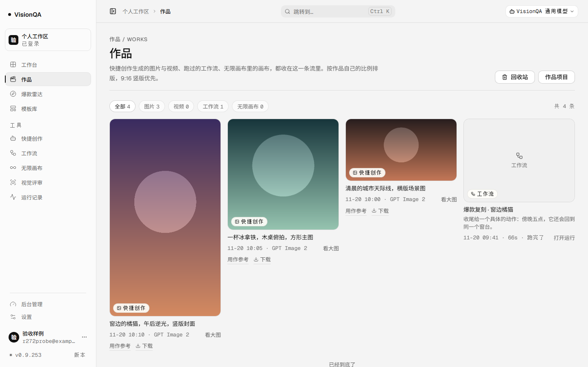
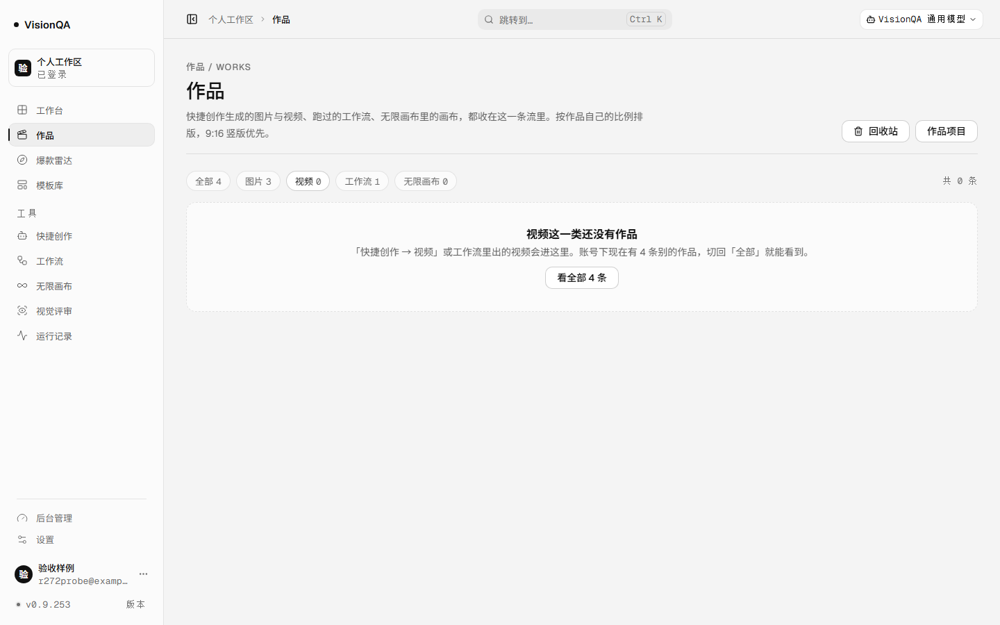
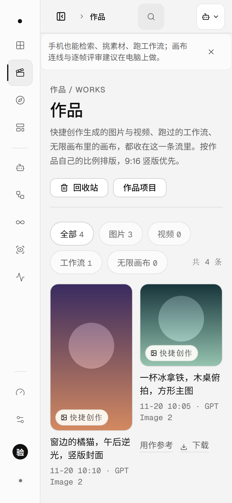

# 作品流这一屏说错的话：栏目没有数目、空状态把「这一类没有」说成「一条都没有」（r272 / v0.9.254）

## 起因

作品页默认落在「创作成果」这一条流上（快捷创作的图与视频、跑过的工作流、无限画布里的产物合成一条）。这一屏有两件事一直在说错：

1. **栏位上没有数目**。五颗胶囊只写「全部 / 图片 / 视频 / 工作流 / 无限画布」，谁也不知道点了会是三条还是三十条。做了 200 张图、没做过视频的人，在一栏一栏试。
2. **筛到空的一栏，页面说「还没有作品」**，下面还写着「去快捷创作生成一张图或一条视频」。对一个有 200 张图的人，这是一句假话，而且把人指去重新生成——他缺的不是新图，是「这一栏本来就没有」。

同一轮顺手清掉改名留下的病句：v0.9.163 把「画布」拆成「工作流」与「无限画布」时用了批量替换，于是

- 「画布工作流」变成了「**工作流工作流**」（分享页的类型标签、导出的 Markdown、智能体上下文、读屏标签，共 5 处）；
- 「画布上另存的工作流」变成了「**工作流上另存的工作流**」——一件东西套着自己，读不通（分享页说明、导出 Markdown）。

前两处是**外部可见**的：分享链接的读者是没有账号的剪辑与客户，导出的 Markdown 会交给别人。

## 做法

### 一、先数全部，再按筛选切

`server/works-feed.mjs` 的 `mergeWorks` 以前只回一个「按筛选后算」的 total，界面因此分不清两种空。现在它先合并三处、数出每一类各有几条，**再**按 kind 切页：

```js
const counts = { all: merged.length, image: 0, video: 0, run: 0, canvas: 0 }
for (const item of merged) if (…hasOwnProperty.call(counts, item.kind) && item.kind !== 'all') counts[item.kind] += 1
```

`total` 的语义不变（仍是当前筛选下的条数），只多回一个 `counts`——老界面读它不会变，老服务端不回它时新界面退回笼统空状态。

### 二、界面

| 位置 | 以前 | 现在 |
| --- | --- | --- |
| 五颗栏位胶囊 | 只有名字 | 名字 + 条数（等宽数字）；**为 0 的那一栏压暗一档** |
| 筛到空的一栏 | 「还没有作品」+ 教你去生成 | 「视频这一类还没有作品」+ 这东西从哪来 + 「看全部 N 条」 |
| 一条都没有 | 只提快捷创作与工作流 | 补上「在无限画布上出图出视频」——这个流本来就收它 |
| 读屏 | 「全部4」 | `aria-label` 读成「全部，4 条」 |

选中一条空栏时不再压暗（否则看着像被禁用）。

### 三、文案

- 分享页类型标签：「工作流工作流」→「工作流」；
- 分享页说明：「这是工作流上另存的工作流…」→「这条模板是从一条工作流另存下来的…」（顺带写清怎么用：模板库点「在工作流打开」）；
- 导出 Markdown：「类型：工作流工作流 · N 个节点」→「类型：工作流 · N 个节点」；说明句同步改成「从一条工作流另存下来的」；
- 智能体上下文里模板的标注：「· 工作流工作流」→「· 工作流」；
- 工作流页画布的读屏标签：「工作流工作流」→「工作流画布」；
- 登录页「正在验证验证码…」→「正在核对验证码…」（动词与名词撞在一起，读起来像口吃）。

### 四、防回归

新增 [test/copy-hygiene.test.mjs](../test/copy-hygiene.test.mjs) 三条：源码里不许出现「工作流工作流 / 画布画布 / 运行运行 / 模板模板 / 作品作品 / 评审评审」这类改名重复词，不许再写「工作流上另存的工作流」，并断言扫到的文件数没塌（目录改名时不会静静放过）。「一栏一栏 / 一条一条 / 一行一行」是正常中文叠用，本来就不在禁用表里。

## 验收（本机临时实例 + 无头 Chrome，0 次上游调用）

样例数据：3 张图（9:16 / 1:1 / 16:9）+ 1 次纯文本工作流运行，没有视频、没有画布产物。

| 断言 | 结果 |
| --- | --- |
| 栏位计数 | 全部 4 · 图片 3 · 视频 0 · 工作流 1 · 无限画布 0 |
| 点「视频」 | 标题「视频这一类还没有作品」，正文点名来源并说明「账号下现在有 4 条别的作品」，按钮「看全部 4 条」 |
| 点「看全部 4 条」 | 回到全部，4 张卡回来 |
| 390 重新加载 | 胶囊折成两行、带计数，`scrollWidth == innerWidth == 390` |
| 控制台 | 0 条异常 |







## 边界

- `counts` 数的是**清单里的条数**，不是库里总数：快捷创作只扫最近 400 份任务元数据、工作流最近 50 条运行、画布只读前 12 块的节点。这三处上限这一轮没动。
- 计数只算「能进作品流的东西」：失败的生成、还在跑 / 排队的运行本来就不进这条流，也就不计入。
- `counts` 是这一轮新加的字段；老服务端不回它时，界面退回笼统空状态（不猜哪一类有东西）。
- 「看全部 N 条」只是切筛选，不发新请求之外的补偿：切回去仍是最近 24 条一页，更早的要「看更早的」。
