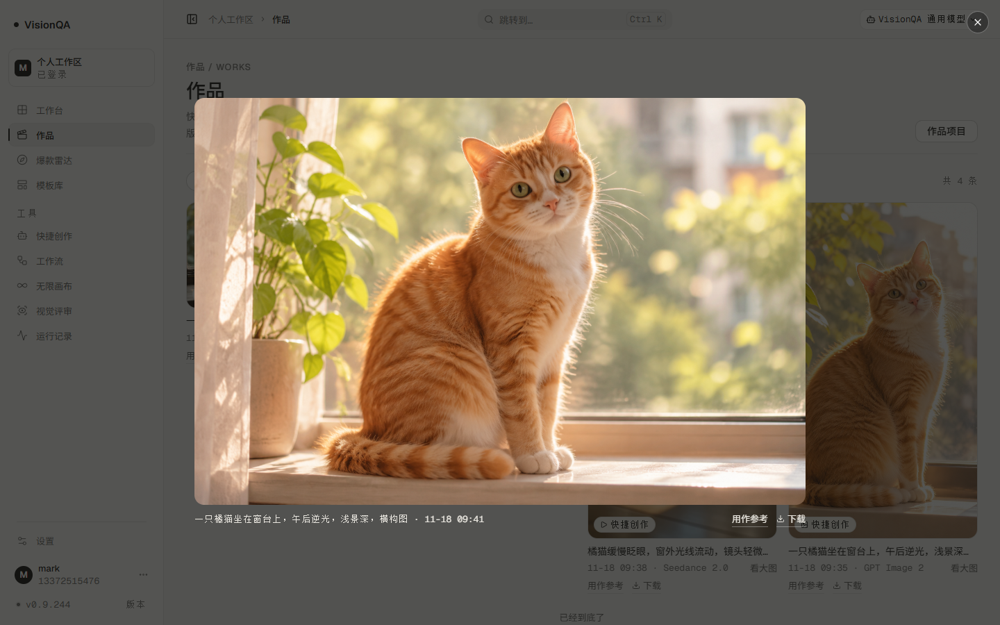
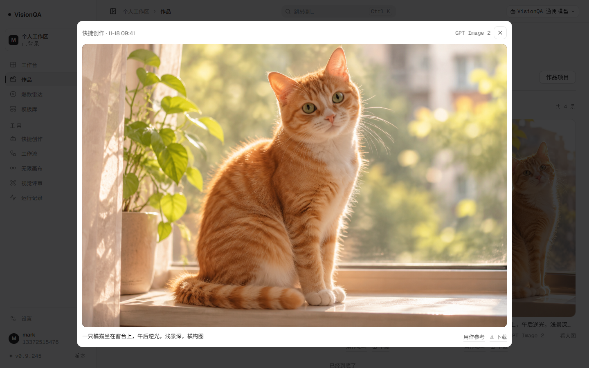
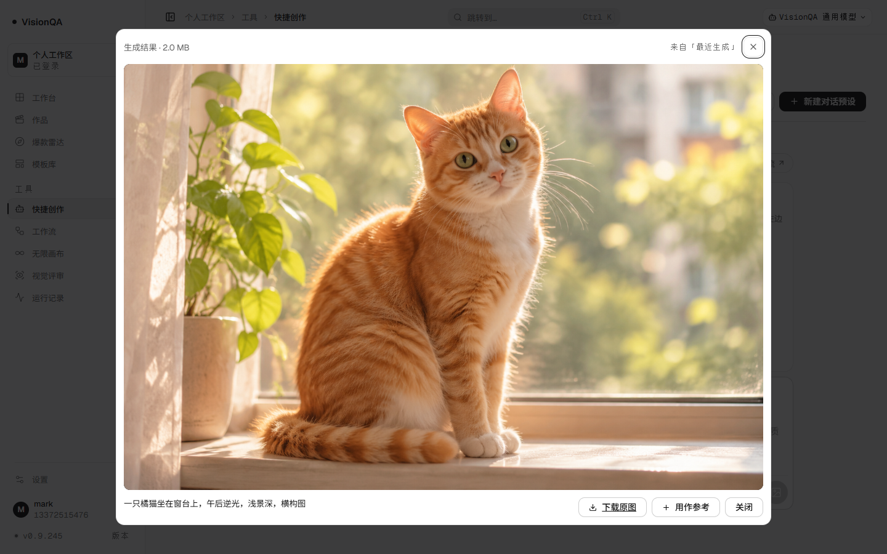
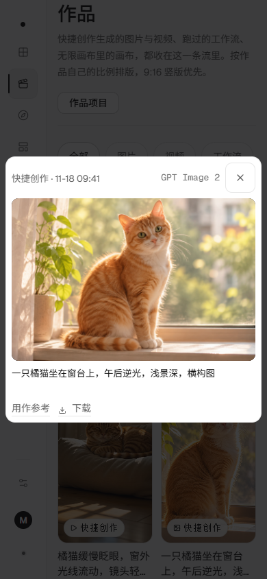
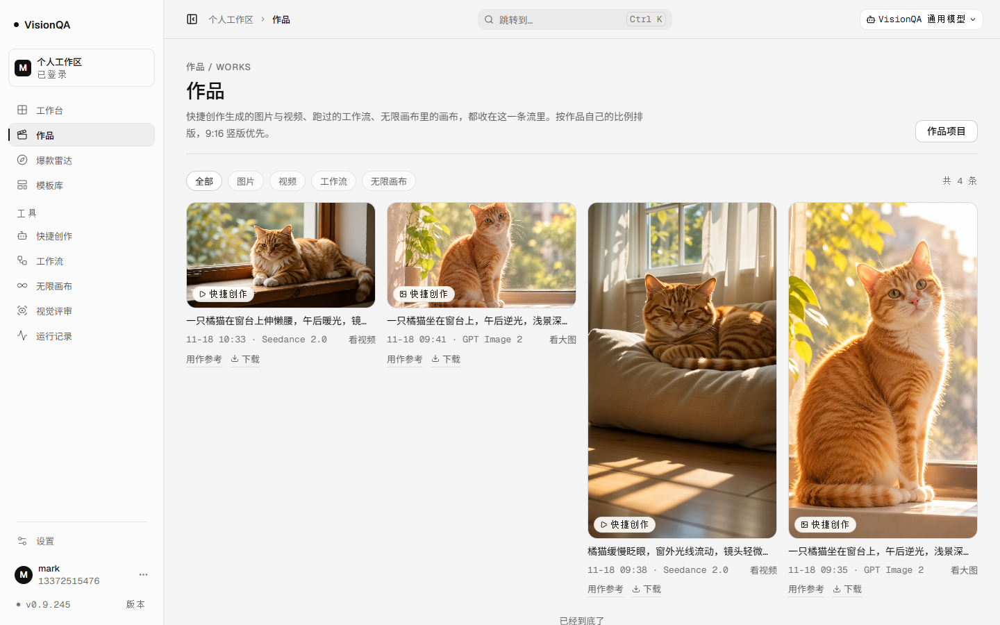

# 作品流的「看大图」换成和快捷创作同一套浮层（r262 / v0.9.245）

2026-11-19。用户在第 4 条里说「整体看着协调，但字有点小」——这一轮顺手把同类的不一致也捋了一条：
同一个动作（点开看大图）在产品里有两套实现，作品流那套既不压暗、也放不大。

## 一、改之前是什么样（生产实测）

用真实账号在 1440 打开作品页、点第一张图：

| | 改之前 | 改之后 |
| --- | --- | --- |
| 浮层实现 | 作品流自己的 `.works-modal`（880px 上限） | 与快捷创作共用 `MediaLightbox` |
| 1536×1024 的图显示成 | **880×587** | **1038×692** |
| 卡片底 | 没有（图直接浮在页面上，放大后与背后的卡片标题、按钮叠在一起） | 浅色卡片 + 说明行 + 动作行，遮罩压暗 78% |
| 视频点开 | `autoPlay` 没带 `muted`，浏览器拦下 → **停在 0:00 的静帧** | 静音自动播（实测 2.5 秒时已在播放） |
| 卡片上「看大图」 | **39×19px**（鼠标点得中、手指点不中） | 高 24px，入口文字按内容分「看大图 / 看视频」 |
| 平板 561–1080 的关闭按钮 | 44px | 44px（共用浮层默认 32px，这一档单独补上） |

## 二、怎么改的

1. 新建 `src/components/MediaLightbox.tsx`：一个浮层组件，接 `kind/src/head/note/caption/actions/onClose/closeRef`，
   样式搬到 `src/styles/media-lightbox.css`（类名从 `.agx-lightbox*` 改成 `.vq-lightbox*`，因为它不再只属于快捷创作）。
2. 快捷创作（`AgentsPage`）把原来那段内联 JSX 换成这个组件，参数原样搬过去——「来自「最近生成」」那枚小字变成 `note`。
3. 作品流（`WorksWall`）删掉 `.works-modal` 那套 DOM 与 `.works-modal*` 全部样式：
   点缩略图 / 点「看大图」都交给同一个浮层，动作行仍然是原来的「用作参考 / 下载」，顶部写「来源 · 时间」，右边小字写模型名（GPT Image 2 / Seedance 2.0，真实名字，不隐去）。
4. 视频在浮层里统一 `autoPlay muted`：静音自动播浏览器不拦，要声音自己按喇叭；这也是「点开就能看」的本意。
5. 卡片上的「看大图」补 24px 触控区；视频那一条改叫「看视频」（一条片子上挂着「看大图」本来就说不通）。

## 三、实测（生产、真实账号、真实作品）

作品页 4 条：2 张图（1536×1024 / 1024×1536）+ 2 条视频（1280×720 / 720×1280）。

| 视口 | 卡片 | 列表最小字号 | 小于 24px 的触控目标 | 图片浮层（媒体 / 卡片） | 视频浮层（媒体 / 卡片） | 横向溢出 |
| --- | --- | --- | --- | --- | --- | --- |
| 1440×900 | 4 条，273px 宽 | 13px | **0**（改前 4 处 19px） | 1038×692 / 1064×798 | 1094×615 / 1120×721，播放中（2.5s） | 无 |
| 1024×768 | 4 条，231px 宽 | 13px | 0 | 840×560 / 866×698 | 950×534 / 976×672，约 7 秒后开始播放 | 无 |
| 390×844 | 4 条，139px 宽 | 13px | 0（按钮全 44px） | 356×237 / 374×388 | 356×200 / 374×351，播放中（2.4s） | 无 |

交互（真按键 / 真点击，非 dispatchEvent 伪造）：

| 动作 | 作品流 | 快捷创作 |
| --- | --- | --- |
| Esc | 关 | 关 |
| 点遮罩空白 | 关 | （同一组件，行为一致） |
| 点关闭按钮 | 关 | 关 |
| 切页签 / 换页面 | — | 浮层自动收掉（两个面板都挂着只隐藏） |

## 四、踩到的坑

1. **用 `document.dispatchEvent` 造 Esc 会得到假结论**：快捷创作的 Esc 监听挂在 `window` 上，作品流那套挂在 `document` 上。
   一开始用 `document.dispatchEvent(new KeyboardEvent('keydown', { key: 'Escape' }))` 去试，作品流关了、快捷创作「关不掉」——
   不是组件坏了，是事件根本没到 window。改成 CDP `Input.dispatchKeyEvent` 真按键，两边都正常。
2. **三处老测试按类名锁死了旧弹层**：`works-wall-mobile`（`.works-modal-close` 44px）、`works-projects-tablet`（平板 44px 关闭）、
   `media-handoff`（`actions(preview, true)`）。抽组件时它们一起挂，必须同步改成「共用浮层 + 新参数」，
   否则跑起来是 1714 条里掉 4 条，不是「无关失败」。
3. **平板会悄悄退化**：旧弹层在 561–1080 是 44px 关闭按钮，共用浮层默认 32px——只补了手机那档就会把平板打回小按钮，
   所以单独加了 `@media (max-width: 1080px)`。触屏平板是手指点，不是鼠标。

## 五、门禁与发布

- 测试 **1714/1714**（新增 r262 一条：作品流与快捷创作共用浮层、旧弹层彻底退场、视频静音自动播、看大图 24px、视频入口写「看视频」；另有 3 条老测试改成指向共用浮层）
- lint **0 error / 25 warning**（627 文件）、`tsc -b` 干净、build 入口 `index-BlpMLYug.js` / 样式 `index-BU82Aozi.css`
- 密钥扫描 1001 文件无命中
- 生产 **0.9.245**：`/api/version` 本地与公网一致、health ok templates 26、服务 active
- 发布标签 `20261119-093002-r262works`；`ops/rollback.sh --to 1` 回 0.9.244

## 六、边界

- 浮层没有缩放、拖动、翻页（上一张 / 下一张）——它只是「看清楚这一条」。
- 视频打开后要先下载：生产那条 2.9 MB 的片子，1024 下实测约 7 秒才出第一帧，期间是浏览器播放器自己的黑框；
  预加载只取元数据，这是网络时间，不是加载失败。
- 作品流里「一块画布」「一次运行」这类卡片没有 `previewUrl`，点缩略图仍然直接跳详情（画布 / 运行只读视图），不进浮层。
- 只逐屏量了 1440 / 1024 / 390；768 与 320 这一轮没有单独扫。
- 本轮没有发起任何真实上游调用（0 次、0 费用）：用的是生产已有的 2 张图 + 2 条视频。
