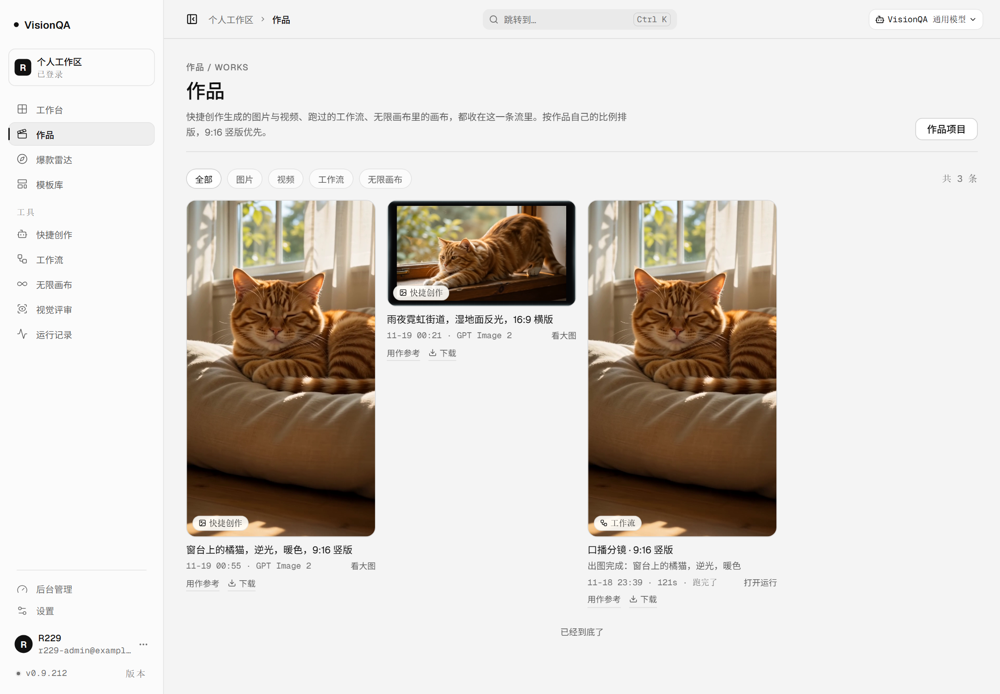
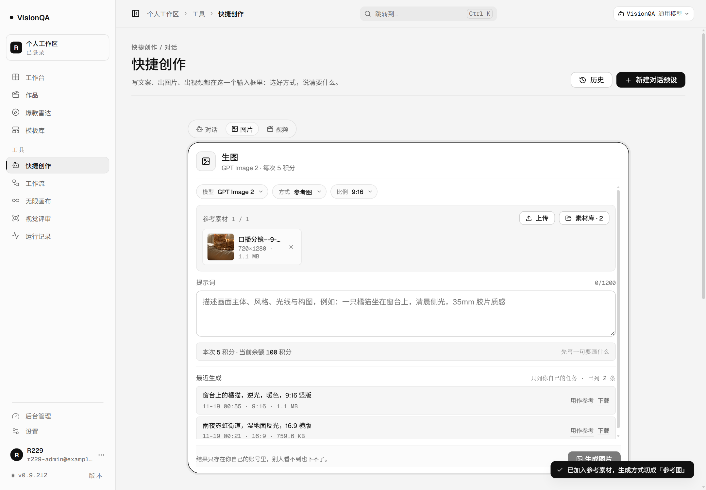
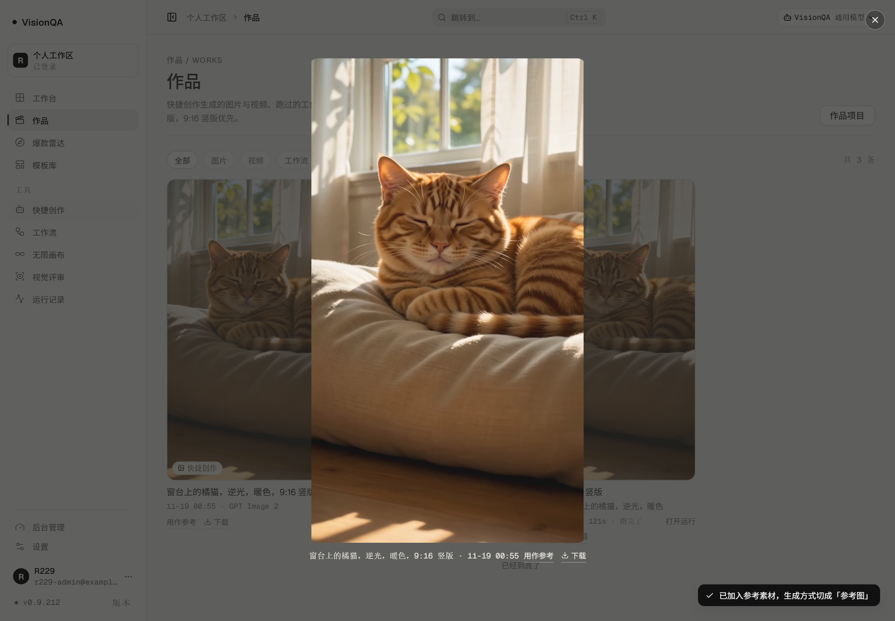
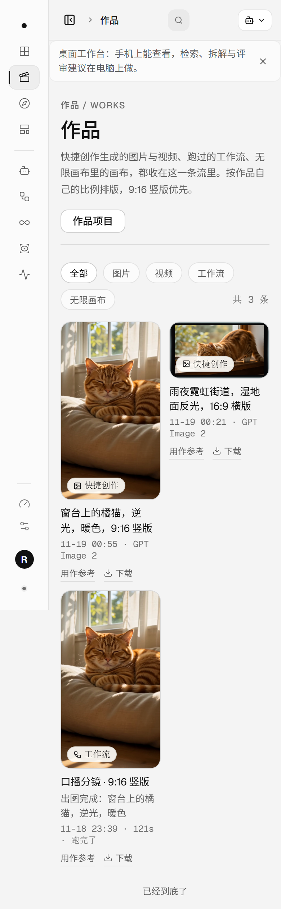
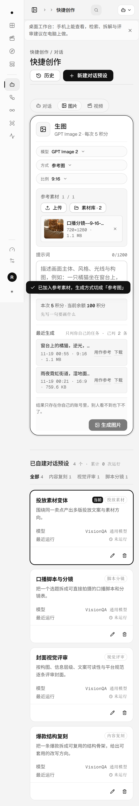

# 作品流里的成品能直接接着改：用作参考 + 下载（r229 / v0.9.213）

## 结论

作品流里每张成品卡（快捷创作的图 / 视频、工作流封面、无限画布里出过的图与视频）现在都有两个动作：
**用作参考** 和 **下载**。点「用作参考」会把这条作品取回、传成参考素材，跳到「快捷创作」并自动挂进托架、
切成对应的生成方式、比例跟着作品走（9:16 的图不会落回 1:1）。

整条路不新增接口、不扣积分、不打上游：用的是已有的 `POST /api/media/assets` 与自己的产物流。

## 这一轮补的是四个断点

| 现场 | 问题 | 改法 |
| --- | --- | --- |
| 作品卡只有「看大图 / 打开运行 / 打开画布」 | 看到自己的成品，下一步只能关掉或去别处翻——「拆结构 → 复刻」在这里断掉 | 卡片与放大层都加 **用作参考** |
| 放大层只显示一张图 | 看完没有下一步，连存下来都要绕回「最近生成」 | 放大层加 **用作参考 / 下载** |
| 画布与工作流的产物没有下载入口 | 「最近生成」只管快捷创作，画布节点 / 工作流封面想存下来没有地方点 | 下载改成取回字节再存，名字按作品标题 + 编号生成 |
| 带过去的图是 9:16，出图默认 1:1 | 每次都要人手改一次比例 | 交接带上作品自己的比例，模型允许就照它设 |

## 怎么接的

```
作品卡（WorksWall）
  ├ mediaUrl(item)   → previewUrl || thumbUrl
  │    ├ 快捷创作：/api/media/tasks/<id>/file
  │    ├ 工作流  ：/api/runs/<id>/assets/…（封面是它自己出过的图）
  │    └ 无限画布：/api/works/canvas-file?canvas=&node=（代理到画布自己的 workspace）
  ├ 取回字节 → probeMediaFile 读真实宽高 / 时长 → POST /api/media/assets
  └ sessionStorage['vq:ref-handoff'] = { assetId, kind, name, from, ratio }
快捷创作（MediaComposer）
  └ 按 kind 落到 图片 / 视频 页签 → 等模型表 + 素材清单 → planRefAttach → 挂上 → 清掉交接
```

- 交接**一次就消费掉**（`takeRefHandoff`），不会下次进来又挂一遍；坏 JSON、非法素材号、认不出的比例一律当没带。
- 挂上要等**模型表回来**：那一刻才知道这个方式收不收、放不放得下；模型表没到就先等，不瞎挂。
- 素材库里已有同名同类型的那份就直接复用，同一条作品点两次不会堆出两份配额。
- 文件名规则（`refFileName`）以前只管「生成结果」，现在也管作品编号：`canvas-node:<画布>:<节点>` 这类带冒号的
  编号只留 `[A-Za-z0-9_-]`，落到 Windows 上才存得下。

## 数字（临时实例 + 磁盘上的样例数据，0 次上游调用）

| 项 | 结果 |
| --- | --- |
| 作品流三张卡 | 都有 `用作参考` / `下载`，按钮高 **24px** |
| 点工作流卡的「用作参考」 | 落到 `#/agents`，页签 **图片**，方式 **参考图**，参考素材 **1 / 1**，比例 **9:16**，交接记录已清空 |
| 提示 | 「已加入参考素材，生成方式切成「参考图」」 |
| 放大层 | 两个动作都在，标题与时间照旧 |
| 点「下载」 | 提示「已开始下载「窗台上的橘猫，逆光，暖色，9-1-229Cat.png」」 |
| 390 宽 | `innerWidth = clientWidth = scrollWidth = 390`、两列、卡片 139px、动作 24px、溢出 0 |
| 390 上的取舍 | 缩略图本身就是「看大图」，那一行让给时间与模型名；标题两行、时间允许折行（不再截成「GPT …」） |
| 页面异常 | 0 条 |

## 门禁与生产

| 项 | 结果 |
| --- | --- |
| 测试 | **1507/1507**（`test/media-handoff.test.mjs` 新增 9 条、media-refs 补 2 条） |
| lint / 类型 / 构建 | 0 error / 26 warning（607 文件）；`tsc -b` 干净；入口 `index-CmfZPuwf.js` |
| 密钥扫描 | 933 文件无命中 |
| 生产 | **0.9.213**，发布 `20261118-171435-20261119-0125-v0.9.213wo`，health `ok` templates 26，6 个服务 active |
| 生产产物 | 入口 200 **742,077 B**；`index-DaZ-5pgv.css` 含 `works-actions.is-modal`；入口与 `AgentsPage` 两个 chunk 都含「用作参考」「vq:ref-handoff」 |
| 未登录 | `/api/chat/conversations` → **401** |
| 回滚 | `ops/rollback.sh --to 1` → `20261118-165639-20261119-r228refs`（0.9.212） |

## 截图（临时实例、磁盘上的样例数据，不是真实生成结果）











## 边界

- 作品流里**跨来源**都能带走，但只限「有文件」的那几条：一张「无限画布」的卡片（它是一整块画布，不是成品）没有文件，
  所以没有这两个动作。
- 视频当参考仍然只有「多模态参考」收（首帧只收图），这是模型规格；带过去时若当前模型没有收视频的方式，会在托架上直说。
- 一条作品变成素材占账号配额（60 个 / 400 MB）；同名复用只覆盖素材库最近 20 条。
- 取回画布产物要经过 `/api/works/canvas-file` 代理，画布服务没连上时这里报「画布没有返回这个文件」。
- 参考图出图（`/images/edits`）与参考素材生视频仍未真调（约 $0.05 + ¥1.4），这轮没替你发起任何真实生成。
- 截图来自本机临时实例（临时 `DATA_DIR` + 磁盘上预置的两条任务与一条运行记录），不是线上真实作品。
