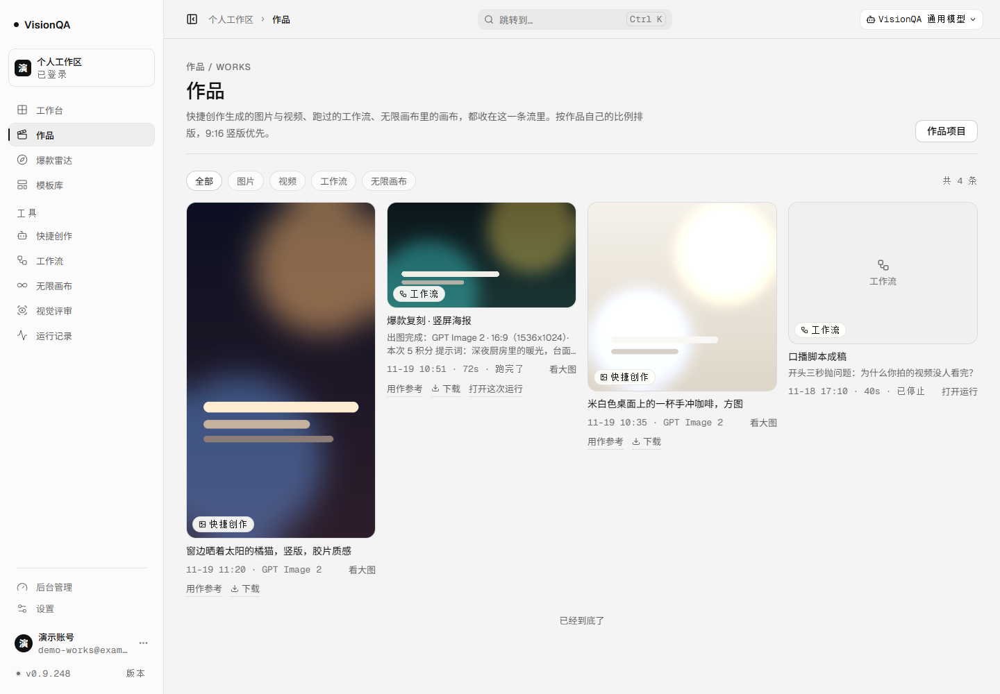
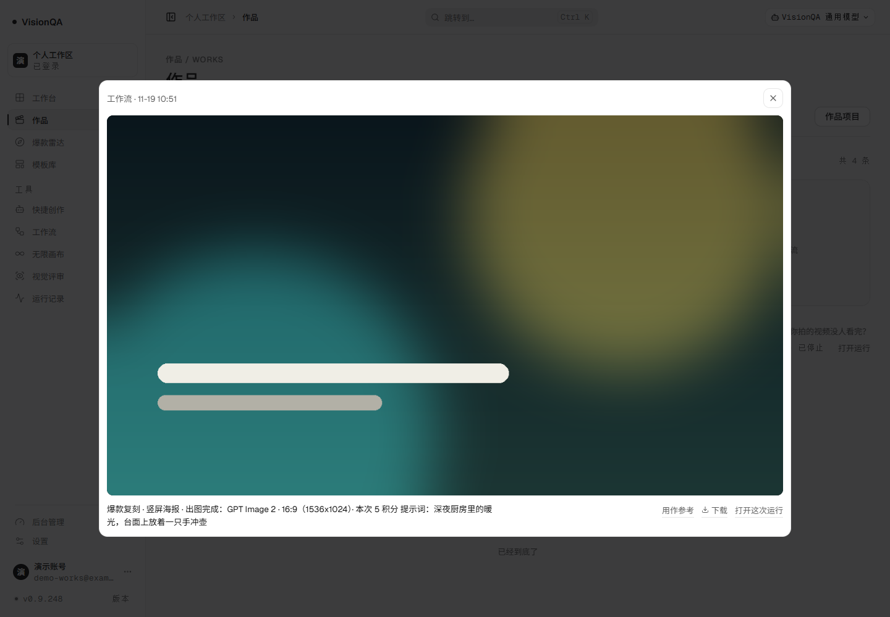
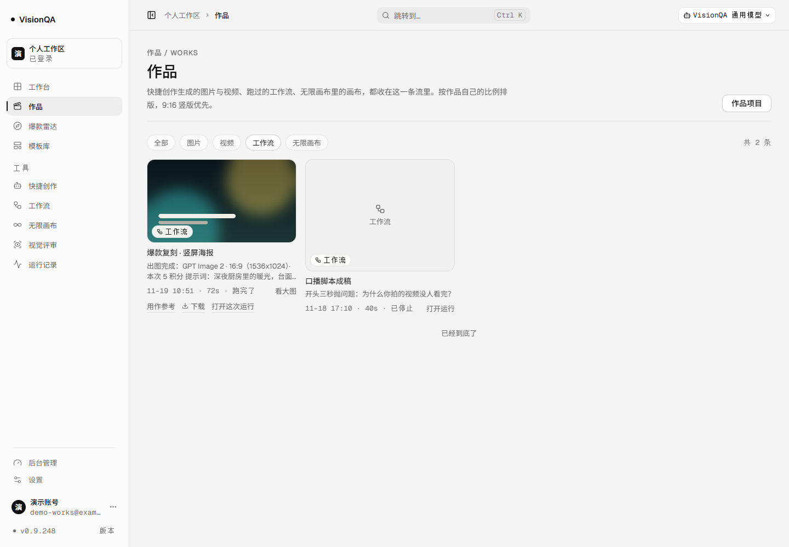
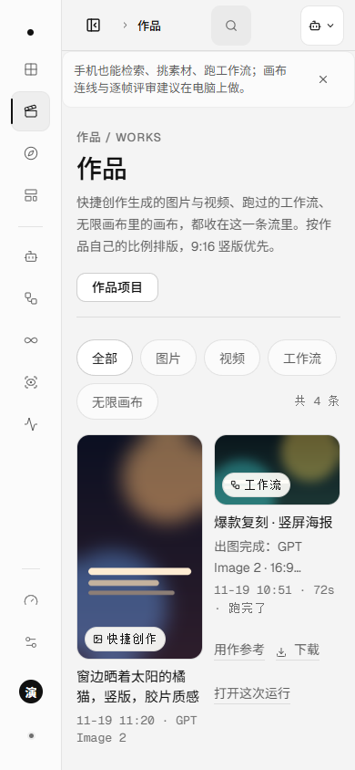
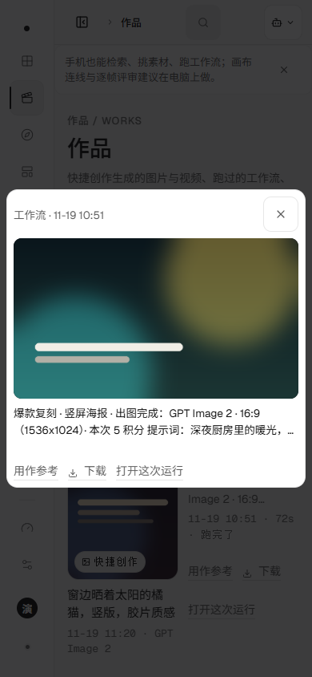

# 作品流里的运行卡：点缩略图是看大图，跳转写成按钮（r266 / v0.9.248）

## 问题：同一张图，两种点击结果

作品流把三处产物收在一条流里。图片卡点缩略图 → 开看大图浮层（r262 起与快捷创作共用 `MediaLightbox`）；
**运行卡**上有封面（工作流出图节点真画出来的那张）却点开就整页跳走，跳到 `#/canvas/<flowId>/run/<runId>`。

根因在服务端：`server/works-feed.mjs` 里运行卡的 `previewUrl` 被写死成 `null`，
只有 `thumbUrl` 有值。前端 `open()` 的判断是「有 previewUrl 才开浮层，否则跳 detailUrl」，
于是同一张图在图片卡上是「看大图」，在运行卡上是「换页面」，而且离开作品流以后筛选、已翻的页都归零。

顺带查出两个真 bug：

1. **还在跑的运行也进了作品流**。`listRuns({ ownerId })` 不过滤状态，卡片上的文案判断只认
   `success / error / 其余一律「已停止」`，所以一条正在跑（或排队中）的运行会显示成「已停止」——
   既是假状态，也是「作品流里冒出还没做出来的作品」。
2. **筛选不记**。`useState('all')`，从运行视图退回来就退回「全部」，刚筛到的「工作流」白点。

## 改法

| 位置 | 以前 | 现在 |
| --- | --- | --- |
| `runWorkItem(run)`（server，新导出） | 运行卡 `previewUrl: null` | 有产物时 `previewUrl` = 封面地址（图或视频），点开就是看大图 / 看视频 |
| 运行卡是否进流 | `running` / `queued` 也进 | `runWorkItem` 对这两种状态返回 `null`，`runItems` 过滤掉 |
| 卡片状态文案 | 只认 success / error，其余「已停止」 | `runStatusLabel()`：跑完了 / 失败 / 已停止 / 还在跑 / 排队中，不认识的状态不猜 |
| 卡片动作行 | 用作参考 / 下载 | 有产物时多一条「打开这次运行」（画布节点是「打开画布」） |
| 看大图浮层 | 只有用作参考 / 下载 | 底部动作行总有「去出处」：跳转变成一次明确的点击 |
| 筛选 | 每次重挂回「全部」 | 记在 `sessionStorage`（`src/domain/works-view.ts`），键 `vq.works.filter.v2`，存坏的值退回「全部」 |

没有产物可看的运行卡（纯文本流程 / 被停掉的）仍然只有「打开运行」一条路——它本来就没有图可看，
给一个空浮层没有意义。

## 实测（本机临时实例，v0.9.248，样例数据 4 条）

- 1440 四张卡：图片卡动作 `用作参考 / 下载`；有封面的运行卡 `用作参考 / 下载 / 打开这次运行`；
  纯文本运行卡只有 `打开运行`，时间行是「… · 40s · 已停止」。
- 点运行卡缩略图：`location.hash` 前后都是 `#/projects`（没离开作品流），浮层里那张图
  自然尺寸 1280×720，动作行 `用作参考 / 下载 / 打开这次运行`。
- 筛「工作流」→ 重载页面 → 仍是「工作流」、2 条卡（以前会退回「全部」4 条）。
- 390×844：`innerWidth 390 / scrollWidth 390`，卡片两列，浮层卡片 374×372，三个动作都在屏内。

## 边界

- 只改了「有产物的运行卡」这条路径；**画布里出的图**同样拿到「打开画布」（带着 canvasId），
  但本机临时实例没有画布应用，这一条只有单测覆盖，没有截图证据。
- 运行卡封面只是**一个产物**（按 `runCover` 的取法：第一个 `/api/runs/` 的图，没有图再取视频），
  一次运行出多张图时不会在浮层里翻页。
- 筛选记的是 `sessionStorage`：同标签页重载、来回跳都在，关掉标签页就回到「全部」。
  已翻出来的页数没有记（接口上限 48 条、一页 24 条），退回来会回到第一页。
- 本轮 0 次真实上游调用、0 费用。
